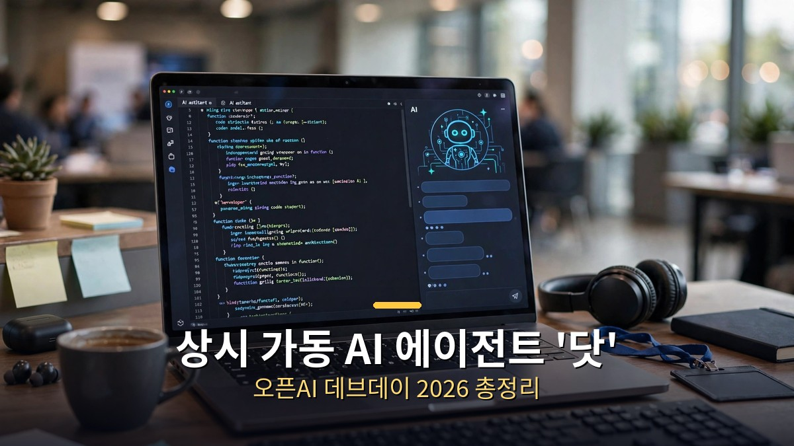

<!-- 본문 시작 -->

9월 말, 거대 AI 모델과 개발자 생태계에서 큰 발표가 이어졌습니다. 구글의 최상위 모델 제미나이 4 아곤과 오픈AI의 연례 개발자 행사 데브데이 2026 소식을 정리했습니다. 이번 발표들의 진짜 주제는 '더 똑똑한 모델'이 아니라 '더 오래 일하는 AI'입니다.

## 구글 제미나이 4 아곤 공개 (9월 30일)

구글 딥마인드가 약 7개월 만에 내놓은 최상위 AI 모델입니다. 소프트웨어 개발, 금융, 법률, 사이버 보안 같은 복잡하고 긴 작업을 겨냥했습니다.

가장 주목할 스펙: 출력 토큰 최대 100만 개
- 이전 세대(6.4만 토큰)의 약 15배이며 업계 최초입니다.
- 여기서 중요한 건 '컨텍스트 윈도우'(입력)가 아니라 '출력 한도'라는 점입니다. AI가 한 번에 뱉어낼 수 있는 분량이 100만 토큰이라는 뜻이라, 긴 보고서·대규모 코드베이스 작업을 통째로 처리할 수 있습니다.

벤치마크 성적 (구글 자체 발표 기준, 업체 주장임을 감안):
- DeepSWE v1.1(실전 코딩 테스트) 77.9% — GPT-6 Astra 74.1%, 클로드 Opus 5.5 74.2%를 앞섬
- AutomationBench(업무 자동화) 51.3% 1위
- Harvey 법률 벤치 19.6% — Astra 5.4%의 3배 이상
- LVBench(긴 영상 이해) 91.7%, CWE-bench(보안) 68%
- 18개 항목 중 12개에서 1위

같은 표에 진 구간도 있습니다.
- FrontierSWE v2 55.0% — Astra 65.5%에 10.5%p 뒤짐
- Terminal-bench 4.0 57.4% — Opus 5.5 66.4%에 밀림
- 터미널 기반 코딩 작업에서는 경쟁 모델이 앞섭니다. "18개 중 12개 1위"라는 헤드라인과 함께 이 대목도 알아두면 좋습니다.

제3자 평가는 엇갈립니다.
- Artificial Analysis 지능 지수 53점 — Astra와 동점, Opus 5.5(58점)에는 뒤짐
- Arena Text Arena 1위(1525점) vs Code Arena WebDev 8위 — "말은 1등, 코딩은 8등"이라는 온도차가 있습니다
- 독립 평가 Vending-Bench 2(Andon Labs)에서는 3위, 시뮬레이션 연말 현금 $13,718 (1위 Astra $15,514)

가격 정책:
- 도입가: 입력 100만 토큰당 $2, 출력 $10. 캐시 입력은 95% 할인($0.10)
- 이후 정가 $4/$20으로 인상 예정 — 클로드 Opus 5.5 정가와 동일 수준입니다

가장 역설적인 대목: 출시됐지만 쓸 수 없는 모델
- 현재 접근 가능한 곳은 사이버 보안 방어팀(Fairwind Program)과 미국 정부뿐입니다.
- 10월 1일 기준 공개 API 카탈로그에 없으며, 유료 API·AI Ultra 출시는 "순차" 예정이나 날짜 미정입니다.
- 강력한 성능이 해킹에 악용될 우려 때문입니다.
- Bloomberg 보도에 따르면 구글 내부에서도 "벤치마크는 잘 나오지만 실무 투입 시 체감은 떨어진다"는 회의론이 있다고 합니다 (구글은 반박). Hacker News 스레드에서도 "모델이 게이트되어 있다"는 실무자 지적이 나왔습니다.

## 오픈AI DevDay 2026 (9월 29일, 샌프란시스코)

오픈AI의 연례 개발자 행사에서 20개가 넘는 발표가 쏟아졌습니다. 매체들이 꼽은 핵심 5개는 Dots, GPT-6.1 Sol, Ultrafast, Decisions API, Agents API입니다. 이번 데브데이의 진짜 주제는 모델이 아니라 '플랫폼'이었습니다.

Dots — 최대 화제작:
- GPT-6 Astra 기반의 상시 가동 에이전트입니다.
- 각 Dot마다 전용 클라우드 리눅스 컴퓨터와 브라우저가 배정되고, Slack·Teams 포함 4,000개 이상 앱과 연결됩니다.
- 사용자가 오프라인이어도 24시간 목표를 향해 일을 계속합니다.
- 첫 Dot은 Pro·Business Premium 요금제에 포함되며, Dot과의 대화는 사용량 한도에 포함되지 않습니다.
- Meta의 Muse, SpaceXAI의 Grok Bot 출시 몇 주 뒤라 "상시 에이전트" 경쟁이 본격화되는 모양새입니다.

GPT-6.1 Sol — 가성비 모델:
- Astra급 성능에 가격은 5분의 1입니다. 입력 $2 / 출력 $10 (100만 토큰당), 캐시 입력 $0.10.
- API·ChatGPT Work·Codex에서 사용 가능합니다 (일반 채팅은 아직).
- 코딩과 컴퓨터 조작 능력이 강화됐습니다.

Ultrafast — 속도 티어:
- Codex에서 최대 8배 (초당 약 300토큰), API에서 6배 빠릅니다.
- 단 가격은 표준의 6배입니다 (Astra Ultrafast 기준 $60/$300).
- 샘 올트먼이 "이제 Ultrafast로만 프롬프트한다"고 언급했습니다.

요금제 개편:
- Pro 500: 월 $500. Plus 사용량의 25배 + Ultrafast 포함.
- 기존 Pro($200)는 10배로 하향 조정됩니다 (기존 구독자는 20배 유지).

개발자 도구:
- Agents API (퍼블릭 베타): 컴퓨터 사용 기능이 추가됐습니다. 비동기 툴 호출·미드턴 스티어링·WebSocket·프롬프트 캐싱·컨텍스트 압축을 하나의 인터페이스로 제공하며, 인프라는 OpenAI가 호스팅합니다.
- Decisions API (리미티드 프리뷰): GPT-6 Luna 기반으로, 정해진 선택지 중 고르는 제한 답변 방식입니다. 분류·라우팅 용도입니다.
- Codex in the cloud: 노트북을 덮어도 클라우드 VM에서 코딩 작업이 계속됩니다.
- Codex Security Cloud: GitHub 저장소의 취약점을 스캔하고 수정안을 준비합니다.
- ChatGPT Space + Pages: 팀·에이전트 협업 워크스페이스와 인간-에이전트 공동 편집 문서입니다.

이번 발표를 한 줄로 정리하면 '답변하는 AI'에서 '일하는 AI'로의 전환입니다. 모델 자체의 성능 경쟁을 넘어, AI가 실제 업무를 대신 수행하는 에이전트 시대로 넘어가고 있음을 보여줍니다.

## 마무리

구글과 오픈AI의 발표에서 공통으로 읽히는 키워드는 '더 길게, 더 정확하게, 더 자율적으로'입니다. 제미나이는 100만 토큰 출력으로 '길게'의 한계를 밀었고, 오픈AI는 Dots라는 상시 에이전트로 '자율적으로'의 시대를 열었습니다. 다만 제미나이의 접근 제한이나 벤치마크와 실무의 온도차처럼, 화려한 숫자 뒤의 조건도 함께 보는 눈이 필요합니다.

<!-- 본문 끝 -->

## 작업용 출처·이미지 정보 (업로드 제외)

- 자료 출처: 로컬 초안 ~/workspace/naver-blog/ainews-series-01-models.md 기준 복원 (윤문 없음, 연관글·더 보기 링크 제외, 이미지 마커 전환)
- 이미지: images/01-hero.jpg ~ 03-img2.jpg / 기존 베이스 일러스트 + 배너 가공 (1200x675) / 사용권: 자작
