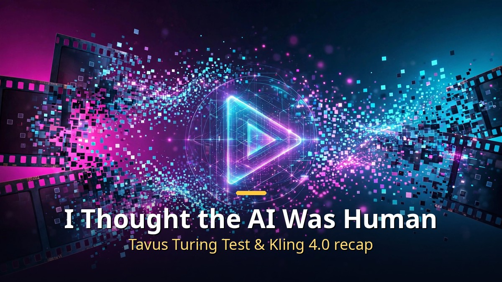

<!-- 본문 시작 -->

AI video technology is erasing the line between AI and people. This time the progress runs in two directions: one is "how human-like it feels" (Tavus Griffin), the other is "how long and precise it can be" (Kling 4.0).

## Tavus Griffin Passes the Video Turing Test (October 1)

Griffin, unveiled by Tavus, claims to be the first "HIM (Human Interaction Model)." It is a unified video-to-video full-duplex model that processes speaking, listening, and seeing at the same time — unlike the old step-by-step structure of "speech recognition → LLM → speech synthesis → avatar."

Here is how the test ran (based on Tavus's official announcement).
- Participants recruited through an independent research platform had a one-minute video call (on the topic "something you look forward to this year").
- They were not told the other party was an AI until the call ended.
- 26 of 54 people (48%) said they had "talked with a real person."
- The previous stack (Phoenix 4.5 + Sparrow-2 + Raven-1) fooled only 1 of 41 people (2.4%), so this is a dramatic improvement.

Looking at the details:
- People who suspected it was an AI usually started doubting within 20 seconds.
- Naturalness scored 5.4/7, trust 5.6/7, and "conversation flow" 4.9 — conversation flow was the lowest-scoring dimension.

There is third-party evaluation as well.
- In NVIDIA's VideoFDB evaluation (237 real call clips), it scored 3.83 for generation quality (humans 3.92, the Gemini 2.5 + Anam combination 2.80), ranking first among 15 models.
- Note, though, that the claim of being "37% ahead" is a marketing-style relative gap ((3.83−2.80)/2.80), not an absolute measure.

Technically, these points stand out:
- It re-evaluates the video several times per second and reads the other person's expressions and gestures even while speaking.
- It stops immediately when interrupted, and processes 720p video in 320ms chunks.
- On an H100, audio-video latency is 0.43 seconds, and voice cloning takes just a 10-second recording.

The most interesting part is the release status.
- Griffin-Lite is available only as a research preview for trusted testers. It is not generally available (GA).
- The public release is being delayed over fraud concerns, and the company is developing a safeguard that "tells the other person it is an AI."
- "Too human-like to release" — that paradox is the heart of this story.

There are also points to view critically.
- The conditions were a small group of 54 people, a vendor-run experiment, and one-minute calls. The "48%" is the result of Tavus's own protocol, not a pass on a standardized test.
- In the same context as the $25.6M deepfake video-call fraud case, questions are being raised about "channel trust."

AI sales (SDR), interviews, education, and customer service are cited as likely uses, but until the disclosure issue is resolved, regulated work carries risk.

## Kling 4.0 (September 28, Kuaishou, China)

This is the new version of Chinese company Kuaishou's AI video generation model. The "30 seconds · 4K" headline made waves, but the announcement comes with conditions.

First, a fact check: the full model has not been released yet.
- What was unveiled on September 28 was only the lightweight "Kling 4.0 Flash" (early access, up to 20 seconds · 720p, limited to Ultra Yearly subscribers).
- The full model is slated for "release during October," with no exact date.
- Broadcast-grade specs such as 4K and 10-bit HDR are also currently at the "coming soon" stage.

Full-model specs (based on Kuaishou's announcement, no third-party verification):
- Generate up to 30 seconds of video in one take
- Up to 10 keyframes, placeable anywhere on the timeline
- Up to 15 references per task (image 10 + video 5 + subject 7 as detailed caps)
- Native 4K + 21:9 aspect ratio, 10-bit HDR
- Stereo audio + improved lip sync
- Dialogue generation in 9 languages + on-screen subtitle generation
- Prompts up to 8,000 tokens
- Re-editing that changes only expression, angle, background, or dialogue

Two features worth noting:
- Experimental Long Video mode: generate up to 120 continuous seconds at 1080p, extendable by up to 60 seconds after generation.
- Omni Reference: it draws on 15 references from up to 50 uploaded files. It keeps a character's face, product colors, and lighting consistent even when the shot changes — targeting a classic weakness of AI video, where a change of angle resets the scene.

The competitive picture:
- On the Artificial Analysis text-to-video leaderboard, Kling 3.0 ranks 12th. The top spots belong to Google's Gemini Omni Flash, Alibaba's Wan 3.0, and Minimax H3 Max.
- Kling 4.0 has no independent evaluation yet because it has not been released.

The business story is big too.
- As of March 2026, ARR is about $500 million (more than double the $240 million of December 2025).
- In July 2026 it raised about 20.45 billion yuan (roughly 3.8 trillion won), valuing the company at about $18 billion. Tencent, Alibaba, and Baidu participated.
- It filed spin-off plans in May 2026, aiming for a Hong Kong IPO.
- For reference, the October 6 New York Advertising Week panel was a marketing event, not a launch announcement.

Until now, AI video generation topped out at clips a few seconds long, so being able to make 30 seconds in one take widens the range to short-form ads, music videos, and short storytelling. Still, it is worth remembering the conditions behind the "30 seconds · 4K" headline: "full model not yet released, 4K coming soon."

## Closing

The central question in AI video is shifting from "how real does it look?" to "how long and naturally can it keep going?" Tavus is pushing the boundary with the naturalness of real-time conversation, Kling with the length and precision of generated video. Both stories share one thing, though — they are vendor announcements — so it is worth remembering the conditions behind the numbers (54 people · 1 minute · in-house test / not yet released · coming soon).

<!-- 본문 끝 -->

## 작업용 출처·이미지 정보 (업로드 제외)

- Source: 로컬 초안 ~/workspace/naver-blog/ainews-series-02-video.md 기준 복원 (윤문 없음, 연관글·더 보기 링크 제외, 이미지 마커 전환)
- Images: images/01-hero-en.jpg ~ 03-img2-en.jpg / existing base illustration + English banner overlay (1200x675) / license: original
