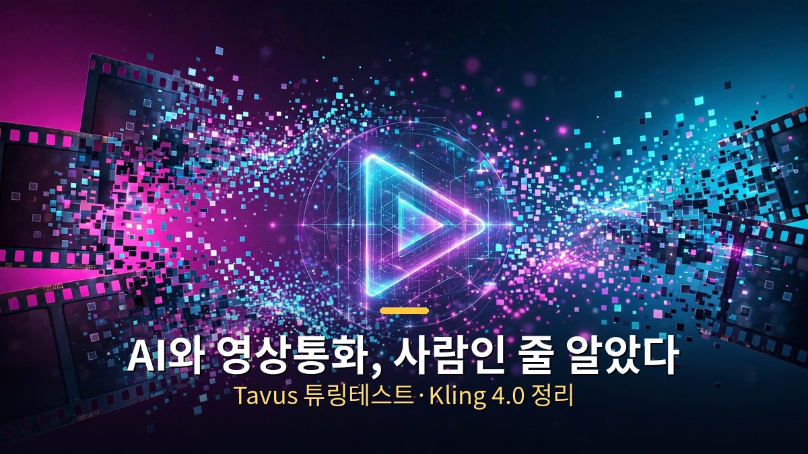
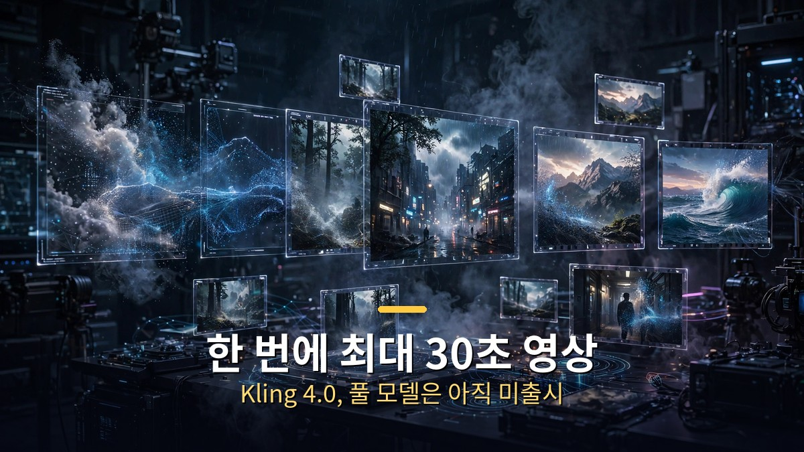

<!-- 본문 시작 -->

AI 영상 기술이 사람과의 경계를 허물고 있습니다. 이번에는 두 가지 방향의 진화입니다. 하나는 '얼마나 사람 같은가'(Tavus Griffin), 다른 하나는 '얼마나 길고 정밀한가'(Kling 4.0)입니다.

## Tavus Griffin, 영상 튜링테스트 통과 (10월 1일)

Tavus가 공개한 Griffin은 '최초의 HIM(Human Interaction Model)'을 표방합니다. 말하기·듣기·보기를 동시에 처리하는 통합 video-to-video 풀듀플렉스 모델로, 기존의 "음성인식→LLM→음성합성→아바타" 단계식 구조와 다릅니다.

테스트는 이렇게 진행됐습니다 (Tavus 공식 발표 기준).
- 독립 리서치 플랫폼에서 모집한 참가자와 1분간 영상통화 ("올해 기대되는 일"이 주제).
- 상대가 AI라는 사실을 통화 끝날 때까지 알리지 않았습니다.
- 54명 중 26명(48%)이 "진짜 사람과 통화했다"고 답했습니다.
- 이전 스택(Phoenix 4.5+Sparrow-2+Raven-1)은 41명 중 1명(2.4%)이었으니 비약적인 향상입니다.

세부 수치를 보면:
- AI임을 의심한 사람들은 대개 20초 이내에 의심을 시작했습니다.
- 자연스러움 5.4/7, 신뢰감 5.6/7, "대화 흐름" 4.9점으로 대화 흐름이 가장 낮은 축이었습니다.

제3자 평가도 있습니다.
- NVIDIA VideoFDB 평가(237개 실제 통화 클립): 생성 품질 3.83점 (인간 3.92점, Gemini 2.5+Anam 조합 2.80점)으로 15개 모델 중 1위.
- 다만 "37% 앞섰다"는 표현은 마케팅적 상대 격차 ((3.83−2.80)/2.80)일 뿐 절대 지표는 아닙니다.

기술적으로 눈여겨볼 점:
- 초당 여러 번 영상을 재평가하고, 말하면서도 상대의 표정·제스처를 인지합니다.
- 끼어들면 즉시 멈추고, 720p 영상을 320ms 청크로 처리합니다.
- H100 기준 오디오-비디오 지연 0.43초, 목소리 복제는 10초 녹음으로 가능합니다.

가장 흥미로운 건 출시 상태입니다.
- Griffin-Lite는 신뢰 테스터 대상 리서치 프리뷰만 제공됩니다. 일반 공개(GA)가 아닙니다.
- 사기 악용 우려로 공개를 연기 중이며, "상대방에게 AI임을 알리는" 안전장치를 개발 중입니다.
- "너무 사람 같아서 출시를 미뤘다"는 역설이 이 뉴스의 핵심입니다.

비판적으로 볼 지점도 있습니다.
- 54명 소규모, 업체 자체 실험, 1분 통화라는 조건입니다. "48%"는 표준화된 시험 통과가 아니라 Tavus 자체 프로토콜의 결과입니다.
- $25.6M 규모의 딥페이크 영상통화 사기 사례와 같은 맥락에서 "채널 신뢰" 문제가 제기됩니다.

활용 전망으로는 AI 영업(SDR)·인터뷰·교육·고객상담이 꼽히지만, 공개(disclosure) 문제 해결 전까지 규제 업무에서는 리스크가 있습니다.

## Kling 4.0 (9월 28일, 중국 콰이쇼우)

중국 콰이쇼우의 AI 영상 생성 모델 새 버전입니다. "30초·4K"라는 헤드라인이 화제였지만, 발표 내용을 뜯어보면 조건이 붙습니다.

먼저 팩트체크: 풀 모델은 아직 미출시입니다.
- 9월 28일 공개된 것은 경량판 'Kling 4.0 Flash'(얼리 액세스, 최대 20초·720p, Ultra Yearly 구독자 한정)뿐입니다.
- 풀 모델은 "10월 중 출시"로 날짜는 미정입니다.
- 4K·10-bit HDR 같은 방송용 스펙도 현재는 "coming soon" 단계입니다.

풀 모델 스펙 (콰이쇼우 발표 기준, 제3자 검증 없음):
- 한 번에 최대 30초 영상 생성
- 타임라인 어디든 배치 가능한 키프레임 최대 10개
- 작업당 레퍼런스 최대 15개 (이미지 10 + 영상 5 + 피사체 7의 세부 상한)
- 네이티브 4K + 21:9 화면비, 10-bit HDR
- 스테레오 오디오 + 립싱크 개선
- 9개 언어 대사 생성 + 화면 자막 생성
- 프롬프트 최대 8,000 토큰
- 표정·앵글·배경·대사만 바꾸는 재편집 기능

주목할 기능 두 가지:
- 실험적 Long Video 모드: 1080p로 최대 120초 연속 생성, 생성 후 60초까지 연장 가능.
- Omni Reference: 최대 50개 업로드 파일 중 15개 레퍼런스를 활용합니다. 샷이 바뀌어도 캐릭터 얼굴·제품 색상·조명을 유지하는데, 이는 기존 AI 영상의 약점(앵글이 바뀌면 장면이 리셋되는 현상)을 겨냥한 것입니다.

경쟁 구도:
- Artificial Analysis 텍스트-투-비디오 리더보드에서 Kling 3.0은 12위입니다. 상위권은 구글 Gemini Omni Flash·알리바바 Wan 3.0·Minimax H3 Max가 차지하고 있습니다.
- Kling 4.0은 미출시라 독립 평가가 없습니다.

비즈니스 스토리도 큽니다.
- 2026년 3월 기준 ARR 약 5억 달러 (2025년 12월 2.4억 달러에서 2배 이상 성장).
- 2026년 7월 약 204.5억 위안(약 3조 8천억원) 투자 유치로 기업가치 약 180억 달러 평가. 텐센트·알리바바·바이두가 참여했습니다.
- 2026년 5월 분사 계획 제출, 홍콩 IPO를 목표로 하고 있습니다.
- 참고로 10월 6일 뉴욕 Advertising Week 패널은 마케팅 행사이며 출시 발표가 아닙니다.

기존 AI 영상 생성은 몇 초짜리 클립이 한계였는데, 30초 분량을 한 번에 만들 수 있게 되면 숏폼 광고·뮤직비디오·짧은 스토리텔링까지 영역이 넓어집니다. 다만 "30초·4K" 헤드라인 뒤에 "풀 모델 미출시, 4K는 coming soon"이라는 조건을 함께 알아두는 게 좋습니다.

## 마무리

AI 영상의 화두는 '얼마나 진짜 같은가'에서 '얼마나 길고 자연스럽게 이어지는가'로 옮겨가고 있습니다. Tavus는 실시간 대화의 자연스러움으로, Kling은 생성 영상의 길이와 정밀도로 각자 경계를 넓히는 중입니다. 다만 두 소식 모두 "업체 발표"라는 공통점이 있으니, 수치 뒤의 조건(54명·1분·자체 실험 / 미출시·coming soon)을 함께 기억해 두시면 좋습니다.

<!-- 본문 끝 -->

## 작업용 출처·이미지 정보 (업로드 제외)

- 자료 출처: 로컬 초안 ~/workspace/naver-blog/ainews-series-02-video.md 기준 복원 (윤문 없음, 연관글·더 보기 링크 제외, 이미지 마커 전환)
- 이미지: images/01-hero.jpg ~ 03-img2.jpg / 기존 베이스 일러스트 + 배너 가공 (1200x675) / 사용권: 자작
