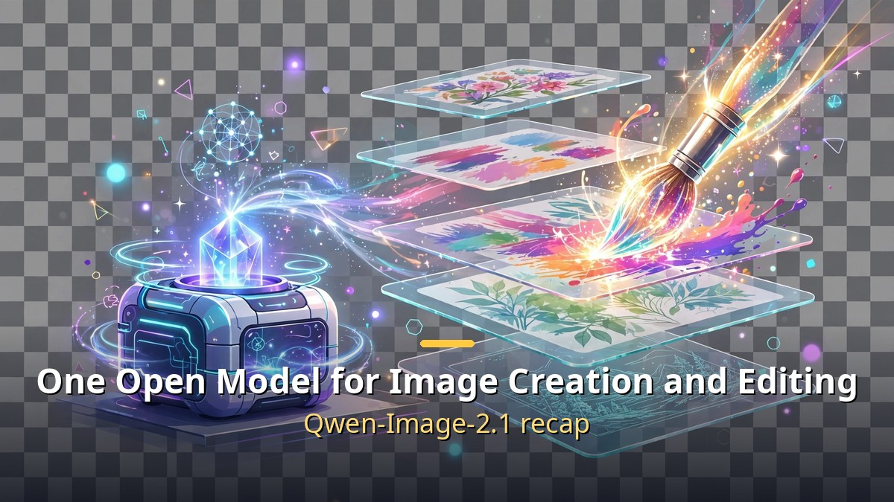
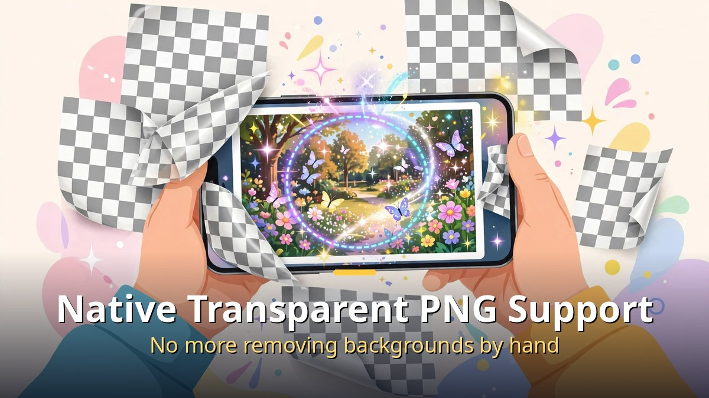
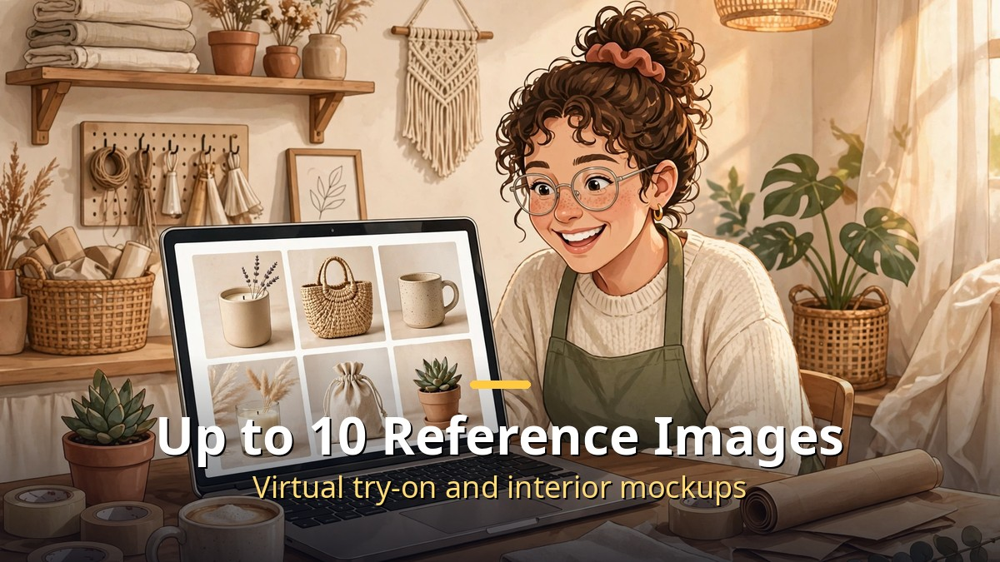

<!-- 본문 시작 -->

- On September 20, Alibaba unveiled its image AI, "Qwen-Image-2.1." It is an open-weight model anyone can download and use.
- It combines image "generation" and "editing" into a single model, and creates transparent-background (PNG) images natively.
- It accepts up to 10 reference images at once, making it strong for tasks like virtual try-on and interior mockups.

First, some terms: "open-weight" means the model's blueprint (its weights) is published so anyone can download it and run it on their own computer. A "diffusion transformer (DiT)" is the latest AI architecture used to create images. The image-generation part of Qwen-Image-2.1 is 7 billion (7B) parameters in size, and it runs on high-end consumer graphics cards (RTX 3090-class).

## Generation and Editing in One

It creates PNG images with transparent backgrounds directly, and can edit text on a transparent layer too.

Until now, the AI that "makes" images and the AI that "fixes" them were often separate. Qwen-Image-2.1 unifies text-to-image generation and editing of existing images in a single model. Local editing works too: circle a specific area in a photo and tell it "change only this part."

The most practical difference is native transparent-image support. It generates PNG (RGBA) images with transparent backgrounds directly, and can edit text on a transparent layer. That saves the trouble of removing backgrounds when making logos, stickers, or compositing material. Resolution is 2,048×2,048 (2K) by default, up to 2,752×1,536.

## Up to 10 Reference Images

You can feed in up to 10 reference images at once.

You can feed in up to 10 reference images at once. Possible uses include compositing several group photos, trying clothes on virtually, or generating interior mockups from room photos. In Alibaba's own benchmark it scored 60.28 points, which the company says places it among the top tier of public image models (a vendor measurement, so take it as a reference).

The runtime environment is broad too. From launch day it was supported in major tools such as ComfyUI (a free tool for using image AI like snapping blocks together) and Diffusers, and it has been verified to run on 8 chip platforms. The license is free for research and evaluation; commercial use requires a separate agreement.

## So What Does This Mean for Me?

Good news for solo business owners and creators making shopping-mall detail pages, YouTube thumbnails, and social media promo images. Without a paid image AI subscription, you now have an option to handle generation, editing, and transparent PNGs on your own PC. It is not fully free for commercial use, so the license needs checking, but the trend is clear: "image AI is entering the value-for-money era too."

## Closing

Image AI competition is walking the same path as text AI. Performance goes up, prices come down, and open models chase from behind. Across this four-part series, we covered the big currents of the AI industry from late September to early October (agents, the model price war, devices, and images). Next time, I will bring another fresh update.

<!-- 본문 끝 -->

## 작업용 출처·이미지 정보 (업로드 제외)

- Source: 로컬 초안 drafts/2026-10-09/draft4_qwen.md 기준 복원 (윤문 없음, 연관글 제외, 이미지 마커 전환)
- Images: images/01-hero-en.jpg ~ 03-img2-en.jpg / existing base illustration + English banner overlay (1200x675) / license: original
