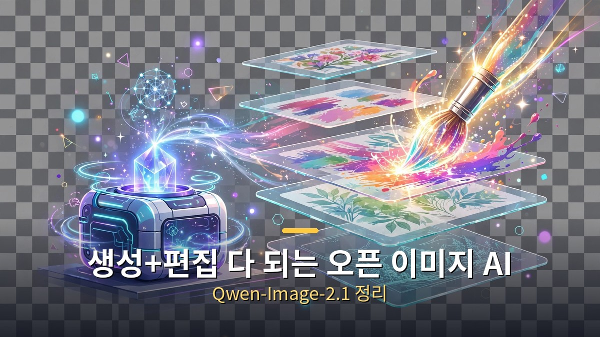
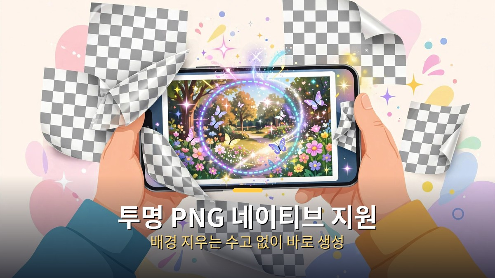
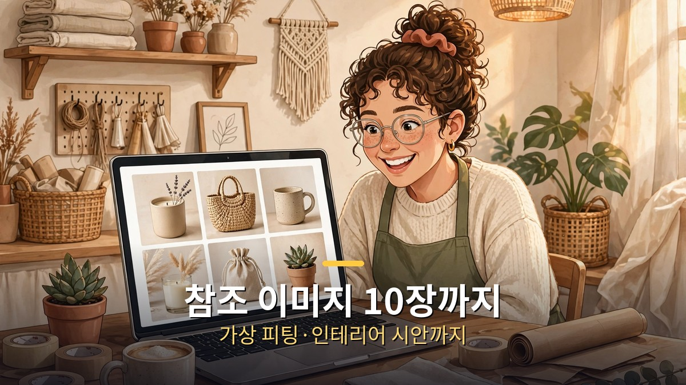

<!-- 본문 시작 -->

- 알리바바가 9월 20일 이미지 AI 'Qwen-Image-2.1'을 공개했습니다. 누구나 내려받아 쓸 수 있는 오픈 웨이트 모델입니다.
- 이미지 '생성'과 '편집'을 하나의 모델로 합쳤고, 투명 배경(PNG) 이미지를 네이티브로 만듭니다.
- 최대 10장의 참조 이미지를 한 번에 넣을 수 있어, 가상 피팅·인테리어 시안 같은 작업에 강합니다.

먼저 용어 정리: '오픈 웨이트(open-weight)'란 AI 모델의 설계도(가중치)를 공개해 누구나 내려받아 자기 컴퓨터에서 돌릴 수 있게 한 방식입니다. '디퓨전 트랜스포머(DiT)'는 이미지를 만드는 데 쓰는 최신 AI 구조입니다. Qwen-Image-2.1의 이미지 생성 부분은 70억(7B) 파라미터 규모로, 고성능 소비자용 그래픽카드(RTX 3090급)에서도 동작합니다.

## 생성과 편집을 하나로

배경이 투명한 PNG 이미지를 바로 생성하고, 투명 레이어 위의 글자도 편집할 수 있습니다.

기존에는 이미지를 '만드는 AI'와 '고치는 AI'가 따로인 경우가 많았습니다. Qwen-Image-2.1은 텍스트로 이미지를 새로 만드는 기능과 기존 이미지를 편집하는 기능을 하나의 모델에 통합했습니다. 사진 속 특정 영역을 동그라미로 표시하고 "여기만 바꿔줘"라고 지시하는 부분 편집(로컬 에디팅)도 됩니다.

가장 실용적인 차별점은 투명 이미지 네이티브 지원입니다. 배경이 투명한 PNG(RGBA) 이미지를 바로 생성하고, 투명 레이어 위의 글자도 편집할 수 있습니다. 로고·스티커·합성용 소재를 만들 때 배경을 지우는 수고가 줄어듭니다. 해상도는 기본 2048×2048(2K)에 최대 2752×1536까지 지원합니다.

## 참조 이미지 10장까지

한 번에 최대 10장의 참조 이미지를 넣을 수 있습니다.

한 번에 최대 10장의 참조 이미지를 넣을 수 있습니다. 단체 사진을 여러 장 넣고 합성하거나, 옷 사진을 넣고 가상 피팅을 하거나, 방 사진을 넣고 인테리어 시안을 뽑는 식의 활용이 가능합니다. 알리바바 자체 벤치마크에서는 60.28점을 기록해 공개된 이미지 모델 중 최상위권이라고 밝혔습니다(업체 자체 측정이라 참고용으로 보시면 됩니다).

실행 환경도 넓습니다. 공개 당일부터 ComfyUI(코mfyUI: 이미지 AI를 블록 조립하듯 쓰는 무료 도구), Diffusers 등 주요 도구에서 바로 쓸 수 있게 지원됐고, 8개 칩 플랫폼에서 동작 확인이 됐습니다. 라이선스는 연구·평가용 무료이며, 상업적 이용은 별도 계약이 필요합니다.

## 그래서 나한테 무슨 의미야

쇼핑몰 상세페이지, 유튜브 썸네일, SNS 홍보 이미지를 만드는 1인 사업자·크리에이터에게 희소식입니다. 유료 이미지 AI 구독 없이도 자기 PC에서 생성·편집·투명 PNG까지 처리할 수 있는 선택지가 생겼기 때문입니다. 완전히 무료 상업 이용은 아니니 라이선스는 확인이 필요하지만, '이미지 AI도 가성비 시대'라는 흐름은 분명합니다.

## 마무리

이미지 AI 경쟁도 텍스트 AI와 같은 길을 걷고 있습니다. 성능은 올라가고, 가격은 내려가고, 오픈 모델이 추격하는 패턴입니다. 이번 시리즈 4편을 통해 9월 하순~10월 초 AI 업계의 큰 흐름(에이전트·모델 가격전쟁·디바이스·이미지)을 정리했습니다. 다음에는 또 다른 새 소식을 가져오겠습니다.

<!-- 본문 끝 -->

## 작업용 출처·이미지 정보 (업로드 제외)

- 자료 출처: 로컬 초안 drafts/2026-10-09/draft4_qwen.md 기준 복원 (윤문 없음, 연관글 제외, 이미지 마커 전환)
- 이미지: images/01-hero.jpg ~ 03-img2.jpg / 기존 베이스 일러스트 + 배너 가공 (1200x675) / 사용권: 자작
