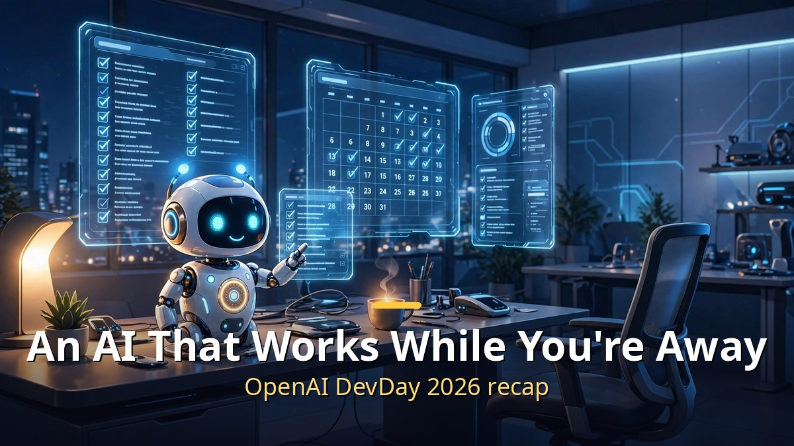
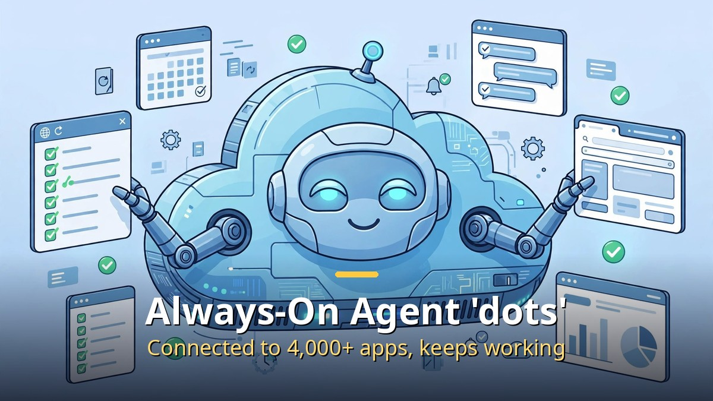

<!-- 본문 시작 -->

- On September 29, 2026, OpenAI unveiled more than 20 new products and features at its developer event, DevDay 2026.
- The headline is "dots," an always-on AI agent that keeps working on your behalf.
- Also announced: "GPT-6.1 Sol," offering near-flagship performance at one-fifth the price, and "Ultrafast" high-speed inference.

First, some terms: "DevDay" is OpenAI's annual developer event, where new ChatGPT and AI model features are unveiled first. This year it was held in San Francisco on September 29 (local time).

## The Always-On AI Agent "dots"

An always-on agent that keeps working even after you step away from your desk.

The star of this announcement is an AI agent called "dots." An "agent" is an AI that takes your instructions and handles multiple steps on its own — and dots goes one step further. It is an "always-on" type that keeps working even after you step away.

Dots is built on GPT-6 Astra (OpenAI's top-tier model), comes with its own cloud computer and browser, and connects to more than 4,000 apps. Hand it tasks like investigating bugs, building apps, coordinating schedules, or preparing invoices, and it proceeds without you opening a new conversation or directing each step. It reports its progress and anything that needs your decision first, and you can redirect it from the activity view screen.

Worth noting is the safety design. When dots investigates on its own while you are away, that phase is limited to "read-only." It does not send messages, change app content, or operate the browser during that phase; real actions follow your instructions and approval rules.

Availability starts with the ChatGPT Pro and Business Premium plans, and the first dot is included at no extra cost. The top tier, "Pro 500" ($500 per month), was unveiled alongside it.

## Models Get Cheaper and Faster

GPT-6.1 Sol delivers near-flagship Astra performance at one-fifth the price.

The model lineup changed too. "GPT-6.1 Sol" offers performance close to the top-tier Astra model at one-fifth the price. Via the API, it costs about $2 per million input tokens and $10 per million output tokens. It is strong at writing code and verifying it itself, and at holding context across long tasks, making it a good fit as the default engine for developer coding agents.

On the speed side, "Ultrafast" arrived. This high-speed inference tier generates up to 300 tokens per second, 8 times faster than standard. The price is 6 times higher, so it suits real-time services where response speed is worth money. For uses that need a decision in under a second, the "Decisions API" was previewed.

## A New Stage for Developers

The "Agents API" is a developer tool for building agents that operate a computer directly inside an application. In plain terms, developers can now plant a dots-like employee inside their own apps.

Distribution changed significantly too. "Sign in with ChatGPT" lets outside apps use a user's ChatGPT subscription, and the "OpenAI Marketplace" is a store where companies buy partner software under contract. With 1.2 billion weekly ChatGPT users, the platform is opening up as a business stage for developers. Also unveiled were the team collaboration space "Space," the collaborative document tool "Pages," and "Cloud Codex," which runs code in the cloud.

## Closing

The direction of this DevDay is clear. AI is moving beyond answering questions toward becoming an "employee" that finishes work while you are away. Since dots is included in the Pro plan, the always-on agent era looks set to open first for individuals and teams on the higher-priced plans. Prices are down and speed is up, so what remains is figuring out how to attach it to your own work. The next post will cover other AI model news from the same period (Claude Opus 5.5 and Grok 4.7).

<!-- 본문 끝 -->

## 작업용 출처·이미지 정보 (업로드 제외)

- Source: 로컬 초안 drafts/2026-10-09/draft1_devday.md 기준 복원 (윤문 없음, 연관글 제외, 이미지 마커 전환)
- Images: images/01-hero-en.jpg ~ 03-img2-en.jpg / existing base illustration + English banner overlay (1200x675) / license: original
