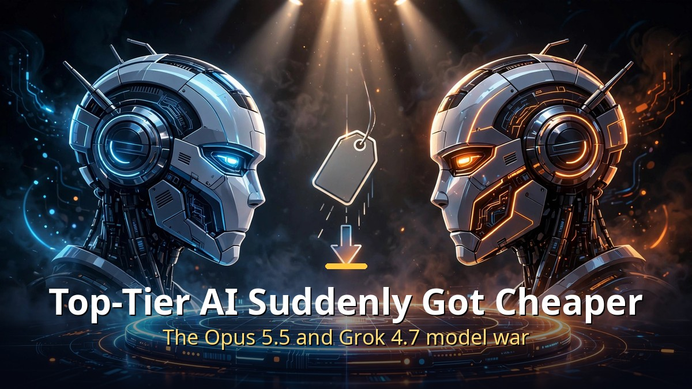
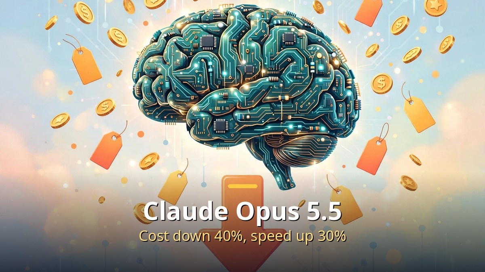
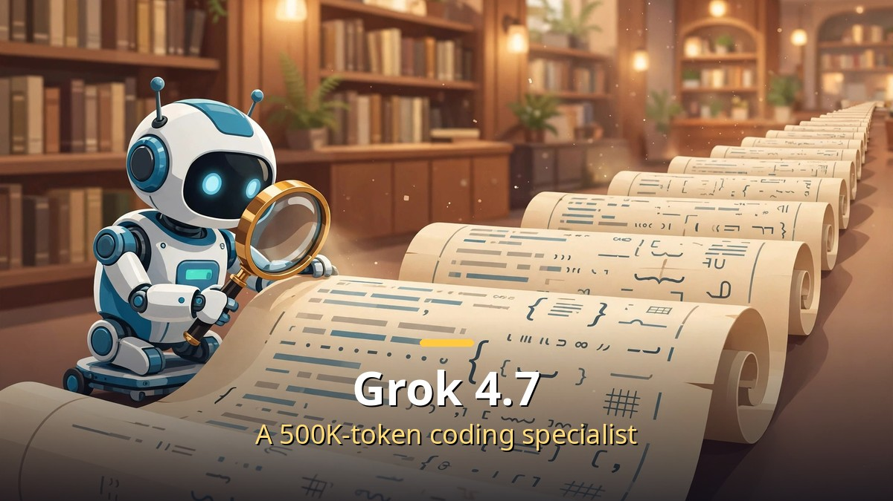

<!-- 본문 시작 -->

- Anthropic launched "Claude Opus 5.5" on September 22. The cost of handling the same task fell by about 40% from the previous generation, and response speed rose by 30%.
- xAI unveiled "Grok 4.7" on September 21. It is a coding- and agent-focused model that processes a long context of 500,000 tokens.
- As the price war among top-tier models heats up, the AI cost users feel is falling fast.

First, some terms: in the AI industry, "Opus" is Anthropic's most advanced Claude model line, and "Grok" is xAI's model brand. A higher version number means a newer model.

## Claude Opus 5.5: Expensive, but Lighter

The cost of handling the same task fell by about 40%, and response speed rose by 30%.

Claude Opus 5.5, unveiled by Anthropic on September 22, is the successor to Opus 5. The official announcement carries two core messages. First, the cost of running ordinary tasks fell by about 40% compared with Opus 5. That does not simply mean a lower per-token price; it means the total cost of finishing the same job went down. Second, output speed rose by 30%.

Performance is also said to approach that of the higher "Fable 5.1" line. Among the disclosed benchmarks, it scored 66.4% on Terminal-Bench 4.0 and 54.4% on FrontierCode. Benchmarks are only a reference, but the direction is clear: "use less, go faster, keep similar performance."

The API price is $4 per million input tokens and $20 per million output tokens. On security, resistance to prompt injection (attacks that trick AI with malicious instructions) has improved, and safeguards against unauthorized copying and distillation through model responses are included. The fact that it was integrated on launch day into GitHub Copilot CLI and VS Code, plus major clouds such as AWS, Google Cloud, and Azure, shows how fast it is spreading into real work.

Notably, Anthropic CEO Dario Amodei recently declared that he would "pace the frontier" — matching the speed of capability advances to the speed of safety advances — and Opus 5.5 is the first model released since that declaration.

## Grok 4.7: A Coding Specialist That Reads Long Texts Whole

A coding- and agent-focused model that processes a long context of 500,000 tokens.

xAI unveiled Grok 4.7 a day earlier, on September 21. It is described as a frontier model "for coding, agent work, and knowledge work." The most eye-catching spec is its 500,000-token context (the length of text it can process at once). That means dozens of books' worth of code and documents can be fed in at once, which suits large-scale code analysis and long agent tasks.

Reasoning effort can be adjusted across four levels — low, medium, high, and max — and the price is $2 per million input tokens and $6 per million output tokens. One caveat: if the prompt (input) exceeds 200,000 tokens, the price doubles under a two-tier pricing scheme, so heavy users of long documents should calculate costs carefully. It was also built into GitHub Copilot right away, making it easy for developers to try.

## So What Does This Mean for Me?

Both models share one thing in common: the "democratization of top-tier performance." Just one or two years ago, top-tier models were expensive resources to use sparingly. Now the same budget covers far more work. For ordinary users, that arrives as faster, smarter answers in chatbot apps; for developers and solo businesses, it arrives as lower API costs.

When choosing a model, looking at "the actual cost and speed for my task" is more practical than looking at a single benchmark score. Use Opus 5.5 or Grok 4.7 for heavy coding and document work, and cheaper lower-tier models for light everyday questions. This kind of "splitting models by task" is becoming the basic skill of AI use in the second half of 2026.

## Closing

The focus of AI model competition is shifting from "who is smarter" to "who does the same work more cheaply and quickly." Falling prices ultimately return to users as benefits, so it pays to keep up, even lightly, with model news in the areas you care about.

<!-- 본문 끝 -->

## 작업용 출처·이미지 정보 (업로드 제외)

- Source: 로컬 초안 drafts/2026-10-09/draft2_models.md 기준 복원 (윤문 없음, 연관글 제외, 이미지 마커 전환)
- Images: images/01-hero-en.jpg ~ 03-img2-en.jpg / existing base illustration + English banner overlay (1200x675) / license: original
