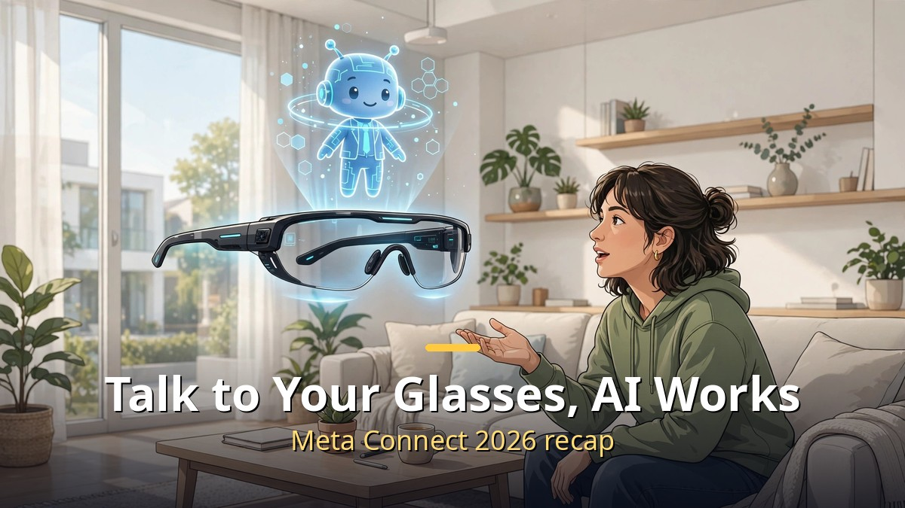
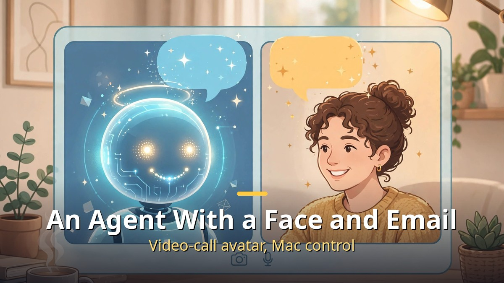
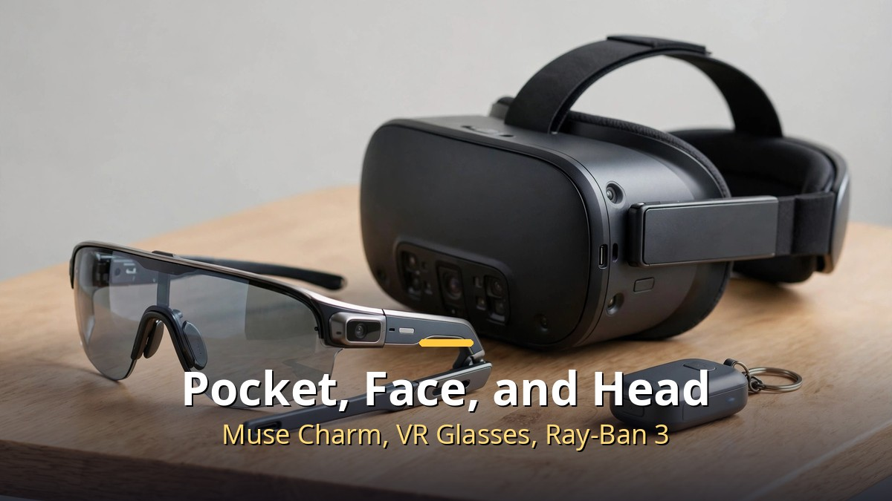

<!-- 본문 시작 -->

- At its annual Connect 2026 event on September 23–24, Meta unveiled a wave of new features for its personal AI agent, Muse.
- Muse can now video-call as an avatar, handle work through its own email address, and directly operate apps on a Mac.
- New hardware arrived too: the keychain-sized Muse Charm, the roughly 100-gram Meta VR Glasses, and the third-generation Ray-Ban Meta.

First, some terms: "Connect" is Meta's annual developer and hardware event, where new VR headsets and smart glasses are announced. "Muse" is Meta's personal AI agent app, launched on September 8, 2026, which handles real tasks on your behalf, such as sending emails, booking travel, filling out forms, and making purchases. It is rolling out first in the United States, Canada, and Mexico.

## An Agent With a Face and an Email Address

Say "Muse" to your glasses, and it responds to what you are looking at.

The software highlight of this Connect was Muse's evolution. Four things stand out.

First, a real-time video-call avatar. Beyond voice chat, you can video-call as a digital avatar of your choosing. Second, a dedicated email address for the agent. Muse can receive mail at its own address and get work done, so AI can be looped directly into an email thread. Third, direct control of a Mac. The Mac Muse app can operate all of your computer's apps with your permission and keep queued tasks running even after you step away. Fourth, smart-glasses integration. Say "Muse" to your glasses and it reacts to what you see. You can ask "How much is this?" about a product on a shelf or a flyer on a wall without describing it first.

Voice is evolving too: Muse can hold longer conversations while running background tasks in parallel, and you can design its speaking style, such as pace and intonation, by describing it.

## Hardware: Pocket, Face, and Head

The keychain-sized Muse Charm, the roughly 100-gram Meta VR Glasses, and the third-generation Ray-Ban Meta arrived together.

New devices arrived as well. The "Muse Charm" is a palm- and keychain-sized dedicated Muse device, woken by fingerprint, targeting a December holiday-season launch. Its price has not been disclosed.

The "Meta VR Glasses" use a roughly 100-gram glasses body with a separate compute module (a puck), priced at $1,299 and scheduled for spring 2027. The third-generation "Ray-Ban Meta" launched as a lineup that includes an audio-only model without a camera, alongside a $249 "Meta Glasses" model. Health features were strengthened too, including FDA-approved hearing assistance, nutrition logging, and workout guidance.

## So What Does This Mean for Me?

The era of chatbots trapped inside a screen is ending. An AI with an email address, an AI that touches your computer directly, an AI that sees the world through your glasses — these are closer to "someone you work with" than a "conversation partner." The service is still centered on the United States and its launch in Korea is undecided, but the direction is clear: agent-style AI is seeping into everyday devices. Learning what you can use now will shrink the gap when it arrives here.

## Closing

Meta's strategy is to put AI into the "body" (the device), not just the app. Once an agent that moves between glasses, a keychain, and a PC becomes familiar, the habit of pulling out a phone and typing may itself change.

<!-- 본문 끝 -->

## 작업용 출처·이미지 정보 (업로드 제외)

- Source: 로컬 초안 drafts/2026-10-09/draft3_meta.md 기준 복원 (윤문 없음, 연관글 제외, 이미지 마커 전환)
- Images: images/01-hero-en.jpg ~ 03-img2-en.jpg / existing base illustration + English banner overlay (1200x675) / license: original
