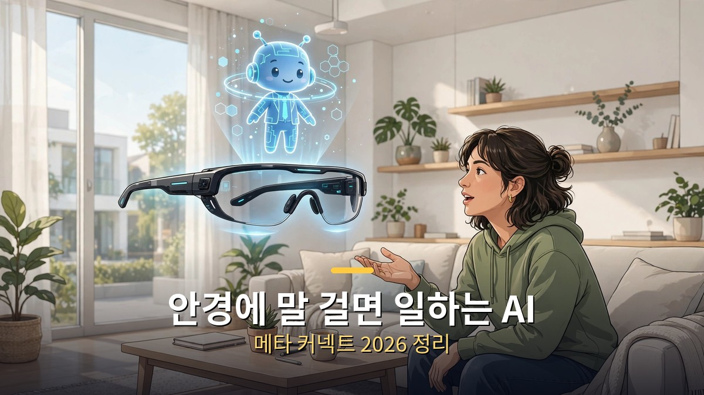
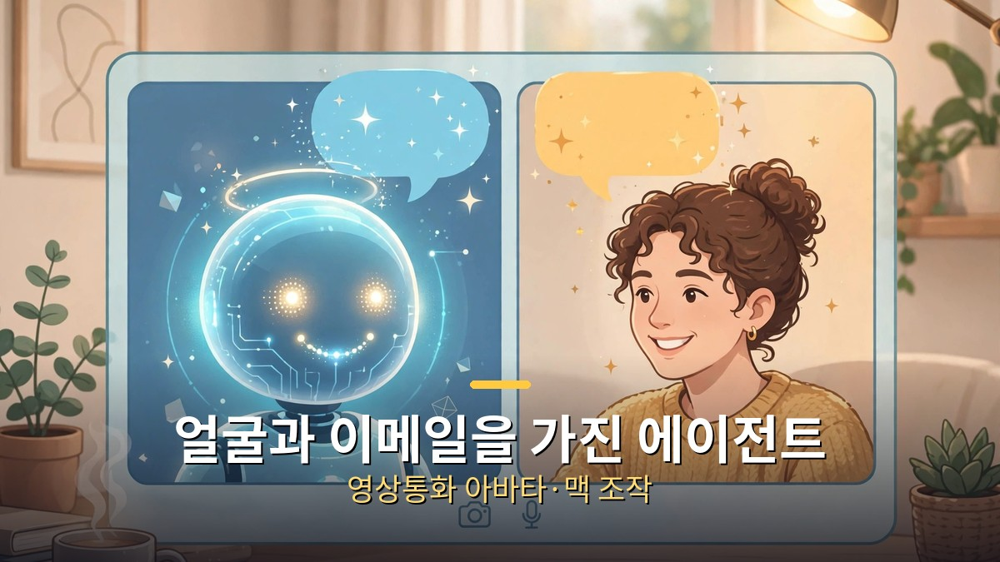
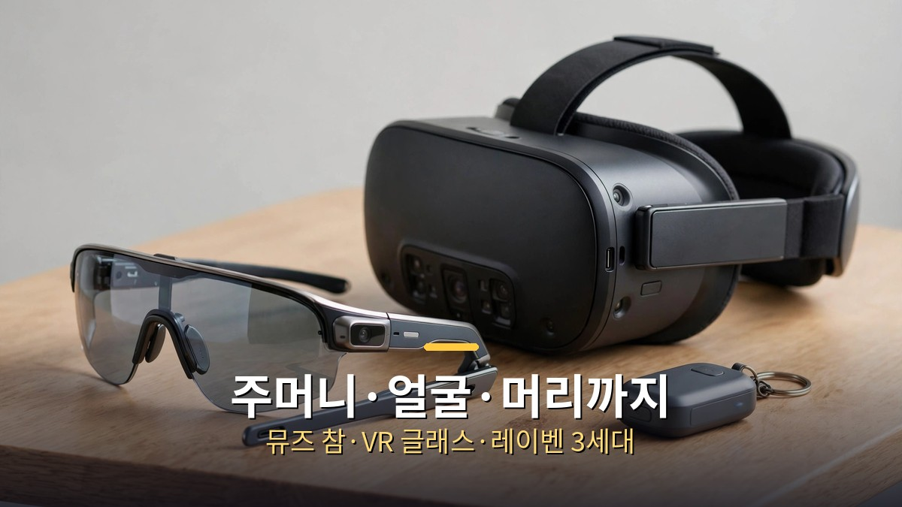

<!-- 본문 시작 -->

- 메타가 9월 23~24일 연례 행사 '커넥트 2026'에서 개인 AI 에이전트 '뮤즈(Muse)'의 새 기능을 대거 공개했습니다.
- 뮤즈는 아바타와 영상통화를 하고, 자기 이메일 주소로 일을 처리하며, 맥(Mac) 컴퓨터의 앱을 직접 조작합니다.
- 새 하드웨어로 열쇠고리 크기의 '뮤즈 참', 100g대 '메타 VR 글래스', '레이벤 메타 3세대'도 발표됐습니다.

먼저 용어 정리: '커넥트(Connect)'는 메타가 매년 여는 개발자·하드웨어 행사로, VR 헤드셋과 스마트글래스 신제품이 공개되는 자리입니다. '뮤즈(Muse)'는 메타가 2026년 9월 8일 출시한 개인 AI 에이전트 앱으로, 이메일 발송·여행 예약·폼 작성·구매 같은 실제 일을 대신 처리합니다. 미국·캐나다·멕시코에서 먼저 서비스 중입니다.

## 에이전트가 얼굴과 이메일을 갖다

안경에 "뮤즈"라고 부르면, 보고 있는 것을 인식해 반응합니다.

이번 커넥트의 소프트웨어 하이라이트는 뮤즈의 진화입니다. 네 가지가 눈에 띕니다.

첫째, 실시간 영상통화 아바타입니다. 음성 대화를 넘어 사용자가 고른 디지털 아바타의 얼굴로 영상통화를 하는 기능입니다. 둘째, 에이전트 전용 이메일 주소입니다. 뮤즈가 자기 이메일로 메일을 받고 일을 처리할 수 있어, 이메일 스레드에 AI를 직접 끼워 넣는 방식이 됩니다. 셋째, 맥 컴퓨터 직접 조작입니다. 맥용 뮤즈 앱이 사용자의 허락 하에 컴퓨터의 모든 앱을 조작하고, 사용자가 자리를 비운 뒤에도 줄 세운 작업을 계속합니다. 넷째, 스마트글래스 연동입니다. 안경에 "뮤즈"라고 부르면 보고 있는 것을 인식해 반응합니다. 선반의 상품이나 벽의 전단지를 설명하지 않아도 "이거 얼마야?"라고 물을 수 있는 식입니다.

목소리도 길게 대화하면서 백그라운드 작업을 병행하고, 빠르기·억양 등 말투를 설명으로 디자인할 수 있게 됩니다.

## 하드웨어: 주머니·얼굴·머리까지

열쇠고리 크기의 뮤즈 참, 100g대 메타 VR 글래스, 레이벤 메타 3세대가 함께 나왔다.

새 기기도 나왔습니다. '뮤즈 참(Muse Charm)'은 손바닥·열쇠고리 크기의 뮤즈 전용 단말로, 지문으로 깨우고 12월 연말 시즌 출시를 목표로 합니다. 가격은 미공개입니다.

'메타 VR 글래스'는 안경 본체 약 100g에 별도 연산 모듈(퍽)을 쓰는 방식으로, 가격은 1,299달러, 2027년 봄 출시 예정입니다. '레이벤 메타 3세대'는 카메라 없는 오디오 전용 모델을 포함한 라인업으로 나왔고, 249달러짜리 '메타 글래스'도 함께 발표됐습니다. 청력 보조(FDA 승인), 영양 기록, 운동 가이드 같은 건강 기능도 강화됐습니다.

## 그래서 나한테 무슨 의미야

챗봇이 화면 안에 갇혀 있던 시대가 끝나가고 있습니다. 이메일 주소를 가진 AI, 컴퓨터를 직접 만지는 AI, 안경 너머 세상을 보는 AI는 '대화 상대'가 아니라 '같이 일하는 존재'에 가깝습니다. 아직은 미국 중심 서비스이고 국내 출시는 미정이지만, 에이전트형 AI가 일상 기기로 스며드는 방향은 분명해 보입니다. 당장 쓸 수 있는 것부터 익혀두면, 국내에 들어왔을 때 격차가 줄어듭니다.

## 마무리

메타의 전략은 AI를 '앱'이 아니라 '몸(디바이스)'에 심는 것입니다. 안경·열쇠고리·PC를 오가는 에이전트가 익숙해지면, 스마트폰을 꺼내 타이핑하던 습관 자체가 바뀔 수 있습니다.

<!-- 본문 끝 -->

## 작업용 출처·이미지 정보 (업로드 제외)

- 자료 출처: 로컬 초안 drafts/2026-10-09/draft3_meta.md 기준 복원 (윤문 없음, 연관글 제외, 이미지 마커 전환)
- 이미지: images/01-hero.jpg ~ 03-img2.jpg / 기존 베이스 일러스트 + 배너 가공 (1200x675) / 사용권: 자작
