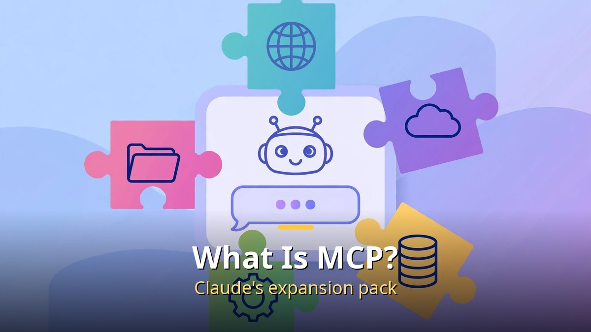
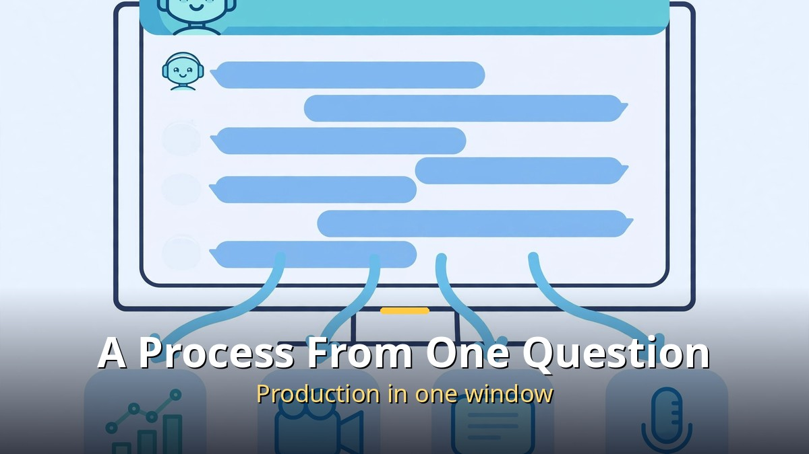
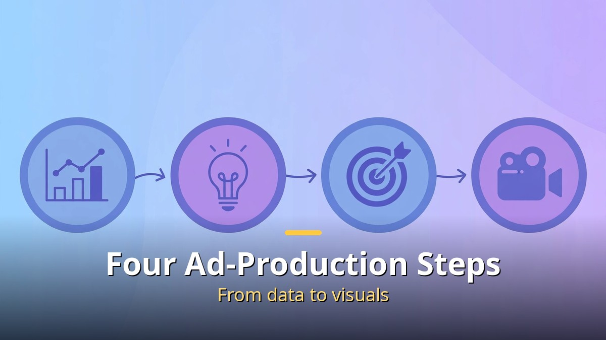

<!-- 본문 시작 -->

There was a time when one ad video needed a filming crew, an editor, and a designer. Now a single question — "What's selling well on TikTok Shop lately?" — can carry you from market research to a finished ad video.

The secret is connecting an "MCP" extension to Claude. Once AI can directly operate video production tools, the human's job becomes choosing. This article covers what MCP is, how the four ad-production steps are automated, and how the real tools Topview and Higgsfield are used — plus what to watch out for.

## What Is MCP? Claude's Expansion Pack

An MCP extension module connecting to Claude.

First, the terms. "Claude" is Anthropic's AI chatbot, and "MCP (Model Context Protocol)" is the standard specification for connecting external tools to AI. Simply put, Claude is the main unit and MCP is the expansion pack you plug in.

Originally Claude could only write text, but with MCP connected it can directly operate video production tools. In the chat window, an instruction like "Install this MCP locally and tell me the login guide," plus a URL, reportedly completes the connection.

## An Ad Production Process That Starts With One Question

A chat question flowing into data, video, subtitle, and voice outputs.

Making an AI ad video used to mean hopping across 5–7 tools: market research on one site, image generation on another, video editing in yet another program. Connecting MCP merges the whole process into one chat window.

The representative example is Topview, an MCP specialized for ad videos. After connecting the Topview MCP to Claude, you start by asking, "What's selling well on TikTok Shop lately?" The AI then checks real-time sales data, picks a product, drafts a plan, creates images, generates an 8-second video, and attaches subtitles, an AI voice, and lip sync. The human's job, by this account, is only to choose.

## Breaking Down the Four Ad-Production Steps

A four-step infographic: data, insight, strategy, visuals.

The backbone of this method is four ad-production steps.

1. Data: Check real-time sales data from TikTok Shop and Amazon
2. Insight: Derive selling patterns from the data (for example, short-form content share of 72.9%)
3. Strategy: Derive a plan for a specific product, such as a K-beauty multi balm
4. Visuals: Automatically generate video from images, plus subtitles, voice, and lip sync

On a screen called "Topview Canvas," the entire process, including the prompt, can be seen at a glance.

## Topview vs. Higgsfield: What's Different?

Another MCP in the same family is "Higgsfield." Connected to Claude Opus 5.5, it was demonstrated planning and generating a whole campaign — UGC ads, unboxings, review videos — from a single product photo.

The differences, in short:

- Topview: An all-in-one type that runs from market research to finished video in one flow. Strong for exploratory production that starts with "What's selling well?"
- Higgsfield: A product-centered type that plans a whole campaign from one product photo. The tip introduced is to state "don'ts" in the prompt (no unsupported claims, no arbitrary packaging changes) so the product's look stays consistent throughout the video.

## Practical Tips to Avoid Wasting Credits

MCP-based video generation mostly uses a credit (paid pass) system, so running it blindly piles up cost fast. The order that prevents waste:

1. Check the expected usage before generating
2. Confirm the direction from the first video, then make the rest
3. State prohibitions in the prompt to reduce regeneration

The key is "decide the direction, then make it" — not "make it first and see."

## So What Does This Mean for Me?

The barrier to ad video production is collapsing. Without a filming crew or editor, a solo business owner or creator can now go alone from the question "What should I sell?" to "a finished ad." Of course, before using an AI-made video as an ad, a person must check product information accuracy and exaggerated claims. Tools got faster, but final responsibility still belongs to the human.

The saying "Once MCP was connected, Claude became a video PD" is no longer an exaggeration. With research, planning, and production in one window, the distance from idea to output has never been shorter.

## Frequently Asked Questions

**Q. What is MCP?**
A. Short for Model Context Protocol, the standard specification for connecting external tools to AI. Connecting MCP to Claude lets you direct external work like video production from the chat window.

**Q. Can I use it without knowing how to code?**
A. Yes. Instructions like "Install this MCP and tell me the login guide" get AI guidance. Still, it helps to understand the credit (paid pass) concept.

**Q. Can I use a generated video as an ad right away?**
A. Have a person check product information accuracy and exaggerated claims first. For AI-generated material, final responsibility lies with the human.

**Q. How much does it cost?**
A. Each tool uses its own credit system. Check expected usage before generating, confirm direction with the first video, then make the rest — that is the waste-reducing trick.

<!-- 본문 끝 -->

## 작업용 출처·이미지 정보 (업로드 제외)

- Source: 로컬 초안 drafts/2026-10-09/draft5_aivideo_v2.md 기준 복원 (윤문 없음, 목차·연관글 제외, 이미지 마커 전환)
- Images: images/01-hero-en.jpg ~ 04-img3-en.jpg / existing base illustration + English banner overlay (1200x675) / license: original
