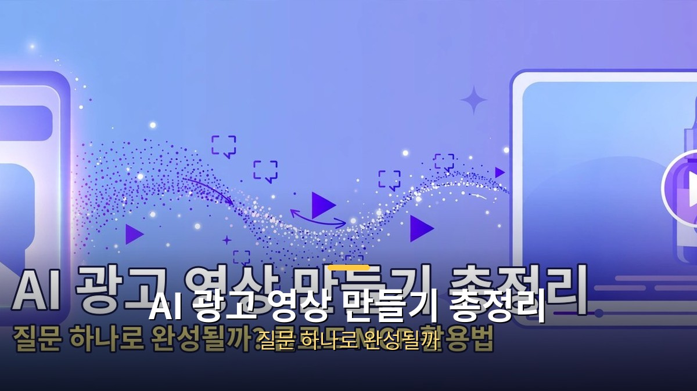
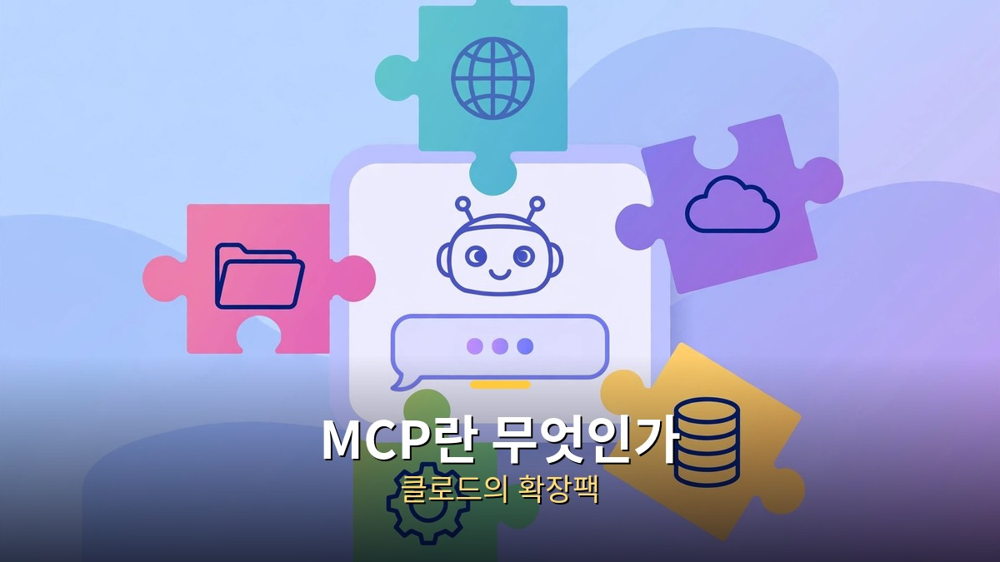
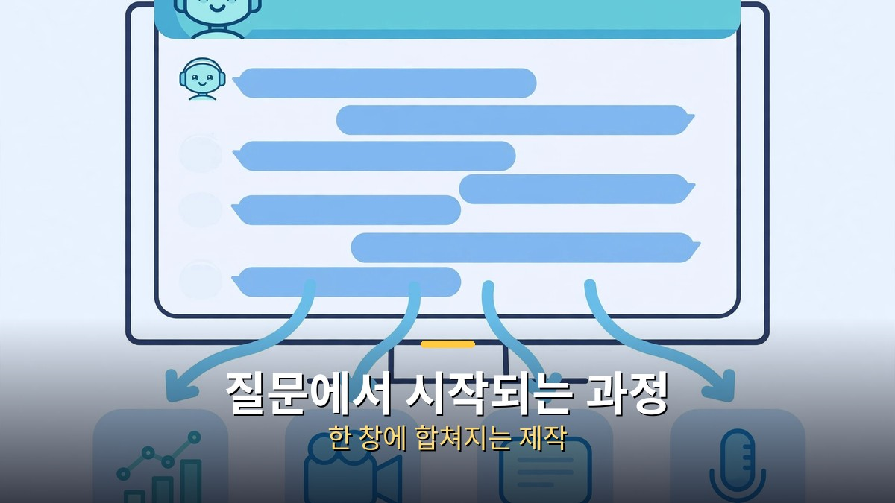
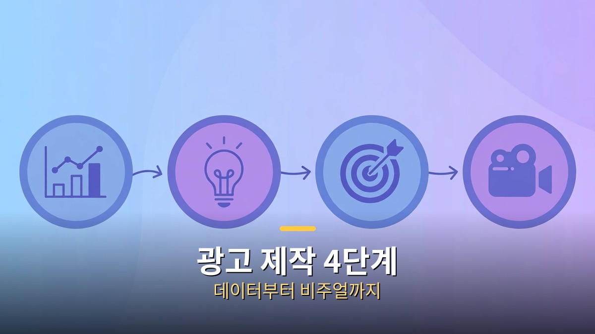

<!-- 본문 시작 -->

광고 영상 하나 만들려면 촬영팀, 편집자, 디자이너가 필요했던 시대가 있었습니다. 그런데 이제 "요즘 틱톡샵에서 뭐가 잘 팔려?"라는 질문 하나로 시장조사부터 완성된 광고 영상까지 나오는 시대가 됐습니다.

비결은 클로드(Claude)에 'MCP'라는 확장 기능을 연결하는 것입니다. AI가 영상 제작 도구까지 직접 다루게 되면서, 사람은 고르기만 하면 되는 구조가 됐습니다.

이번 글에서는 MCP가 뭔지부터, 광고 제작 4단계가 어떻게 자동화되는지, 실제 도구인 탑뷰와 힉스필드의 활용법과 주의점까지 살펴보겠습니다.

## MCP란? 클로드의 확장팩

클로드에 MCP 확장 모듈이 연결되는 모습.

먼저 용어 정리부터 하겠습니다. '클로드(Claude)'는 앤트로픽의 AI 챗봇이고, 'MCP(Model Context Protocol)'는 AI에 외부 도구를 연결하는 표준 규격입니다. 쉽게 말해 클로드가 본체, MCP가 꽂는 확장팩입니다.

원래 클로드는 글만 쓸 수 있었지만, MCP를 연결하면 영상 제작 도구까지 직접 다룰 수 있게 됩니다. 채팅창에서 "이 MCP를 로컬에 설치하고 로그인 가이드를 알려줘"라는 지시와 URL 하나로 연결이 끝난다고 합니다.

## 질문 하나로 시작되는 광고 제작 과정

채팅 질문이 데이터, 영상, 자막, 음성 결과물로 이어지는 흐름.

기존에 AI 광고 영상을 만들려면 시장조사는 한 사이트에서, 이미지 생성은 다른 도구에서, 영상 편집은 또 다른 프로그램에서 하는 식으로 5~7개 도구를 오가야 했습니다. MCP를 연결하면 이 과정이 하나의 채팅창으로 합쳐집니다.

대표적인 예가 광고 영상 특화 MCP인 '탑뷰(Topview)'입니다. 클로드에 탑뷰 MCP를 연결한 뒤 "요즘 틱톡샵에서 뭐가 잘 팔려?"라고 묻는 것부터 시작합니다. 그러면 AI가 실시간 판매 데이터를 조회하고, 상품을 고르고, 기획안을 짜고, 이미지를 만들고, 8초짜리 영상을 생성하고, 자막, AI 목소리, 립싱크까지 붙여줍니다. 사람이 한 일은 고르는 것뿐이라는 설명입니다.

## 광고 제작 4단계 뜯어보기

데이터, 인사이트, 전략, 비주얼 4단계 인포그래픽.

이 방식의 뼈대는 광고 제작 4단계입니다.

1. 데이터: 틱톡샵, 아마존의 실시간 판매 데이터 조회
2. 인사이트: 데이터에서 팔리는 패턴 도출 (예: 숏폼 콘텐츠 비중 72.9%)
3. 전략: K-뷰티 멀티밤 같은 구체 상품의 기획안 도출
4. 비주얼: 이미지에서 영상, 자막, 보이스, 립싱크 자동 생성

'탑뷰 캔버스'라는 화면에서는 프롬프트를 포함한 전 과정을 한눈에 볼 수 있습니다.

## 탑뷰 vs 힉스필드, 뭐가 다를까

비슷한 계열로 '힉스필드(Higgsfield)' MCP도 있습니다. 클로드 오푸스 5.5와 연결해 제품 사진 한 장으로 UGC 광고, 언박싱, 리뷰 영상 등 캠페인 전체를 기획하고 생성하는 워크플로우가 시연됐습니다.

차이점을 정리하면 이렇습니다.

- 탑뷰: 시장조사부터 영상 완성까지 한 번에 이어지는 올인원형. "뭐가 잘 팔려?"라는 질문에서 시작하는 탐색형 제작에 강합니다.
- 힉스필드: 제품 사진 한 장을 출발점으로 캠페인 전체를 기획하는 제품 중심형. 제품의 외형이 영상 내내 일관되게 유지되도록 '하지 말아야 할 것'(지원하지 않는 주장 금지, 포장 임의 변경 금지 등)을 프롬프트에 명시하는 게 요령으로 소개됩니다.

## 크레딧 낭비 막는 실전 요령

MCP 기반 영상 생성은 대부분 크레딧(유료 이용권) 방식이라, 막 돌리면 비용이 금방 쌓입니다. 낭비를 막는 순서가 있습니다.

1. 생성 전에 예상 사용량을 먼저 확인한다
2. 첫 영상을 보고 방향을 확정한 뒤 나머지를 만든다
3. 프롬프트에 금지 사항을 명시해 재생성을 줄인다

"일단 만들고 보자"가 아니라 "방향을 정하고 만들자"가 핵심입니다.

## 그래서 나한테 무슨 의미야

광고 영상 제작의 진입장벽이 무너지고 있습니다. 촬영팀, 편집자 없이도 1인 사업자나 크리에이터가 "무엇을 팔지"라는 질문부터 "완성된 광고"까지 혼자 처리할 수 있는 길이 열린 것입니다.

물론 AI가 만든 영상을 그대로 광고에 쓰기 전에는 제품 정보의 정확성과 과장 표현 여부를 사람이 검수해야 합니다. 도구는 빨라졌지만, 최종 책임은 여전히 사람의 몫입니다.

"MCP를 연결했더니 클로드가 영상 PD가 됐다"는 말이 과장이 아닌 시대입니다. 시장조사, 기획, 제작이 한 창에 들어오면서, 아이디어가 곧 결과물이 되는 거리가 그 어느 때보다 짧아졌습니다.

## 자주 묻는 질문

**Q. MCP가 뭔가요?**
A. Model Context Protocol의 약자로, AI에 외부 도구를 연결하는 표준 규격입니다. 클로드에 MCP를 연결하면 채팅창에서 영상 제작 같은 외부 작업을 직접 시킬 수 있습니다.

**Q. 코딩을 몰라도 쓸 수 있나요?**
A. 네. "이 MCP를 설치하고 로그인 가이드를 알려줘" 같은 말로 지시하면 AI가 안내해줍니다. 다만 크레딧(유료 이용권) 개념은 알아두는 게 좋습니다.

**Q. 만든 영상을 바로 광고에 써도 되나요?**
A. 제품 정보가 정확한지, 과장 표현은 없는지 사람이 검수한 뒤에 쓰세요. AI 생성물은 최종 책임이 사람에게 있습니다.

**Q. 비용은 얼마나 드나요?**
A. 도구마다 다른 크레딧 방식을 씁니다. 생성 전 예상 사용량을 확인하고, 첫 영상으로 방향을 확정한 뒤 나머지를 만드는 게 낭비를 줄이는 요령입니다.

<!-- 본문 끝 -->

## 작업용 출처·이미지 정보 (업로드 제외)

- 자료 출처: 로컬 초안 drafts/2026-10-09/draft5_aivideo_v2.md 기준 복원 (윤문 없음, 목차·연관글 제외, 이미지 마커 전환)
- 이미지: images/01-hero.jpg ~ 04-img3.jpg / 기존 베이스 일러스트 + 배너 가공 (1200x675) / 사용권: 자작
