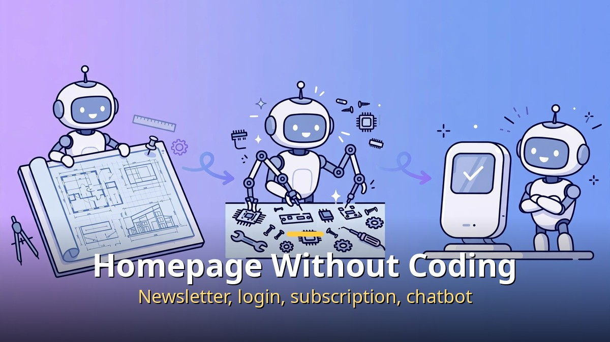
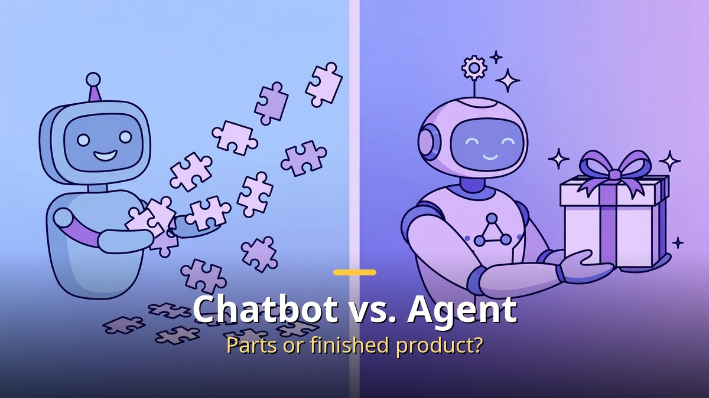
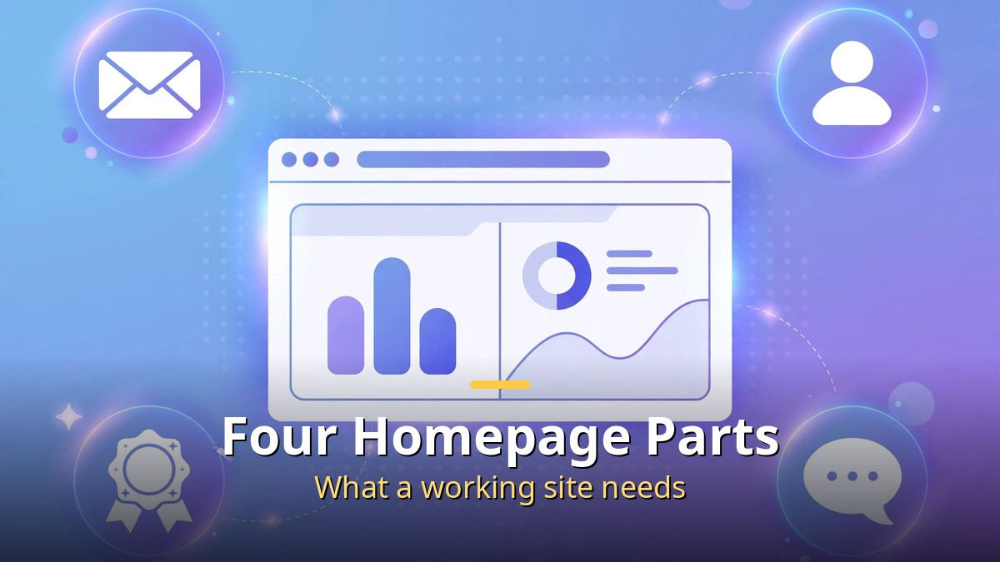
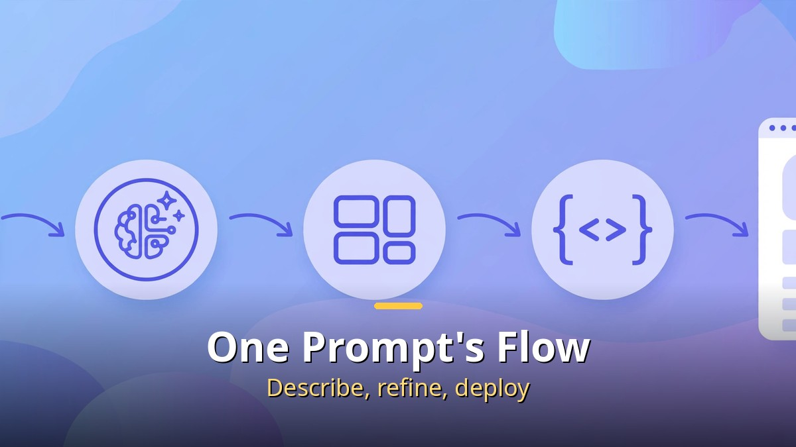

<!-- 본문 시작 -->

" I want a homepage, but I can't code and hiring is expensive." That is the worry of many solo founders and small shop owners. Now a single sentence — "Make me a homepage with newsletter signup and login" — can produce a site that actually runs. The star is the autonomous AI agent Manus. This article explains what Manus is, how it differs from a chatbot, whether a homepage really gets built, and what it costs.

## What Is Manus? An AI That Works From a Goal

Manus is an "autonomous AI agent." Unlike ChatGPT, which answers questions, it takes a goal, makes its own plan, browses the web, runs code, and delivers a finished product. Ask it to "research 50 competitors and make a report," and it actually opens a browser, visits 50 sites, pulls the material, and completes the document. You assign and review; it executes.

The secret is a cloud virtual environment. Manus keeps a "working room" — browser, files, and code execution — alive throughout the job. Work continues even if you close the app. You can also watch its computer screen in real time, so you can see transparently what it is doing.

## How Does It Differ From a Chatbot? Agent vs. Assistant

If a chatbot hands you the parts, an agent hands you the finished product.

In one sentence: "ChatGPT gives you parts to assemble; Manus gives you the finished product." Ask a chatbot for a report and you get an outline, then content, then a table — you must direct each step. Manus handles planning, research, analysis, writing, and packaging from a single goal on its own.

Of course, it is not free. The price of autonomy is "credits." Complex jobs eat many credits and can blow past the daily free allowance. Simple questions are faster and cheaper with a chatbot; multi-step work is where an agent earns its keep. Choose by the job.

## What Does One Homepage Include? Newsletter, Login, Subscription, Chatbot

A newsletter, login, subscription, and AI chatbot for real operation, all at once.

Manus's "web app builder" builds a real site. Not just HTML looks, but a working site with a database, user authentication, and payment connections. For example, this set comes together at once.

- Newsletter: a newsletter page with a signup form and mailing list
- Login: a member system with email, Google, and GitHub login
- Subscription: a membership structure connected to paid subscription payments
- AI chatbot: a customer-service chatbot embedded in the site

Work once split among a designer, front-end developer, back-end developer, and database manager now starts from a single prompt. That is why people call the finish "insane."

## How Is It Actually Built? The Magic of a One-Line Prompt

One prompt line leads through design, coding, and deployment.

The flow goes like this. ① Describe the site you want in a sentence. "A homepage for a coffee subscription newsletter, with signup and a back-issue view, please." ② Manus shows its work plan. ③ It designs, codes, builds the database, attaches login, and deploys. ④ You receive a finished link, check it, and refine it with instructions like "change the color."

One caution: visual finish needs refinement. The AI's first draft is rarely the final design. Repeating "try it in this mood" a few times is normal. Still, it is a different world from starting from a blank screen.

## Pricing and Limits: How Far Does Free Go?

Manus has a free plan. 300 credits refresh daily, enough for roughly one light project a day for free. Paid plans start at $20 a month. Team plans add $20 per seat with a shared credit pool.

Know the limits too. Complex jobs burn credits fast. Sites behind paywalls or captchas cannot be entered. Heavy traffic can make it unstable. And above all, code, contracts, and payment connections the AI makes need a human check. Working and working well are different things.

## Who Is It For? A Weapon for Solo Founders

It shines brightest for solo founders and side projects. Landing pages to test an idea, newsletter-based memberships, simple booking or ordering sites — uses where you want to "ship fast and watch the reaction." It fits exactly between "too early to hire a developer" and "no-code tools fall short on features."

Conversely, services needing bank-grade security or complex regulation are still too early. Manus is a tool of speed, not a guarantee of trust. Deciding where to use it is ultimately the human's job.

## Closing

In one line: beyond an AI that talks well, an AI that finishes the job has arrived, and Manus, as its leading example, has sharply lowered the bar for homepage building. Newsletter, login, subscription, and chatbot now start from a single prompt line. Since you can start free, why not pull out that shelved site idea this weekend?

## Frequently Asked Questions

**Q. What is Manus?**
A. An autonomous AI agent that plans and executes from a goal to deliver a finished product. It handles multi-step work like web research, coding, and document writing on its own.

**Q. Can a homepage really be built without coding?**
A. Yes — a prompt directs design, coding, database, and deployment through Manus. Visual refinement and final review are still best done by a person.

**Q. Can I use it for free?**
A. A free plan provides 300 credits a day, enough to try light projects daily for free. Serious use starts with paid plans from $20 a month.

**Q. How is it different from ChatGPT?**
A. ChatGPT is conversational and needs direction at each step; Manus autonomously carries out the whole process from one goal. Simple questions suit ChatGPT; complex execution suits Manus.

<!-- 본문 끝 -->

## 작업용 출처·이미지 정보 (업로드 제외)

- Source: 로컬 초안 drafts/2026-10-10/draft5_manus.md 기준 복원 (윤문 없음, 목차·연관글 제외, 이미지 마커 전환)
- Images: images/01-hero-en.jpg ~ 04-img3-en.jpg / existing base illustration + English banner overlay (1200x675) / license: original
