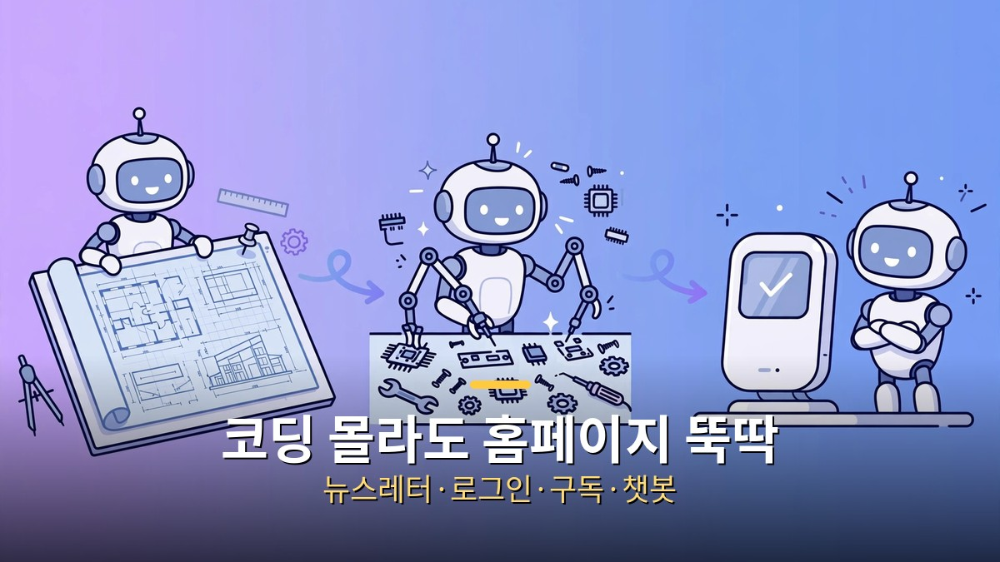
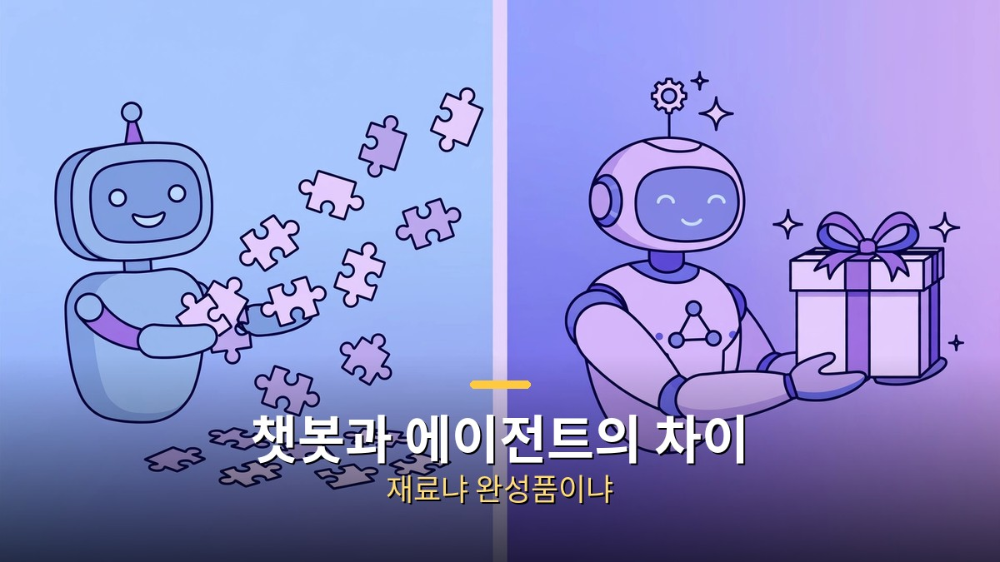
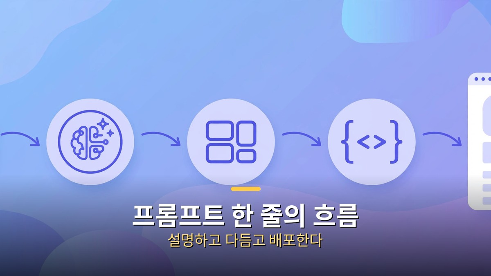

<!-- 본문 시작 -->

"홈페이지 하나 만들고 싶은데, 코딩은 못 하고 외주는 비싸고." 많은 1인 창업자와 자영업자의 고민입니다. 그런데 이제 "뉴스레터 구독이랑 로그인 되는 홈페이지 만들어줘"라는 한 마디로 실제 운영 가능한 사이트가 뚝딱 나오는 시대가 됐습니다. 주인공은 자율 AI 에이전트 'Manus(마누스)'입니다. 이번 글에서는 Manus가 뭔지, 챗봇과 뭐가 다른지, 진짜로 홈페이지가 만들어지는지, 비용은 얼마인지 정리해 보겠습니다.

## Manus가 뭐야? 목표를 주면 알아서 일하는 AI

Manus는 '자율 AI 에이전트'입니다. 챗GPT처럼 질문에 답하는 게 아니라, 목표를 주면 스스로 계획을 세우고 웹을 뒤지고 코드를 돌려 완성품을 내놓습니다. "경쟁사 50곳을 조사해 보고서로 만들어줘"라고 하면, 실제로 브라우저를 열어 50곳을 방문하고 자료를 뽑아 문서를 완성합니다. 당신은 시키고, 결과물을 검수하는 역할이 됩니다.

이게 가능한 비결은 클라우드 가상 환경입니다. Manus는 작업 내내 브라우저·파일·코드 실행 상태를 유지하는 '일하는 방'을 갖고 있습니다. 앱을 꺼도 작업이 계속됩니다. Manus의 컴퓨터 화면을 실시간으로 볼 수도 있어서, 뭘 하고 있는지 투명하게 확인할 수 있습니다.

## 챗봇이랑 뭐가 달라? 에이전트 vs 어시스턴트

챗봇이 재료를 건네준다면, 에이전트는 완성품을 건네줍니다.

차이를 한 문장으로 줄이면 이렇습니다. "챗GPT는 조립할 부품을 주고, Manus는 완성품을 준다." 챗봇에게 보고서를 부탁하면 목차를 받고, 내용을 받고, 표를 받는 식으로 단계마다 당신이 시켜야 합니다. Manus는 목표 하나에 계획 수립부터 자료 수집·분석·문서 작성·포장까지 혼자 해냅니다.

물론 공짜는 아닙니다. 자율성의 대가는 '크레딧'입니다. 복잡한 작업은 크레딧을 많이 먹고, 하루 무료 할당량을 훌쩍 넘길 수 있습니다. 간단한 질문은 챗봇이 더 빠르고 싸고, 여러 단계가 엮인 일은 에이전트가 제값을 합니다. 용도에 따라 골라 쓰는 게 정답입니다.

## 홈페이지 하나면 뭐가 되는데? 뉴스레터·로그인·구독·챗봇

실제 운영에 필요한 뉴스레터·로그인·구독·AI 챗봇을 한 번에 만들 수 있습니다.

Manus의 '웹 앱 빌더' 기능은 진짜 사이트를 만듭니다. 겉모습 HTML만이 아니라 데이터베이스·사용자 인증·결제 연동까지 되는 '돌아가는' 사이트입니다. 예를 들어 이런 구성이 한 번에 됩니다.

- 뉴스레터: 구독 폼과 발송 목록이 붙은 뉴스레터 페이지
- 로그인: 이메일·구글·깃허브 로그인이 되는 회원 시스템
- 구독: 유료 구독 결제가 연결된 멤버십 구조
- AI 챗봇: 사이트 안에 박힌 고객 응대 챗봇

예전엔 디자이너·프론트엔드·백엔드·DB 관리자가 나눠 하던 일을 프롬프트 한 줄이 시작합니다. "완성도 미쳤다"는 평가가 나오는 이유입니다.

## 실제로 어떻게 만들어? 프롬프트 한 줄의 마법

프롬프트 한 줄로 디자인·코딩·배포까지 이어집니다.

흐름은 이렇습니다. ① 만들고 싶은 사이트를 문장으로 설명합니다. "커피 구독 뉴스레터를 위한 홈페이지, 구독 신청이랑 지난호 보기가 됐으면 좋겠어." ② Manus가 작업 계획을 보여줍니다. ③ 디자인을 뽑고, 코드를 짜고, 데이터베이스를 만들고, 로그인을 붙이고, 배포까지 합니다. ④ 완성된 링크를 받아 확인하고, "색을 바꿔줘"처럼 다듬기를 지시합니다.

주의할 점도 있습니다. 시각적 완성도는 다듬기가 필요합니다. AI가 뽑은 첫 시안이 곧 최종 디자인은 아닙니다. "이 느낌으로 다시"를 몇 번 반복하는 게 보통입니다. 그래도 빈 화면에서 시작하는 것과는 차원이 다릅니다.

## 요금제와 한계, 공짜로 어디까지 되나

Manus는 무료 플랜이 있습니다. 하루 300크레딧이 새로고침되고, 가벼운 프로젝트 하나 정도는 매일 무료로 돌릴 수 있는 수준입니다. 유료 플랜은 월 20달러부터 시작합니다. 팀 플랜은 좌석당 월 20달러에 공용 크레딧 풀을 씁니다.

한계도 알아둬야 합니다. 복잡한 작업은 크레딧을 빠르게 태웁니다. 유료 벽 뒤의 사이트나 캡차가 있는 곳은 못 들어갑니다. 트래픽이 몰리면 불안정할 때도 있습니다. 그리고 무엇보다, AI가 만든 코드·계약서·결제 연동은 사람이 한 번씩 검수해야 합니다. 돌아가는 것과 잘 돌아가는 것은 다릅니다.

## 이런 사람에게 추천, 1인 창업의 무기

가장 빛을 보는 곳은 1인 창업과 사이드 프로젝트입니다. 아이디어 검증용 랜딩 페이지, 뉴스레터 기반 멤버십, 간단한 예약·주문 사이트처럼 "빨리 내놓고 반응을 보는" 용도에 최적입니다. 개발자를 고용하기엔 이르고, 노코드로 하기엔 기능이 모자란 그 사이 어딘가 말입니다.

반대로 은행급 보안이나 복잡한 규제가 걸린 서비스라면 아직 이릅니다. Manus는 속도의 도구이지, 신뢰의 보증서가 아닙니다. 어디에 쓸지 정하는 건 결국 사람의 몫입니다.

## 마무리

Manus를 한 줄로 정리하면 이렇습니다. 말을 잘하는 AI를 넘어, 일을 끝내주는 AI가 왔고, 그 대표 주자로 Manus가 홈페이지 제작의 문턱을 확 낮췄습니다. 뉴스레터·로그인·구독·챗봇이 프롬프트 한 줄에서 시작되는 시대입니다. 무료로 시작해 볼 수 있으니, 미뤄뒀던 그 사이트 아이디어를 이번 주말에 한 번 꺼내 보시는 건 어떨까요.

## 자주 묻는 질문

**Q. Manus가 뭔가요?**
A. 목표를 주면 스스로 계획하고 실행해 완성품을 내놓는 자율 AI 에이전트입니다. 웹 조사·코딩·문서 작성 같은 여러 단계 작업을 혼자 해냅니다.

**Q. 정말 코딩 없이 홈페이지가 만들어지나요?**
A. 네, 프롬프트로 지시하면 디자인·코딩·데이터베이스·배포까지 Manus가 처리합니다. 다만 시각적 다듬기와 최종 검수는 사람이 하는 게 좋습니다.

**Q. 무료로 쓸 수 있나요?**
A. 하루 300크레딧이 제공되는 무료 플랜이 있어 가벼운 프로젝트는 매일 무료로 시도할 수 있습니다. 본격적으로 쓰려면 월 20달러부터인 유료 플랜이 있습니다.

**Q. 챗GPT와 뭐가 다른가요?**
A. 챗GPT는 대화형으로 단계마다 지시가 필요하고, Manus는 목표 하나에 전 과정을 자율 수행합니다. 간단한 질문은 챗GPT가, 복잡한 실행은 Manus가 유리합니다.

<!-- 본문 끝 -->

## 작업용 출처·이미지 정보 (업로드 제외)

- 자료 출처: 로컬 초안 drafts/2026-10-10/draft5_manus.md 기준 복원 (윤문 없음, 목차·연관글 제외, 이미지 마커 전환)
- 이미지: images/01-hero.jpg ~ 04-img3.jpg / 기존 베이스 일러스트 + 배너 가공 (1200x675) / 사용권: 자작
