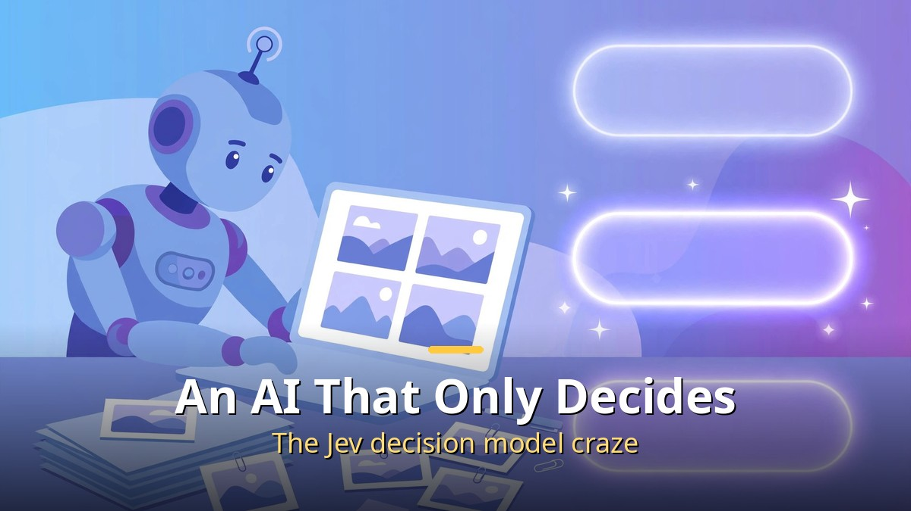
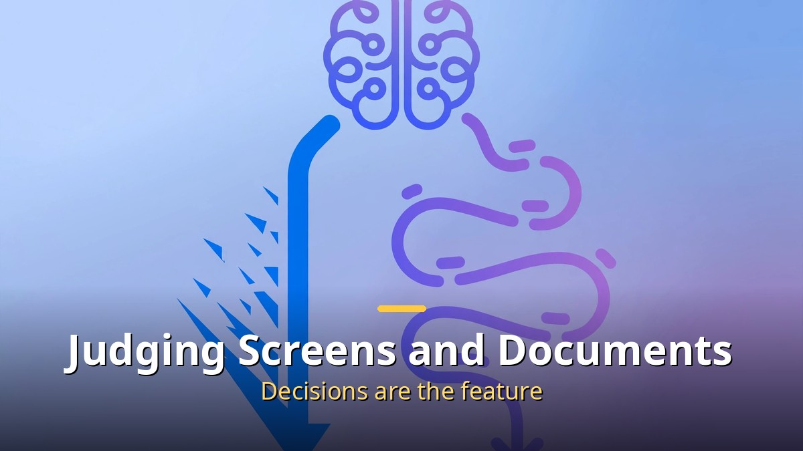
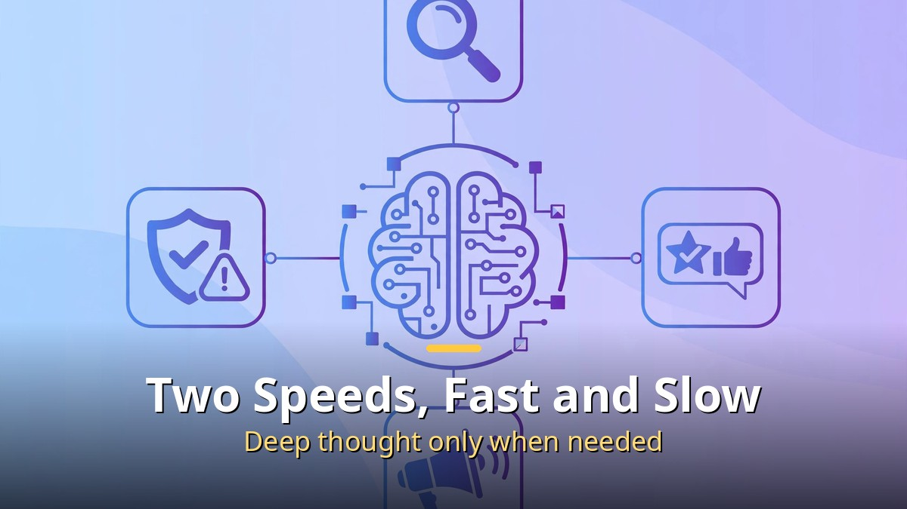
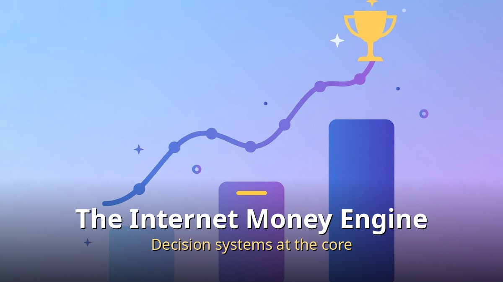

<!-- 본문 시작 -->

## What Is Jev, and Why All the Fuss?

Easy ones at once, hard ones slowly. Judgments at two speeds.

Until now, AI model news was about writing longer or speaking smarter. This time the story is different. An AI that does not write but makes decisions has shaken the developer community. Its name is Jev, from AutoTrust, an applied AI lab based in Singapore.

Its flagship model, JEV-27B-VL, is a visual decision model that looks at screens, images, and documents and judges. GEV-26B-Decide is a reasoning model handling text and images together. The 27B means 27 billion parameters — mid-sized for a large model.

The trigger for the buzz is clear. As of October 8, 2026, JEV-27B-VL ranked first and GEV-26B-Decide third on Hugging Face's global trending list. On AutoTrust's own public benchmark, the Jev Decision Index, the vision section scored 69.82, first place, more than 6 points above second. But remember that this score is the company's own self-report.

## What Is a Decision Model? How Is It Different from Writing AI?

Behind the internet's money-making engine is actually a decision system.

A decision model, literally, is a model that makes decisions. While generative AI like ChatGPT specializes in writing paragraphs, a decision model reads screens, images, documents, and records and returns a probability for each possible choice. For example, looking at a shopping screen, it might judge a 92% chance of clicking buy versus 7% for adding to cart.

The core idea borrows from psychologist Daniel Kahneman's fast and slow thinking. Easy judgments finish in a single pass (System 1); only ambiguous cases are worked through step by step (System 2). Like driving a familiar road without thinking and switching on navigation only in an unfamiliar alley. Expensive reasoning is used only when saved, so both speed and cost are controlled.

## Where Is It Used? The Real Engine Behind Internet Money

AutoTrust's chairman put it strikingly: if language models taught AI to write, the bigger commercial opportunity is teaching AI to decide. Search, recommendations, advertising, fraud detection — the internet's best money-making businesses are, in fact, giant decision systems.

Today such systems are stitched together from many narrow models. They cost a lot to maintain and adapt slowly. If a single model that looks at a screen and scores every choice with probabilities within milliseconds can replace them, it would be far more efficient than today's large-language-model deployments. It also pairs well with computer-use features, where AI agents look at screens and click and type.

## Why the Attention Now? Open Source as a Weapon

On October 8, 2026, it topped Hugging Face's global trending list.

The Jev series was released as open weights. Anyone can download and use it, and core components (adapters, decision heads, calibration files) were released under the Apache 2.0 license. One month's 2.98 million downloads mean developers are actually trying it by hand.

The lineup is also organized by use: JEV-27B-VL for screens, documents, and cameras (about 1.53 million downloads), GEV-26B-Decide for fast-and-slow reasoning (about 900,000), and the lightweight JEV-9B (about 320,000). Shopping, settings, and email screen demos, plus a robot-arm simulation, showed visually what can be built with it — and that worked.

## What Does It Mean for Me? Apps Quietly Getting Smarter

For ordinary users, the decision model reads like this: the apps and websites you use will evolve beyond speaking better toward judging better. Spam classification gets more accurate, recommendations fit taste better, scam-message detection gets faster.

There is also cost. A structure that uses expensive reasoning only when necessary can lower AI service operating costs, leaving room for more free or low-cost AI features. It sounds like news wrapped in technical jargon, but in the end it comes down to smarter and cheaper AI services.

## Limits Remain: Why You Should Not Take the Numbers at Face Value

A few things must be noted. First, the benchmark first-place score is AutoTrust's self-measurement. Hugging Face trending rank is attention, not performance. Second, whether the decision model layer truly becomes an independent market is not yet verified. It is the company's vision, not an industry consensus.

Third, judgment quality ultimately depends on data and calibration. Assigning probabilities means it can be wrong, and if that wrong judgment is used in money, medicine, or law, responsibility gets complicated. New technology needs both its rosy outlook and its limits in view.

## Conclusion

To sum up the Jev craze in one line: after writing AI, the next stage is deciding AI, and the open-source decision model Jev leads it. Hugging Face trending first place and 2.98 million monthly downloads show developer expectations. But performance figures are self-reported, and real services to come will decide the true contest. Now that the question has shifted from what AI can do to what we will let AI decide, this trend is worth watching.

## Frequently Asked Questions

Q. What is a decision model?
A. Instead of generating text, it looks at screens, documents, and images and assigns probabilities to possible actions, making a decision. It specializes in judgment work such as search, recommendations, advertising, and fraud detection.

Q. Who made it?
A. AutoTrust, an applied AI lab in Singapore, with an office in Silicon Valley too. It released the JEV and GEV series as open weights.

Q. Can I use it for free?
A. Model weights are public for anyone to download, and core components are under the Apache 2.0 license. But running them requires computing resources such as a GPU.

Q. How is it different from ChatGPT?
A. ChatGPT is strong at generation — writing sentences well — while decision models are strong at judgment — scoring choices. They are more likely to be used together than to compete.

<!-- 본문 끝 -->

## 작업용 출처·이미지 정보 (업로드 제외)

- 자료 출처: 로컬 초안 drafts/2026-10-10/draft1_jev.md 계열 복원 (윤문 없음, 목차·연관글 제외, 이미지 마커 전환)
- 이미지: images/01-hero-en.jpg ~ 04-img3-en.jpg / 기존 베이스 일러스트 + 영어 배너 오버레이 (1200x675) / 사용권: 자작
