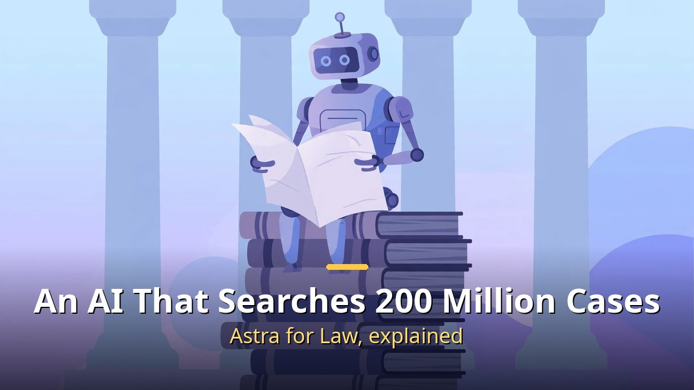
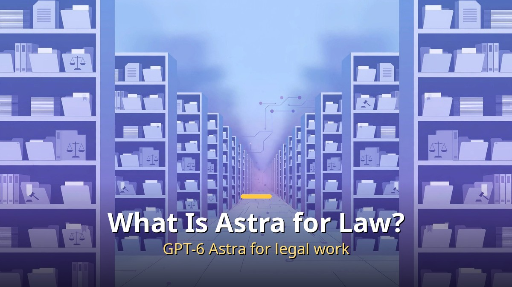
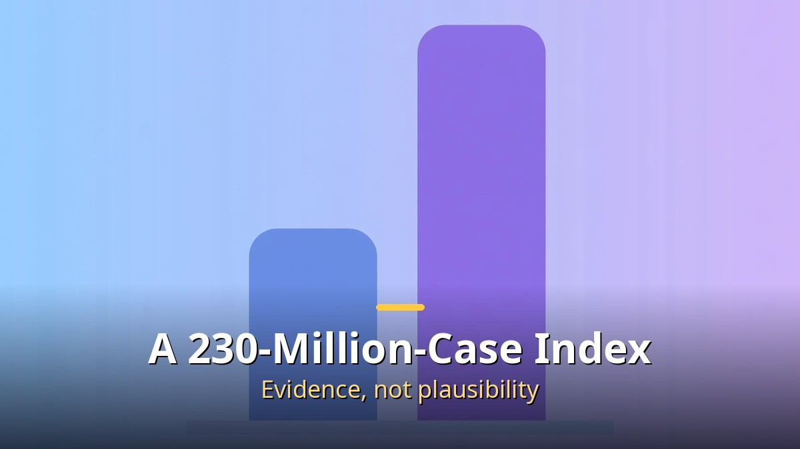
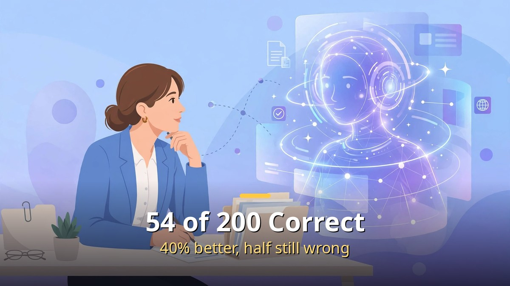

<!-- 본문 시작 -->

"Wouldn't it be convenient if AI gave legal advice?" You may have thought so. But law is one of the fields where AI must be most careful, because a plausible-sounding answer can cause real harm. On September 17, 2026, OpenAI took on this difficult homework head-on with a product called Astra for Law, a legal-specialized AI. This article looks at what it is, how well it performs, and how it may change the daily work of lawyers and ordinary people.

## What Is Astra for Law? A Legal-Specialized AI Arrives

Astra for Law is a version of GPT-6 Astra specialized for legal work.

Astra for Law is not a completely new model. It is a specialized version of OpenAI's latest model, GPT-6 Astra, with a legal search index and legal-work instructions layered on top. In ChatGPT it appears in the model list as "GPT-6 Astra Law," and it is planned to be released via API later.

Its core philosophy is "an answer with evidence, not a plausible answer." In law, a single invented case citation can ruin an actual lawsuit. So this product is designed on the premise of searching real cases and statutes before giving an answer.

## What Is Special? A Legal Search Index of 230 Million Cases

A legal search index covering 230 million US cases and statutes is the core.

Its biggest weapon is a US legal search index reaching 230 million URLs. It gathers federal and state cases, statutes, court rules, and administrative decisions, updated daily. The data source is CourtListener from the nonprofit Free Law Project, which reportedly covers 99.9% of published US cases.

If an analogy helps, it is like having a secretary beside you who has memorized the entire law section of every library in the country. Where an AI using general web search may "pretend to know," this one "opens the actual ruling and shows it," greatly reducing citation hallucination — inventing cases that do not exist.

## The Report Card: What 54 Correct Out of 200 Means

It answered 54 of 200 legal questions correctly — 40% better than a general model, but nearly half wrong.

OpenAI's headline was "40% improvement." The basis is this. On a 200-question legal research benchmark, Astra for Law scored 54.0%, while the same model using general web search scored 38.7%. Dividing 54 by 38.7 gives about 1.4 times — a 40% improvement.

But a more important number lies elsewhere. 54% means, flipped around, that 46 out of 100 were wrong. On case-search questions it found 24% more relevant cases, but nearly half still failed the bar. It is a transitional report card where "remarkable progress" and "cannot yet replace people" are true at the same time.

## Who Uses It, and How? A Product Built with Big Law Firms

This product was not built alone. It was developed with three major US law firms — Sullivan & Cromwell, Ropes & Gray, and Cooley. That means the evidence, outputs, and review procedures for legal research, contract review, and due diligence work were tuned to real practice.

Distribution is also cautious. At first it is offered to selected US firms through a "trusted access" program, usable inside ChatGPT and Codex. Twenty-six plugins connecting to legal data companies such as Thomson Reuters, Relativity, and Clio were released alongside it. A strategy of putting it first in verified hands.

## Will Lawyers Disappear? The Premise Is an Assistant Tool

The short answer is no. At least not now. In legal work, "who takes responsibility" matters as much as "the right answer." When AI finds cases and drafts documents, lawyers concentrate on review, judgment, and persuading clients — a division of labor.

OpenAI makes this point clearly. In high-stakes fields such as law, rules about the scope of use matter, and a person must stand before important decisions. The change is closer to lawyers' work shifting from "finding materials" to "making judgments."

## What About Ordinary People? If the Bar for Legal Services Lowers

For ordinary people, this news matters because of the price of legal services. Lawyer consultations are expensive, so many disputes are simply "endured and passed over." If case search and drafting are automated, the cost of legal services falls, and the benefit may reach consumers.

Of course, it is currently centered on US cases, so it is hard to apply directly in Korea. But if the same approach expands to Korean case and statute data, change could start in everyday legal areas such as lease disputes and labor consultations. Whether institutions move as fast as technology is the key question.

## Conclusion

In one line, Astra for Law is a legal experiment on the path from "plausible AI" to "evidence-based AI," with a score of 54 and a long way to go. But the fact that an AI secretary that searches 230 million cases has begun entering the practice of big law firms is itself a signal of change. Not an AI that replaces lawyers, but an AI that, borrowing lawyers' hands, lowers the bar for legal services. It is heading that way.

## Frequently Asked Questions

Q. What is Astra for Law?
A. A legal-specialized AI released by OpenAI on September 17, 2026. It combines GPT-6 Astra with a 230-million-case US legal search index and legal-work instructions.

Q. How accurate is it?
A. It scored 54.0% on 200 legal research questions. That is 40% better than a general model (38.7%), but nearly half are wrong, so human review is essential.

Q. Will lawyers become unnecessary?
A. No. AI assists with research and drafting, while final judgment and responsibility stay with lawyers, under a division-of-labor premise.

Q. Can it be used in Korea?
A. It is currently centered on US legal data and offered first to selected US firms. Expanding to Korean case data will take time.

<!-- 본문 끝 -->

## 작업용 출처·이미지 정보 (업로드 제외)

- 자료 출처: 로컬 초안 drafts/2026-10-10/draft3_astraforlaw.md 계열 복원 (윤문 없음, 이미지 마커 전환, 목차·연관글 제외)
- 이미지: images/01-hero-en.jpg ~ 04-img3-en.jpg / 기존 베이스 일러스트 + 영어 배너 오버레이 (1200x675) / 사용권: 자작
