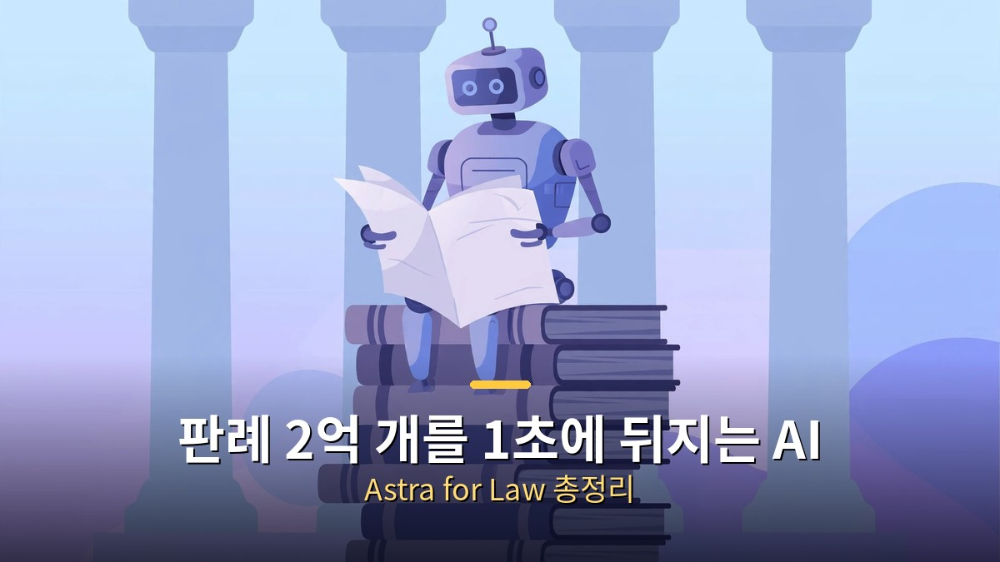
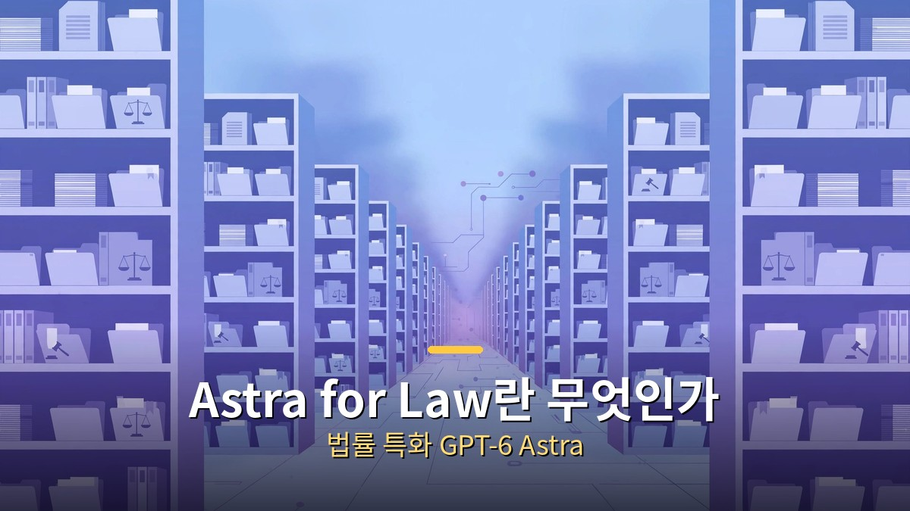
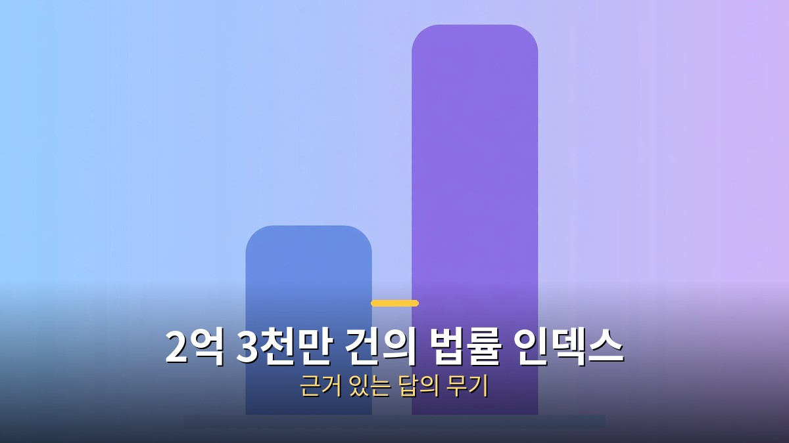

<!-- 본문 시작 -->

"AI가 법률 상담을 해 주면 얼마나 편할까?" 생각해 본 적 있으신가요? 그런데 법률은 AI가 가장 조심해야 할 분야 중 하나입니다. 그럴듯한 답이 실제 피해를 낳을 수 있기 때문입니다. 2026년 9월 17일, 오픈AI가 이 어려운 숙제에 정면으로 도전하는 제품을 내놨습니다. 이름은 'Astra for Law', 법률 특화 AI입니다. 이번 글에서는 이게 뭔지, 얼마나 잘하는지, 변호사와 우리의 일상을 어떻게 바꿀지 살펴보겠습니다.

## Astra for Law가 뭐야? 법률 특화 AI의 등장

Astra for Law는 법률 업무에 특화된 GPT-6 Astra 버전입니다.

Astra for Law는 완전히 새로운 모델이 아닙니다. 오픈AI의 최신 모델 GPT-6 Astra에 법률용 검색 인덱스와 법률 업무에 맞춘 지침을 얹은 '특화 버전'입니다. 챗GPT에서는 모델 선택 목록에 'GPT-6 Astra Law'로 뜨고, 나중에는 API로도 풀릴 예정입니다.

핵심 철학은 "그럴듯한 답이 아니라 근거 있는 답"입니다. 법률에서는 그럴듯하게 지어낸 판례 하나가 실제 소송을 망칠 수 있습니다. 그래서 이 제품은 답을 내놓기 전에 실제 판례·법령을 뒤지는 과정을 전제로 설계됐습니다.

## 뭐가 특별한데? 2억 3천만 건의 법률 검색 인덱스

미국 판례·법령 2억 3천만 건을 아우르는 법률 검색 인덱스가 핵심입니다.

가장 큰 무기는 2억 3천만 개 URL에 달하는 미국 법률 검색 인덱스입니다. 연방·주 판례, 법령, 법원 규칙, 행정 판정을 매일 갱신하며 모읍니다. 데이터 원천은 비영리 단체 프리로프로젝트의 코트리서너(CourtListener)로, 공개된 미국 판례의 99.9%를 커버한다고 합니다.

비유가 통한다면, 전국 도서관의 법률 코너를 통째로 외운 비서가 옆에 앉아 있는 셈입니다. 일반 웹 검색을 쓰는 AI가 "아는 척"할 때, 이쪽은 "실제 판결문을 펼쳐 보여"주는 방식이라 인용 날조(없는 판례를 지어내는 현상)가 크게 줄어듭니다.

## 성적표는? 200문제 중 54개 정답의 의미

법률 문제 200개 중 54개를 맞혔습니다. 일반 모델보다 40% 낫지만 절반은 틀립니다.

오픈AI의 발표 헤드라인은 "40% 향상"이었습니다. 근거는 이렇습니다. 법률 리서치 벤치마크 200문제에서 Astra for Law는 54.0%를 맞혔고, 일반 웹 검색을 쓰는 같은 모델은 38.7%를 맞혔습니다. 54를 38.7로 나누면 약 1.4배, 즉 40% 향상이라는 계산입니다.

하지만 더 중요한 숫자는 따로 있습니다. 54%라는 건 뒤집으면 100개 중 46개는 틀렸다는 뜻입니다. 판례 검색 문제에서는 관련 판례를 24% 더 많이 찾아냈지만, 여전히 절반 가까이는 기준을 통과하지 못했습니다. "놀라운 진전"과 "아직 사람을 대신할 수 없음"이 동시에 참인, 과도기의 성적표입니다.

## 누가 어떻게 써? 대형 로펌과 함께 만든 제품

이 제품은 혼자 만든 게 아닙니다. 설리번앤크롬웰, 롭스앤그레이, 쿨리 같은 미국 대형 로펌 3곳과 함께 개발했습니다. 법률 리서치·계약 검토·실사 업무에 필요한 근와, 출력물, 검토 절차를 실제 업무에 맞춰 다듬었다는 뜻입니다.

제공 방식도 신중합니다. 처음에는 선별된 미국 로펌 대상 '트러스트 액세스' 프로그램으로, 챗GPT와 코덱스 안에서 쓸 수 있습니다. 톰슨로이터·렐러티비티·클리오 같은 법률 데이터 업체와 연결되는 플러그인 26종도 함께 나왔습니다. 검증된 손부터 쥐여주는 전략입니다.

## 변호사가 사라지는 거야? 보조 도구라는 전제

결론부터 말하면 아닙니다. 적어도 지금은요. 법률 업무는 "맞는 답"만큼 "누가 책임지나"가 중요합니다. AI가 판례를 찾아주고 초안을 써 주면 변호사는 검토·판단·의뢰인 설득에 집중하는 분업이 됩니다.

오픈AI도 이 점을 분명히 합니다. 법률처럼 stakes(걸린 것)가 큰 분야일수록 사용 범위 규칙이 중요하고, 중요한 결정 앞에는 사람이 서야 한다는 겁니다. 변호사의 일이 '자료 찾기'에서 '판단 내리기'로 옮겨가는 변화에 가깝습니다.

## 우리한테는? 법률 서비스의 문턱이 낮아진다면

일반인에게 이 소식이 의미 있는 이유는 법률 서비스의 가격 때문입니다. 변호사 상담은 비싸고, 그래서 많은 분쟁이 "그냥 참고 넘어"갑니다. 판례 검색과 초안 작성이 자동화되면 법률 서비스 원가가 내려가고, 그 혜택이 소비자에게 돌아올 여지가 생깁니다.

물론 지금은 미국 판례 중심이라 한국에 바로 적용되긴 어렵습니다. 하지만 한국 판례·법령 데이터로 같은 방식이 확장된다면, 전세 분쟁·노동 상담 같은 생활 법률 영역부터 변화가 시작될 수 있습니다. 기술보다 제도가 속도를 낼지가 관건입니다.

## 마무리

Astra for Law를 한 줄로 정리하면 이렇습니다. "그럴듯한 AI"에서 "근거 있는 AI"로 가는 법률판 실험이고, 성적은 54점으로 아직 갈 길이 멉니다. 하지만 2억 3천만 건의 판례를 뒤지는 AI 비서가 대형 로펌의 실무에 들어가기 시작했다는 사실 자체가 변화의 신호입니다. 변호사를 대체하는 AI가 아니라, 변호사의 손을 빌려 법률 서비스의 문턱을 낮추는 AI. 그 방향으로 가고 있습니다.

## 자주 묻는 질문

Q. Astra for Law가 뭔가요?
A. 오픈AI가 2026년 9월 17일에 내놓은 법률 특화 AI입니다. GPT-6 Astra에 미국 법률 2억 3천만 건 검색 인덱스와 법률 업무 지침을 결합한 제품입니다.

Q. 얼마나 정확한가요?
A. 법률 리서치 200문제에서 54.0%의 정답률을 기록했습니다. 일반 모델(38.7%)보다 40% 낫지만, 절반 가까이는 틀리므로 사람 검토가 필수입니다.

Q. 변호사가 필요 없어지나요?
A. 아닙니다. 자료 조사·초안 작성은 AI가 돕고, 최종 판단과 책임은 변호사가 지는 분업 구조가 전제입니다.

Q. 한국에서도 쓸 수 있나요?
A. 현재는 미국 법률 데이터 중심이고 선별된 미국 로펌부터 제공됩니다. 한국 판례 데이터로 확장되려면 시간이 필요합니다.

<!-- 본문 끝 -->

## 작업용 출처·이미지 정보 (업로드 제외)

- 자료 출처: 로컬 초안 drafts/2026-10-10/draft3_astraforlaw.md 계열 복원 (윤문 없음, 이미지 마커 전환, 목차·연관글 제외)
- 이미지: images/01-hero.jpg ~ 04-img3.jpg / 기존 베이스 일러스트 + 배너 가공 (1200x675) / 사용권: 자작
