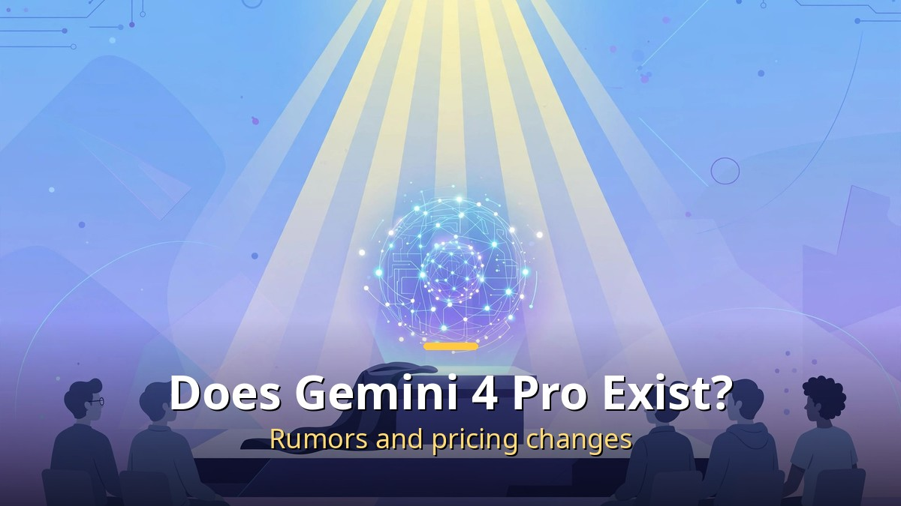
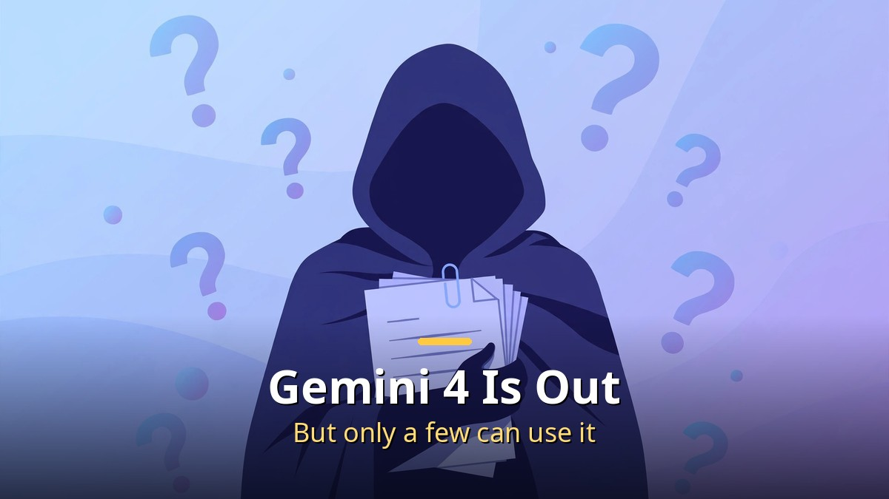
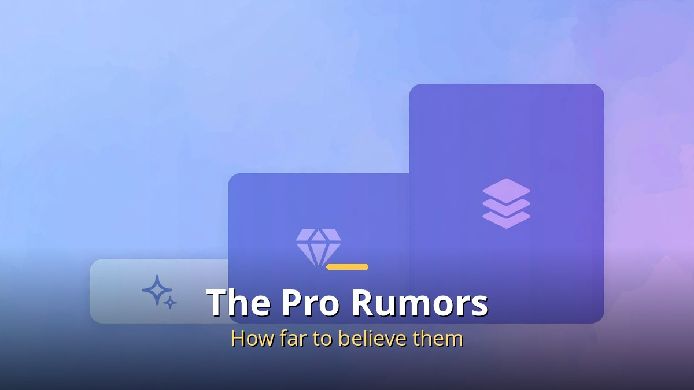
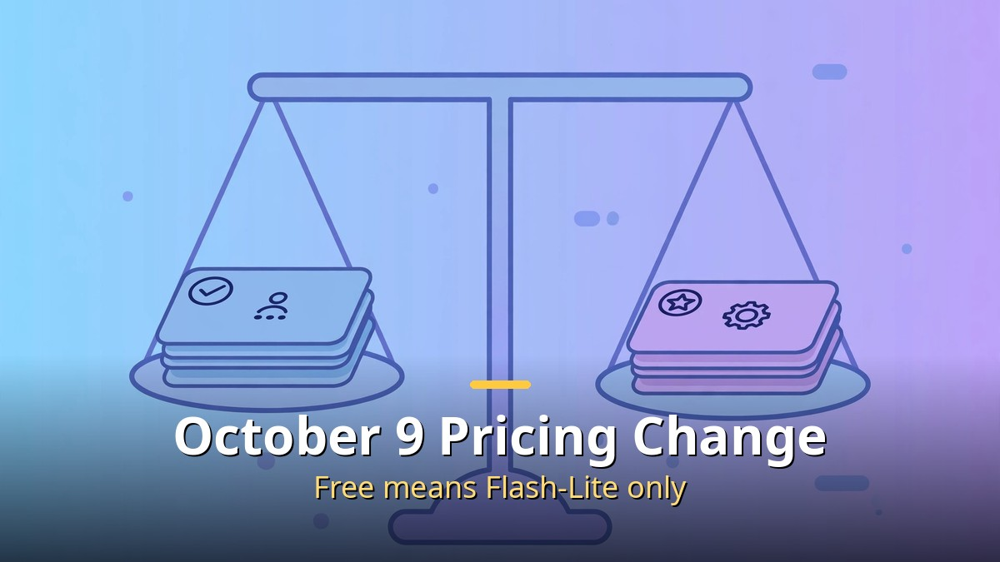

<!-- 본문 시작 -->

Google's next-generation AI, Gemini 4, has been announced, but almost no one can actually use it. On top of that, a name called "Gemini 4 Pro" is circulating as a rumor. Does it exist, or is it just a rumor? And since October 9, the models available for free have shrunk sharply. This article organizes the current state of Gemini 4, the truth about the Pro rumors, the pricing changes, and the "AI building AI" debate that flared up alongside them.

## Gemini 4 Is Out, But Only a Few Can Use It

Gemini 4 Argon was announced on September 30, 2026, but only a few can use it yet.

Google announced its next flagship model, Gemini 4 Argon, on September 30, 2026. It is a heavyweight model that can output one million tokens at once and hold onto complex work for a long time. Yet as of October 7, only cybersecurity experts and a small number of trusted testers could use it. Announced, but not yet publicly released.

This gap — "announced but unusable" — breeds rumors. As traces of pre-release testing leak out one by one, people piece them together and sketch the next picture.

## The "Pro" Rumors: How Far Should You Believe Them?

The leaked "Pro" information is still at the rumor stage, unconfirmed by Google.

The name "Gemini 4 Pro" has never been officially announced by Google. Leaked checkpoints and leaked benchmarks are circulating, but all of them are unofficial. Some leaked benchmarks claim to beat Opus 5.5 and GPT-6 Astra, but none of that has been verified.

The rule for reading rumors is simple. If the source is not "Google official," treat it as provisional. There have been plenty of cases where pre-release leaks differed from reality. Pro may exist, but right now there is no basis to assert that it does.

## The October 9 Pricing Change: Free Means Flash-Lite Only

Starting October 9, free accounts can use only Flash-Lite.

A more certain change than any rumor exists. On October 9, the model choices in the Gemini app shrank sharply. Free accounts without a subscription can use only Flash-Lite; Flash and Pro were blocked. The $4.99-per-month AI Plus plan also lost Pro, keeping only Flash-Lite and Flash.

To keep using Pro, you need AI Pro at $19.99 per month or higher. For people who often gave Gemini heavy work, the change is keenly felt. Google also said it measures usage by compute, not by prompt count. Longer, more complex questions consume more of the quota.

## Should You Subscribe? How to Choose a Plan

The standard is your usage pattern. For light questions, summaries, and translation, free Flash-Lite is often enough. If you often do heavy work — report writing, long document analysis, coding — AI Pro is worth considering. AI Plus was the middle step, but losing Pro reduced its appeal.

One tip. Google said it would email subscribers about the timing of changes, so AI Plus users should check their inboxes. Students should also check whether their school partnership offers a free benefit. (In August 2026, there was a free one-year offer for students.)

## The RSI Debate: Is the Era of AI Building AI Coming?

Alongside Gemini 4, the debate over recursive self-improvement (RSI) is heating up: the loop in which AI builds smarter AI. Geoffrey Hinton, often called a godfather of AI, urged a response within a year at the US Congress in September, saying AI is already designing better AI. Anthropic's CEO argued for slowing down, while Meta's CEO prescribed the opposite — putting more compute into RSI.

A reality check is needed. What has been proven is about "one loop." DeepMind's AlphaEvolve optimized a kernel used in Gemini training — an example of AI improving things around a model. But there is still no public evidence that a model has completely improved its own core. We need eyes that measure the distance between fear and reality.

## What to Watch: A Checklist for Rumor Season

Over the next few weeks, watch it this way. First, whether Google's official blog mentions "Gemini 4 Pro." Until an official announcement comes, it is a rumor. Second, when Argon expands from a few testers to general users. The speed of that expansion will indicate the next step. Third, how rival models respond on price and performance. Model wars always trigger chain reactions.

## Conclusion

In short: Gemini 4 Argon exists but belongs to a few so far, "Pro" is at the rumor stage, and the free plan effectively shrank on October 9. Layered on top is the RSI debate about AI building AI, making this a moment for guessing at "the next six months." Rather than being swayed by rumors, the surest response is to watch two things: official announcements and pricing emails.

## Frequently Asked Questions

Q. Has Gemini 4 Pro been released?
A. No. Google has never announced it, and the circulating information is unofficial leaks. What was announced on September 30 is Gemini 4 Argon, which only a few testers are using.

Q. What changed for free Gemini use?
A. Since October 9, free accounts can use only the Flash-Lite model. Flash and Pro are available only on subscription plans.

Q. How much is the AI Pro plan?
A. From $19.99 per month. It includes the Pro model and advanced reasoning options such as Deep Think. Prices may vary by market and promotion.

Q. What is RSI?
A. Short for recursive self-improvement: the loop in which AI builds smarter AI. Partial cases exist, but there is no evidence yet that complete self-improvement has occurred.

<!-- 본문 끝 -->

## 작업용 출처·이미지 정보 (업로드 제외)

- 자료 출처: 로컬 초안 drafts/2026-10-10/draft4_gemini4pro.md 계열 복원 (윤문 없음, 이미지 마커 전환, 목차·연관글 제외)
- 이미지: images/01-hero-en.jpg ~ 04-img3-en.jpg / 기존 베이스 일러스트 + 영어 배너 오버레이 (1200x675) / 사용권: 자작
