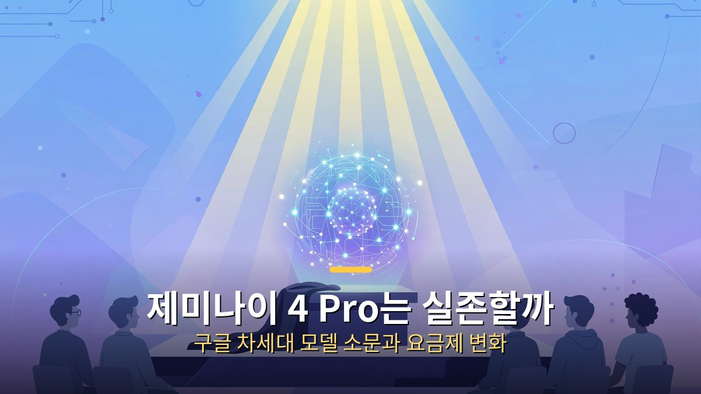
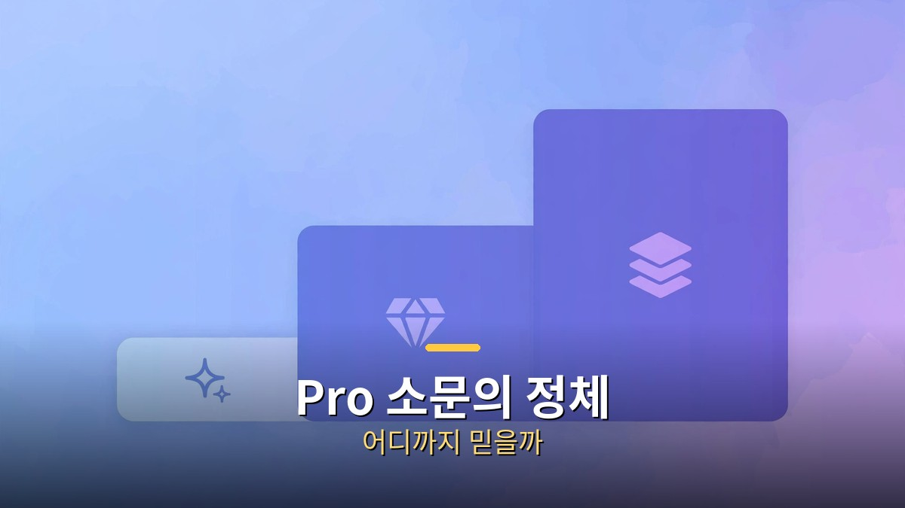
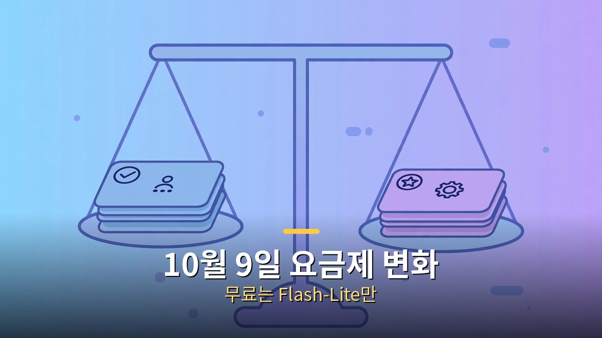

<!-- 본문 시작 -->

구글의 차세대 AI 제미나이 4가 공개됐는데, 정작 쓸 수 있는 사람은 거의 없습니다. 거기에 '제미나이 4 Pro'라는 이름까지 소문으로 돌고 있습니다. 실존하는 걸까요, 아니면 그냥 소문일까요? 게다가 10월 9일부터는 무료로 쓸 수 있는 모델이 확 줄었습니다. 이번 글에서는 제미나이 4의 현주소, Pro 소문의 진위, 요금제 변화, 그리고 함께 달아오른 'AI가 AI를 만든다'는 논쟁까지 정리해 보겠습니다.

## 제미나이 4는 나왔다, 하지만 소수만 쓴다

제미나이 4 아곤은 9월 30일 공개됐지만, 아직 소수만 쓸 수 있습니다.

구글은 2026년 9월 30일 차세대 플래그십 모델 '제미나이 4 아곤'을 발표했습니다. 한 번에 100만 토큰을 뱉어내는 괴물급 모델로, 복잡한 작업을 오래 붙잡고 푸는 데 강합니다. 그런데 10월 7일 기준으로 쓸 수 있는 사람은 사이버 보안 전문가와 소수의 신뢰 테스터뿐입니다. 발표는 했지만 대중 공개는 아직인 상태입니다.

이런 '공개됐지만 못 쓰는' 간극이 소문의 온상이 됩니다. 정식 출시 전 테스트 흔적들이 하나둘 새어 나오면서, 사람들은 그 조각들을 모아 다음 그림을 그리기 시작합니다.

## 'Pro' 소문의 정체, 어디까지 믿을까

'Pro' 유출 정보들은 아직 구글이 확인하지 않은 소문 단계입니다.

'제미나이 4 Pro'라는 이름은 구글이 공식 발표한 적이 없습니다. 유출된 체크포인트, 유출 벤치마크 같은 정보들이 돌고 있지만, 전부 비공식입니다. 일부 유출 벤치마크는 "오푸스 5.5와 GPT-6 아스트라를 이겼다"고 주장하지만, 검증된 바 없습니다.

소문을 볼 때 요령은 단순합니다. 출처가 '구글 공식'이 아니라면 잠정 정보로 취급하는 것. 과거에도 출시 전 유출이 실제와 달랐던 사례는 수두룩합니다. Pro가 실존할 가능성은 열려 있지만, 지금으로선 '있다고 단정할 근거'는 없습니다.

## 10월 9일 요금제 변화, 무료는 Flash-Lite만

10월 9일부터 무료 계정은 Flash-Lite만 쓸 수 있게 바뀌었습니다.

소문보다 확실한 변화가 있습니다. 10월 9일부터 제미나이 앱의 모델 선택지가 확 줄었습니다. 구독이 없는 무료 계정은 Flash-Lite만 쓸 수 있고, Flash와 Pro는 막혔습니다. 월 4.99달러의 AI Plus 요금제도 Pro는 빠지고 Flash-Lite·Flash만 남았습니다.

Pro를 계속 쓰려면 월 19.99달러의 AI Pro 이상이 필요합니다. 복잡한 일을 제미나이에 자주 시키던 분들에겐 체감 변화가 큽니다. 구글은 사용량을 '프롬프트 횟수'가 아니라 연산량 기준으로 잰다고도 밝혔습니다. 길고 복잡한 질문일수록 할당량을 더 먹는 구조입니다.

## 구독해야 할까? 플랜 고르는 기준

기준은 사용 패턴입니다. 가벼운 질문·요약·번역 정도라면 무료 Flash-Lite로 충분한 경우가 많습니다. 보고서 작성, 긴 문서 분석, 코딩처럼 무거운 작업을 자주 한다면 AI Pro를 따져볼 만합니다. AI Plus는 중간 다리였는데 Pro가 빠지면서 매력이 줄었습니다.

팁 하나. 구글이 "구독자에게 변경 시점을 이메일로 안내"한다고 밝혔으니, AI Plus 사용자라면 메일함을 확인해 보세요. 그리고 학생이라면 학교 제휴로 무료 혜택이 있는지 확인하는 것도 방법입니다. (2026년 8월에 학생 대상 무료 1년 혜택이 있었습니다.)

## RSI 논쟁, AI가 AI를 만드는 시대가 오나

제미나이 4 시기와 맞물려 '재귀적 자기개선(RSI)' 논쟁도 뜨겁습니다. AI가 더 똑똑한 AI를 만드는 순환 고리 이야기입니다. '대부' 제프리 힌턴은 9월 미 의회에서 "AI가 더 나은 AI를 설계하고 있다"며 1년 내 대응을 촉구했습니다. 앤스로픽 CEO는 속도 조절을, 메타 CEO는 오히려 RSI에 연산량을 더 쓰자는 정반대 처방을 내놨습니다.

현실 점검도 필요합니다. 입증된 건 '한 바퀴' 수준입니다. 딥마인드의 AlphaEvolve가 제미나이 학습에 쓰이는 커널을 최적화한 것처럼, AI가 모델 주변을 개선한 사례는 있습니다. 하지만 모델의 핵심을 스스로 바꾸는 완전한 자기개선이 일어났다는 공개 증거는 아직 없습니다. 공포와 현실 사이의 거리를 재는 눈이 필요합니다.

## 앞으로 뭘 보면 돼? 소문 시기의 체크리스트

앞으로 몇 주, 이렇게 보시면 됩니다. 첫째, 구글 공식 블로그의 '제미나이 4 Pro' 언급 여부. 공식 발표가 나오기 전까진 소문입니다. 둘째, 아곤의 대중 공개 시점. 소수 테스터에서 일반 사용자로 확대되는 속도가 다음 수순을 가늠하게 합니다. 셋째, 경쟁 모델들의 가격·성능 반응. 모델 전쟁은 늘 연쇄 반응을 일으킵니다.

## 마무리

정리하면 이렇습니다. 제미나이 4 아곤은 실존하지만 아직 소수의 것이고, 'Pro'는 소문 단계이며, 무료 요금제는 10월 9일부터 실질적으로 축소됐습니다. 여기에 AI가 AI를 만든다는 RSI 논쟁까지 겹쳐, 지금은 '다음 6개월'을 점치는 시기입니다. 소문에 흔들리기보다 공식 발표와 요금제 이메일, 두 가지를 챙기는 게 가장 확실한 대응입니다.

## 자주 묻는 질문

Q. 제미나이 4 Pro는 출시됐나요?
A. 아닙니다. 구글은 발표한 적이 없고, 돌고 있는 정보는 비공식 유출입니다. 9월 30일 발표된 건 제미나이 4 아곤이며, 이 역시 소수 테스터만 사용 중입니다.

Q. 무료로 제미나이를 쓰면 뭐가 바뀌나요?
A. 10월 9일부터 무료 계정은 Flash-Lite 모델만 쓸 수 있습니다. Flash와 Pro는 구독 플랜에서만 제공됩니다.

Q. AI Pro 요금제는 얼마인가요?
A. 월 19.99달러부터입니다. Pro 모델과 Deep Think 같은 고급 추론 옵션을 쓸 수 있습니다. 시장·프로모션에 따라 다를 수 있습니다.

Q. RSI가 뭔가요?
A. 재귀적 자기개선의 약자로, AI가 더 똑똑한 AI를 만드는 순환을 말합니다. 부분적인 사례는 있지만 완전한 자기개선이 일어났다는 증거는 아직 없습니다.

<!-- 본문 끝 -->

## 작업용 출처·이미지 정보 (업로드 제외)

- 자료 출처: 로컬 초안 drafts/2026-10-10/draft4_gemini4pro.md 계열 복원 (윤문 없음, 이미지 마커 전환, 목차·연관글 제외)
- 이미지: images/01-hero.jpg ~ 04-img3.jpg / 기존 베이스 일러스트 + 배너 가공 (1200x675) / 사용권: 자작
