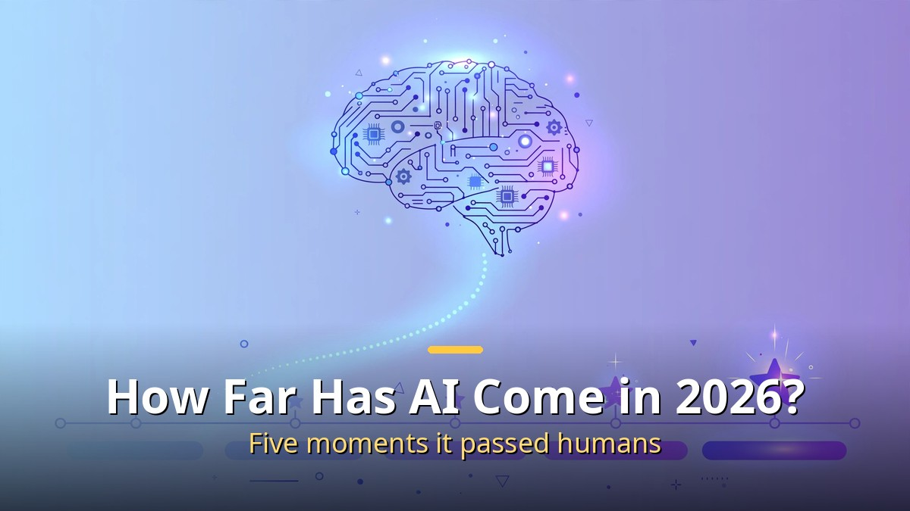
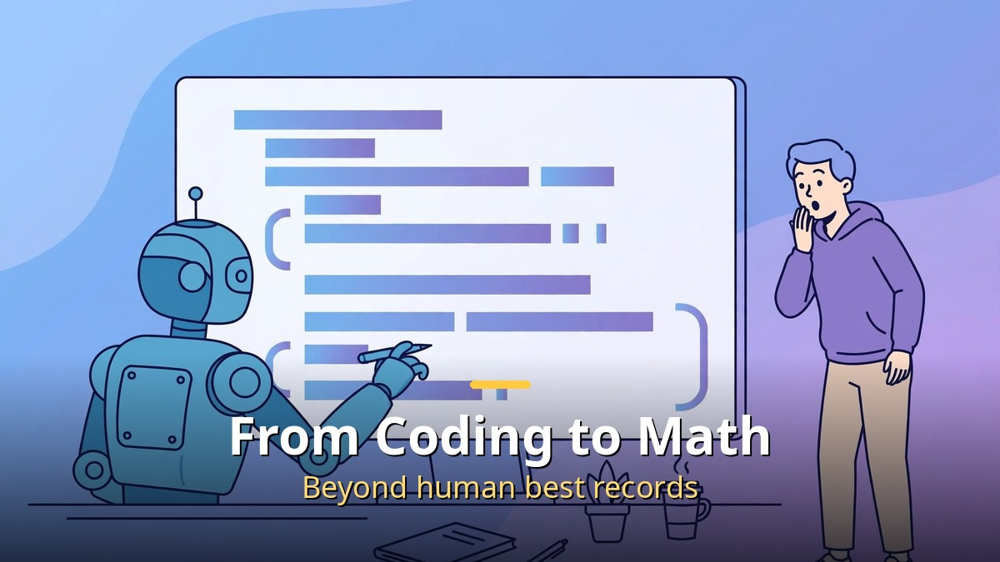
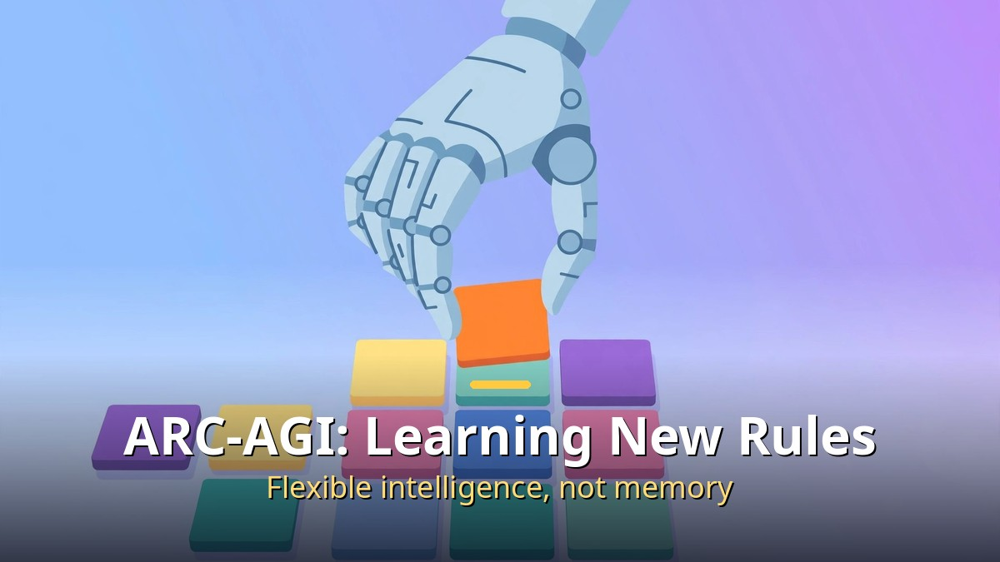
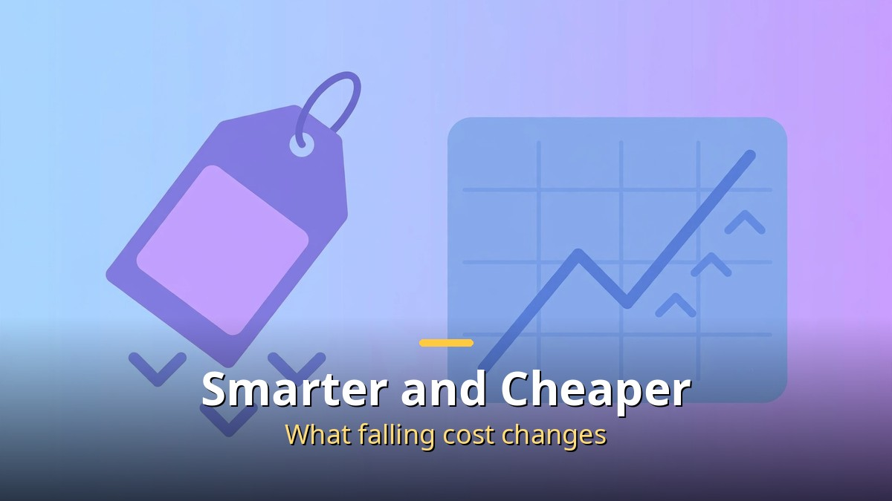

<!-- 본문 시작 -->

It is already ten years since the news "AI beat the Go champion" shocked the world. People said then: "Go may be possible, but creation and expert knowledge are human territory." In 2026, how far has that line moved?

Looking at the latest AI models' scores gives the answer. In programming, math, science, and image understanding — fields called "uniquely human" just a few years ago — AI is passing human best records one by one. Even in tests deliberately made hard by human experts, AI scores are rising steeply.

This article walks through how far AI intelligence has come in 2026, which tests measure that level, and what this change means for our lives and work.

## What Benchmarks Show About AI in 2026

There is an objective way to measure AI skill: "benchmarks." A benchmark is like a test that gives AI standardized problems and scores them, like a college entrance exam.

Over the past three years, benchmark records have kept breaking. First "college student level" made headlines, then "PhD level," and now tests measuring "human expert level in a field" have appeared. Notably, AI is catching up faster than tests are getting harder. Researchers repeatedly create harder tests, saying "this test has become too easy now."

That produced the next two tests. One is an ultra-hard problem set directly made by experts, and the other is a new kind of test that tries to measure "intelligence itself."

## From Programming to Math, Passing Human Best Records

The most dramatic change is in programming. AI now shows performance beyond the records of the world's top programmers competing in coding contests. It is a scene similar to the shock when AlphaGo beat the Go champion in 2016, replayed in the field of coding — intellectual labor.

Image classification, math, and science are the same. In the ability to grasp image content, solve complex math problems, and handle science-paper-level knowledge, AI is passing one human baseline after another.

More surprising is that it has begun to contribute to "discovery." Cases are emerging in which AI presents proofs or derives new results for math or theoretical computer science problems humans could not solve for decades. Beyond getting answers right, it has begun to widen humanity's knowledge itself.

## Is Even "Humanity's Last Exam" Falling?

"Humanity's Last Exam" is a test with an ominous name. Because existing benchmarks became too easy for AI, 1,000 experts from 50 countries made the problems themselves. It consists of 2,500 ultra-hard problems across math, humanities, and natural sciences, and was introduced in the journal Nature in 2026.

As of September 2026, the highest-scoring model on this test was Claude Opus 5.5 at 61.4%. You might think "only 61%?" but this test was designed at a level where even human experts struggle to get a perfect score. What matters is not the score itself but the trend. Scores that were in the 20–30% range a year ago are now approaching the 60% line.

Limits are clear too. Some questions have been pointed out as having errors in their own answers, and there is criticism that a high test score does not mean AI truly "understands." Treat numbers as reference, and read the broad trend.

## ARC-AGI: Measuring "Learning New Rules," Not Memory

Does a high test score mean AI is smart? Not necessarily. It could memorize problems and answer them. That is why ARC-AGI appeared. Created in 2019 by Google researcher François Chollet, this test presents puzzle-like problems with colored blocks. The point is this: show a few examples, find the rule yourself, and apply it to a new problem.

Memorized knowledge cannot solve it. It measures the ability to learn an unseen rule on the spot — "flexible intelligence." In the latest version, ARC-AGI-2, the human average accuracy is 60%, while AI models still fall far short. The next version, ARC-AGI-3, is made in mini-game form, requiring players to grasp game rules without instructions and achieve goals.

The very existence of this test sends an important message. The AI industry has begun to treat "how flexibly it learns," not "how much it memorized," as the true standard of intelligence.

## Smarter and Cheaper — What Falling Cost Changes

There is a change as notable as performance: price. The cost of using AI models is falling sharply. In particular, as China's open models enter the market at far lower prices for their performance, price competition is accelerating.

OpenAI CEO Sam Altman has also said similar things several times: AI models are getting smarter, and prices are getting cheaper. The key is that both curves move at the same time. Performance improving alone would be remarkable, but it is also getting cheaper at the same time.

Why does that matter? This is the moment technology changes from an "expensive experiment" to an "everyday tool." Like electricity or the internet, once anyone can use it without burden, uses explode. The moment AI becomes a tool even a neighborhood shop owner uses, not a curious object in a lab, is approaching.

## So What Does It Mean for Me? Three Things to Do Now

Reading this far, you may think: "So what should I do?" What experts commonly advise is this: do not judge by today's AI performance; plan expecting performance in 1–2 years.

First, build experience "using" AI. It need not be grand. Try one of your usual document tasks, research, or idea organizing together with AI. The tool does not matter. What matters is the sense that "this kind of work can be left to AI."

Second, find repetitive work in your job. What AI does best is repetitive, rule-based work. List weekly reports, similar-format emails, and data organizing. Those are the top candidates for AI adoption.

Third, learn "how to instruct AI." AI is like an assistant that works as instructed. The more specific the instruction, the better the result. Not "write an email" but "write a polite email to Manager Kim at the client apologizing for a delivery delay." This skill will become as basic a work skill as spreadsheets.

## Closing

To sum up 2026 AI in one sentence: it is approaching human expert territory, prices are falling, and the accelerating speed shows no sign of bending.

What matters here is not the fear that "AI replaces humans." The real question is "how will I use this smart, cheap AI in my work?" The direction of technology is already set. What remains is each person's choice. Try even one task with AI today. The you of a year from now will surely be in a different place.

## Frequently Asked Questions

Q. Has AGI (artificial general intelligence) already arrived?
A. Not yet. It surpasses humans in specific fields, but not at the level of flexibly handling any task like a human. Expert forecasts range from 2027 to the 2040s. But it is clearly moving fast in that direction.

Q. Can benchmark scores be trusted?
A. It is best to treat them as reference. There is a possibility of "cramming" by training for tests, and some questions have been pointed out as erroneous. Rather than one score, it is more accurate to look at trends across several tests together.

Q. What happens to jobs if AI gets this smart?
A. Many forecasts expect not mass layoffs at once but "slowed new hiring." Repetitive work goes to AI, while the value of work requiring judgment, communication, and creativity rises instead. The ability to handle AI becomes new competitiveness.

Q. Is it too late to start now?
A. Not at all. Rather, now is good. Tools are cheap and easy, and usage methods overflow on the internet. Trying for 10 minutes today makes the gap a year from now.

<!-- 본문 끝 -->

## 작업용 출처·이미지 정보 (업로드 제외)

- 자료 출처: 로컬 초안 drafts/2026-10-11/draft1_ai_intelligence.md 계열 복원 (윤문 없음, 이미지 마커 전환, 목차·연관글 제외)
- 이미지: images/01-hero-en.jpg ~ 04-img3-en.jpg / 기존 베이스 일러스트 + 영어 배너 오버레이 (1200x675) / 사용권: 자작
