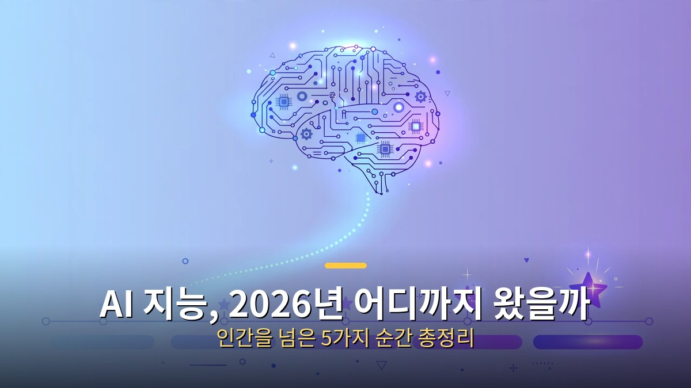
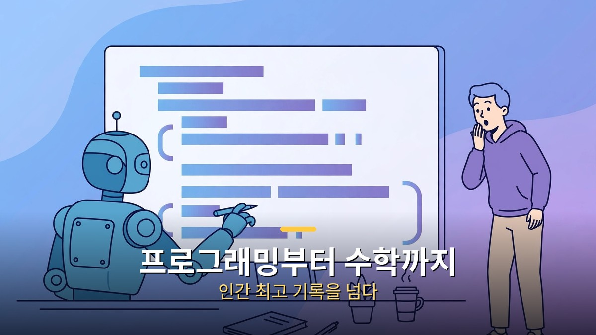
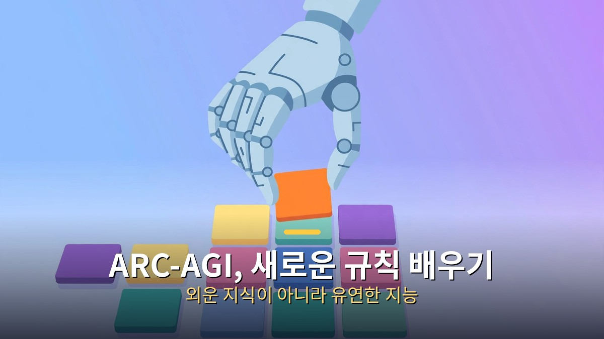
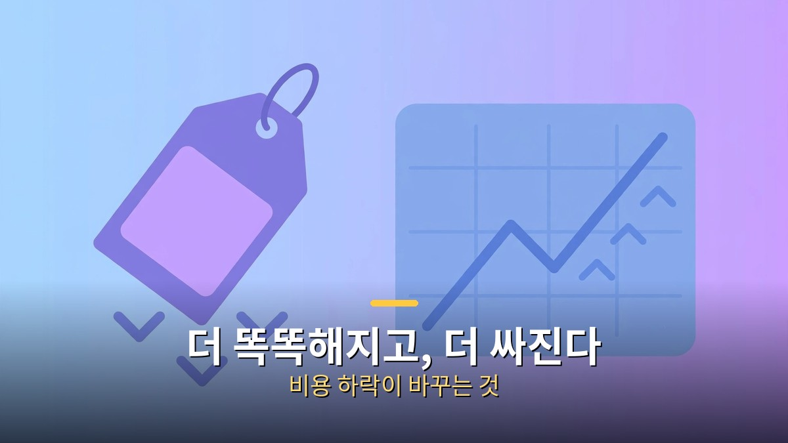

<!-- 본문 시작 -->

"AI가 바둑 챔피언을 이겼다"는 소식이 세상을 놀라게 한 게 벌써 10년 전 일입니다. 그때 사람들은 말했습니다. "바둑은 되겠지만, 창작이나 전문 지식은 인간의 영역"이라고요. 2026년인 지금, 그 선이 어디까지 밀려났을까요?

최신 AI 모델들의 성적을 보면 답이 나옵니다. 프로그래밍, 수학, 과학, 이미지 이해까지 — 불과 몇 년 전만 해도 "인간 고유의 영역"이라고 불리던 분야에서 AI가 인간 최고 기록을 하나둘 넘기고 있습니다. 심지어 인간 전문가들이 일부러 어렵게 낸 시험에서도 AI의 점수는 가파르게 오르는 중입니다.

이번 글에서는 2026년 AI 지능이 어디까지 왔는지, 어떤 시험으로 그 수준을 재는지, 그리고 이 변화가 우리 생활과 일에 무엇을 의미하는지 차근차근 살펴보겠습니다.

## 벤치마크가 보여주는 2026년 AI의 현주소

AI의 실력을 객관적으로 재는 방법이 있습니다. 바로 '벤치마크'입니다. 벤치마크는 AI에게 표준화된 문제를 풀게 해서 점수를 매기는 시험 같은 겁니다. 수능처럼요.

지난 3년간 이 벤치마크들의 기록은 계속 깨졌습니다. 처음에는 "대학생 수준"이 화제였고, 다음엔 "박사 수준"이 나왔고, 지금은 "해당 분야 인간 전문가 수준"을 재는 시험까지 등장했습니다. 특이한 점은 시험이 어려워지는 속도보다 AI가 따라잡는 속도가 더 빠르다는 겁니다. 연구자들이 "이제 이 시험은 너무 쉬워졌다"며 더 어려운 시험을 만드는 일이 반복되고 있습니다.

그래서 나온 게 다음 두 시험입니다. 하나는 전문가들이 직접 낸 초고난도 문제집, 다른 하나는 아예 '지능 그 자체'를 재려는 새로운 방식의 테스트입니다.

## 프로그래밍부터 수학까지, 인간 최고 기록을 넘다

프로그래밍 대회에서 AI는 이제 인간 챔피언을 가볍게 넘습니다.

가장 극적인 변화는 프로그래밍 분야입니다. AI는 이제 세계 최고 수준의 프로그래머들이 겨루는 코딩 대회의 기록을 뛰어넘는 성능을 보입니다. 2016년 알파고가 바둑 챔피언을 이겼을 때의 충격과 비슷한 장면이, 코딩이라는 '지적 노동'의 영역에서 재현되고 있는 셈입니다.

이미지 분류, 수학, 과학 분야도 마찬가지입니다. 이미지를 보고 내용을 파악하는 능력, 복잡한 수학 문제를 푸는 능력, 과학 논문 수준의 지식을 다루는 능력에서 AI는 인간이 세운 기준선을 하나씩 넘고 있습니다.

더 놀라운 건 '발견'에 기여하기 시작했다는 점입니다. 인간이 수십 년간 풀지 못한 수학이나 이론 컴퓨터과학의 난제에 대해, AI가 증명을 제시하거나 새로운 결과를 도출하는 사례가 나오고 있습니다. 답을 맞히는 수준을 넘어, 인류의 지식 자체를 넓히는 데 쓰이기 시작한 겁니다.

## '인류 최후의 시험'도 무너지는 중?

"인류 최후의 시험(Humanity's Last Exam)"이라는 이름부터 심상치 않은 시험이 있습니다. 기존 벤치마크들이 AI에게 너무 쉬워지자, 전 세계 50개국 1,000명의 전문가가 직접 문제를 냈습니다. 수학, 인문학, 자연과학 등 분야를 가리지 않는 2,500개의 초고난도 문제로 구성됐고, 2026년에는 학술지 네이처에도 소개됐습니다.

2026년 9월 기준, 이 시험에서 가장 높은 점수를 받은 모델은 클로드 오푸스 5.5로 61.4%를 기록했습니다. "겨우 61%?"라고 생각할 수 있지만, 이 시험은 인간 전문가도 만점 받기 어려운 수준으로 설계됐습니다. 중요한 건 점수 자체보다 추세입니다. 1년 전만 해도 20~30%대에 머물던 점수가 지금은 60% 선을 넘보고 있습니다.

다만 한계도 분명합니다. 일부 문항의 정답 자체에 오류가 있다는 지적도 나왔고, 시험 점수가 높다고 해서 AI가 진짜 '이해'한다고 보기는 어렵다는 비판도 있습니다. 숫자는 참고용으로 보고, 큰 흐름을 읽는 게 좋습니다.

## ARC-AGI: 암기력이 아니라 '새로운 규칙 배우기'를 잰다

ARC-AGI는 외운 지식이 아니라 새로운 규칙을 배우는 능력을 잽니다.

시험 점수가 높으면 AI가 똑똑한 걸까요? 꼭 그렇진 않습니다. 문제를 외워서 맞힐 수도 있으니까요. 그래서 등장한 게 ARC-AGI라는 테스트입니다. 구글 출신 연구자 프랑수아 숄레가 2019년에 만든 이 시험은, 색깔 블록 퍼즐처럼 생긴 문제를 냅니다. 핵심은 이겁니다. 예시를 몇 개 보여주고, 거기서 규칙을 스스로 찾아내 새로운 문제에 적용하라는 것.

외운 지식으로는 풀 수 없습니다. 처음 보는 규칙을 그 자리에서 배우는 능력, 즉 '유연한 지능'을 재는 시험입니다. 최신 버전인 ARC-AGI-2에서는 인간 평균 정답률이 60%인데, AI 모델들은 아직 한참 못 미치고 있습니다. 차세대 버전인 ARC-AGI-3은 아예 미니 게임 형태로 만들어져, 설명서 없이 게임 규칙을 파악하고 목표를 달성해야 합니다.

이 시험의 존재 자체가 중요한 메시지를 줍니다. AI 업계가 "얼마나 많이 외웠나"가 아니라 "얼마나 유연하게 배우나"를 진짜 지능의 기준으로 삼기 시작했다는 뜻이니까요.

## 더 똑똑해지고, 더 싸진다 — 비용 하락이 바꾸는 것

성능은 오르고 가격은 떨어지는 중. 이게 가장 큰 변화입니다.

성능만큼 주목해야 할 변화가 있습니다. 바로 가격입니다. AI 모델의 사용 비용은 급격히 떨어지고 있습니다. 특히 중국의 오픈 모델들이 성능 대비 훨씬 저렴한 가격으로 시장에 뛰어들면서, 가격 경쟁이 더 빨라졌습니다.

오픈AI CEO 샘 올트먼도 여러 차례 비슷한 취지의 말을 했습니다. AI 모델은 점점 더 똑똑해지고, 가격은 점점 더 저렴해진다는 것. 이 두 곡선이 동시에 움직인다는 게 핵심입니다. 성능이 좋아지는 것만으로도 대단한데, 그게 동시에 싸지고 있습니다.

이게 왜 중요할까요? 기술이 '비싼 실험'에서 '일상의 도구'로 바뀌는 순간이 바로 이때이기 때문입니다. 전기나 인터넷처럼, 누구나 부담 없이 쓸 수 있는 수준이 되면 쓰임새가 폭발적으로 늘어납니다. AI가 연구실의 신기한 물건이 아니라, 동네 가게 사장님도 쓰는 도구가 되는 시점이 다가오고 있습니다.

## 그래서 나한테 무슨 의미야? 지금 당장 할 수 있는 3가지

여기까지 읽으면 이런 생각이 들 겁니다. "그래서 나는 뭘 해야 하지?" 전문가들이 공통으로 조언하는 건 이겁니다. 지금의 AI 성능을 보고 판단하지 말고, 1~2년 뒤의 성능을 예상하고 계획을 세우라는 것.

첫째, AI를 '써보는' 경험을 쌓으세요. 거창할 필요 없습니다. 평소 문서 작업, 자료 조사, 아이디어 정리 중 하나를 AI와 함께 해보세요. 도구는 중요하지 않습니다. 중요한 건 "이런 일은 AI에게 맡길 수 있구나"라는 감각입니다.

둘째, 내 일에서 반복되는 일을 찾아보세요. AI가 가장 잘하는 건 반복적이고 규칙적인 일입니다. 매주 반복하는 보고서, 비슷한 형식의 이메일, 자료 정리 같은 일을 목록으로 적어보세요. 그게 바로 AI 도입 후보 1순위입니다.

셋째, 'AI에게 시키는 법'을 배우세요. AI는 시키는 대로 일하는 비서와 비슷합니다. 지시를 구체적으로 할수록 결과가 좋아집니다. "이메일 써줘"가 아니라 "거래처 김 과장에게 납기 연기 사과 이메일을 정중하게 써줘"처럼 말이죠. 이 능력은 앞으로 엑셀만큼 기본적인 업무 능력이 될 겁니다.

## 마무리

2026년의 AI를 한 문장으로 정리하면 이렇습니다. 인간 전문가의 영역을 넘보고 있고, 가격은 떨어지고 있으며, 빨라지는 속도는 꺾일 기미가 없습니다.

여기서 중요한 건 'AI가 인간을 대체한다'는 공포가 아닙니다. 진짜 질문은 "이렇게 똑똑하고 싸진 AI를, 나는 내 일에 어떻게 쓸 것인가"입니다. 기술의 방향은 이미 정해졌습니다. 남은 건 각자의 선택입니다. 오늘 당장 한 가지 일이라도 AI와 함께 해보세요. 1년 뒤의 당신은 분명 지금과 다른 자리에 있을 겁니다.

## 자주 묻는 질문

Q. AGI(범용인공지능)는 이미 온 건가요?
A. 아직 아닙니다. 특정 분야에서는 인간을 넘었지만, 인간처럼 어떤 일이든 유연하게 해내는 수준에는 못 미칩니다. 전문가들의 예상도 2027년부터 2040년대까지 다양합니다. 다만 그 방향으로 빠르게 가고 있다는 건 분명합니다.

Q. 벤치마크 점수는 믿을 만한가요?
A. 참고용으로 보는 게 좋습니다. 시험에 맞춰 학습한 '벼락치기' 가능성도 있고, 일부 문항에 오류가 있다는 지적도 있습니다. 하나의 점수보다는 여러 시험에서의 추세를 함께 보는 게 정확합니다.

Q. AI가 이렇게 똑똑해지면 일자리는 어떻게 되나요?
A. 당장 대량 해고보다는 '신규 채용 둔화' 형태로 나타날 거라는 전망이 많습니다. 반복 업무는 AI가 가져가지만, 판단·소통·창의가 필요한 일의 가치는 오히려 올라갑니다. AI를 다루는 능력이 새로운 경쟁력이 됩니다.

Q. 지금 시작하기에 늦지 않았나요?
A. 전혀 늦지 않았습니다. 오히려 지금이 좋습니다. 도구는 싸고 쉬워졌고, 활용법은 인터넷에 넘쳐납니다. 오늘 10분 써보는 게 1년 뒤의 격차를 만듭니다.

<!-- 본문 끝 -->

## 작업용 출처·이미지 정보 (업로드 제외)

- 자료 출처: 로컬 초안 drafts/2026-10-11/draft1_ai_intelligence.md 계열 복원 (윤문 없음, 이미지 마커 전환, 목차·연관글 제외)
- 이미지: images/01-hero.jpg ~ 04-img3.jpg / 기존 베이스 일러스트 + 배너 가공 (1200x675) / 사용권: 자작
