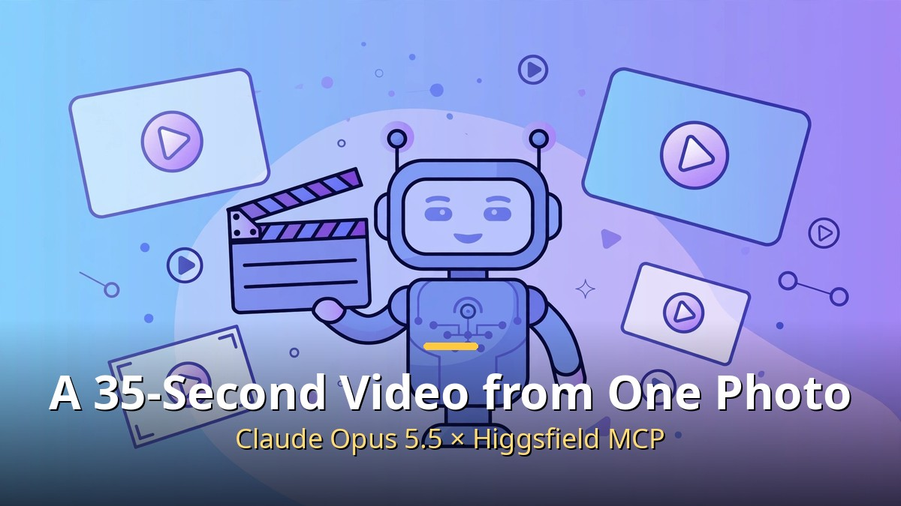
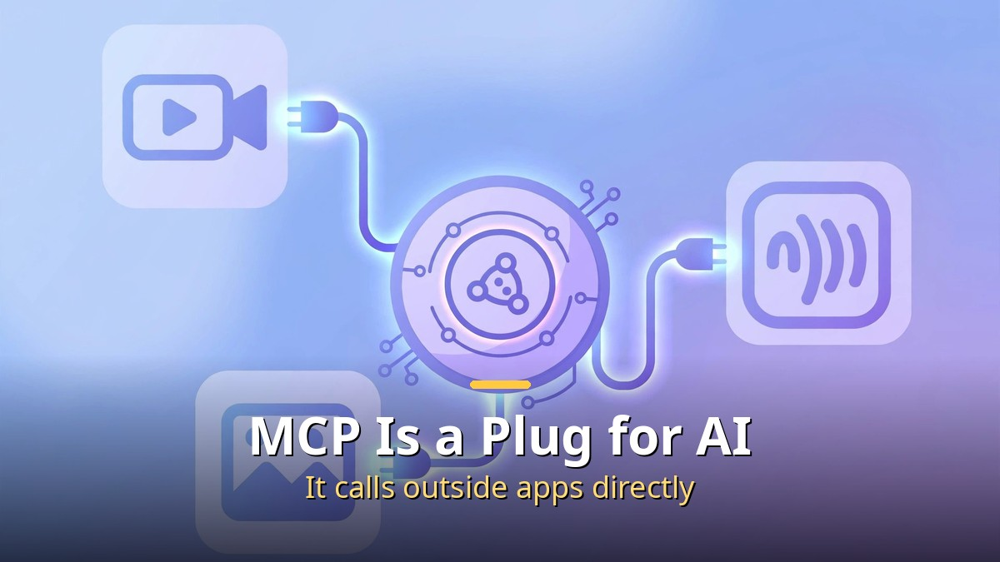
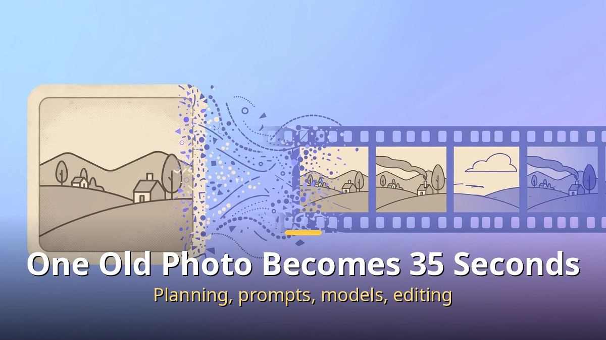
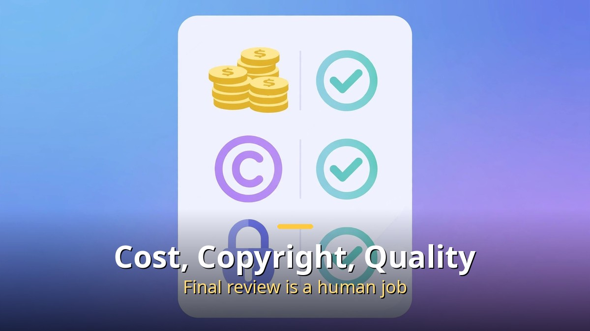

<!-- 본문 시작 -->

What does it take to make one video? A planner, a camera crew, an editor, a voice actor — in the past, you needed several people and equipment. Now one photo and one chat window can produce a 35-second video.

The secret is the combination of an AI agent and MCP, a connection technology. When a person describes in words "I want a video like this," the AI handles planning, prompt writing, model selection, video generation, and editing. The person only sets the direction and picks results.

This article walks through how the workflow of connecting Claude Opus 5.5 with Higgsfield MCP works, whether ordinary people can follow it, and where it is useful.

## What Is MCP? The Era When AI Uses Apps Directly

MCP is the connection standard that lets an AI assistant call on outside services' functions directly. In plain terms, it is a "plug for AI."

In the past, even if you asked AI to "make a video from this photo," it could only explain in words, and a person had to open another app and do the work. Once MCP connects, that changes. From the chat window, AI connects directly to a video generation site, runs the job, and brings back the result. The effort of moving between apps disappears.

This flow does not stop at video. Services have also appeared that connect voice synthesis, dubbing, music, and sound effects through one connector. An era has opened in which one plan can produce a script, narration, background music, and video in a single conversation.

## Connecting Higgsfield MCP, This Way

Higgsfield is a platform where you can use many video and image generation models in one place. Connect MCP to it, and Claude becomes an "agent" mode that directly picks and uses Higgsfield's models.

Connecting is simpler than it sounds. Copy the MCP address from Higgsfield's settings, paste it into the connector (or MCP) tab in Claude's desktop app settings, and approve the connection. No separate API key issuance or server operation is needed. Sign in with a Higgsfield account and you can use it right away.

Once connected, Claude holds video production tools in hand. When a user says "make an ad video," it judges by itself which model suits the scene and uses it. There is no need to move between tabs comparing models.

## The Real Production Process: From One Old Photo to a 35-Second Video

Take a real case. There was one old graduation-work photo from 1998. The goal was to make a 35-second video from it. The person's role was only three things.

First, hand over the photo and describe in words "I want a scene like this." Second, pick a preferred direction from the drafts AI produced. Third, check the final result. No filming, no editing-program study was needed.

Claude Opus 5.5 moved like this. It analyzed the photo to grasp the scene's mood and elements, and split the direction into three strands to draft a plan. It wrote prompts for each scene itself and picked the model suited to each scene from Higgsfield's models. After making two 15-second clips, it joined them naturally to complete a 35-second video.

A notable point is that the whole process was recorded in one workspace (an Obsidian note). Plan, drafts, choices, and results are organized at a glance, making it easy to review or revise later.

## Where Agents Differ: Planning, Prompts, Model Choice, Editing

"Can't I just use a video generation AI?" you might ask. The difference is in the "agent." An ordinary generation AI produces one result per instruction. An agent, given a goal, judges intermediate steps by itself and pushes through to the end.

Claude Opus 5.5 is known as a "long-running" agent. Even when work gets long, it re-reads what it wrote on its workboard and keeps the flow. If the plan changes, it revises prompts; if a model is unsatisfactory, it switches to another model and generates again. A person does not need to say "do this next" every time.

In short: people take the role of imagining "what to make" and choosing, while the AI agent takes the role of executing "how to make it." Creative direction stays with people; hands-on execution goes to AI.

## It Shines in Ads and Shopping Videos: Where to Use It

This workflow shines most in advertising and shopping videos. With one product photo, market research, ad planning, image production, and video completion follow in one go. No need to cast a model or turn on a camera. Even when cuts change, the product's appearance stays consistent — a big advantage.

It is especially welcome news for solo business owners and small shops. Without outsourcing costs, they can make short videos for product pages, social ads, and product introductions themselves. AI also helps by researching reviews of best-selling products and reflecting them in planning.

It is also useful for content creators. They can make videos that convey information without showing their face, and reuse a planning template once made to produce a series.

## Before You Start: Cost, Copyright, Quality Checks

Not everything is an advantage. Know three things before starting.

First, cost. Video generation consumes "credits." You can start with free credits, but regenerating many times uses them up quickly. A good way to save credits is to draft lightly to set direction, then run full generation after confirming.

Second, copyright. The rights situation for AI-made video is still being settled country by country. For commercial use, be sure to check the platform's terms, and do not use other people's photos or brands without permission.

Third, final review is a human job. AI-made video can hide mistakes such as awkward fingers or broken text. Before publishing, watch it from start to finish yourself, and especially check core information such as product names, prices, and contact details.

## Closing

To sum up, the combination of an agent-type AI like Claude Opus 5.5 and Higgsfield MCP is changing video production from "a skill in handling tools" to "planning that sets direction." All you need is one photo and a description of the scene you want.

Of course, AI does not do everything. Imagination about what to make, taste in picking results, and final review remain human work. But the rest — writing plans, refining prompts, choosing models, joining clips — can now be left to AI.

If you are interested, try a test with free credits. The experience of an old photo being reborn as a 35-second video is more thrilling than you might expect.

## Frequently Asked Questions

Q. MCP connection sounds hard. Can a non-specialist do it?
A. Yes. Copy the address, paste it into settings, approve sign-in — those three steps are enough. No coding is needed. You do need a Claude desktop app and accounts for each service prepared in advance.

Q. Can I start for free?
A. Higgsfield provides free credits. That is enough for a light test. To make many videos in earnest, consider a paid plan.

Q. Can I use a made video on YouTube or in ads?
A. Check the platform's terms. Commercial-use rights for AI-generated work differ by service, so read the "commercial use" section of the terms. Unauthorized use of other people's likeness or brands is separately prohibited.

Q. How is this different from the earlier "Claude MCP ad video" article?
A. If the earlier approach was a basic workflow for making an ad video with one question, this one is a step further, in which the Opus 5.5 agent leads the whole process of planning, model selection, and editing. Reading both together makes the flow clearer.

<!-- 본문 끝 -->

## 작업용 출처·이미지 정보 (업로드 제외)

- 자료 출처: 로컬 초안 drafts/2026-10-11/draft2_claude_higgsfield.md 계열 복원 (윤문 없음, 이미지 마커 전환, 목차·연관글 제외)
- 이미지: images/01-hero-en.jpg ~ 04-img3-en.jpg / 기존 베이스 일러스트 + 영어 배너 오버레이 (1200x675) / 사용권: 자작
