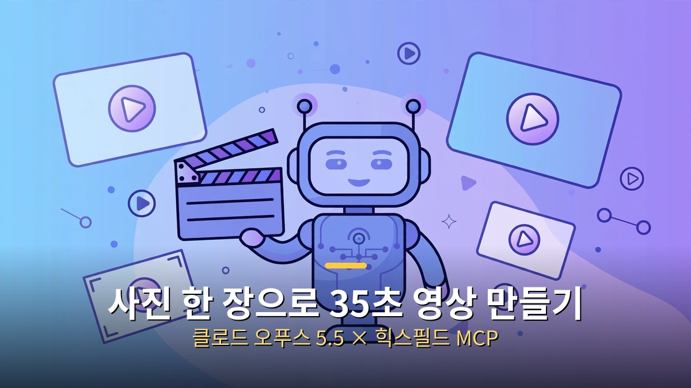
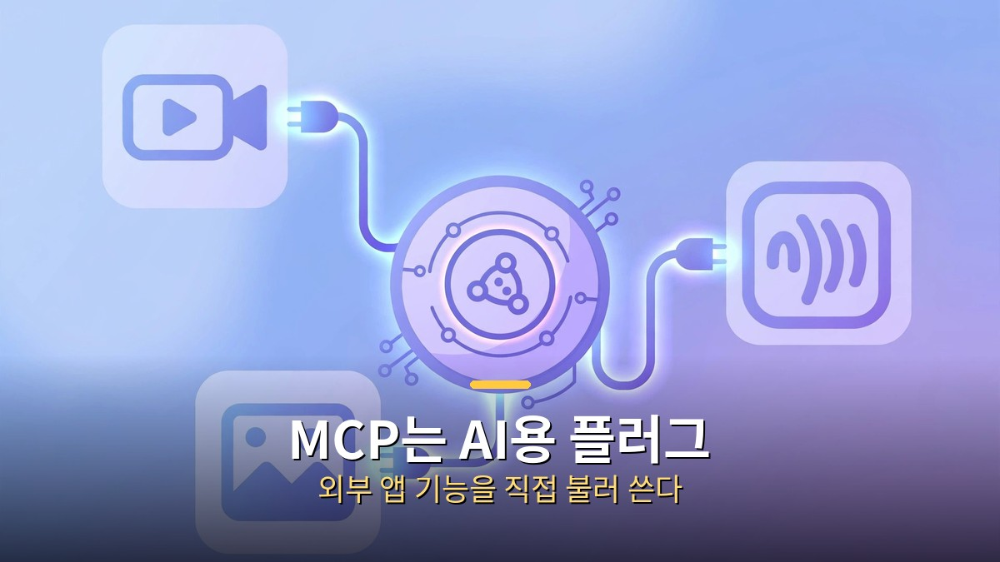
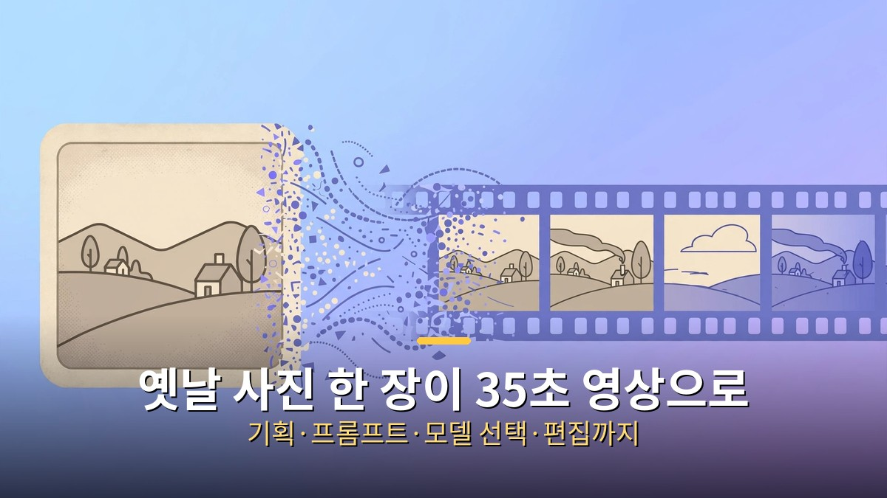
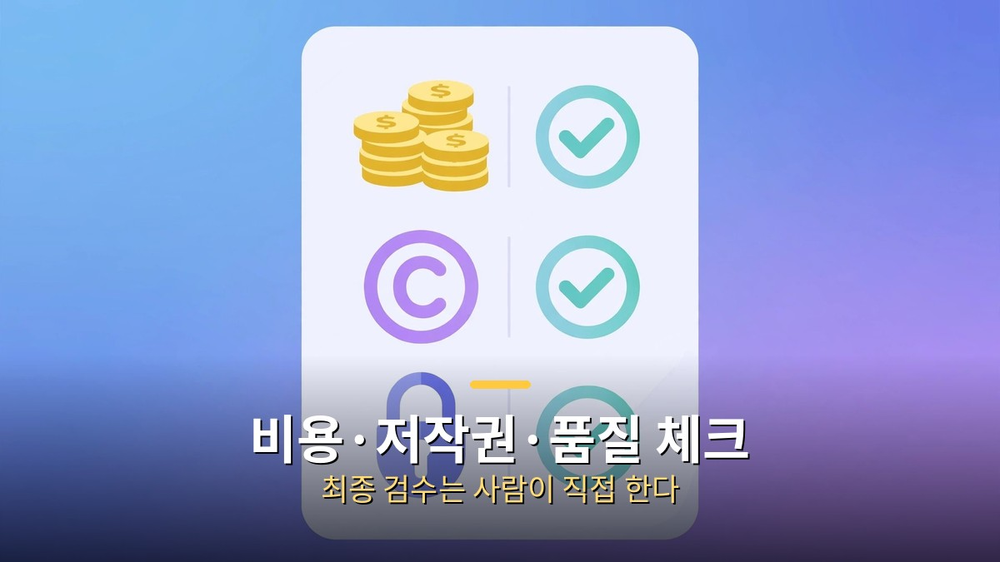

<!-- 본문 시작 -->

영상 하나 만드는 데 뭐가 필요할까요? 기획자, 촬영팀, 편집자, 성우... 예전엔 사람 여럿과 장비가 있어야 했습니다. 그런데 요즘은 사진 한 장과 채팅창 하나로 35초짜리 영상이 뚝딱 나옵니다.

비결은 'AI 에이전트'와 'MCP'라는 연결 기술의 조합입니다. 사람이 "이런 영상을 만들고 싶어"라고 말로 설명하면, AI가 기획부터 프롬프트 작성, 모델 선택, 영상 생성, 편집까지 알아서 진행합니다. 사람은 방향만 정하고 고르기만 하면 됩니다.

이번 글에서는 클로드 오푸스 5.5와 힉스필드 MCP를 연결해 영상을 만드는 최신 워크플로우가 어떻게 돌아가는지, 일반인도 따라 할 수 있는지, 어디에 활용하면 좋은지 차근차근 살펴보겠습니다.

## MCP가 뭐야? AI가 앱을 직접 쓰는 시대

MCP는 AI가 외부 앱의 기능을 직접 불러 쓰게 해주는 연결 규격입니다.

MCP(Model Context Protocol)는 AI 비서가 외부 서비스의 기능을 직접 불러 쓸 수 있게 해주는 연결 규격입니다. 쉽게 말하면 'AI용 플러그'입니다.

예전에는 AI에게 "이 사진으로 영상 만들어줘"라고 해도, AI는 말로만 설명해주고 실제 작업은 사람이 다른 앱을 열어 직접 해야 했습니다. MCP가 연결되면 달라집니다. 채팅창에서 AI가 영상 생성 사이트에 직접 접속해 작업을 실행하고, 결과물을 가져옵니다. 앱을 오가는 수고가 사라지는 겁니다.

이 흐름은 영상에만 머물지 않습니다. 음성 합성, 더빙, 음악, 음향 효과까지 커넥터 하나로 연결해 쓰는 서비스도 등장했습니다. 기획안 하나로 대본, 내레이션, 배경 음악, 영상을 한 대화창에서 만드는 시대가 열린 겁니다.

## 힉스필드 MCP 연결, 이렇게 한다

힉스필드는 여러 영상·이미지 생성 모델을 한 사이트에서 고루 쓸 수 있는 플랫폼입니다. 여기에 MCP 연결을 걸면, 클로드가 힉스필드의 모델들을 직접 골라 쓰는 '에이전트' 모드가 됩니다.

연결 방법은 생각보다 간단합니다. 힉스필드 사이트의 설정에서 MCP 주소를 복사한 뒤, 클로드 데스크톱 앱의 설정 → 커넥터(또는 MCP) 탭에 붙여 넣고 연결을 승인하면 됩니다. 별도의 API 키 발급이나 서버 운영이 필요 없습니다. 힉스필드 계정으로 로그인하면 바로 쓸 수 있습니다.

연결이 끝나면 클로드는 영상 제작 도구들을 손에 쥔 상태가 됩니다. 사용자가 "광고 영상 하나 만들어줘"라고 하면, 어떤 모델이 이 장면에 적합한지 스스로 판단해 골라 씁니다. 모델마다 탭을 옮겨 다니며 비교할 필요가 없어집니다.

## 실제 제작 과정: 옛날 사진 한 장에서 35초 영상까지

1998년 졸업 작품 사진 한 장이 35초 영상으로 다시 태어났습니다.

실제 사례를 볼까요. 1998년의 오래된 졸업 작품 사진 한 장이 있었습니다. 이 사진으로 35초짜리 영상을 만드는 게 목표였습니다. 사람의 역할은 세 가지뿐이었습니다.

첫째, 사진을 건네고 "이런 장면을 만들고 싶다"고 말로 설명하기. 둘째, AI가 뽑아준 초안들 중에서 마음에 드는 방향 고르기. 셋째, 최종 결과물 확인하기. 촬영도, 편집 프로그램 공부도 필요 없었습니다.

클로드 오푸스 5.5는 이렇게 움직였습니다. 사진을 분석해 장면의 분위기와 요소를 파악하고, 연출 방향을 세 갈래로 나눠 기획안을 짰습니다. 각 장면에 맞는 프롬프트(생성 지시문)를 직접 쓰고, 힉스필드의 여러 모델 중 장면에 어울리는 것을 골랐습니다. 15초짜리 클립 두 개를 만든 뒤 자연스럽게 이어 붙여 35초 영상을 완성했습니다.

특이한 점은 이 모든 과정이 하나의 작업 공간(옵시디언 노트)에 기록됐다는 겁니다. 기획, 초안, 선택, 결과물이 한눈에 정리돼 나중에 다시 보거나 고치기 쉽습니다.

## 에이전트가 달라지는 지점: 기획·프롬프트·모델 선택·편집

"그냥 영상 생성 AI를 쓰면 되는 거 아냐?"라고 물을 수 있습니다. 차이는 '에이전트'에 있습니다. 일반 생성 AI는 한 번 지시하면 한 번 결과물을 냅니다. 에이전트는 목표를 주고 나면, 중간 단계들을 스스로 판단하며 끝까지 밀고 갑니다.

클로드 오푸스 5.5는 '오래 달리는' 에이전트로 알려져 있습니다. 작업이 길어져도 작업보드에 적어둔 내용을 다시 읽고 흐름을 유지합니다. 기획이 바뀌면 프롬프트를 고치고, 모델이 마음에 안 들면 다른 모델로 바꿔 다시 뽑습니다. 사람이 매번 "다음엔 이걸 해줘"라고 말하지 않아도 됩니다.

정리하면 이렇습니다. 사람은 '무엇을 만들지' 상상하고 선택하는 역할, AI 에이전트는 '어떻게 만들지' 실행하는 역할. 창작의 주도권은 사람에게 있고, 손이 많이 가는 실행은 AI가 가져가는 구조입니다.

## 광고·쇼핑 영상에도 바로 쓴다: 어디에 활용할까

이 워크플로우가 가장 빛나는 곳은 단연 광고와 쇼핑 영상입니다. 제품 사진 한 장이면 시장 조사부터 광고 기획, 이미지 제작, 영상 완성까지 한 번에 이어집니다. 모델을 섭외하지 않아도 되고, 카메라를 켜지도 않아도 됩니다. 컷이 바뀌어도 제품의 생김새가 그대로 유지되는 것도 큰 장점입니다.

1인 사업자나 소상공인에게는 특히 반가운 소식입니다. 외주 비용 없이 상세페이지용 짧은 영상, SNS 광고, 제품 소개 영상을 직접 만들 수 있습니다. 잘 팔리는 제품의 리뷰를 조사해 기획에 반영하는 것도 AI가 함께 해줍니다.

콘텐츠 크리에이터에게도 유용합니다. 얼굴을 드러내지 않고도 정보를 전달하는 영상을 만들 수 있고, 한 번 만든 기획 틀을 재활용해 시리즈물을 뽑아낼 수도 있습니다.

## 시작 전에 알아둘 것: 비용·저작권·품질 체크

크레딧 소진, 저작권, 최종 검수는 사람이 직접 챙겨야 합니다.

장점만 있는 건 아닙니다. 시작 전에 알아둘 세 가지가 있습니다.

첫째, 비용입니다. 영상 생성은 '크레딧'을 소모합니다. 무료 크레딧으로 시작할 수 있지만, 여러 번 다시 뽑다 보면 금방 닳습니다. 초안은 가볍게 뽑아 방향을 정하고, 확정한 뒤에 본 생성에 들어가는 게 크레딧을 아끼는 요령입니다.

둘째, 저작권입니다. AI가 만든 영상의 권리 관계는 아직 나라마다 정리 중입니다. 상업용으로 쓸 때는 플랫폼의 이용약관을 꼭 확인하고, 타인의 사진이나 브랜드를 무단으로 쓰지 않도록 주의해야 합니다.

셋째, 최종 검수는 사람의 몫입니다. AI가 만든 영상에는 어색한 손가락, 깨지는 글자 같은 실수가 숨어 있을 수 있습니다. 공개 전에는 처음부터 끝까지 직접 보고, 특히 제품명·가격·연락처 같은 핵심 정보가 정확한지 확인하세요.

## 마무리

정리해봅시다. 클로드 오푸스 5.5 같은 에이전트형 AI와 힉스필드 MCP의 조합은, 영상 제작을 '도구를 다루는 기술'에서 '방향을 정하는 기획'으로 바꾸고 있습니다. 필요한 건 사진 한 장과 만들고 싶은 장면에 대한 설명뿐입니다.

물론 AI가 다 해주는 건 아닙니다. 무엇을 만들지 정하는 상상력, 결과물을 골라내는 안목, 마지막 검수는 여전히 사람의 일입니다. 하지만 그 나머지 — 기획안 쓰기, 프롬프트 다듬기, 모델 고르기, 클립 이어 붙이기 — 는 이제 AI에게 맡길 수 있습니다.

관심이 생겼다면 무료 크레딧으로 한 번 테스트해보세요. 오래된 사진 한 장이 35초짜리 영상으로 다시 태어나는 경험, 생각보다 짜릿합니다.

## 자주 묻는 질문

Q. MCP 연결이 어려울 것 같은데, 비전공자도 할 수 있나요?
A. 네, 가능합니다. 주소 복사 → 설정에 붙여넣기 → 로그인 승인, 이 세 단계면 됩니다. 코딩이 필요 없습니다. 다만 클로드 데스크톱 앱과 각 서비스의 계정은 미리 준비해야 합니다.

Q. 무료로 시작할 수 있나요?
A. 힉스필드는 무료 크레딧을 제공합니다. 가볍게 테스트해보기엔 충분합니다. 본격적으로 여러 편을 만들려면 유료 플랜을 고려해야 합니다.

Q. 만든 영상을 유튜브나 광고에 써도 되나요?
A. 플랫폼의 이용약관을 확인해야 합니다. AI 생성물의 상업적 이용 권리는 서비스마다 다르니, 약관의 '상업적 이용' 항목을 꼭 읽어보세요. 타인의 초상·브랜드 무단 사용은 별개로 금지됩니다.

Q. 예전에 소개된 '클로드 MCP 광고 영상 만들기' 글과 뭐가 다른가요?
A. 이전 글에서 다룬 방식이 질문 하나로 광고 영상을 만드는 기초 워크플로우였다면, 이번은 오푸스 5.5 에이전트가 기획·모델 선택·편집까지 전 과정을 주도하는 한 단계 진화한 방식입니다. 두 글을 함께 보면 흐름이 더 잘 이해됩니다.

<!-- 본문 끝 -->

## 작업용 출처·이미지 정보 (업로드 제외)

- 자료 출처: 로컬 초안 drafts/2026-10-11/draft2_claude_higgsfield.md 계열 복원 (윤문 없음, 이미지 마커 전환, 목차·연관글 제외)
- 이미지: images/01-hero.jpg ~ 04-img3.jpg / 기존 베이스 일러스트 + 배너 가공 (1200x675) / 사용권: 자작
