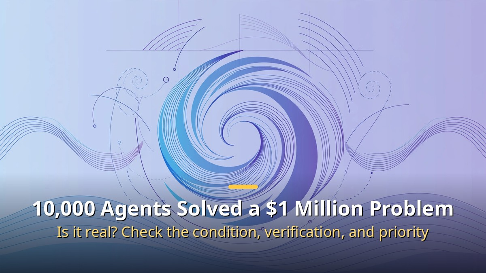
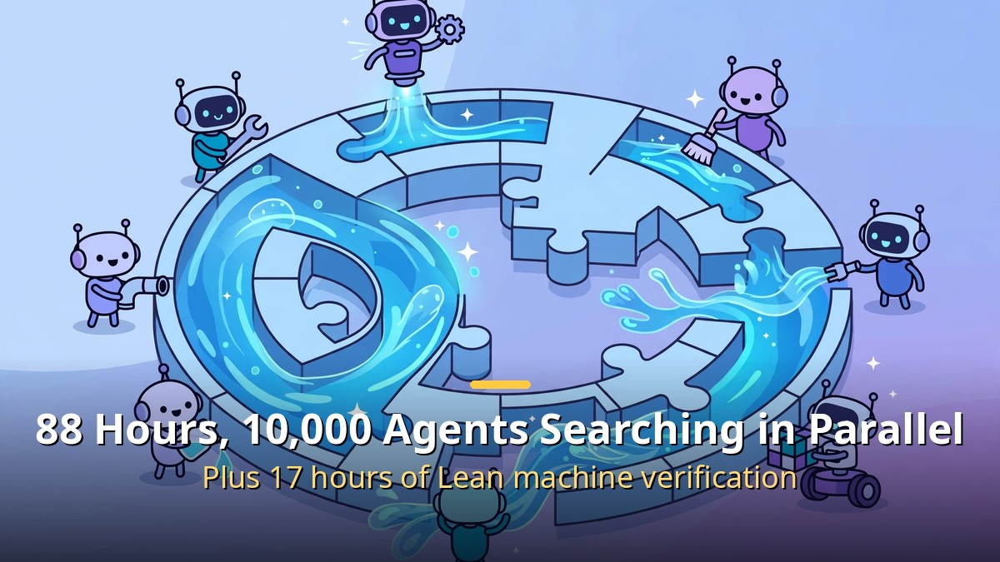
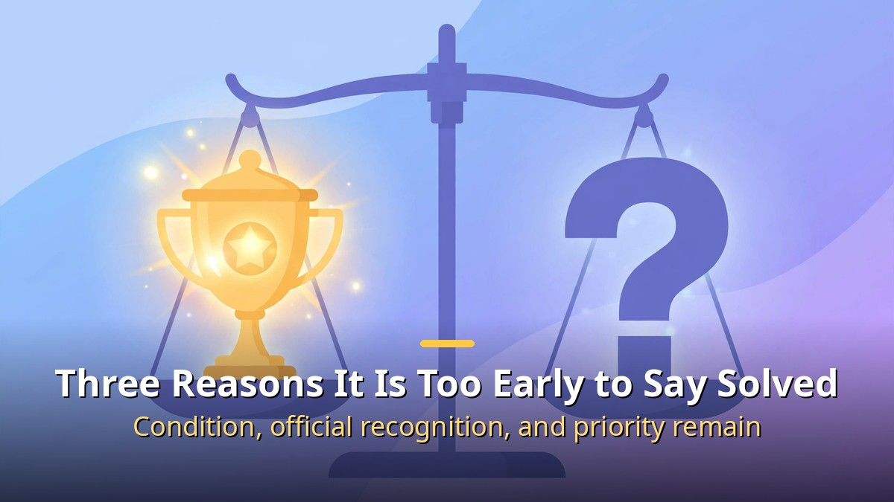

<!-- 본문 시작 -->

There is a math problem worth $1 million. Designated a Millennium Problem in 2000, the Navier-Stokes problem went more than 20 years without anyone claiming the prize.

Then in September 2026 came an announcement: about 10,000 AI agents had solved it. **The conclusion first: within the stated conditions, the result is meaningful, but it is too early to say the problem is closed.**

## What 10,000 Agents Did in 88 Hours

The Navier-Stokes equations describe how water and air flow. The unresolved question was whether the flow always stays smooth, or whether a point can appear where the speed grows without bound.

According to the announcement, about 10,000 agents centered on an undisclosed internal model searched for a proof in parallel for 88 hours. The result pointed to the existence of a case where speed grows without bound in finite time, under a condition where an external force is applied.

About 10,000 agents explored the proof in parallel for 88 hours.

The completed proof then took about 17 hours to re-check with Lean, a verification tool. Instead of a human reading it by feel, a machine catches the logical errors. The company also stated it would not claim the prize money.

## Three Reasons It Is Too Early to Say "Solved"

The achievement was large, but so was the dispute over its conditions and priority.

First, the condition. This result covers the case with an external force applied, so it does not mean the original form of the problem is solved.

Second, official recognition is still pending. Recognition by the Clay Mathematics Institute requires journal publication and peer review, so machine verification and official recognition as a solution are different things.

Third, a priority dispute. Mathematicians who have worked on related research raised questions about prior work, and their account conflicts with the company's explanation.

| Issue | What was announced | What remains |
| --- | --- | --- |
| Condition | A blow-up proof with an external force applied | Is the original form solved too? |
| Verification | Machine-verified with Lean | Journal and peer-review recognition is separate |
| Priority | Result derived through large-scale computation | How credit is shared with prior research |

In summary, AI producing a real result on a problem unsolved for over 90 years is a major event. But only when three checks are complete — the condition, official verification, and priority — can we say the problem is truly solved.

<!-- 본문 끝 -->

## 작업용 출처·이미지 정보 (업로드 제외)

- 자료 출처: 로컬 초안 drafts/2026-10-12/remake1.txt 계열 복원 (제목 일치로 원본 확정, 윤문 없음, 이미지 마커 전환; 원본 이미지 3장 체계 유지)
- 이미지: images/01-hero-en.jpg ~ 03-img2-en.jpg / 기존 베이스 일러스트 + 영어 배너 오버레이 (1200x675) / 사용권: 자작
