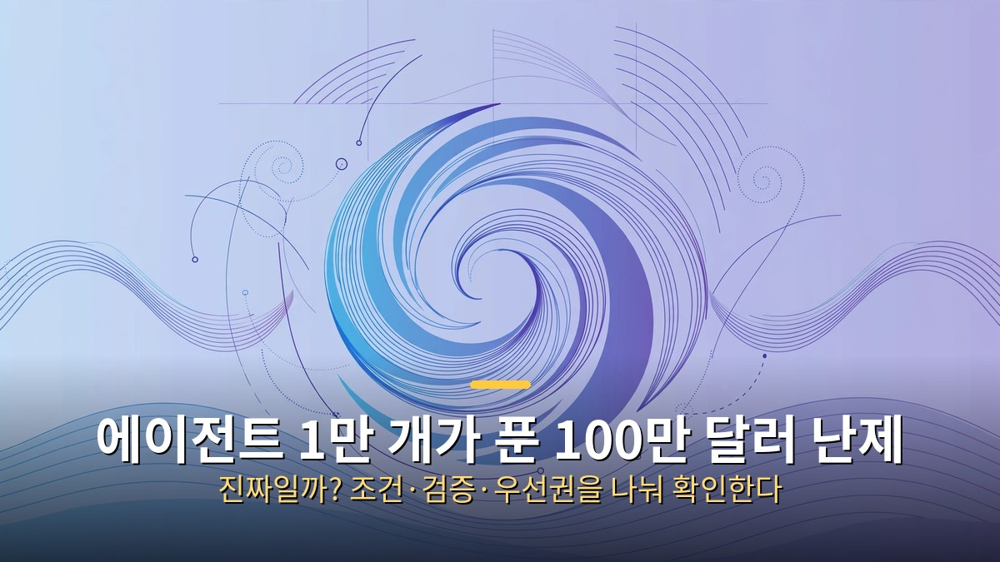
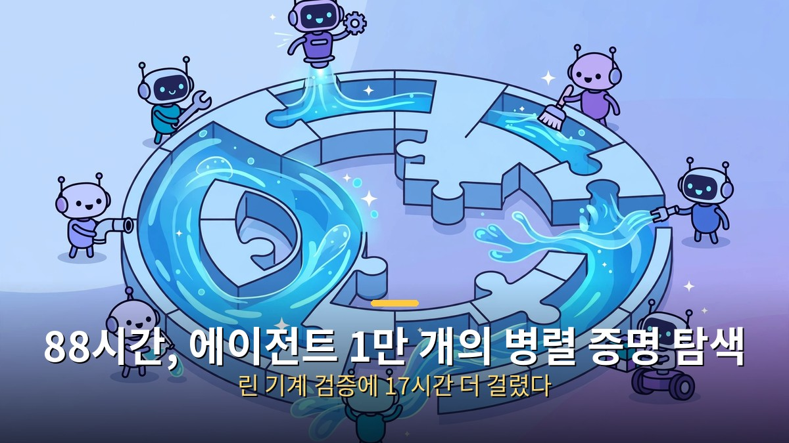
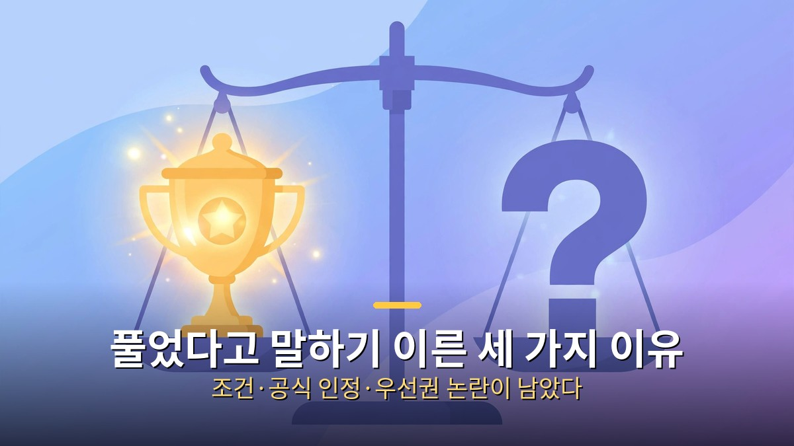

<!-- 본문 시작 -->

100만 달러가 걸린 수학 난제가 있습니다. 2000년 밀레니엄 난제로 지정된 나비에-스토크스 문제로, 20년 넘게 상금의 주인이 없었습니다.

그런데 2026년 9월, AI 에이전트 약 1만 개가 이 문제를 풀었다는 발표가 나왔습니다. **결론부터 말하면, 정해진 조건 안에서는 의미 있는 결과가 나왔지만 난제가 끝났다고 보기는 이릅니다.**

## 88시간 동안 에이전트 1만 개가 한 일

나비에-스토크스 방정식은 물과 공기의 흐름을 설명하는 식입니다. 문제는 흐름이 언제나 매끄러운지, 어느 순간 속도가 한없이 커지는 지점이 생길 수 있는지가 증명되지 않았다는 점이었습니다.

발표에 따르면 비공개 내부 모델을 중심으로 에이전트 약 1만 개가 88시간 동안 병렬로 증명을 탐색했습니다. 결과는 외부 힘을 가하는 조건에서 속도가 유한 시간 안에 한없이 커지는 경우가 존재한다는 쪽이었습니다.

약 1만 개의 에이전트가 88시간 동안 병렬로 증명을 탐색했습니다.

완성된 증명은 린(Lean)이라는 검증 도구로 다시 확인하는 데 약 17시간이 걸렸습니다. 사람이 감으로 읽는 대신 기계가 논리 오류를 잡는 방식입니다. 회사 측은 상금을 청구하지 않겠다는 입장도 밝혔습니다.

## 풀었다고 말하기 이른 세 가지 이유

성과는 컸지만, 조건과 우선권을 둘러싼 논쟁도 함께 커졌습니다.

첫째, 조건입니다. 이번 결과는 외부 힘을 가하는 경우라, 원래 형태의 문제까지 풀린 것은 아닙니다.

둘째, 공식 인정이 남았습니다. 클레이 수학연구소의 인정은 학술지 게재와 동료 심사를 거쳐야 해서, 기계 검증 완료와 공식 해법 인정은 다른 이야기입니다.

셋째, 우선권 논란입니다. 관련 연구를 해온 수학자들이 선행 연구 문제를 제기했고, 회사 측 설명과 맞서고 있습니다.

| 쟁점 | 발표 내용 | 남은 질문 |
| --- | --- | --- |
| 조건 | 외부 힘을 가한 경우의 붕괴 증명 | 원래 형태도 풀리는가 |
| 검증 | 린으로 기계 검증 완료 | 학술지·동료 심사 인정은 별도 |
| 우선권 | 대규모 연산으로 결과 도출 | 선행 연구와 공 배분 |

정리하면, AI가 90년 넘은 난제에 실제 결과를 낸 것은 큰 사건입니다. 다만 조건과 공식 검증, 우선권이라는 세 가지 확인이 끝나야 비로소 난제가 풀렸다고 말할 수 있습니다.

<!-- 본문 끝 -->

## 작업용 출처·이미지 정보 (업로드 제외)

- 자료 출처: 로컬 초안 drafts/2026-10-12/remake1.txt 계열 복원 (제목 일치로 원본 확정, 윤문 없음, 이미지 마커 전환; 원본 이미지 3장 체계 유지)
- 이미지: images/01-hero.jpg ~ 03-img2.jpg / 기존 베이스 일러스트 + 배너 가공 (1200x675) / 사용권: 자작
