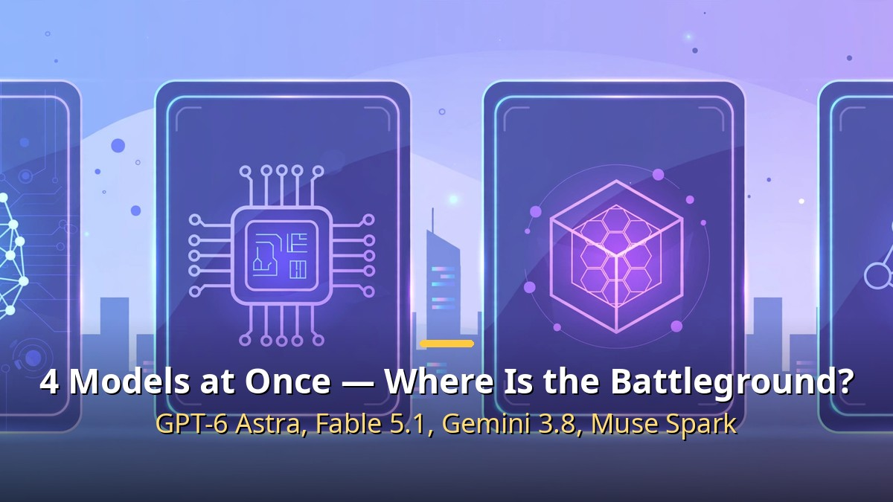
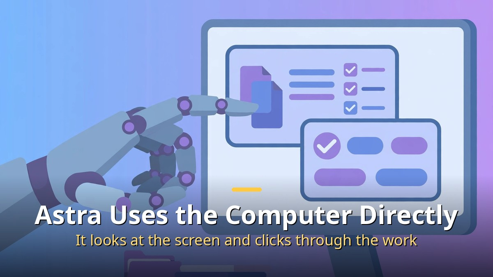
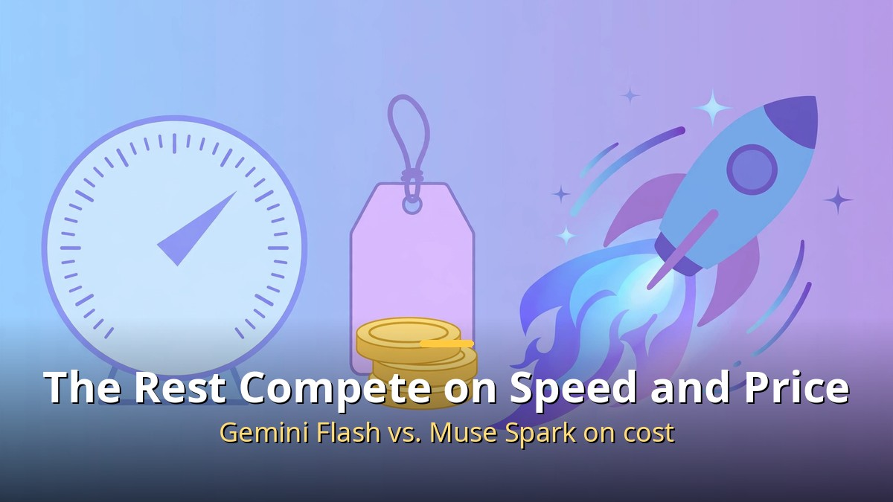
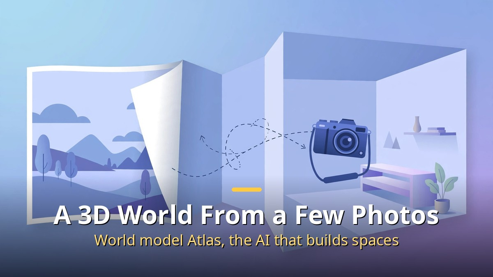

<!-- 본문 시작 -->

In the first week of September 2026, four companies released their flagship AI models within four days. In the same week, a world model that builds a 3D world from just a few photos was also unveiled.

**All four models remember roughly 1 million tokens at once, so the difference was not their scores but their roles.**

| Model | Release date | Battleground |
| --- | --- | --- |
| Fable 5.1 | September 1 | Long tasks and reasoning |
| Gemini 3.8 Flash | September 2 | Speed, price, and multimodality |
| Muse Spark 1.3 | September 2 | Total cost per task |
| GPT-6 Astra | September 3 | Direct computer use |

## Astra Uses the Computer Directly

Astra's core strength is using a computer directly, not just chatting.

Astra's keyword is computer use. Instead of only answering questions, it looks at the screen, clicks buttons, and carries multi-step work forward on its own. In an evaluation modeled on contract management work, its scores rose sharply over the previous model and the time per task fell by nearly half. However, the evaluation designers also drew a line: this does not mean legal work can be left to it without human supervision.

## The Rest Split by Long Tasks, Speed, and Cost

Fable 5.1 leads with the ability to sustain long tasks and the depth of its reasoning. Gemini 3.8 Flash takes text, images, sound, and video together as multimodal input, and its low price is a strength — though the announced price has a limited-time character, so the date needs to be checked.

Gemini Flash and Muse Spark compete on speed and price.

Muse Spark 1.3 offers near-flagship performance at a much lower cost. Experimental approaches also appeared, such as a discounted tier conditioned on providing usage data.

## A Model That Builds a 3D World From a Few Photos Also Arrived

A world model that creates a 3D space you can enter from just a few photos.

World Labs' Atlas takes a different direction. Feed it one photo or a few, and it creates a 3D scene you can look around by moving the camera, reconstructs rooms in 3D, and even covers simulations for robot training. It is still in an early stage open only to some partners, so there is a gap between the demo video and the actual product.

In short, this week's competition looks like a shift from a score race to a role race. What matters now is a criterion for choosing among a model that uses a computer directly, one that endures long tasks, one that is cheap and fast, and one that builds spaces — the one that fits your own work.

<!-- 본문 끝 -->

## 작업용 출처·이미지 정보 (업로드 제외)

- 자료 출처: 로컬 초안 drafts/2026-10-12/remake2.txt 계열 복원 (제목 일치로 원본 확정, 윤문 없음, 이미지 마커 전환)
- 이미지: images/01-hero-en.jpg ~ 04-img3-en.jpg / 기존 베이스 일러스트 + 영어 배너 오버레이 (1200x675) / 사용권: 자작
