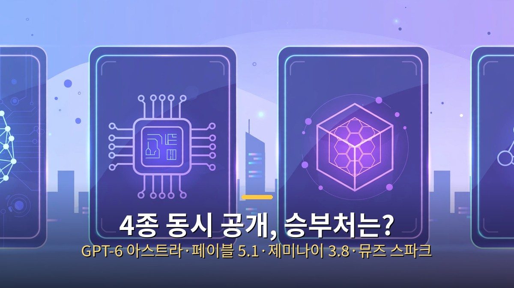
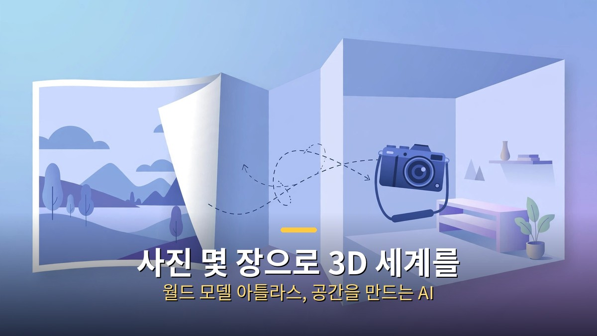

<!-- 본문 시작 -->

2026년 9월 첫째 주, 나흘 사이에 네 회사의 대표 AI 모델이 한꺼번에 공개됐습니다. 여기에 사진 몇 장으로 3D 세계를 만드는 월드 모델까지 같은 주에 나왔습니다.

**네 모델 모두 한 번에 기억하는 분량은 100만 토큰 안팎으로 비슷했고, 차이는 점수가 아니라 역할에서 갈렸습니다.**

| 모델 | 공개일 | 승부처 |
| --- | --- | --- |
| 페이블 5.1 | 9월 1일 | 긴 작업과 추론 |
| 제미나이 3.8 플래시 | 9월 2일 | 속도·가격·멀티모달 |
| 뮤즈 스파크 1.3 | 9월 2일 | 작업당 전체 비용 |
| GPT-6 아스트라 | 9월 3일 | 컴퓨터 직접 사용 |

## 아스트라는 컴퓨터를 직접 쓴다

아스트라의 핵심은 대화보다 컴퓨터를 직접 쓰는 능력입니다.

아스트라의 키워드는 컴퓨터 사용입니다. 답만 하는 게 아니라 화면을 보고 버튼을 눌러 여러 단계의 업무를 이어갑니다. 계약 관리 업무 평가에서는 이전 모델보다 점수가 크게 오르고 과제 시간은 절반 가까이 줄었습니다. 다만 감독 없이 법률 업무를 맡길 수 있다는 뜻은 아니라고, 평가 설계 측도 선을 그었습니다.

## 나머지는 긴 작업, 속도, 비용으로 갈린다

페이블 5.1은 긴 작업을 이어가는 능력과 추론의 깊이를 앞세웁니다. 제미나이 3.8 플래시는 글·이미지·소리·영상을 함께 받는 멀티모달과 낮은 가격이 강점인데, 안내 가격은 기간 한정 성격이 있어 날짜 확인이 필요합니다.

제미나이 플래시와 뮤즈 스파크는 속도와 가격으로 승부합니다.

뮤즈 스파크 1.3은 대표 모델에 가까운 성능을 훨씬 낮은 비용으로 쓰는 구조를 내세웁니다. 사용 데이터를 제공하는 조건의 할인 등급 같은 실험적인 방식도 등장했습니다.

## 사진 몇 장으로 3D 세계를 만드는 모델도 나왔다

사진 몇 장으로 들어갈 수 있는 3D 공간을 만드는 월드 모델입니다.

월드랩스의 아틀라스는 방향이 다릅니다. 사진 한 장이나 몇 장을 넣으면 카메라를 움직이며 볼 수 있는 3D 장면을 만들고, 방을 3D로 복원하고, 로봇 학습용 시뮬레이션까지 다룹니다. 다만 아직 일부 파트너에게만 열리는 초기 단계라, 시연 영상과 실제 제품 사이에는 거리가 있습니다.

정리하면, 이번 주의 경쟁은 점수 경쟁에서 역할 경쟁으로 넘어간 모습입니다. 컴퓨터를 직접 쓰는 모델, 긴 작업을 버티는 모델, 싸고 빠른 모델, 공간을 만드는 모델 중에서 내 작업에 맞는 것을 고르는 기준이 중요해졌습니다.

<!-- 본문 끝 -->

## 작업용 출처·이미지 정보 (업로드 제외)

- 자료 출처: 로컬 초안 drafts/2026-10-12/remake2.txt 계열 복원 (제목 일치로 원본 확정, 윤문 없음, 이미지 마커 전환)
- 이미지: images/01-hero.jpg ~ 04-img3.jpg / 기존 베이스 일러스트 + 배너 가공 (1200x675) / 사용권: 자작
