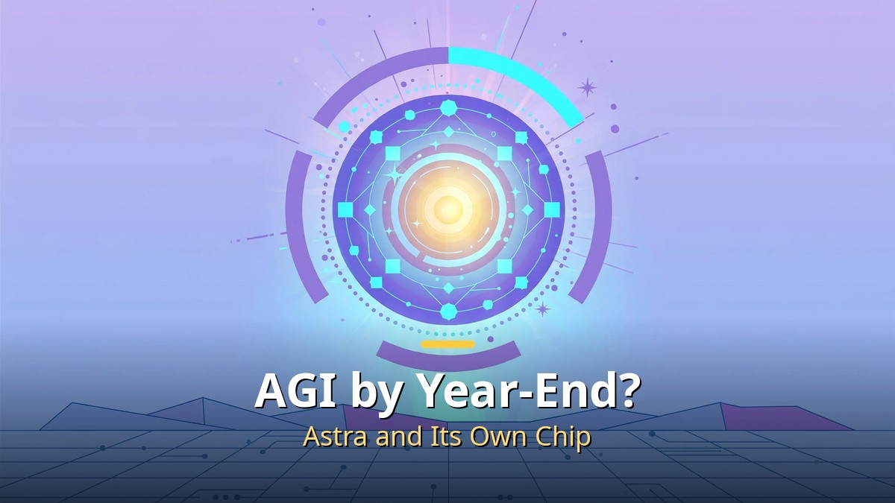
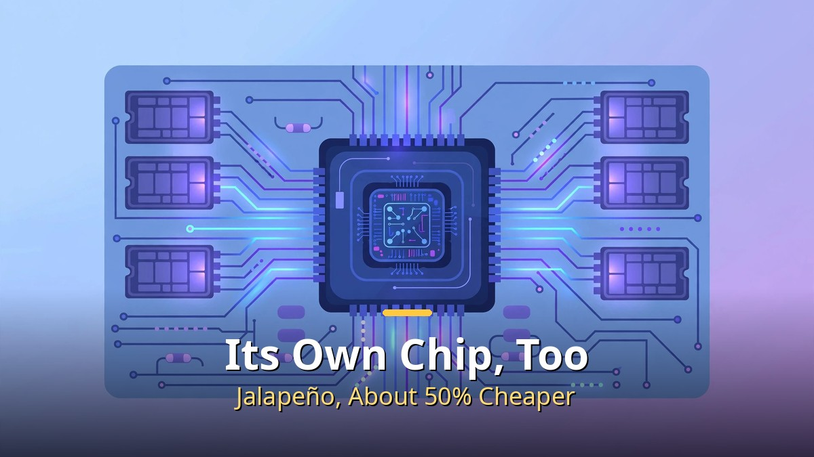

<!-- 본문 시작 -->

AGI by Year-End?

OpenAI said it would have a system it internally calls AGI by the end of the year. CEO Sam Altman said so in a Time interview, and its chief research officer put progress at "about 80% of the way to AGI."

Behind that claim is the next-generation model Astra. With its own chip added, **the axis of competition seems to be moving from model performance to the speed of the whole system.**

## Astra Works Like a Researcher

Astra Works Like a Researcher

Astra was introduced as a model that takes a person's experiment idea, implements it directly in a codebase, runs the experiment, and reports the results. Give it a paper, and it performs work that would take a researcher a week, without human help, according to its description.

Altman said Astra could become "the first model to invent something new in a meaningful way." But this AGI uses OpenAI's own definition and an internal system standard, so it should be kept apart from a public launch or a formally recognized achievement.

## Its Own Chip, Too

Its Own Chip, Too

OpenAI also unveiled Jalapeño, its first own AI chip, co-developed with Broadcom. It is specialized not for training but for inference — producing answers in live services.

It took only nine months from design to final tape-out, and early tests reportedly cut costs by about 50% versus GPUs. Pilot deployment starts at year-end, with mass production targeted for 2027. It is a move to reduce dependence on Nvidia.

## Chinese Open Models and Video Move Fast, Too

Chinese Open Models and Video

China's Z.ai open model GLM-5.3-Flash was introduced as showing near-latest-model performance despite its relatively small size. With a quantized version, it can run on a high-performance laptop.

Google's Gemini Omni 1.1 continued scenes from a previous video's context and output in 4K, and the video generation model H3 produced examples of video made faster than playback speed.

| Item | Content | What to check |
| --- | --- | --- |
| AGI claim | Internal system goal by year-end | Own-definition standard, not a public schedule |
| Astra | Research automation model | Still in private testing |
| Jalapeño | Inference chip with Broadcom | Early-test figures, mass production in 2027 |
| GLM-5.3 | Chinese open-weight model | Quantization may lower performance |

To sum up, the common thread in this week's news is speed. A model takes over research, a dedicated chip lowers costs, and open models catch up quickly — so actual release schedules and verification results matter more than declarations.

<!-- 본문 끝 -->

## 작업용 출처·이미지 정보 (업로드 제외)

- 자료 출처: 로컬 초안 drafts/2026-10-12/extra1.txt 복원 (윤문 없음, <강조>→굵게·소제목→##·이미지 링크 전환, 표 구분선 보완)
- 이미지: images/01-hero-en.jpg ~ 04-img3-en.jpg / 기존 베이스 일러스트 + 영어 배너 오버레이 (1200x675) / 사용권: 자작
