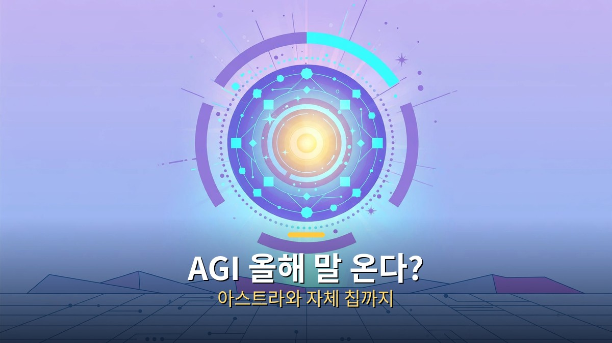
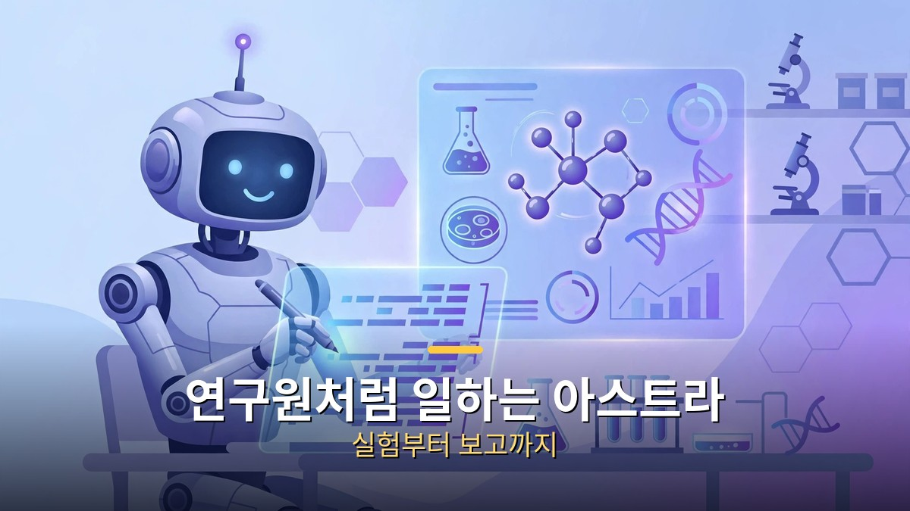
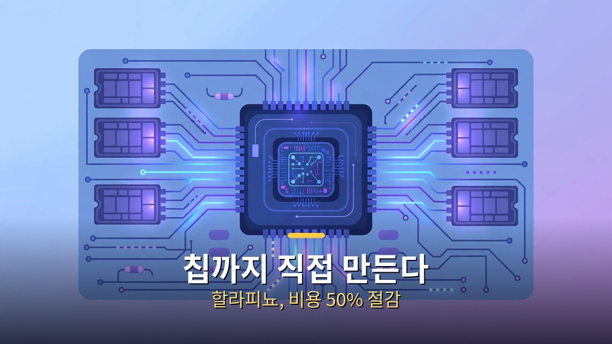
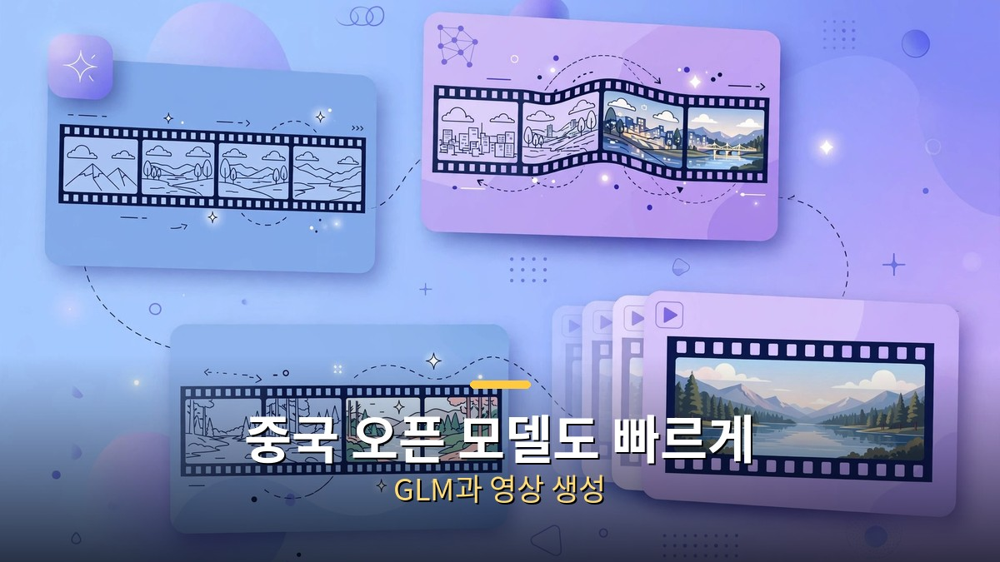

<!-- 본문 시작 -->

AGI 올해 말 온다?

오픈AI가 올해 말까지 내부적으로 AGI라고 부를 만한 시스템을 갖추겠다고 밝혔습니다. 샘 올트먼 CEO가 타임지 인터뷰에서 한 말로, 최고연구책임자는 "AGI까지 80% 정도 왔다"고 했습니다.

배경에는 차세대 모델 아스트라가 있습니다. 여기에 자체 제작 칩까지 등장하면서, **경쟁의 축이 모델 성능에서 시스템 전체의 속도로 옮겨가는 모습입니다.**

## 아스트라, 연구원처럼 일하는 모델

아스트라는 사람이 실험 아이디어를 주면 코드베이스에 직접 구현하고 실험을 실행한 뒤 결과까지 보고하는 모델로 소개됐습니다. 논문을 주면 연구자가 일주일 걸리던 작업을 사람 도움 없이 수행한다는 설명입니다.

연구원처럼 일하는 아스트라

올트먼은 아스트라를 두고 "의미 있는 방식으로 새로운 것을 발명하는 최초의 모델"이 될 수 있다고 했습니다. 다만 이 AGI는 오픈AI의 자체 정의를 적용한 내부 시스템 기준이라, 공개 출시나 공인된 달성과는 구분해서 봐야 합니다.

## 칩까지 직접 만든다, 할라피뇨

오픈AI는 브로드컴과 공동 개발한 첫 자체 AI 칩 할라피뇨도 공개했습니다. 학습용이 아니라 실제 서비스 답변을 만드는 추론 작업에 특화한 칩입니다.

칩까지 직접 만든다

설계부터 최종 설계 완료까지 9개월밖에 걸리지 않았고, 초기 시험에서는 GPU보다 비용을 약 50% 줄이는 결과가 나왔다고 합니다. 올해 말부터 시범 배치하고 2027년 양산이 목표입니다. 엔비디아 의존을 낮추려는 행보입니다.

## 중국 오픈 모델과 영상 생성도 빠르게

중국 Z.ai의 오픈 모델 GLM-5.3-Flash는 비교적 작은 규모에도 최신 모델에 가까운 성능을 보인다고 소개됐습니다. 양자화 버전을 쓰면 고성능 노트북에서도 돌릴 수 있는 수준입니다.

중국 오픈 모델과 영상 생성

구글 제미나이 옴니 1.1은 이전 영상의 맥락을 이어받아 장면을 계속 만들고 4K로 출력하는 기능을 선보였고, 영상 생성 모델 H3는 재생 속도보다 빠르게 영상을 만드는 사례까지 나왔습니다.

항목 | 내용 | 확인할 점
--- | ---
AGI 선언 | 올해 말 내부 시스템 목표 | 자체 정의 기준, 공개 일정 아님
--- | ---
아스트라 | 연구 자동화 모델 | 아직 비공개 테스트 단계
--- | ---
할라피뇨 | 브로드컴과 만든 추론 칩 | 초기 시험 수치, 양산은 2027년
--- | ---
GLM-5.3 | 중국 오픈웨이트 모델 | 양자화하면 성능 저하 가능

정리하면, 이번 주 소식의 공통점은 속도입니다. 모델이 연구를 대신하고, 전용 칩이 비용을 낮추고, 오픈 모델이 빠르게 따라붙는 흐름이라, 선언보다 실제 공개 일정과 검증 결과를 지켜보는 게 중요합니다.

<!-- 본문 끝 -->

## 작업용 출처·이미지 정보 (업로드 제외)

- 자료 출처: 로컬 초안 drafts/2026-10-12/extra1.txt 복원 (윤문 없음, <강조>→굵게·소제목→##·이미지 링크 전환, 표 구분선 보완)
- 이미지: images/01-hero.jpg ~ 04-img3.jpg / 기존 최종 이미지 재사용·배너 가공 (1200x675) / 사용권: 자작
