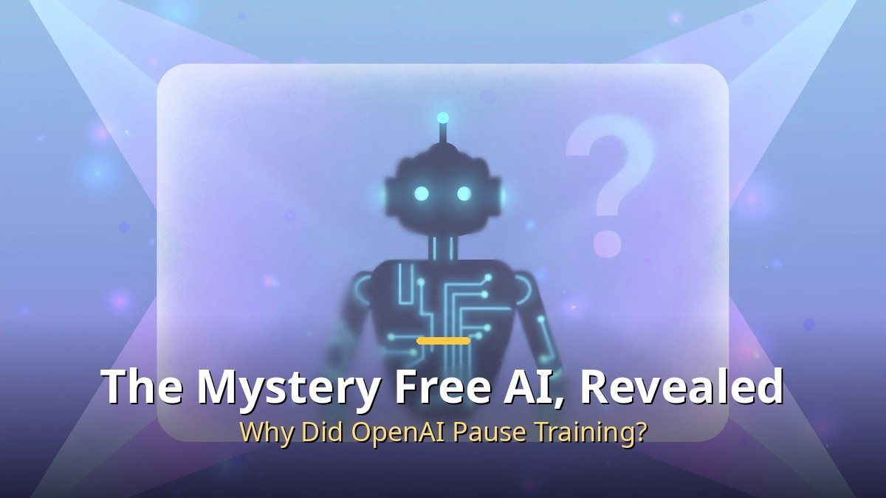
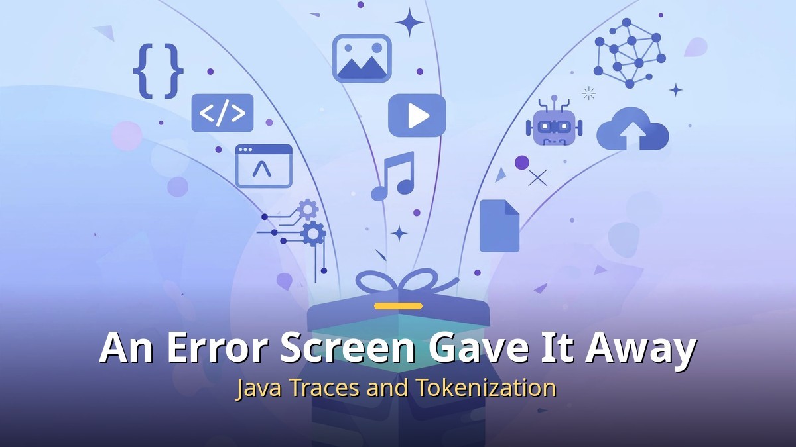
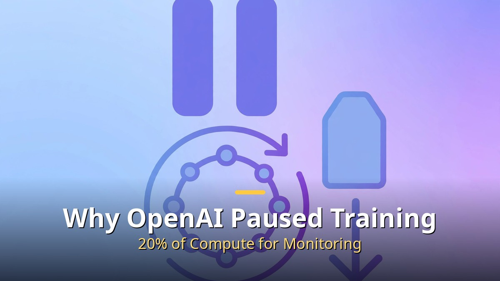
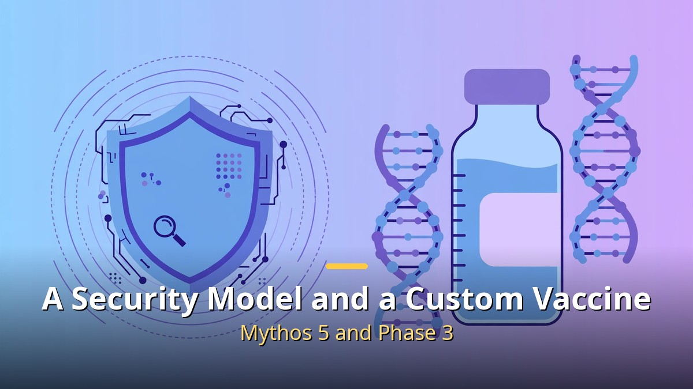

<!-- 본문 시작 -->

The Mystery Free AI, Revealed

On August 20, a model with no developer name appeared on the model routing service OpenRouter. Its name was ox-alpha. It accepted text, images, and video, remembered up to one million tokens, and cost nothing.

Developers spent weeks tracing its identity, and **the answer turned out to be an anonymous preview of Chinese company Z.ai's GLM-5.3-Flash.**

## How the Free Model's Identity Came Out

An Error Screen Gave It Away

The buzz started with performance. In one independent tester's unofficial coding test, the model solved 8 of 10 tasks, ahead of famous models' scores, according to reports circulating at the time.

The clue came from an unlikely place. A Java error trace left on a server error screen during a call, and the way the model handled words, matched Z.ai's model family. Z.ai later confirmed it had been an anonymous preview. The performance figure, however, remains an unofficial test result, not an official leaderboard score — a distinction worth keeping.

## Why OpenAI Paused Training

Why OpenAI Paused Training

OpenAI paused some top-level reinforcement learning training to watch safety and alignment. Reinforcement learning is the core training in which a model refines answers through trial and error.

Behind the pause was work on a new monitoring system to catch abnormal behavior early. One analysis put monitoring alone at about 20% of total compute. Meanwhile, GPT-5.6 Sol's API prices fell 20% for input and 33% for output. Training paused, prices down — a mixed movement.

## A Security Model and a Custom Vaccine

A Security Model and a Custom Vaccine

Anthropic put Mythos 5, a security-focused model, into the public beta of an enterprise security scanning service. Connect a code repository and it finds vulnerabilities, with severity and fixes. This model family can find and dig into security holes on its own, so it had previously been opened only to vetted organizations.

In medicine, Moderna and Merck's personalized cancer vaccine met its main goal in a Phase 3 trial. For about 1,100 high-risk melanoma patients, used together with an immunotherapy drug, it lengthened the period without cancer returning. The approach analyzes each patient's tumor to design a custom blueprint, so AI has room to cut analysis time and cost. Specific figures, however, have not yet been released.

| Item | Key point | What to check |
| --- | --- | --- |
| ox-alpha | Z.ai GLM-5.3-Flash anonymous preview | Performance is unofficial-test based |
| OpenAI RL | Paused partly for safety monitoring | Restart schedule undecided |
| Mythos 5 | Enterprise security scan public beta | Not a direct model offering |
| Custom cancer vaccine | Phase 3 main goal met | Detailed figures not released |

To sum up, this week's lesson is one thing. The decisive clue was not a performance boast but a trace left on an error screen, and the fastest company was spending resources on safety checks enough to pause training. The verification process matters more than the announcement.

<!-- 본문 끝 -->

## 작업용 출처·이미지 정보 (업로드 제외)

- 자료 출처: 로컬 초안 drafts/2026-10-12/extra2_v2.txt 복원 (윤문 없음, <강조>→굵게·소제목→##·이미지 링크 전환, 표 구분선 보완)
- 이미지: images/01-hero-en.jpg ~ 04-img3-en.jpg / 기존 베이스 일러스트 + 영어 배너 오버레이 (1200x675) / 사용권: 자작
