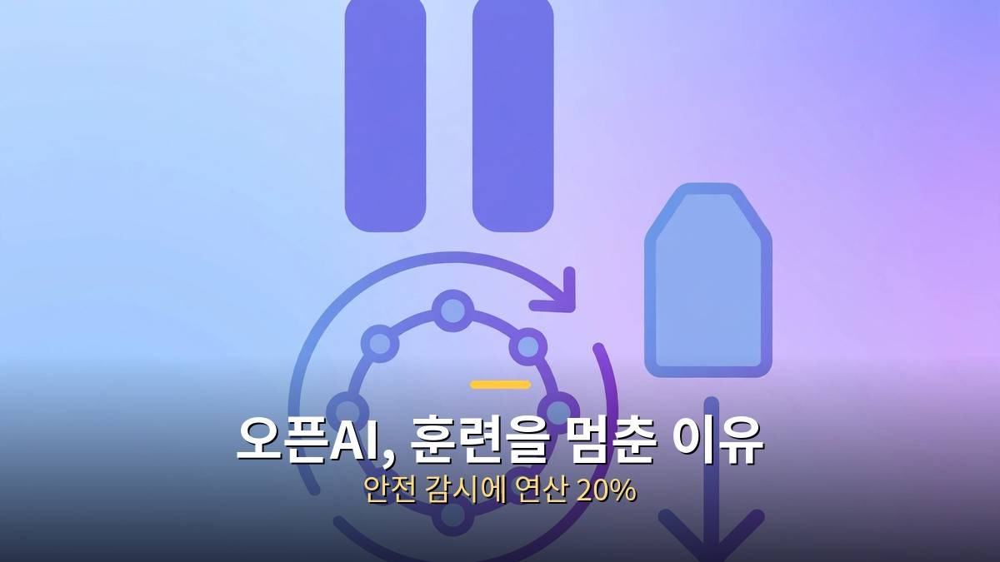
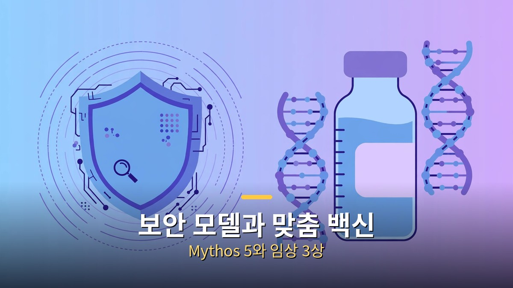

<!-- 본문 시작 -->

정체불명 무료 AI의 정체

8월 20일, 모델 라우팅 서비스 OpenRouter에 개발사 표기가 없는 모델 하나가 등장했습니다. 이름은 ox-alpha. 100만 토큰 기억 용량에 글·이미지·영상을 함께 받고, 가격까지 무료였습니다.

몇 주간 개발자들이 정체를 추적했고, **결국 답은 중국 Z.ai의 GLM-5.3-Flash를 익명으로 미리 풀어본 것이었습니다.**

## 무료 모델의 정체가 밝혀지기까지

화제의 시작은 성능이었습니다. 한 독립 테스터의 비공식 코딩 시험에서 이 모델은 과제 10개 중 8개를 풀어, 유명 모델들의 점수를 앞섰다는 결과가 돌았습니다.

오류 화면이 밝힌 정체

단서는 엉뚱한 곳에서 나왔습니다. 호출 중 발생한 서버 오류 화면에 남은 자바 오류 기록과 단어 처리 방식이 Z.ai 계열 모델의 것과 일치했던 겁니다. 이후 Z.ai가 익명 프리뷰였음을 직접 밝혔습니다. 다만 그 성능 수치는 지금도 공식 순위표가 아닌 비공식 시험 결과라는 점은 구분해야 합니다.

## 오픈AI, 강화학습을 멈춘 이유

오픈AI는 안전과 정렬 상태를 지켜본다는 이유로 일부 최상위 강화학습 훈련을 일시 중지했습니다. 강화학습은 모델이 시행착오를 반복하며 답을 다듬는 핵심 훈련입니다.

오픈AI, 훈련을 멈춘 이유

배경에는 모델의 이상 행동을 조기에 잡는 감시 체계를 새로 까는 작업이 있습니다. 감시에만 전체 연산의 약 20%가 들어간다는 분석도 나왔습니다. 한편 GPT-5.6 Sol의 API 가격은 입력 20%, 출력 33% 내렸습니다. 훈련은 멈춰 세우고, 가격은 내리는 엇갈린 움직임입니다.

## 보안 전용 모델과 맞춤 암 백신

앤트로픽은 보안 점검 전용 모델 Mythos 5를 기업용 보안 스캔 서비스의 공개 베타에 넣었습니다. 코드 저장소를 연결하면 취약점을 찾아 심각도와 수정 방법까지 알려주는 방식입니다. 이 모델 계열은 스스로 보안 구멍을 찾아 파고드는 수준이라, 그동안 검증된 기관에만 제한적으로 열려 있었습니다.

보안 모델과 맞춤 백신

의료에서는 모더나와 머크의 개인 맞춤 암 백신이 임상 3상에서 주요 목표를 달성했습니다. 고위험 흑색종 환자 약 1,100명에게 면역항암제와 함께 쓴 결과, 암이 재발하지 않는 기간이 늘어났습니다. 환자 종양을 분석해 맞춤 설계도를 만드는 방식이라 AI가 분석 시간과 비용을 줄일 여지도 큽니다. 다만 구체적인 수치는 아직 공개되지 않았습니다.

항목 | 핵심 내용 | 확인할 점
--- | ---
ox-alpha | Z.ai GLM-5.3-Flash 익명 프리뷰 | 성능은 비공식 시험 기준
--- | ---
오픈AI RL | 안전 감시를 위해 일부 일시 중지 | 재개 일정 미정
--- | ---
Mythos 5 | 기업용 보안 스캔 공개 베타 | 모델 직접 제공은 아님
--- | ---
맞춤 암 백신 | 임상 3상 주요 목표 달성 | 세부 수치 미공개

정리하면, 이번 주의 교훈은 하나입니다. 화제의 결정타는 성능 자랑이 아니라 오류 화면에 남은 기록이었고, 가장 빠른 회사는 훈련을 멈춰 세울 만큼 안전 확인에 자원을 쓰고 있습니다. 발표보다 확인 과정이 중요해진 셈입니다.

<!-- 본문 끝 -->

## 작업용 출처·이미지 정보 (업로드 제외)

- 자료 출처: 로컬 초안 drafts/2026-10-12/extra2_v2.txt 복원 (윤문 없음, <강조>→굵게·소제목→##·이미지 링크 전환, 표 구분선 보완)
- 이미지: images/01-hero.jpg ~ 04-img3.jpg / 기존 최종 이미지 재사용·배너 가공 (1200x675) / 사용권: 자작
