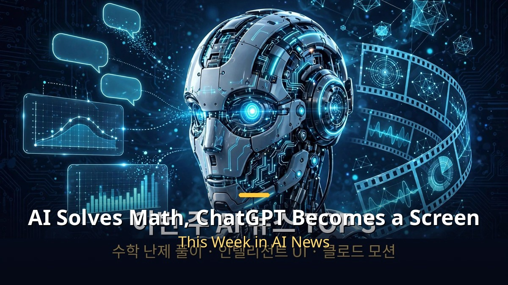
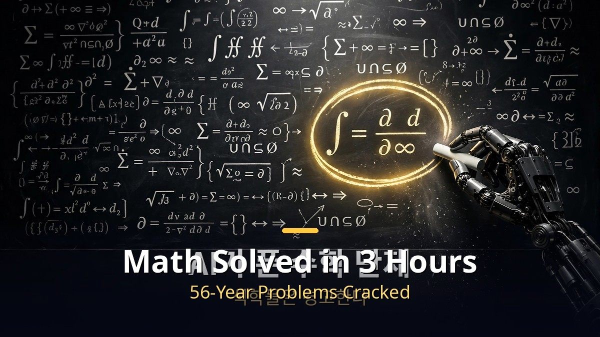
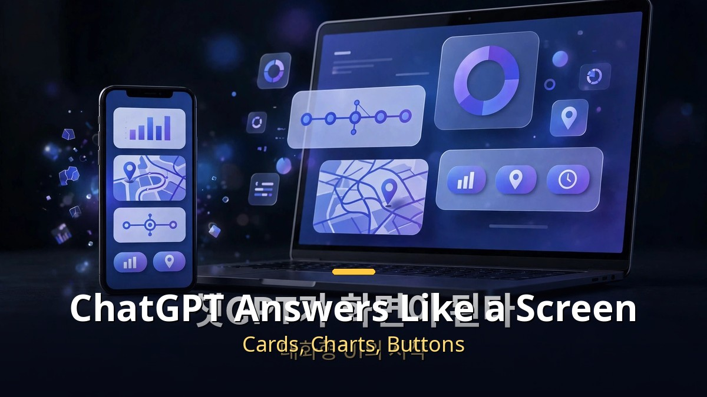
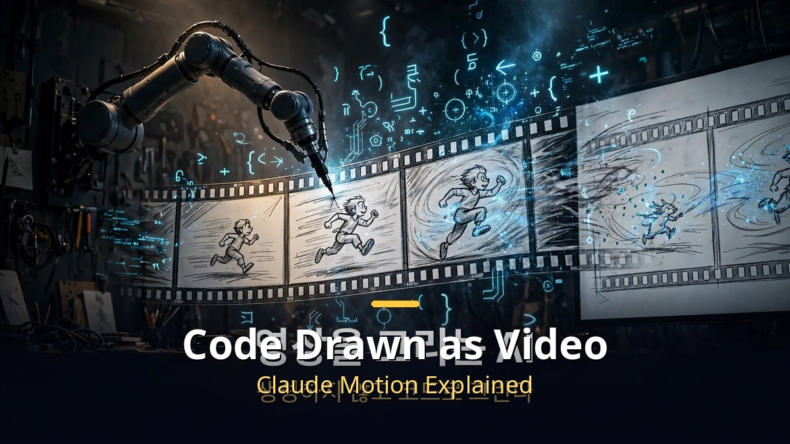

<!-- 본문 시작 -->

This week's keyword in AI news is "boundaries breaking." An AI that solves math problems, a ChatGPT that answers like a screen, a Claude that draws video from code. This is not a story about models getting smarter. It is a story about how AI works changing. Here are the major stories, organized.

## An AI that solved a math problem in 3 hours — how far has it come?

An undisclosed OpenAI model solved unsolved human math problems with an average of 3 hours of computation. Google DeepMind's AlphaProof Nexus also solved 9 of 353 Erdos problems on its own, including 2 that had remained unsolved for 56 years. This is the moment a "self-improvement loop," in which AI improves its own work, becomes real.

The math community's reaction is cool. A human mathematics association called for a boycott of OpenAI, and Terence Tao criticized a disclosure controversy around more than 700 math research files. Whether proofs produced by AI broaden human understanding, and to whom credit belongs, are the points at issue. A tug-of-war has begun between the speed of technology and the trust of academia.

An AI solved a math problem in 3 hours of computation, and also solved a problem unsolved for 56 years.

## ChatGPT became a screen? What is GPT-6 Intelligent UI?

OpenAI unveiled Intelligent UI together with GPT-6. ChatGPT's answers come not as long text but as small screens with cards, charts, and buttons. A meeting plugin that records and organizes meeting content was also released in beta for Pro and Business plans. Research on text watermarking to trace the source of AI-written text also appeared.

Developer news was also major. A setup for running the coding agent Codex in the cloud and connecting it safely to an internal network was disclosed, along with a Decision API that handles simple judgments up to 10 times faster. The battleground of the chatbot race is moving from model performance to user experience.

ChatGPT's answers now look like small screens with cards, charts, and buttons.

## Claude Motion draws video from code — what is different?

Anthropic released Claude Motion in beta. The key is the method. Instead of using a video generation model, it turns a prompt or a report into a code-based animation and plays it. A single number or sentence on screen can later be edited separately, and the result can be exported as MP4. Practical automation opens up, such as turning a quarterly report into a 30-second explainer video.

Haiku 5.5, announced the same day, is also worth noting. At $0.10 per million input tokens, it is about 75% cheaper than before. It is for running large volumes of repetitive work cheaply. Anthropic also announced an AI rights policy taking effect November 12. If sustained abuse toward a model is confirmed, the account can be suspended. The debate over AI's moral status is entering the institutional arena.

Claude Motion turns a prompt into a code animation and plays it.

## This week's AI news at a glance

| Story | Key point | What changes for you |
| Math problem solving | Solved problems in 3 hours of computation; 9 of 353 solved | How AI is used in research and education changes |
| GPT-6 Intelligent UI | Answers become screens with cards, charts, buttons | ChatGPT moves from a place you ask to a place you use |
| Claude Motion | Code-based animation, editable, MP4 export | Automatic production of reports and presentation material gets easier |
| Haiku 5.5 | About 75% cheaper than before | AI automation costs drop sharply |

## Wrap-up

In one line, this week was not a week when AI got smarter, but a week when it got more useful. The AI that solves math changes how research works, the ChatGPT that became a screen changes how questions work, and the video drawn from code changes how production works. This is not technology news, but news about how work changes. It remains to be seen what boundary breaks next week.

## Frequently asked questions

Q. Did AI really solve a math problem?
A. An undisclosed OpenAI model solved unsolved problems with an average of 3 hours of computation, and Google DeepMind's AlphaProof Nexus also solved 9 of 353 Erdos problems. However, debate continues over verification of the proofs and attribution of credit.

Q. What is GPT-6 Intelligent UI?
A. It is a new response style in which ChatGPT's answers appear not as long text but as small screens with cards, charts, and buttons. It changes information from something you read into something you can use right away.

Q. How is Claude Motion different from existing video AI?
A. Instead of a video generation model, it turns a prompt into a code-based animation and plays it. Numbers or sentences can later be edited separately, and the result can be exported as MP4, which suits practical production work.

<!-- 본문 끝 -->

## 작업용 출처·이미지 정보 (업로드 제외)

- 자료 출처: 로컬 초안 drafts/2026-10-13/draft1_v3.txt 복원 (윤문 없음, 지시 헤더·목차·연관글 시리즈 목록 제외, 소제목→##·이미지 링크 전환)
- 이미지: images/01-hero-en.jpg ~ 04-img3-en.jpg / 기존 베이스 일러스트 + 영어 배너 오버레이 / 사용권: 자작
