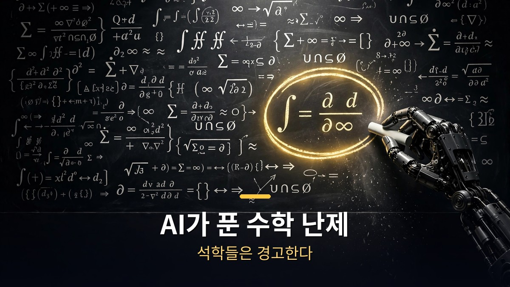

<!-- 본문 시작 -->

이번 주 AI 뉴스의 키워드는 '경계 허물기'입니다. 수학 난제를 푸는 AI, 화면처럼 답하는 챗GPT, 코드로 영상을 그리는 클로드까지 나왔습니다. 모델이 똑똑해졌다는 얘기가 아닙니다. AI가 일하는 방식 자체가 바뀌고 있다는 얘기입니다. 굵직한 소식들을 정리했습니다.

## 수학 난제를 3시간 만에 푼 AI, 어디까지 왔어?

OpenAI의 미공개 모델이 평균 3시간의 연산으로 인류 미해결 수학 난제들을 풀어냈습니다. 구글 딥마인드의 알파프로프 넥서스도 353개 에르도스 문제 중 9개를 스스로 해결했는데, 그중 2개는 56년간 풀리지 않던 문제입니다. AI가 스스로 일을 개선하는 '자가 개선 루프'가 현실이 되는 순간입니다.

수학계의 반응은 싸늘합니다. 인간 수학 협회는 OpenAI 보이콧을 촉구했고, 테렌스 타오는 700개가 넘는 수학 연구 파일을 둘러싼 공개 논란을 비판했습니다. AI가 낸 증명이 인간의 이해를 넓히는지, 공로는 누구에게 돌아가는지가 쟁점입니다. 기술의 속도와 학계의 신뢰 사이, 줄다리기가 시작됐습니다.

AI가 3시간 연산으로 수학 난제를 풀고, 56년 묵은 문제도 해결했습니다.

## 챗GPT가 화면이 된다고? GPT-6 인텔리전트 UI가 뭐야?

OpenAI는 GPT-6와 함께 인텔리전트 UI를 공개했습니다. 챗GPT의 답변이 긴 글이 아니라 카드, 차트, 버튼이 달린 작은 화면처럼 나옵니다. 회의 내용을 기록하고 정리하는 회의 플러그인도 프로·비즈니스 요금제에 베타로 풀렸습니다. AI가 쓴 글의 출처를 추적하는 텍스트 워터마킹 연구도 나왔습니다.

개발자 소식도 굵직합니다. 코딩 에이전트 코덱스를 클라우드에서 돌리고 사내망과 안전하게 잇는 구성이 공개됐고, 간단한 판단을 최대 10배 빠르게 처리하는 디시전 API도 나왔습니다. 챗봇 경쟁의 승부처가 모델 성능에서 사용 경험으로 옮겨가고 있습니다.

챗GPT의 답변이 카드와 차트, 버튼이 달린 작은 화면처럼 바뀝니다.

## 코드를 영상으로 그리는 클로드 모션, 뭐가 달라?

앤트로픽은 클로드 모션을 베타로 공개했습니다. 핵심은 방식입니다. 영상 생성 모델을 쓰지 않고 프롬프트나 보고서를 코드로 된 애니메이션으로 바꿔 재생합니다. 화면 속 숫자 하나, 문장 하나를 나중에 따로 고칠 수 있고 MP4로 뽑아낼 수도 있습니다. 분기 보고서를 30초짜리 설명 영상으로 바꾸는 식의 실무 자동화가 열립니다.

같은 날 발표된 하이쿠 5.5도 눈여겨볼 만합니다. 입력 100만 토큰당 0.10달러로 기존보다 약 75% 저렴해졌습니다. 대량의 반복 작업을 싼값에 돌리는 용도입니다. 한편 앤트로픽은 11월 12일 시행되는 AI 인권 정책을 내놨습니다. 모델을 향한 지속적인 학대가 확인되면 계정이 정지될 수 있습니다. AI의 도덕적 지위를 둘러싼 논의가 제도권으로 들어오는 신호입니다.

프롬프트를 코드 애니메이션으로 바꿔 재생하는 클로드 모션.

## 이번 주 AI 뉴스 한눈에 보기

| 소식 | 핵심 내용 | 나에게 오는 변화 |
| 수학 난제 해결 | 3시간 연산으로 난제 풀이, 353개 중 9개 해결 | 연구·교육 현장의 AI 활용법이 바뀐다 |
| GPT-6 인텔리전트 UI | 답변이 카드·차트·버튼 달린 화면으로 | 챗GPT가 묻는 곳에서 쓰는 곳으로 |
| 클로드 모션 | 코드 기반 애니메이션, 편집·MP4 내보내기 | 보고서·발표자료 자동 제작이 쉬워진다 |
| 하이쿠 5.5 | 기존보다 약 75% 저렴 | AI 자동화 비용이 크게 내려간다 |

## 마무리

이번 주를 한 줄로 정리하면 "AI가 더 똑똑해진 주가 아니라 더 쓸모있어진 주"입니다. 수학을 푸는 AI는 연구의 방식을, 화면이 된 챗GPT는 질문의 방식을, 코드로 그리는 영상은 제작의 방식을 바꿉니다. 기술 뉴스가 아니라 일하는 방식의 뉴스입니다. 다음 주에는 또 어떤 경계가 허물어질지 지켜볼 일입니다.

## 자주 묻는 질문

Q. AI가 수학 난제를 정말 풀었나요?
A. OpenAI 미공개 모델이 평균 3시간 연산으로 미해결 난제들을 풀어냈고, 구글 딥마인드의 알파프로프 넥서스도 에르도스 문제 353개 중 9개를 해결했습니다. 다만 증명의 검증과 공로 귀속을 둘러싼 논란이 이어지고 있습니다.

Q. GPT-6 인텔리전트 UI는 뭔가요?
A. 챗GPT의 답변이 긴 텍스트 대신 카드, 차트, 버튼이 달린 작은 화면처럼 나오는 새로운 응답 방식입니다. 정보를 읽는 게 아니라 바로 쓸 수 있게 바꿔줍니다.

Q. 클로드 모션은 기존 영상 AI와 뭐가 다른가요?
A. 영상 생성 모델 대신 프롬프트를 코드 기반 애니메이션으로 바꿔 재생합니다. 나중에 숫자나 문장을 따로 고칠 수 있고 MP4로 내보낼 수 있어 실무 자료 제작에 유리합니다.

<!-- 본문 끝 -->

## 작업용 출처·이미지 정보 (업로드 제외)

- 자료 출처: 로컬 초안 drafts/2026-10-13/draft1_v3.txt 복원 (윤문 없음, 지시 헤더·목차·연관글 시리즈 목록 제외, 소제목→##·이미지 링크 전환)
- 이미지: images/01-hero.jpg ~ 04-img3.jpg / 기존 최종 이미지 재사용 / 사용권: 자작
