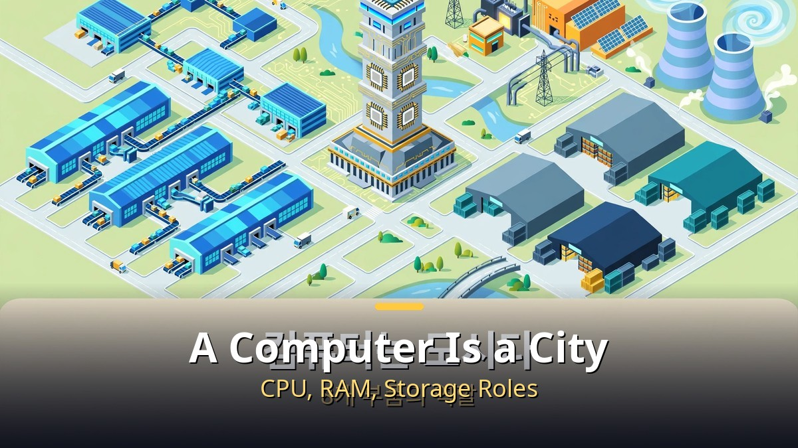
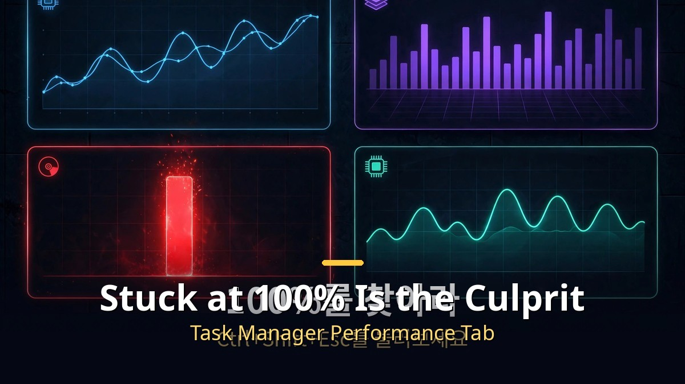
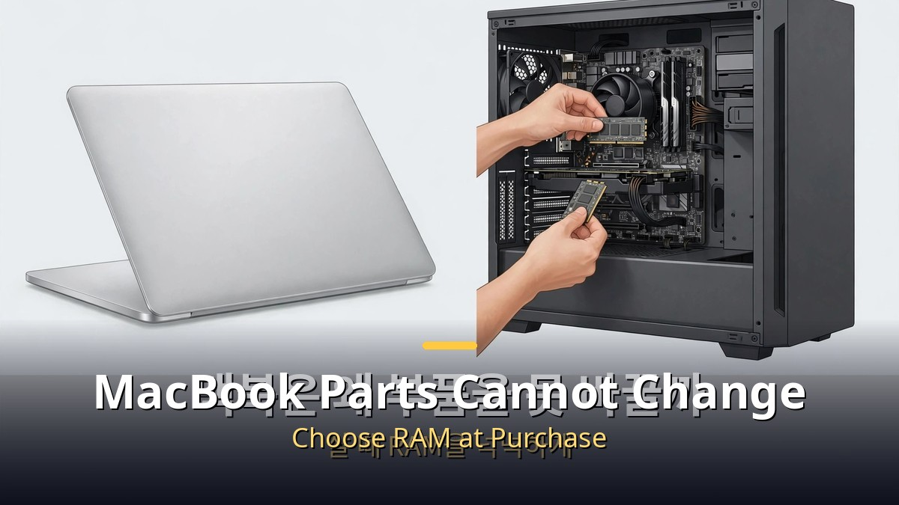

<!-- 본문 시작 -->

When you are vibe coding, an unfair moment arrives. You asked the AI for the same kind of work, yet one day its answers slow down and the whole computer stutters. Many people blame the AI. But the real culprit is usually elsewhere: your computer's parts. A map of the parts, comparing a computer to a city, shows why it slows down.

## What does each computer part do?

The CPU is the city hall. It issues orders and makes decisions. Cores are the number of counters working at once, and clock speed, shown in GHz, is how fast they process. RAM is the parcel sorting center. It is the workbench where the material you are using right now is spread out, and it empties completely when the power goes off. That is why unsaved work disappears. Storage is the warehouse. An HDD is a spinning disk and slow, while an SSD is up to 39 times faster. Moving Windows from an HDD to an SSD alone changes how the computer feels.

The graphics card is a card-section cheering squad. Many people each perform one fixed role at the same time, a structure used to draw game screens. That parallel processing ability is now also used for AI computation. The motherboard is the city's land and roads, the power supply is the substation, and the cooler is the wind path. If the power supply is weak, the computer shuts off, and if heat is trapped, parts slow themselves down in throttling. That is why one dust cleaning can feel like a performance upgrade.

A computer is a city. The CPU is city hall, RAM is the parcel sorting center, storage is the warehouse.

## How do you find the part that slows things down?

When it slows down, press Ctrl+Shift+Esc to open Task Manager. On the Performance tab, check CPU, memory, disk, and GPU. If any one of them is stuck at 100%, that part is the bottleneck. A computer's overall performance is decided not by its most expensive part but by its slowest part. Even with a top-end CPU, if storage is an HDD, the CPU just waits.

The disk entry also shows at once whether it is an SSD or an HDD. If disk usage is stuck at 100% and the drive is an HDD, the culprit is almost certain. Switching an HDD to an SSD is the cheapest upgrade for the difference it makes. Checking the system comes before replacing an expensive part.

In Task Manager's Performance tab, the part stuck at 100% is the culprit.

## Why can't a MacBook's parts be replaced?

A MacBook's M chip integrates the CPU, graphics, AI compute chip, and RAM into one design. With short distances between parts, it is fast and efficient. But memory cannot be added after purchase. So for a MacBook, choosing plenty of RAM at purchase time is the right answer. Many people who bought an 8GB model regret it once they start vibe coding. Choosing 16GB, or 24GB if the budget allows, is the secret to using it for a long time.

A MacBook M chip integrates parts into one, so post-purchase upgrades are not possible.

## Computer parts at a glance

| Part | City metaphor | Cause of slowdowns |
| CPU | City hall | Compute bottleneck, too few cores or too low clock |
| RAM | Parcel sorting center | Workbench fills up when capacity is short |
| Storage | Warehouse | HDD up to 39x slower than SSD |
| Graphics card | Card-section cheering squad | Parallel processing, also used for AI compute |
| Power and cooling | Substation and wind path | Power shortage, heat throttling |

## Wrap-up

More often than you might think, it is not the AI that slowed down, but the computer struggling. With a one-page map of the parts, you can stop blaming the AI unfairly. Find the bottleneck in Task Manager, switch to an SSD if you have an HDD, and start with cleaning if heat is suspected. The speed of vibe coding is decided not by the AI model but by the computer on your desk. Next time it stutters, press Ctrl+Shift+Esc before getting angry at the AI.

## Frequently asked questions

Q. What should I check first when vibe coding slows down?
A. Press Ctrl+Shift+Esc to open Task Manager and look at the Performance tab. Among CPU, memory, disk, and GPU, the item stuck at 100% is the bottleneck. Check that part first.

Q. How much faster is switching from HDD to SSD?
A. An SSD is up to 39 times faster than an HDD. Moving the drive Windows is installed on to an SSD alone makes a big difference in boot and program launch feel. It is the cheapest upgrade for the difference it makes.

Q. Why can't a MacBook's RAM be increased?
A. The M chip integrates the CPU, graphics, AI compute chip, and RAM into one design, so memory cannot be added after purchase. That is why it is better to choose 16GB or more when buying a MacBook.

<!-- 본문 끝 -->

## 작업용 출처·이미지 정보 (업로드 제외)

- 자료 출처: 로컬 초안 drafts/2026-10-13/draft2_v3.txt 복원 (윤문 없음, 지시 헤더·목차·연관글 시리즈 목록 제외, 소제목→##·이미지 링크 전환)
- 이미지: images/01-hero-en.jpg ~ 04-img3-en.jpg / 기존 베이스 일러스트 + 영어 배너 오버레이 / 사용권: 자작
