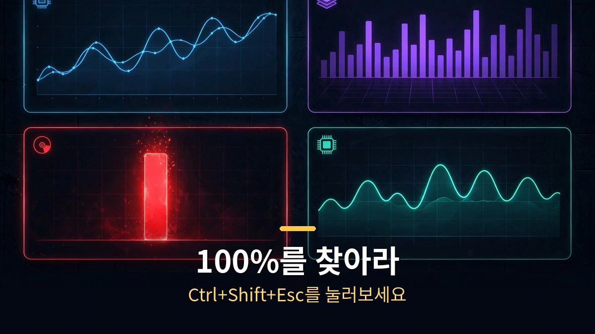
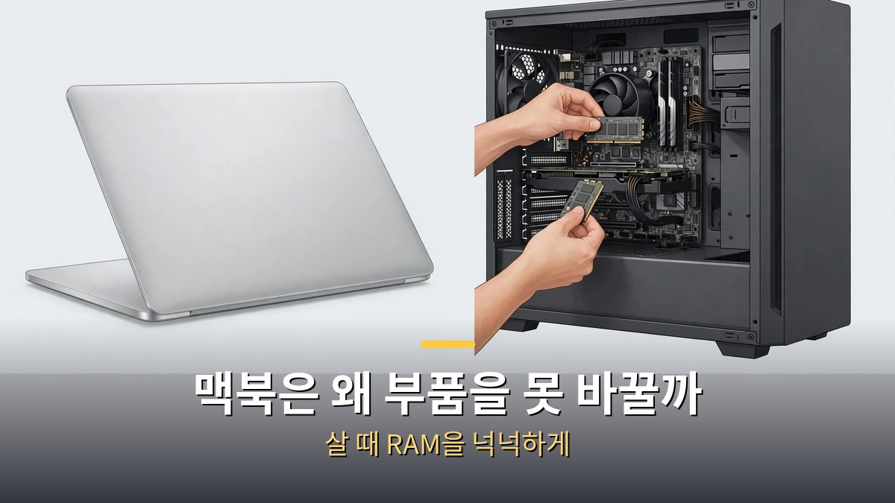

<!-- 본문 시작 -->

바이브코딩을 하다 보면 억울한 순간이 옵니다. 분명 AI에게 시킨 건 같은 일인데, 어느 날부터 답이 느려지고 컴퓨터 전체가 버벅입니다. 이때 많은 사람이 AI를 탓합니다. 하지만 진짜 범인은 따로 있을 확률이 높습니다. 바로 당신의 컴퓨터 부품입니다. 컴퓨터를 도시에 비유한 부품 지도 한 장으로 느려지는 이유를 찾아보겠습니다.

## 컴퓨터 부품, 각각 뭐 하는 거야?

CPU는 시청입니다. 명령을 내리고 처리하는 결정권자입니다. 코어는 동시에 일하는 창구 수, 클럭은 처리 속도로 GHz 단위로 표기됩니다. RAM은 택배 분류장입니다. 지금 쓰는 자료를 펼쳐두는 작업대인데 전원을 끄면 싹 비워집니다. 그래서 저장 안 한 작업은 날아갑니다. 저장장치는 창고입니다. HDD는 빙글빙글 도는 원판이라 느리고, SSD는 최대 39배 빠릅니다. 윈도우를 HDD에서 SSD로 옮기는 것만으로 체감이 확 달라집니다.

그래픽카드는 카드 섹션 응원단입니다. 수많은 사람이 정해진 역할만 동시에 수행하는 구조로, 게임 화면을 그리는 데 쓰입니다. 이 병렬 처리 능력이 요즘 AI 연산에도 쓰입니다. 메인보드는 도시의 땅과 도로, 파워는 변전소, 쿨러는 바람길입니다. 파워가 부실하면 컴퓨터가 꺼지고, 열이 막히면 부품이 스스로 속도를 낮추는 스로틀링이 걸립니다. 먼지 청소 한 번이 성능 향상으로 이어지는 이유입니다.

컴퓨터는 도시다. CPU는 시청, RAM은 택배 분류장, 저장장치는 창고입니다.

## 느려지는 범인은 어떻게 찾아?

느려지는 순간 Ctrl+Shift+Esc를 눌러 작업 관리자를 열어보세요. '성능' 탭에서 CPU, 메모리, 디스크, GPU를 확인합니다. 어느 하나가 100%에 붙어 있다면 그 부품이 병목입니다. 컴퓨터 전체 성능은 가장 비싼 부품이 아니라 가장 느린 부품이 결정합니다. 최고급 CPU라도 저장장치가 HDD면 CPU는 기다리기만 합니다.

디스크 항목에서는 SSD인지 HDD인지도 바로 보입니다. 디스크 사용률이 100%에 붙어 있고 HDD라면 범인은 거의 확정입니다. HDD를 SSD로 바꾸는 게 체감 대비 가장 싼 업그레이드입니다. 비싼 부품을 바꾸기 전에 시스템부터 확인하는 게 순서입니다.

작업 관리자 성능 탭에서 100%에 붙어 있는 부품이 범인입니다.

## 맥북은 왜 부품을 못 바꾸는데?

맥북의 M칩은 CPU, 그래픽, AI 연산 칩, 램이 하나로 통합된 설계입니다. 부품 간 거리가 짧아 빠르고 효율적입니다. 대신 산 뒤에 메모리를 늘릴 수 없습니다. 그래서 맥북은 살 때 램을 넉넉하게 고르는 게 정답입니다. 8GB 모델을 샀다가 바이브코딩을 시작하면 금방 후회하는 패턴이 많습니다. 16GB, 여유가 된다면 24GB를 고르는 게 오래 쓰는 비결입니다.

맥북 M칩은 부품이 하나로 통합돼 사후 업그레이드가 안 됩니다.

## 컴퓨터 부품 한눈에 보기

| 부품 | 도시 비유 | 느려지는 원인 |
| CPU | 시청 | 연산 병목, 코어·클럭 부족 |
| RAM | 택배 분류장 | 용량 부족 시 작업대 포화 |
| 저장장치 | 창고 | HDD는 SSD보다 최대 39배 느림 |
| 그래픽카드 | 카드 섹션 응원단 | 병렬 처리, AI 연산에도 활용 |
| 파워·쿨러 | 변전소·바람길 | 전력 부족, 발열 스로틀링 |

## 마무리

AI가 느려진 게 아니라 컴퓨터가 버거워하는 경우가 생각보다 많습니다. 부품 지도 한 장이면 억울한 AI 탓을 그만둘 수 있습니다. 작업 관리자에서 병목을 찾고, HDD라면 SSD로, 발열이 의심되면 청소부터. 바이브코딩의 속도는 AI 모델이 아니라 당신 책상 위 컴퓨터가 결정합니다. 다음에 버벅이면 AI에게 화내기 전에 Ctrl+Shift+Esc부터 눌러보세요.

## 자주 묻는 질문

Q. 바이브코딩이 느려지면 가장 먼저 뭘 확인해야 하나요?
A. Ctrl+Shift+Esc로 작업 관리자를 열어 '성능' 탭을 봅니다. CPU, 메모리, 디스크, GPU 중 100%에 붙어 있는 항목이 병목입니다. 그 부품부터 점검하세요.

Q. HDD를 SSD로 바꾸면 얼마나 빨라지나요?
A. SSD는 HDD보다 최대 39배 빠릅니다. 윈도우가 설치된 드라이브를 SSD로 옮기는 것만으로도 부팅과 프로그램 실행 체감이 크게 달라집니다. 체감 대비 가장 저렴한 업그레이드입니다.

Q. 맥북은 램을 왜 못 늘리나요?
A. M칩은 CPU, 그래픽, AI 연산 칩, 램을 하나로 통합한 설계라 구매 후 메모리 추가가 안 됩니다. 그래서 맥북은 살 때 16GB 이상으로 넉넉하게 고르는 게 좋습니다.

<!-- 본문 끝 -->

## 작업용 출처·이미지 정보 (업로드 제외)

- 자료 출처: 로컬 초안 drafts/2026-10-13/draft2_v3.txt 복원 (윤문 없음, 지시 헤더·목차·연관글 시리즈 목록 제외, 소제목→##·이미지 링크 전환)
- 이미지: images/01-hero.jpg ~ 04-img3.jpg / 기존 최종 이미지 재사용 / 사용권: 자작
