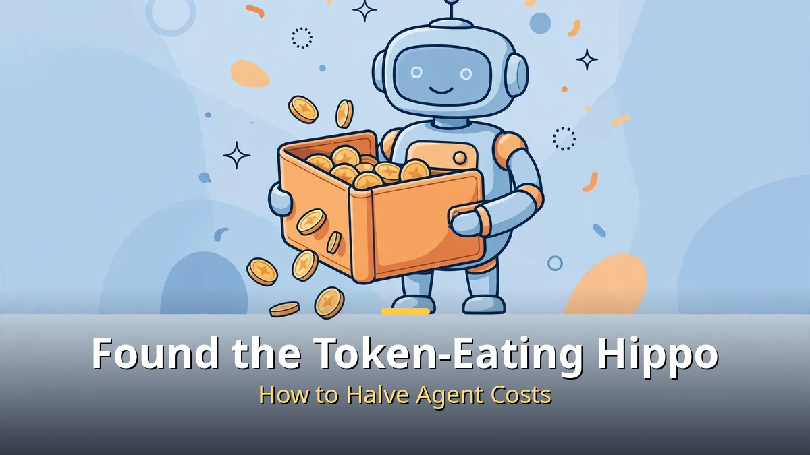
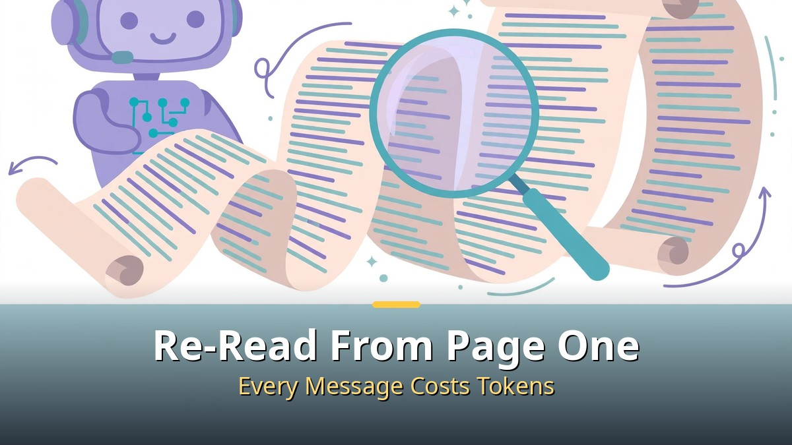
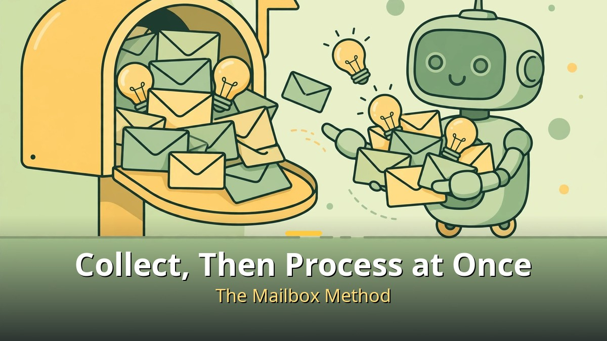
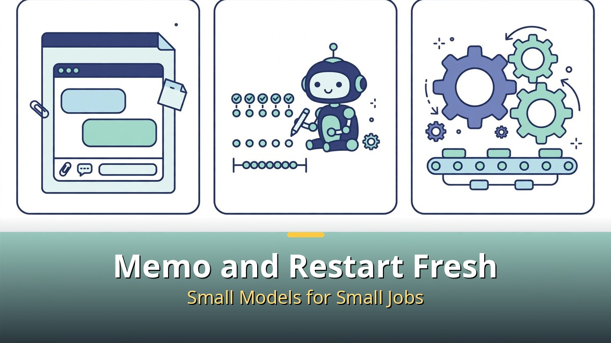

<!-- 본문 시작 -->

When you use an AI agent, this thought comes to mind.
"I barely asked it to do anything, so why is the bill so high?"
It is not because you asked for a lot.
There is a different culprit.
It comes from the structure: the AI re-reads the whole conversation from the beginning every time.
Today, I organized the identity of the token-eating hippo and how to halve the cost.

> **Key takeaway: An AI cannot remember previous conversations the way people do, so every time you talk to it, it re-reads the entire record. That is why tokens are consumed the most when you resume a conversation after a long break. If you collect ideas in a mailbox and process them in batches, you can save a great deal of cost.**

## What is the real culprit behind AI bills?

AI does not have human-like memory.
Every time we talk to it, it re-reads the entire conversation so far from the beginning and then produces an answer.

It is like re-reading a book from page one every time you are asked a question while reading it.
The longer the conversation, the more it has to read, so token use grows.

But the real problem is not the length of the conversation.
It is when you talk to it again after taking a break of about an hour.

When you come back and say, "Finish what we were doing earlier," the AI has to pay the cost of re-reading the whole long conversation from the beginning.

In fact, when one day of AI activity was measured, newly processed work took only about 10% of the total time, while almost half of the total time went to waking up conversations that had been resting.

Tokens do not go out because you asked for a lot. They go out when you drag a conversation on and then wake up a rested conversation.
That is the identity of the token-eating hippo.

The AI re-reads the conversation from the beginning every time you talk to it. The longer it gets, the more tokens it uses.

## What is the mailbox method?

The key is to process things in batches.
Instead of throwing an idea at the AI the moment it comes to mind, collect it in a "mailbox" and process everything at once later.

First, a quick note on the speaker's way of working in the video.
The speaker does not work alone, but runs a team of several AI agents.
They are divided by purpose, like a writing team, a research team, and a coding team.

And the AI assistant that manages these teams is "Bella."
Think of her as a chief of staff.

Bella's core job is managing the mailbox.
If the user wakes up the responsible team every time an idea comes up, the resting team has to wake up again each time, consuming tokens.

So when Bella receives a request, she puts it in that team's mailbox, and the team picks it all up and processes it when it next starts work.
Only truly urgent work is handled immediately.

You can use the same method.
Make an "ask the AI" list in a notes app, and whenever a thought comes to mind, write it there.
Deliver the list to the AI once or twice a day at set times.

Just gathering requests instead of throwing them one by one can greatly reduce tokens.

Interestingly, this method is also good for people.
If you wait for an immediate answer every time you throw out work, your mind never gets a rest.

If you leave it in the mailbox, the AI remembers the work and you can focus on what you are doing now.
Saving tokens ends up being a way to save focus and health.

Do not throw ideas out right away. Collect them in the mailbox and process them in a batch.

## What are the tips you can use right away?

Besides the mailbox method, here are three tips you can use right away.

First, do not leave a conversation that has lasted more than an hour as it is.
Leave a short memo of what has happened so far, close the window, and then have the new window start from that memo.
Having it read a single memo is much cheaper than having it re-read a long conversation in full.

Second, leave simple, repetitive work like searching or counting to a smaller model.
Using an expensive large model like a calculator is a waste.
For the same task, a smaller model was faster and cost about half as much.

Third, automate work that repeats the same way every time with a program instead of AI.
There is no need to use AI for work processed in a fixed order.
That way, token costs drop to zero.

For long sessions, leave a memo and start a new window; leave simple work to a small model.

| Method | Effect | When to use it |
|---|---|---|
| Mailbox method | Cuts conversation restart costs | When ideas come up throughout the day |
| Memo, then a new window | Cuts tokens for long conversations | Conversations lasting more than an hour |
| Smaller model | About half the cost | Simple, repetitive work like searching and counting |
| Program automation | Zero token cost | Repetitive work done the same way every time |

Using it, I realized that saving on AI bills ended up changing my daily rhythm.
Once I dropped the habit of throwing work out and waiting for an immediate answer, my mind felt much lighter.
While I had the AI handle work in batches, I could rest fully.
I felt firsthand how one way of using technology can change how you work.

## Frequently asked questions

**Q. What exactly is a token?**
A. It is the unit by which AI processes text.
When you ask AI to do work, you are charged based on the amount of input and output text, and that unit is the token.
The longer the conversation, the more tokens grow.

**Q. How do I start the mailbox method?**
A. Make an "ask the AI" list in a notes app or document, and whenever a thought comes to mind, write it there.
Deliver the list to the AI once or twice a day at set times.

**Q. Where do I pick a smaller model?**
A. Check the model selection menu in services like ChatGPT or Claude.
There are separate low-cost, high-speed models for light work.
They often have words like mini or haiku in their names.

<!-- 본문 끝 -->

## 작업용 출처·이미지 정보 (업로드 제외)

- 자료 출처: 로컬 초안 drafts/2026-10-13/draft3_token_v2.txt 복원 (윤문 없음)
- 이미지: images/01-hero-en.jpg ~ 04-img3-en.jpg / 기존 베이스 일러스트 + 영어 배너 오버레이 / 사용권: 자작
