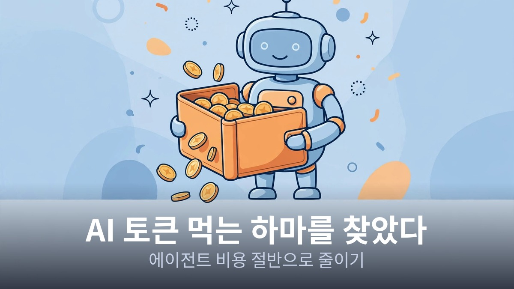
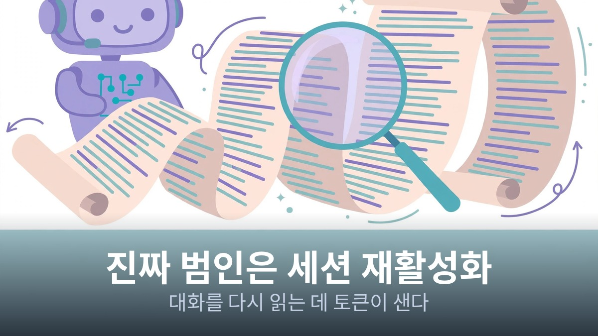
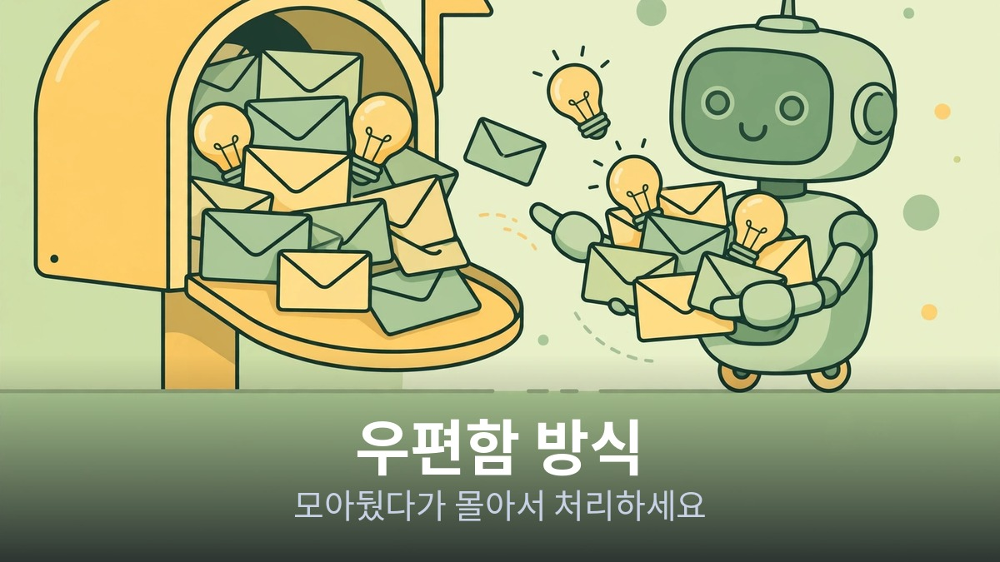
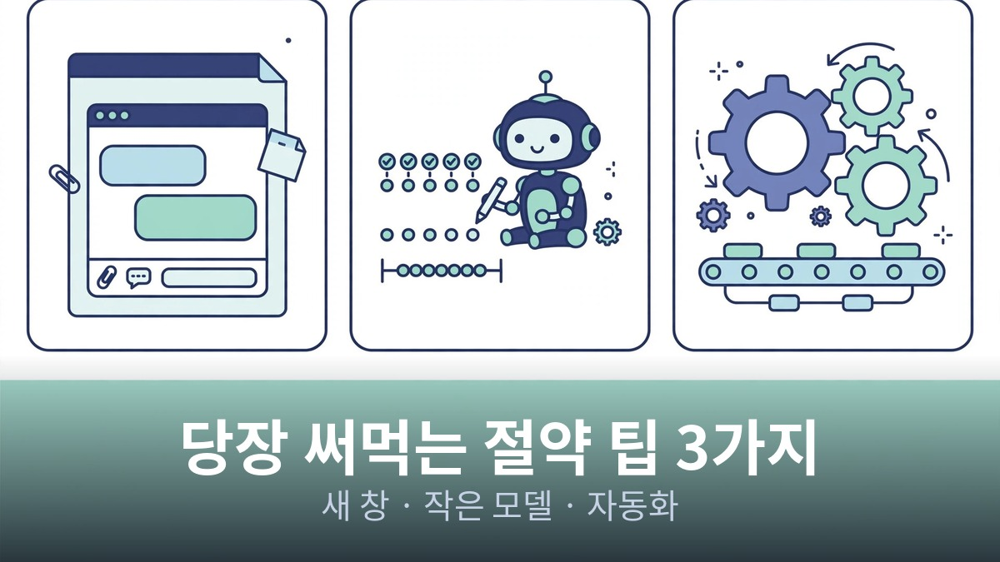

<!-- 본문 시작 -->

AI 에이전트를 쓰다 보면 이런 생각이 듭니다.
"시킨 것도 별로 없는데 왜 이렇게 요금이 나오지?"
많이 시켜서 그런 게 아닙니다.
범인은 따로 있습니다.
AI가 대화 내용을 매번 처음부터 다시 읽는 구조 때문입니다.
오늘은 토큰 먹는 하마의 정체와 비용을 절반으로 줄이는 방법을 정리했습니다.

> **핵심 정리**
>
> AI는 이전 대화를 기억하지 못해서 말을 걸 때마다 전체 기록을 다시 읽습니다.
> 그래서 대화를 오래 쉬었다가 다시 시작할 때 토큰이 가장 많이 소모됩니다.
> 아이디어를 우편함에 모아뒀다가 몰아서 처리하면 비용을 크게 아낄 수 있습니다.

## AI 요금의 진짜 범인은 뭐야?

AI에게는 사람 같은 기억력이 없습니다.
우리가 말을 걸 때마다 지금까지 나눈 대화 전체를 처음부터 다시 읽고 답변을 만듭니다.

책을 읽다가 질문을 받을 때마다 첫 페이지부터 다시 훑는 것과 비슷합니다.
대화가 길어질수록 읽어야 할 분량이 늘어나니 토큰 소모가 커지는 구조입니다.

그런데 진짜 문제는 대화의 길이가 아닙니다.
한 시간 정도 쉬었다가 다시 말을 걸 때입니다.

잠시 자리를 비웠다가 돌아와서 "아까 그거 마저 해줘"라고 하면, AI는 길었던 대화 전체를 처음부터 다시 읽는 비용을 치러야 합니다.

실제로 하루 동안 AI의 활동을 재어보니 새로 업무를 처리한 시간은 전체의 10% 남짓이었고, 쉬었던 대화를 다시 깨우는 데 전체 시간의 절반 가까이가 쓰였습니다.

토큰은 많이 시켜서 나가는 게 아니라, 대화를 길게 끌다가 쉬었던 대화를 다시 깨울 때 나갑니다.
이게 토큰 먹는 하마의 정체입니다.

AI는 말을 걸 때마다 대화를 처음부터 다시 읽습니다. 길어질수록 토큰이 늘어납니다.

## 우편함 방식이 뭐야?

핵심은 '몰아서 처리하기'입니다.
아이디어가 떠오를 때마다 바로 AI에게 던지지 말고 '우편함'에 모아뒀다가 한꺼번에 처리하는 방식입니다.

여기서 잠깐, 영상 속 화자의 작업 방식을 설명해야 합니다.
화자는 혼자 일하는 게 아니라 여러 개의 AI 에이전트 팀을 운용하고 있습니다.
글쓰기 팀, 조사 팀, 코딩 팀처럼 용도별로 나눈 겁니다.

그리고 이 팀들을 총괄하는 AI 비서가 바로 '벨라'입니다.
비서실장 같은 역할이라고 보면 됩니다.

벨라의 핵심 업무가 바로 우편함 관리입니다.
사용자가 아이디어를 떠올릴 때마다 담당 팀을 바로 깨우면, 쉬고 있던 팀이 매번 다시 깨어나면서 토큰이 소모됩니다.

그래서 벨라는 요청을 받으면 해당 팀의 우편함에 넣어두고, 팀이 다음에 작업을 시작할 때 한꺼번에 가져가 처리하도록 합니다.
정말 급한 일만 즉시 처리하는 겁니다.

우리도 같은 방식을 쓸 수 있습니다.
메모 앱에 'AI에게 시킬 일' 목록을 만들고, 생각이 날 때마다 거기에 적어두세요.
하루에 한두 번 정해진 시간에 목록을 AI에게 전달하면 됩니다.

그때그때 던지는 대신 모아서 시키는 것만으로 토큰이 크게 줄어듭니다.

재밌는 건 이 방식이 사람에게도 좋다는 점입니다.
일을 던질 때마다 즉시 답을 기다리면 머리가 쉴 틈이 없습니다.

우편함에 맡겨두면 AI는 작업을 기억하고 사용자는 지금 하는 일에 집중할 수 있습니다.
토큰을 아끼는 법이 결국 집중력과 건강을 아끼는 법이 됩니다.

아이디어를 바로 던지지 말고 우편함에 모아뒀다가 몰아서 처리하세요.

## 당장 써먹을 절약 팁은 뭐야?

우편함 방식 말고도 바로 쓸 수 있는 팁 세 가지가 있습니다.

첫째, 한 시간 이상 이어진 대화는 그대로 두지 마세요.
지금까지 진행된 내용을 짧게 메모로 남기고 창을 닫은 뒤, 새 창에서 그 메모부터 읽게 하면 됩니다.
긴 대화를 통째로 다시 읽히는 것보다 메모 한 장을 읽히는 게 훨씬 쌉니다.

둘째, 찾기나 세기 같은 단순 반복 작업은 작은 모델에게 맡기세요.
비싼 대형 모델로 계산기 두드리듯 쓰는 건 낭비입니다.
같은 작업을 시켰을 때 작은 모델이 더 빠르고 비용은 절반 정도였습니다.

셋째, 매번 같은 방식으로 반복되는 일은 AI 대신 프로그램으로 자동화하세요.
정해진 순서대로 처리되는 일에 굳이 AI를 쓸 필요가 없습니다.
이렇게 하면 토큰 비용이 전혀 들지 않습니다.

긴 세션은 메모 후 새 창에서, 단순 작업은 작은 모델에게 맡기세요.

방법 | 효과 | 언제 쓰면 좋은지
우편함 방식 | 대화 재시작 비용 절감 | 아이디어가 수시로 떠오를 때
대화 메모 후 새 창 | 긴 대화 토큰 절감 | 1시간 이상 이어진 대화
작은 모델 활용 | 비용 절반 | 찾기, 세기 등 단순 반복 작업
프로그램 자동화 | 토큰 비용 제로 | 매번 같은 방식의 반복 업무

써보니까 AI 요금 아끼는 게 결국 제 생활 리듬을 바꾸는 일이었습니다.
그때그때 던지고 바로 답을 기다리던 습관을 버리니 머리가 한결 가벼워졌습니다.
AI에게 일을 몰아서 시키는 동안 저는 온전히 쉴 수 있게 됐습니다.
기술 활용법 하나가 일하는 방식까지 바꾸는 걸 실감했습니다.

## 자주 묻는 질문

Q. 토큰이 정확히 뭔가요?
A. AI가 텍스트를 처리하는 단위입니다.
AI에게 일을 시키면 입력과 출력 텍스트 양에 따라 요금이 매겨지는데, 이 단위가 토큰입니다.
대화가 길어질수록 토큰이 늘어납니다.

Q. 우편함 방식은 어떻게 시작하나요?
A. 메모 앱이나 문서에 'AI에게 시킬 일' 목록을 만들고, 생각이 날 때마다 거기에 적어두세요.
하루에 한두 번 정해진 시간에 목록을 AI에게 전달하면 됩니다.

Q. 작은 모델은 어디서 고르나요?
A. 챗GPT나 클로드 같은 서비스에서 모델 선택 메뉴를 확인해 보세요.
가벼운 작업용으로 나온 저가형·고속 모델이 따로 있습니다.
이름에 mini나 haiku 같은 단어가 붙은 경우가 많습니다.

<!-- 본문 끝 -->

## 작업용 출처·이미지 정보 (업로드 제외)

- 자료 출처: 로컬 초안 drafts/2026-10-13/draft3_token_v2.txt 복원 (윤문 없음)
- 이미지: images/01-hero.jpg ~ 04-img3.jpg / 기존 최종 이미지 재사용 / 사용권: 자작
