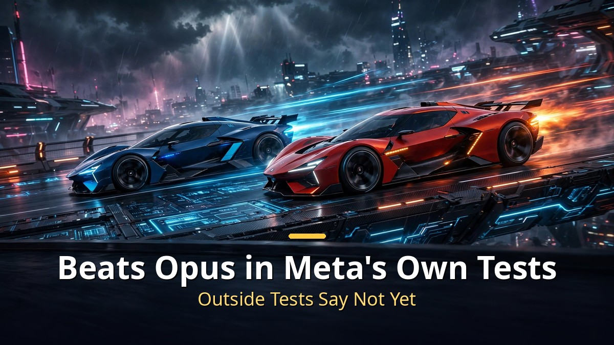
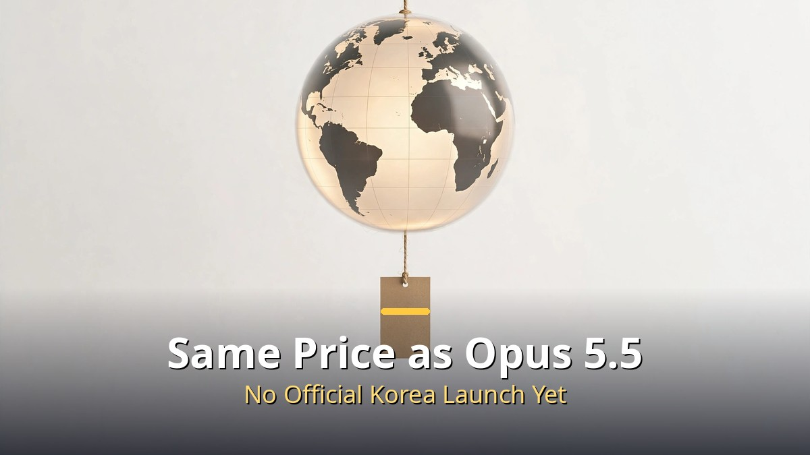

<!-- 본문 시작 -->

Meta has unveiled a rebuilt AI model after 14 months of work.
Its name is Muse Wonder, the most powerful model in Meta's history.
In its own tests, it even beat Claude Opus 5.5.
The key point is that it was built as an agent that does work for you, not as a chatbot.

> **Key takeaway: Muse Wonder is not a chatbot that answers questions, but an agent that handles work for you. In Meta's own evaluation it beat Opus 5.5, but in outside evaluations it is still just catching up. Its goal is to take on everyday headaches like insurance claims and understanding rental contracts.**

## What is different about Muse Wonder?

Muse Wonder was announced on October 12, 2026.
Two versions came out: the standard model and a higher-end version called Muse Wonder Full.

Both were designed from the start to be used as agents.
The aim is not to answer questions, but a helper that carries work through to the end.

Meta's published examples show the direction.
Processing insurance claims, understanding rental contracts, checking your finances, building apps.

You might have expected coding examples first, but everyday tasks came first.
Meta is aiming at ordinary people's daily lives, not developers.

Benchmark numbers were also published.
On Meta's own composite index, Muse Wonder Full scored 59.1, while Opus 5.5 scored 55.2.

The gap was wider on SWE Marathon, a coding evaluation.
Muse Wonder Full scored 57.5, Opus 5.5 scored 46.3.

Meta's own evaluation beat Opus 5.5, but outside evaluations are still at catch-up level.

| Benchmark | Muse Wonder Full | Opus 5.5 |
|---|---|---|
| Meta's own composite index | 59.1 | 55.2 |
| SWE Marathon (coding) | 57.5 | 46.3 |

But there is a caveat: this is Meta's own yardstick.
Outside evaluations still put it slightly below Opus 5.5.

"Beat it" is less accurate than "caught up to its heels."
Interestingly, although its coding scores are this high, it is not good at 3D modeling.
Meta admitted that itself.

## What are Active Memory and Active Focus?

There are two key features.
Active Memory and Active Focus.

Active Memory is memory.
It carries information from earlier conversations into later ones better.

Because it pulls out only the details it needs, you do not have to explain everything from scratch each time.
It reduces the most annoying part of using an agent: "I already told you that."

Active Focus deals with the problem of an agent stopping mid-task.
If an error occurs, it recovers on its own; if it is unsure, it asks the user; and before important actions, it asks for confirmation.

The aim is clear.
To reduce agents giving up on work or doing things they were not asked to do.

Meta expects this to widen the range of work you can hand over.

Active Memory carries conversations forward, and Active Focus wakes up a stalled agent on its own.

The published demos are also close to daily life.
It plans a Saturday run with a 15.1 km track and marks points on a map.
It arranges wedding seating by considering guests' relationships.

These are not grand technology demos, but scenes that make you think, "I could actually use that."

## How much does it cost, and can you use it in Korea?

Input costs $4 per million tokens, output $20 per million tokens.
That is exactly the same price as Claude Opus 5.5.

It is roughly 3 to 5 times more expensive than the previous model, Muse Spark.
Whether the performance justifies the price remains to be seen.

Developers can already use it through the Meta API and Muse Code.
The Full version is only for higher-tier Muse Code subscribers, and a dedicated Muse agent app is coming soon.

Korea has not had an official launch yet.
Still, there are workarounds, and a code for free credits is reportedly available.

Same price as Opus 5.5. Korea has not launched officially yet.

Meta says it threw everything out and started over 14 months ago, and this is its first proper result.
Given its Instagram, Threads, and Facebook user base, it is in a position to bring a frontier-level agent to more people than anyone.
OpenAI, Anthropic, and Google are likely to push agent development even harder.
The next few months look like a turning point for the competitive landscape.

## Frequently asked questions

**Q. Is Muse Wonder better than Opus 5.5?**
A. In Meta's own evaluation it came out ahead, but outside evaluations still put it slightly below. It is more accurate to say it has caught up to its heels than that it has overtaken it.

**Q. Can you use it in Korea?**
A. There has been no official launch yet. There are workarounds, and a free credit code is reportedly available. Waiting for the dedicated Muse agent app is another option.

**Q. How is it different from existing chatbots?**
A. It was built from the start to be used as an agent. The goal is not to answer questions, but to handle work like insurance claims or understanding contracts. Active Memory and Active Focus support that.

<!-- 본문 끝 -->

## 작업용 출처·이미지 정보 (업로드 제외)

- 자료 출처: 로컬 초안 drafts/2026-10-14/draft_muse_final.md 복원 (윤문 없음)
- 이미지: images/01-hero-en.jpg ~ 04-img3-en.jpg / 기존 베이스 일러스트 + 영어 배너 오버레이 / 사용권: 자작
