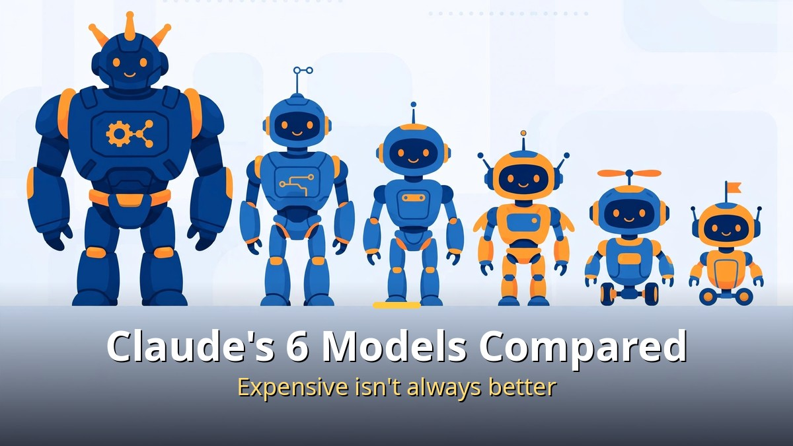
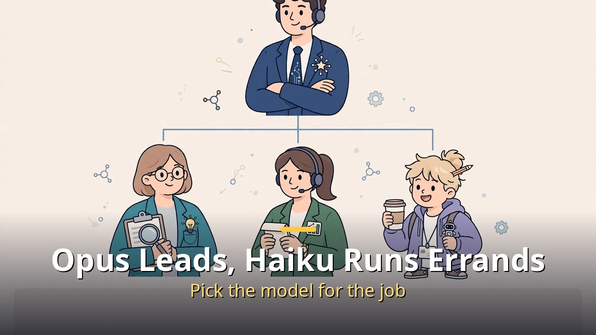
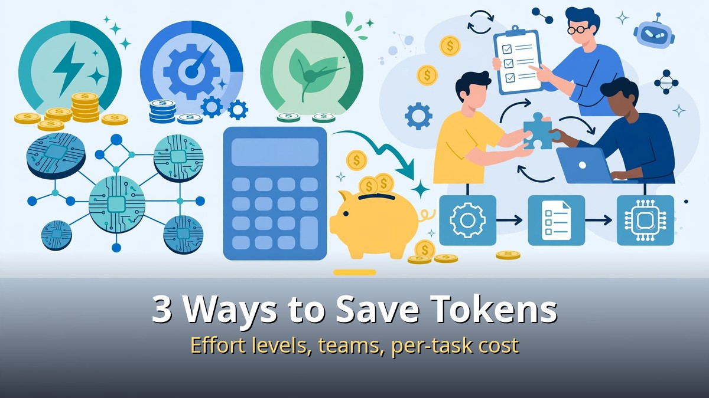

<!-- 본문 시작 -->

When you use Claude, do you just leave the model selection as it is?
Most people pick the most expensive model, or whichever sits at the top.
For the same job, Haiku costs 1,000 won and Fable costs 10,000 won.
Here are the roles of all six models and how to save tokens.

> **Key takeaway: There are more than 10 Claude models, but if you insist on only the most expensive one, token costs can differ by up to 10 times. Think of each model as an employee and assign it work that fits. Adjusting effort levels, splitting work into teams, and calculating cost per completed job can cut token use dramatically.**

---

## How do the six models' roles differ?

Opus is the team lead, Haiku is the junior. Picking the right model for the job is the key.

Thinking of Claude's six models as six employees makes them easy to understand.
Each has a different role and price.

**Opus 5.5** is the **team lead**.
Even the official docs say, "If you don't know what to use, start with Opus 5.5."
It handles complex jobs alone from start to finish: hours-long coding, editing dozens of files, summarizing long documents.

It also has a fast mode.
Answers come out up to **2.5 times** faster, but the price doubles.
It is like a taxi you only take when a deadline is right around the corner.

**Fable 5.1** is the advisor.
It is the smartest Claude model you can use right now.
It takes on hard problems: hours-long research, tracking down errors with unknown causes, designing new architectures.

It costs **2.5 times more than Opus** and is slower, so you don't call on it every day.
You bring it in like an outside expert only when the team lead can't solve a problem.

**Sonnet 5.5** is the deputy.
Its price is half of Opus, but it is faster.
For everyday work — code edits, article drafts, table cleanup, material summaries — this model is enough.

**Haiku 4.5** is the junior.
It is the fastest and cheapest of the six.
It costs **a quarter of Opus** and **a tenth of Fable**.

It takes on hands-on, simple jobs: finding files, renaming, classifying text, writing short replies.
The core of automatic task splitting is the team lead handing off errands like "go find a file in this folder" while working on big jobs.

**Older models (Opus 5, Sonnet 5, and so on) need caution.**
They look cheap, but they actually cost more than the newer ones.
For the same amount of work, if the new model costs $4, the old one costs $5.

| Model | Role | Price feel |
|---|---|---|
| Opus 5.5 | Team lead, handles complex work | Baseline (4,000 won) |
| Fable 5.1 | Advisor, only when stuck | 2.5x (10,000 won) |
| Sonnet 5.5 | Deputy, everyday work | Half (2,000 won) |
| Haiku 4.5 | Junior, simple errands | A quarter (1,000 won) |
| Older versions | Keeping existing systems running | More expensive than new ones |

---

## What are the three ways to save tokens?

Lower the effort level, split work into teams, and calculate cost per completed job.

First, **adjust the effort level**.
Claude's cost and results change with the effort level (low, medium, high, very high, max).

When Opus 5.5 took a coding test with the effort level lowered to "medium," cost fell **30%** and the score dropped only 2.5 points.
For research or document work, lowering to "medium" often keeps accuracy unchanged.

An even better approach is to set everything to "low" first and retry only the failures at "high."
That keeps the pass rate up while cutting cost by **nearly 40%**.

Second, **split work into teams**.
The expensive model only plans, and cheaper models do the actual work.

In an official docs experiment, a bundle of easy jobs cost half as much this way.
But for hard jobs, the expensive model alone was actually 20–30% cheaper.
Splitting, handing off, and merging work also costs tokens.

The rule is simple.
If there are several small, unrelated jobs, use a team; if it is one long, connected job, let one model handle it.

Third, **calculate the cost of finishing one job**.
Look at the total cost of completing one job, not the token price itself.

If a cheap model gets it wrong four times and succeeds on the fourth, you pay four times.
If an expensive model gets it right the first time, you pay once.

In fact, when Fable 5.1 ran at a low effort level, its token price was 5 times higher, but the cost of solving one problem was **35% cheaper** and the score was 11 points higher.
For work that must be redone when it fails, giving it to a model that gets it right the first time is the real saving.

---

## What are the common mistakes?

Continuing the same chat, overusing the maximum effort level, and picking older versions are common mistakes.

Mistake one: **keeping a conversation going**.
Claude rereads the previous conversation every time it answers, so when the topic changes, starting a new chat is cheaper.

Mistake two: **using maximum effort for a simple question**.
Using maximum effort on "What should I eat for lunch today?" is like taking it to an executive meeting.

Mistake three: **picking an older model**.
Choosing one to save money means paying more for an outdated employee.

Switching models is simple.
In the chat screen, tap the model name next to the writing box; in Claude Code, type /model.

Think for just three seconds before choosing.
**"Could I hand this job to the junior?"**
That one question can change a month's usage.

The person who uses Claude well was not the one using the most expensive model.
It was the person who called the right employee for each job.
Yesterday's token-saving post covered the mailbox method; today, model selection is the next puzzle piece.
Put the two together and the big picture of the AI cost diet comes into view.

---

## Frequently asked questions

**Q. If I don't know what to pick, what should I choose?**

A. Start with Opus 5.5. The official docs recommend that too. Once you get used to it, move everyday work to Sonnet 5.5 and simple errands to Haiku 4.5.

**Q. Why are older versions more expensive?**

A. Older versions are kept around so companies with already-built programs have time to migrate their existing systems. If you are starting something new, there is almost no reason to pick an older version.

**Q. Where do I change the effort level?**

A. In Claude Code, type /effort. Setting everything to "low" first and retrying only failures at "high" is the most efficient approach.

<!-- 본문 끝 -->

## 작업용 출처·이미지 정보 (업로드 제외)

- 자료 출처: 로컬 초안 drafts/2026-10-14/draft_claude_models_v3_mtnb.md 복원 (윤문 없음)
- 이미지: images/01-hero-en.jpg ~ 04-img3-en.jpg / 기존 베이스 일러스트 + 영어 배너 오버레이 / 사용권: 자작
