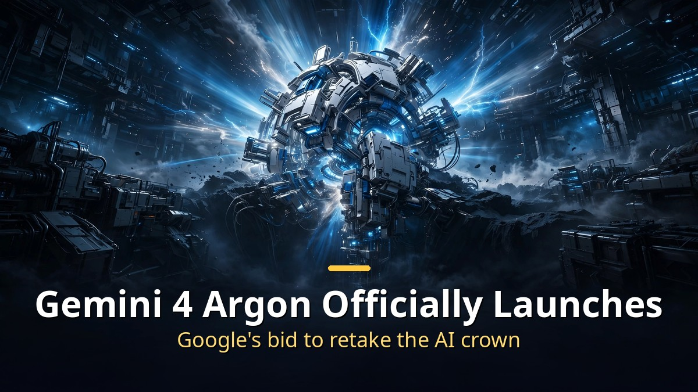

<!-- 본문 시작 -->

Google has released its top-tier AI model for the first time in seven months.
Its name is Gemini 4 Argon, and it took first place in finance, coding, law, and tax evaluations.
Until November 30, you can use it at half price.

> **Key takeaway: Gemini 4 Argon is Google's flagship model, built to handle complex real-world work step by step. It ranked No. 1 on the Vals Index, which measures performance across finance, coding, law, and tax. It is available at a 50% discount until November 30.**

---

## What makes Gemini 4 Argon different?

The first flagship model in seven months, built for complex real-world work.

Google had held back its flagship release since Gemini 3.1 Pro in February 2026.
The reason was a judgment that its coding ability was not good enough.

In the meantime, it released only lightweight Flash models every three weeks.
It had originally planned to ship Gemini 3.5 Pro in June this year, but after strengthening safety measures and improving coding performance, development shifted direction toward Argon.

Argon focuses on **multi-step, in-depth work** in coding, finance, law, cybersecurity, and science.
Rather than simply producing an answer, it handles complex jobs from start to finish.

Its output token limit jumped from 64,000 to **1 million**.
That makes it strong for long-running jobs like refactoring a large codebase.

---

## How good is it really?

No. 1 on the Vals Index, and already handling Google's toughest internal tasks.

Looking at benchmark results, it took **first place on the Vals Index**, which measures performance across major economic sectors including finance, coding, law, and tax.
On some coding benchmarks, however, other models took first place.

Google's internal use cases are concrete.
AI-agent-based code submissions rose **more than 35%**, and rollbacks of submitted code fell by **a third**.

The Chrome team's case stands out.
A restructuring job that separated core webpage-processing code in the 40-million-line Chromium codebase was shortened **from months to weeks**.

Early corporate users include Deloitte, LexisNexis, Ambience Healthcare, and Isomorphic Labs.
They are using it for deep research and document synthesis, long-term data analysis, and large-scale code analysis.

In science, it was used to nearly **double** the inference throughput of AlphaQubit, a quantum error-correction decoder.
Google will give 10,000 selected scientists the top tier of its coding tool Antigravity free for six months.

---

## How much does it cost, and where can you use it?

Half price until November 30. After that, prices double.

Access depends on your subscription tier.
Google AI Pro and Ultra subscribers can use it in the Gemini app and in AI Mode in Google Search.
Ultra subscribers can also use it in the coding tool Antigravity.
Developers and businesses use it through the API and Google AI Studio.

The launch special price is **$2 per million input tokens and $10 per million output tokens**.
After November 30, those prices double to $4 and $20.

One caveat, though.
Tech outlet The Verge points out that even if the per-token price is lower than rival models, the actual cost is not necessarily cheaper if the number of tokens used for the same job differs.

In cybersecurity, Google plans to add hundreds of partners to the **Fairwind program**, which is offered only to verified defensive organizations.
Wiz, a Google Cloud subsidiary, used Argon to find vulnerabilities in healthcare systems, helping protect hundreds of thousands of patient records.

Early user reactions are mixed.
Writing and logical reasoning drew praise like "reads like a well-written short essay," but coding performance divides opinion.
Some say Anthropic's Claude Opus 5.5 is still better, while others report it fixed errors that earlier AIs could not find.

Domestic Gemini app users in Korea grew to 9.47 million last July, then added only 400,000 over the following two months.
Over the same period, domestic ChatGPT users reached 24.7 million, a gap of about 2.5 times.
Whether this launch becomes a turning point is worth watching.

---

## Frequently asked questions

**Q. Can I use it for free?**

A. Not yet for general free users. It is available to paid Google AI Pro and Ultra subscribers, or to paying API customers.

**Q. What happens to the price after November 30?**

A. The current special price ($2 input, $10 output) ends, and prices double to $4 and $20. If you plan to use it, the promotional period is the better deal.

**Q. How is it for coding?**

A. Opinions are divided. It is strong for long-running work like large-scale code refactoring, but some developers still rate Claude Opus 5.5 higher. It is worth comparing them directly for your own use case.

<!-- 본문 끝 -->

## 작업용 출처·이미지 정보 (업로드 제외)

- 자료 출처: 로컬 초안 drafts/2026-10-15/draft_gemini4_argon_mtnb.md 복원 (윤문 없음)
- 이미지: images/01-hero-en.jpg ~ 04-img3-en.jpg / 기존 베이스 일러스트 + 영어 배너 오버레이 / 사용권: 자작
