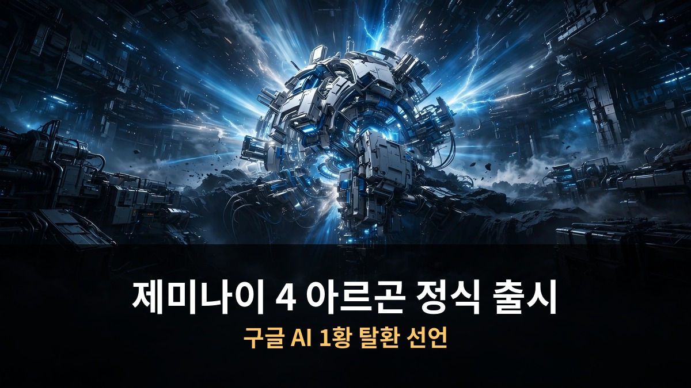

<!-- 본문 시작 -->

구글이 7개월 만에 최상위 AI 모델을 내놨습니다.
이름은 제미나이 4 아르곤, 금융·코딩·법률·세무 평가에서 1위를 차지했습니다.
11월 30일까지는 반값에 쓸 수 있습니다.

> **핵심 정리**
>
> 제미나이 4 아르곤은 **복잡한 실무 작업을 단계적으로 처리**하는 데 특화된 구글의 최상위 모델입니다.
> 금융·코딩·법률·세무 성능 지표인 밸스 인덱스에서 **1위**를 기록했습니다.
> 11월 30일까지 **50% 할인**된 가격으로 쓸 수 있습니다.

---

## 제미나이 4 아르곤, 뭐가 달라?

7개월 만의 최상위 모델. 복잡한 실무 작업에 특화됐습니다.

구글은 2026년 2월 제미나이 3.1 프로 이후 최상위 모델 공개를 미뤄왔습니다.
코딩 능력이 부족하다는 판단 때문이었습니다.

그 사이 경량 플래시 모델만 3주 단위로 내놨습니다.
원래 올해 6월 제미나이 3.5 프로를 낼 예정이었지만, 안전장치 강화와 코딩 성능 개선을 거치며 개발 방향이 아르곤으로 바뀌었습니다.

아르곤은 코딩, 금융, 법률, 사이버 보안, 과학 등에서 **여러 단계를 거치는 심층 작업**에 초점을 맞췄습니다.
단순히 답을 내놓는 게 아니라, 복잡한 업무를 처음부터 끝까지 처리하는 모델입니다.

출력 토큰 제한이 기존 64,000개에서 **100만 개**로 대폭 늘었습니다.
대규모 코드베이스 리팩토링처럼 장시간 이어지는 작업에 강합니다.

---

## 실제 성능은 어느 정도야?

밸스 인덱스 1위, 구글 내부에서도 가장 까다로운 과제에 투입 중.

벤치마크 결과를 보면 금융, 코딩, 법률, 세무 등 주요 경제 부문 성능을 재는 **밸스 인덱스에서 1위**를 차지했습니다.
다만 일부 코딩 벤치마크에서는 다른 모델이 1위를 기록하기도 했습니다.

구글 내부 활용 사례가 구체적입니다.
AI 에이전트 기반 코드 제출이 **35% 이상** 늘었고, 제출한 코드를 되돌리는 롤백은 **3분의 1** 줄었습니다.

크롬팀 사례가 인상적입니다.
4,000만 줄 규모의 크로미움 코드베이스에서 핵심 웹페이지 처리 코드를 분리하는 구조 개편 작업을 **수개월에서 수주**로 단축했습니다.

사전 이용 기업으로는 딜로이트, 렉시스넥시스, 앰비언스 헬스케어, 아이소모픽랩스 등이 참여했습니다.
심층 연구와 문서 종합, 장기간 데이터 분석, 대규모 코드 분석에 활용하고 있습니다.

과학 분야에서는 양자오류 정정 디코더인 알파큐비트의 추론 처리량을 **거의 두 배**로 높이는 데 쓰였습니다.
구글은 선발을 거쳐 과학자 1만 명에게 코딩 도구 안티그래비티의 최상위 등급을 6개월간 무료로 제공합니다.

---

## 얼마에, 어디서 쓸 수 있어?

11월 30일까지 반값. 이후에는 가격이 두 배로 오릅니다.

이용 방법은 구독 등급에 따라 다릅니다.
구글 AI 프로·울트라 구독자는 제미나이 앱과 구글 검색의 AI 모드에서 쓸 수 있습니다.
울트라 구독자는 코딩 도구 안티그래비티에서도 이용 가능합니다.
개발자와 기업은 API와 구글 AI 스튜디오를 통해 씁니다.

가격은 출시 기념 특가로 **입력 토큰 100만 개당 2달러, 출력 토큰 100만 개당 10달러**입니다.
11월 30일 이후에는 각각 4달러와 20달러로 두 배가 됩니다.

다만 주의할 점이 있습니다.
IT매체 더버지는 토큰당 가격이 경쟁 모델보다 낮아도, 같은 작업에 쓰는 토큰 수가 다르면 실제 비용이 반드시 저렴한 건 아니라고 지적했습니다.

사이버 보안 분야에서는 검증된 방어 조직에만 제공하는 **페어윈드 프로그램**의 파트너를 수백 곳 추가할 계획입니다.
구글 클라우드 자회사 위즈는 아르곤으로 의료시스템의 취약점을 찾아내 수십만 건의 환자 기록 보호를 지원했습니다.

출시 직후 이용자 반응은 엇갈립니다.
글쓰기와 논리적 추론 능력에는 "잘 쓴 짧은 에세이 같다"는 호평이 이어졌지만, 코딩 성능은 평가가 나뉩니다.
일부는 앤트로픽의 클로드 오퍼스 5.5가 여전히 낫다고 하고, 기존 AI가 못 찾은 오류를 해결했다는 후기도 있습니다.

국내 제미나이 앱 이용자는 지난 7월 947만 명까지 늘었다가 이후 두 달간 40만 명 증가에 그쳤습니다.
같은 기간 국내 챗GPT 이용자는 2,470만 명으로 약 2.5배 격차가 납니다.
이번 출시가 반등 계기가 될지 주목됩니다.

---

## 자주 묻는 질문

**Q. 무료로 쓸 수 있나요?**

A. 일반 무료 이용자에게는 아직 제공되지 않습니다. 구글 AI 프로·울트라 유료 구독자, 또는 API 유료 고객이 이용할 수 있습니다.

**Q. 11월 30일 이후 가격은 어떻게 되나요?**

A. 현재 특가(입력 2달러, 출력 10달러)가 끝나면 각각 4달러와 20달러로 두 배가 됩니다. 쓸 계획이 있다면 특가 기간을 활용하는 게 유리합니다.

**Q. 코딩용으로는 어떤가요?**

A. 평가가 엇갈립니다. 대규모 코드 리팩토링 같은 장시간 작업에는 강점을 보이지만, 일부 개발자는 클로드 오퍼스 5.5가 여전히 낫다고 평가합니다. 용도에 따라 직접 비교해보는 게 좋습니다.

<!-- 본문 끝 -->

## 작업용 출처·이미지 정보 (업로드 제외)

- 자료 출처: 로컬 초안 drafts/2026-10-15/draft_gemini4_argon_mtnb.md 복원 (윤문 없음)
- 이미지: images/01-hero.jpg ~ 04-img3.jpg / 기존 최종 이미지 재사용 / 사용권: 자작
