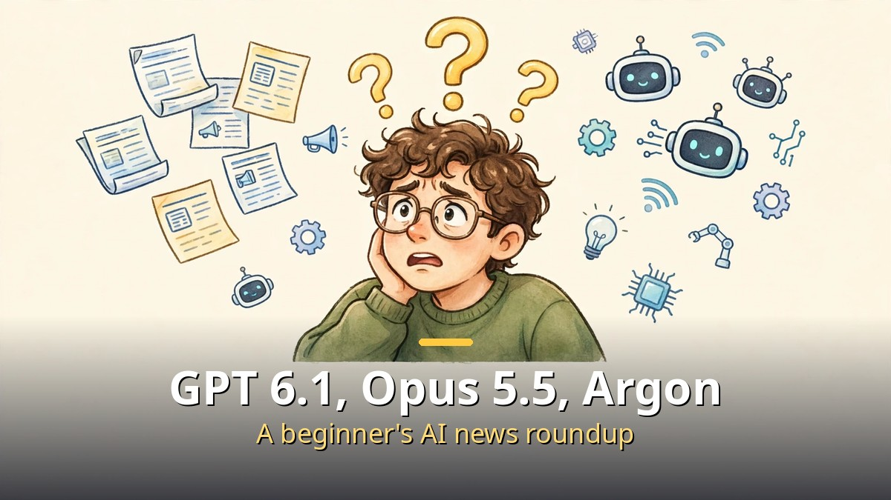
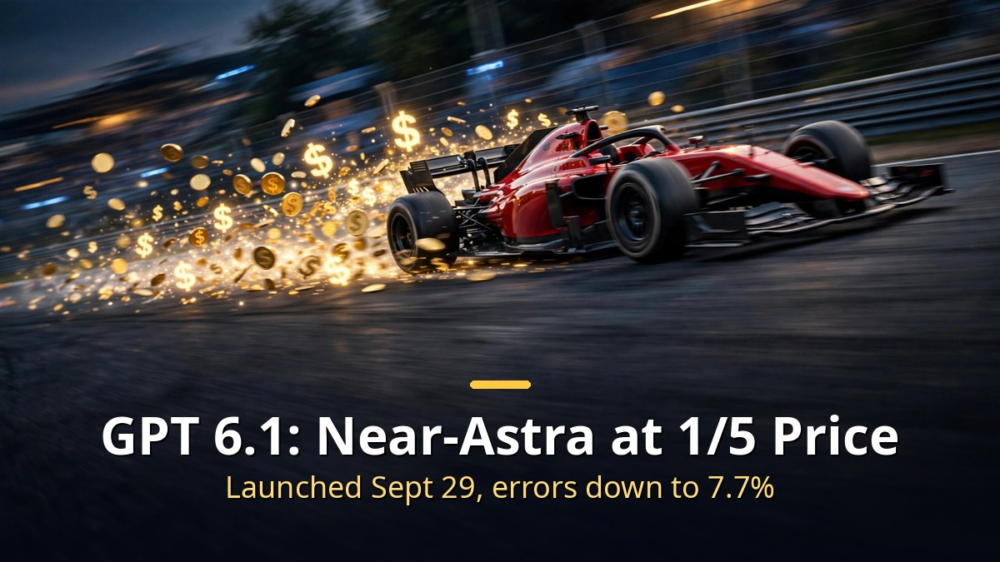
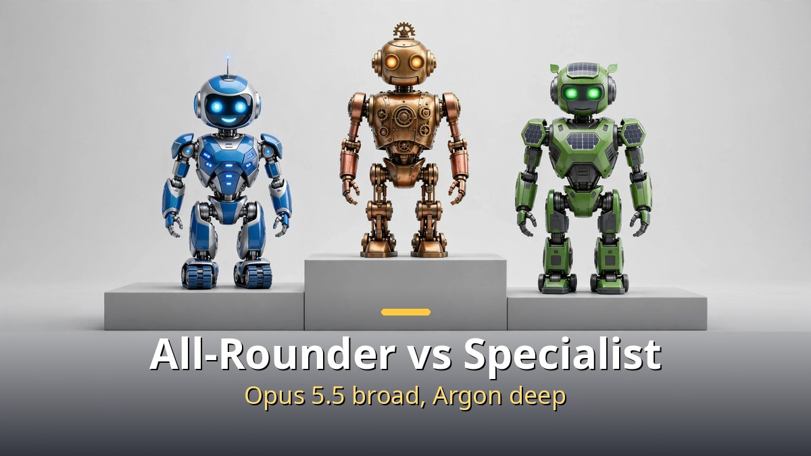
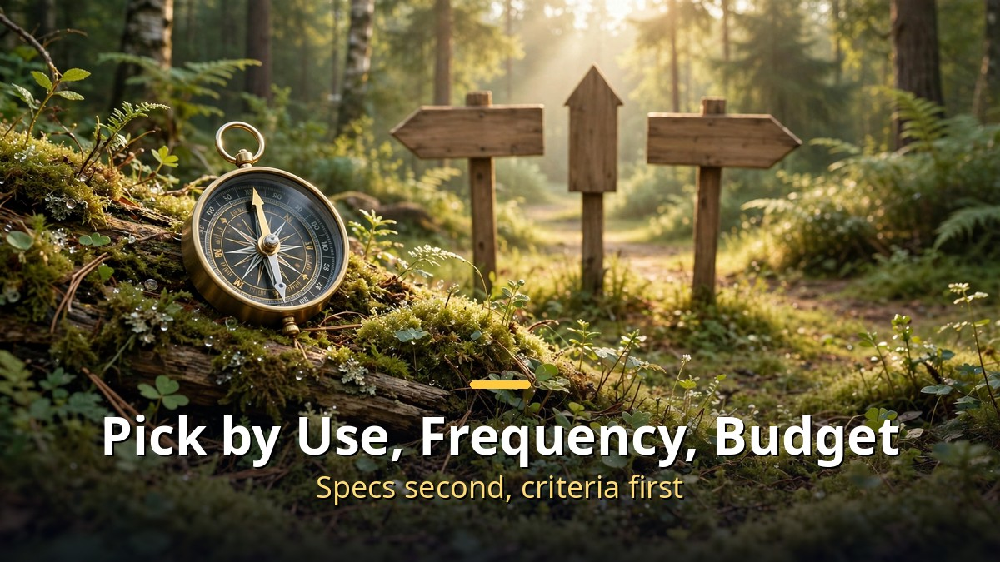

<!-- 본문 시작 -->

AI model news keeps pouring in, but what is what?
GPT 6.1, Opus 5.5, and Gemini 4 Argon, all in one place.
The rule for choosing a model is simpler than you think.

> **Key takeaway**
>
> The heart of the latest AI model race is **performance per dollar**.
> GPT 6.1 offers near-Astra performance at one fifth the price, and Gemini 4 Argon competes on real-world specialization.
> When choosing a model, first decide **what you will use it for**. That matters most.

---

## What is GPT 6.1?

GPT 6.1 is the model OpenAI unveiled at DevDay on September 29.
Its full name is GPT-6.1 Sol, specialized for complex coding and agent work.

Its biggest feature is **value for money**.
It delivers performance close to the top-tier GPT-6 Astra at **one fifth the price**.
Factual errors on hard questions also fell.
The share of answers containing factual errors at low reasoning levels dropped from 11.4% to **7.7%**.

Availability is broad too.
It is offered in ChatGPT Work and Codex to Plus, Pro, Business, Enterprise, and Education users.
The API model ID is gpt-6.1-sol.

An **UltraFast** pricing tier came out for speed-focused users.
Up to 8 times faster in Codex and up to 6 times faster via API, but at 6 times the price.
$12 per million input tokens and $60 per million output tokens.

Note that GPT-6.1 Astra, which was due to be announced alongside it, had its release canceled for missing safety standards.
Fast and cheap models are coming first.

---

## What about Opus 5.5 and Gemini 4 Argon?

**Claude Opus 5.5** is Anthropic's all-round flagship model.
It handles complex jobs alone to the end: hours-long coding, edits across dozens of files, long document summaries.
The official advice is: "If you don't know what to use, start with Opus 5.5."

**Gemini 4 Argon** is Google's top model, released October 13.
Its concept is **real-world specialization**: coding, finance, law, cybersecurity, and science.
It ranked first on the Vals Index, a benchmark of finance, coding, law, and tax performance.

The difference between the two is direction.
Opus 5.5 is the all-rounder that does **many things well**; Argon goes **deep** in professional work.

Prices differ too.
Argon has a special price until November 30: $2 input and $10 output.
After that it doubles, so if you plan to use it, try it early.

| Model | Feature | Best for |
|---|---|---|
| GPT-6.1 Sol | Near-Astra performance, one fifth the price | Coding and agent work, value seekers |
| Opus 5.5 | All-round flagship | When unsure, complex all-in-one jobs |
| Gemini 4 Argon | Real-world specialization, Vals Index No. 1 | Finance, law, security and other professional work |

---

## How should a beginner choose?

Don't try to memorize specs when reading model news.
Three criteria are enough.

First, decide **what you will use it for**.
Writing, coding, or research each call for a different model.
Once the use is set, the options shrink fast.

Second, think about **how often** you will use it.
Occasional use makes even an expensive model affordable.
Daily use favors models with a low per-token price.

Third, set **how much** you can pay.
Start free, then move to paid when you need it.
There is no need to pick an expensive plan from the start.

And one more thing.
Having a **standard to judge** AI output matters as much as choosing a model.
You need to tell whether an answer is good or not to use AI properly.

Models keep changing.
Today's No. 1 is not guaranteed to be tomorrow's No. 1.
With your own criteria, you won't be shaken no matter what model arrives.

---

## Frequently asked questions

**Q. If I pick just one of the three?**

A. Start with your use. GPT-6.1 Sol for coding and agent work, Opus 5.5 if you don't know what you need, Gemini 4 Argon for professional work like finance, law, and security.

**Q. Can I try them for free?**

A. You can try basic models in each service's free tier. The latest flagship models mostly require a paid subscription or API payment.

**Q. Models change so fast. Do I have to keep up?**

A. No. Pick one model that fits your use and learn it deeply rather than skimming many. Switch only when a big change comes.

<!-- 본문 끝 -->

## 작업용 출처·이미지 정보 (업로드 제외)

- 자료 출처: GPT 6.1·오퍼스 5.5·제미나이 4 아르곤 (2026-10-15 한국어본, 영어 백로그 #12)
- 이미지: images/01-hero-en.jpg ~ 04-img3-en.jpg / 직접 제작 (AI 생성 + 영어 오버레이) / 사용권: 자작
