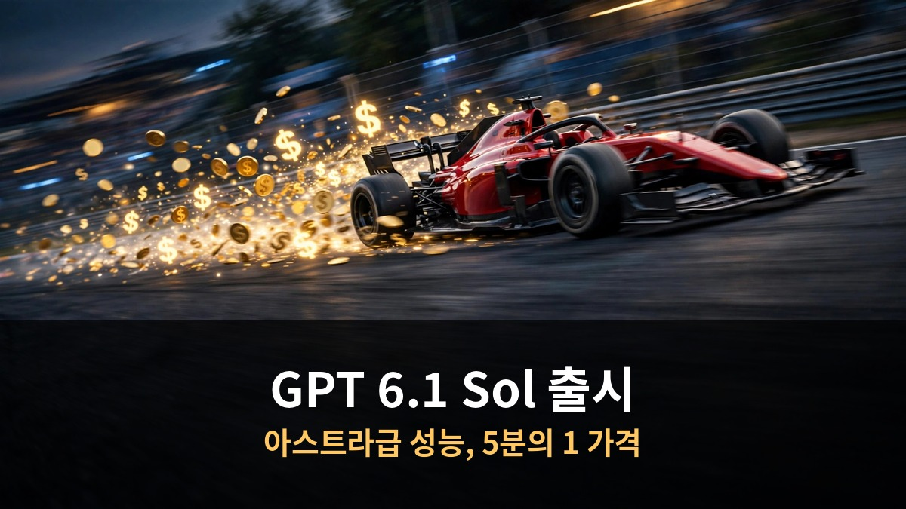

<!-- 본문 시작 -->

AI 모델 소식이 쏟아지는데 뭐가 뭔지 모르겠나요?
GPT 6.1, 오퍼스 5.5, 제미나이 4 아르곤까지 한 번에 정리했습니다.
모델 고르는 기준은 생각보다 단순합니다.

> **핵심 정리**
>
> 최신 AI 모델 경쟁의 핵심은 **가격 대비 성능**입니다.
> GPT 6.1은 아스트라급 성능을 5분의 1 가격에, 제미나이 4 아르곤은 실무 특화로 승부합니다.
> 모델을 고를 때는 **무엇에 쓸지**를 먼저 정하는 게 가장 중요합니다.

---

## GPT 6.1, 뭔가요?

9월 29일 출시. 아스트라급 성능을 5분의 1 가격에 제공합니다.

GPT 6.1은 오픈AI가 9월 29일 데브데이에서 공개한 모델입니다.
정식 명칭은 GPT-6.1 Sol이며, 복잡한 코딩과 에이전트 작업에 특화됐습니다.

가장 큰 특징은 **가성비**입니다.
최상위 모델인 GPT-6 아스트라에 근접하는 성능을 **5분의 1 가격**에 제공합니다.
어려운 질문에 대한 사실 오류율도 낮아졌습니다.
낮은 추론 수준에서 사실 오류가 포함된 답변 비율이 11.4%에서 **7.7%**로 줄었습니다.

이용 범위도 넓어졌습니다.
챗GPT Work와 Codex에서 플러스, 프로, 비즈니스, 엔터프라이즈, 교육용 사용자에게 제공됩니다.
API 모델 ID는 gpt-6.1-sol입니다.

속도를 중시하는 사용자를 위한 **울트라패스트** 요금제도 나왔습니다.
Codex에서 최대 8배, API에서 최대 6배 빠르지만 가격은 6배입니다.
입력 토큰 100만 개당 12달러, 출력 토큰 100만 개당 60달러입니다.

참고로 함께 발표될 예정이던 GPT-6.1 아스트라는 안전성 기준 미달로 출시가 취소됐습니다.
빠르고 저렴한 모델이 먼저 나오는 흐름입니다.

---

## 오퍼스 5.5와 제미나이 4 아르곤은?

오퍼스는 만능 팀장, 아르곤은 실무 특화. 용도가 다릅니다.

**클로드 오퍼스 5.5**는 앤트로픽의 만능형 플래그십 모델입니다.
몇 시간 걸리는 코딩, 수십 개 파일 수정, 긴 문서 요약 같은 복잡한 일을 혼자 끝까지 처리합니다.
"뭘 써야 할지 모르겠으면 오퍼스 5.5로 시작하라"는 게 공식 권장입니다.

**제미나이 4 아르곤**은 구글이 10월 13일 내놓은 최상위 모델입니다.
코딩, 금융, 법률, 사이버 보안, 과학 등 **실무 특화**가 콘셉트입니다.
금융·코딩·법률·세무 성능 지표인 밸스 인덱스에서 1위를 차지했습니다.

두 모델의 차이는 방향성입니다.
오퍼스 5.5는 **넓게 잘하는** 만능형, 아르곤은 **깊게 파는** 실무형입니다.

가격도 다릅니다.
아르곤은 11월 30일까지 입력 2달러, 출력 10달러의 특가가 적용됩니다.
이후에는 두 배가 되니 쓸 계획이 있다면 미리 써보는 게 좋습니다.

| 모델 | 특징 | 어울리는 용도 |
|---|---|---|
| GPT-6.1 Sol | 아스트라급 성능, 5분의 1 가격 | 코딩·에이전트 작업, 가성비 중시 |
| 오퍼스 5.5 | 만능형 플래그십 | 뭘 쓸지 모를 때, 복잡한 종합 작업 |
| 제미나이 4 아르곤 | 실무 특화, 밸스 인덱스 1위 | 금융·법률·보안 등 전문 업무 |

---

## 왕초보는 뭘 기준으로 고르나요?

모델 스펙보다 먼저 정할 것. 무엇을, 얼마나 자주, 얼마까지.

모델 뉴스를 볼 때 스펙부터 외우려 하지 마세요.
기준은 세 가지면 충분합니다.

첫째, **무엇에 쓸지**를 정하세요.
글쓰기인지, 코딩인지, 자료 조사인지에 따라 맞는 모델이 다릅니다.
용도가 정해지면 선택지가 확 줄어듭니다.

둘째, **얼마나 자주** 쓸지를 생각하세요.
가끔 쓰는 거면 비싼 모델도 부담이 적습니다.
매일 쓰는 거면 토큰 단가가 낮은 모델이 유리합니다.

셋째, **얼마까지** 낼 수 있는지 정하세요.
무료로 시작해보고, 필요해지면 유료로 넘어가는 게 순서입니다.
처음부터 비싼 요금제를 고를 필요는 없습니다.

그리고 한 가지 더.
AI가 내놓은 결과물을 **판단할 기준**을 갖는 게 모델 선택만큼 중요합니다.
좋은 답인지 아닌지 가릴 줄 알아야 AI를 제대로 활용할 수 있습니다.

모델은 계속 바뀝니다.
오늘의 1위가 내일의 1위라는 보장은 없습니다.
기준을 갖고 있으면 어떤 모델이 나와도 흔들리지 않습니다.

---

## 자주 묻는 질문

**Q. 셋 중 하나만 고른다면?**

A. 용도부터 정하세요. 코딩·에이전트 작업 위주면 GPT-6.1 Sol, 뭘 해야 할지 모르겠으면 오퍼스 5.5, 금융·법률·보안 같은 전문 업무면 제미나이 4 아르곤이 어울립니다.

**Q. 무료로 써볼 수 있나요?**

A. 각 서비스의 무료 등급에서 기본 모델을 써볼 수 있습니다. 최신 플래그십 모델은 대부분 유료 구독이나 API 결제가 필요합니다.

**Q. 모델이 너무 빨리 바뀌는데 따라가야 하나요?**

A. 다 따라갈 필요는 없습니다. 자신의 용도에 맞는 모델 하나를 정해 깊게 써보는 게 여러 개를 얕게 쓰는 것보다 낫습니다. 큰 변화가 있을 때만 갈아타세요.

<!-- 본문 끝 -->

## 작업용 출처·이미지 정보 (업로드 제외)

- 자료 출처: GPT 6.1·오퍼스 5.5·제미나이 4 아르곤 (2026-10-15 한국어본 복원, 윤문 없음)
- 이미지: images/01-hero.jpg ~ 04-img3.jpg / 직접 제작 (AI 생성 + 한글 오버레이) / 사용권: 자작
