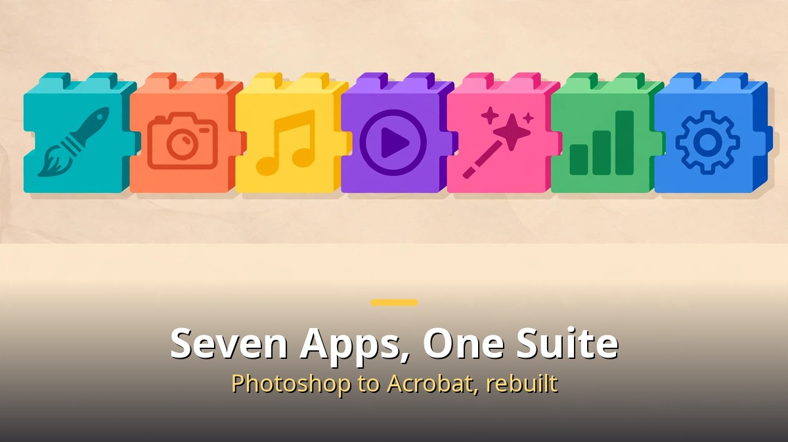
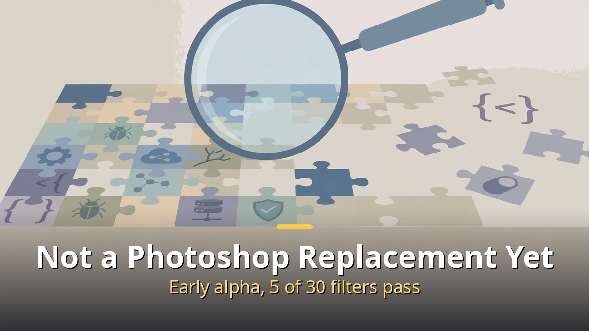
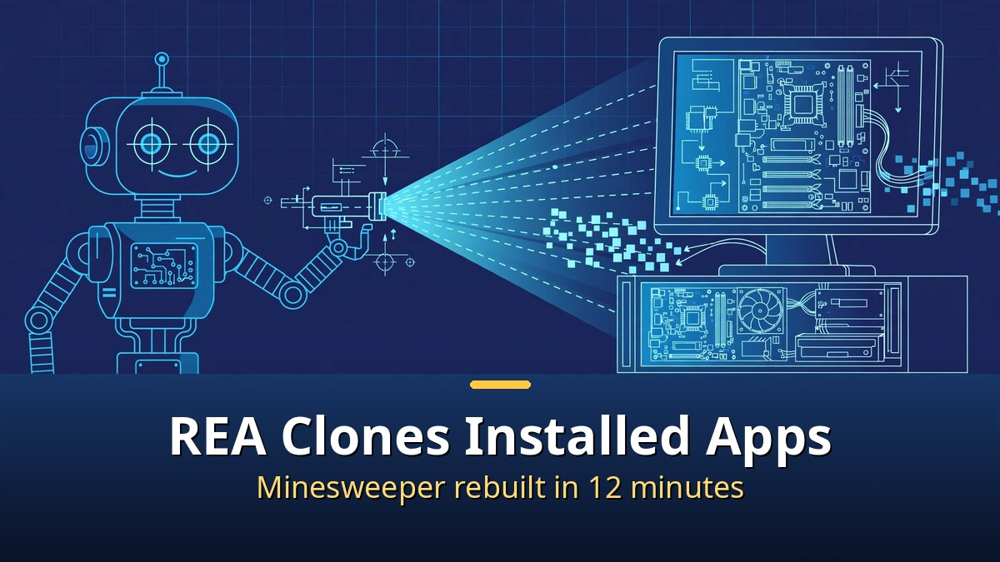

<!-- 본문 시작 -->

Photoshop, Premiere, Illustrator.
One developer rebuilt all seven Adobe apps from scratch with AI.
The name is PhotoCraft. Free and open source.
And then REA appeared, an AI tool that clones an installed app wholesale.
Is the era of software really coming to an end?

> **Key takeaway: 15-year veteran developer Brandon Thomas used Claude Opus 5.5 to rebuild Adobe's seven apps in Rust as ArtCraft. PhotoCraft passed 9,400 stars within a week of going public. But it is still early alpha, far from a full Photoshop replacement. Meanwhile REA, an AI tool that analyzes and clones installed apps, passed 100,000 stars and sparked a copyright debate.**

## What is PhotoCraft?

ArtCraft is the project, and PhotoCraft is its flagship app.
Alongside the Photoshop counterpart PhotoCraft come VectorCraft (Illustrator), FilmCraft (Premiere), LightCraft (Lightroom), EffectCraft (After Effects), DesignCraft (InDesign), and PrintCraft (Acrobat). A seven-app suite.

Developer Brandon Thomas is a 15-year veteran.
He built payment systems moving billions of dollars a day and has used Rust for ten years.
He stressed himself that he is no "lightweight vibe coder."

The motive was simple.
He was fed up with the cancellation penalty charged every time he unsubscribed from Adobe.
He bragged on Reddit that AI helped him rebuild Adobe's seven apps, and his post in Adobe's subreddit was quickly deleted.

Technically he claims a "clean-room reimplementation."
Not copying Adobe's source code, but rebuilding from scratch using only public specifications.
It can open and save PSD files and supports layers, masks, and smart objects.

## Can it really replace Photoshop?

Honestly, not yet.
The project README itself says it is "not a Photoshop replacement yet."

Measured results tell the story.
PhotoCraft passed only 5 of 30 filter tests and failed smart object handling.
FilmCraft does not support third-party plugins such as VST3 (an external audio plugin standard).

Thomas himself first promised 100% feature parity within a month, then walked it back to "a few months."
An ex-Adobe engineer has said rewriting Photoshop from scratch is nearly impossible.

AI coding has become fast at producing software that looks finished.
But decades of edge cases and exception handling are the real moat.
That is not solved by spending more tokens.

Still, the significance is large.
Open source veteran Eric Raymond declared "Adobe is finished. Closed source is dead," and the post passed 1.8 million views.

## What is REA?

REA is a separate tool from PhotoCraft.
It is an AI reverse-engineering toolkit that analyzes and clones installed apps.

How it works is striking.
Even an installed app whose code is invisible can be analyzed with a single command and rebuilt as-is.
In one experiment, the Minesweeper game was cloned intact in 12 minutes.

REA itself passed 100,000 GitHub stars.
It is a collection of tools for coding agents to take apart binaries, apps, and websites.

That is where the copyright problem erupts.
Copying someone else's paid program without permission and using or selling it can be copyright infringement.
TokenPost summarized it: "The legal status of reproducing specific software varies by program, license, and jurisdiction."

The video warns clearly.
Practice only on open source programs.

---

| Item | PhotoCraft (ArtCraft) | REA |
|---|---|---|
| What it is | Clean-room rebuild of Adobe's 7 apps | Tool that analyzes and clones installed apps |
| Made by | Brandon Thomas (15-year developer) | Open source community |
| AI used | Claude Opus 5.5 | Coding agent integration |
| Language | Rust | Various |
| Status | Early alpha | 100,000+ stars |
| Copyright | Clean-room claim | Infringement possible depending on target |

---

To be precise, I did not try it myself so much as take it apart, and this is what struck me.
People who installed PhotoCraft say it is "buggy, but really feels like Photoshop."
For someone who needs Photoshop only twice a year, say to make a child's birthday invitation, the subscription fee feels like a waste.
Given that Adobe paid a $150 million settlement this year over subscription traps, the angry open-sourcing looks set to continue.
But "closed source is dead" is still premature.
It is not dead. For the first time, it has met a real competitor.

## Frequently asked questions

**Q. Is PhotoCraft free?**

A. Yes, it is open source under the MIT or Apache 2.0 license. It runs on macOS, Windows, and Linux.

**Q. Can I use it instead of Photoshop right now?**

A. Not yet. It is early alpha, so filters, plugins, and AI features are lacking. Try it for light work first.

**Q. Can I clone a commercial program with REA?**

A. No. That can be copyright infringement. Practice only on open source programs.

<!-- 본문 끝 -->

## 작업용 출처·이미지 정보 (업로드 제외)

- 자료 출처: 어도비 7종 무료로 다시 만든 AI (2026-10-16 한국어본, 영어 백로그 #11)
- 이미지: images/01-hero-en.jpg ~ 04-img3-en.jpg / 직접 제작 (AI 생성 + 영어 오버레이) / 사용권: 자작
