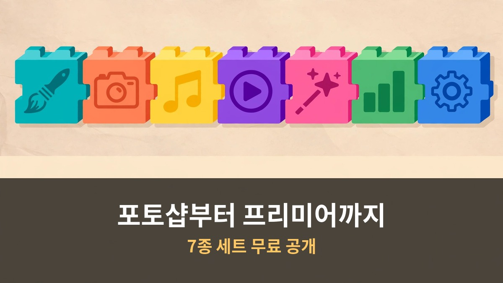
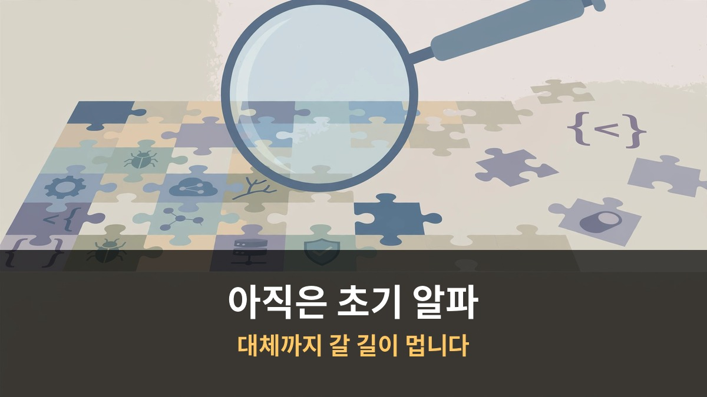

<!-- 본문 시작 -->

포토샵, 프리미어, 일러스트레이터.
월 구독료 내고 쓰는 어도비 프로그램 7종을 한 개발자가 AI와 함께 처음부터 다시 만들었습니다.
이름하여 포토크래프트. 무료, 오픈소스입니다.
심지어 설치형 앱을 통째로 복제하는 AI 도구 REA까지 등장했습니다.
소프트웨어의 시대가 정말 끝나가는 걸까요.

> **핵심 정리: 15년차 개발자 브랜든 토마스가 클로드 오퍼스 5.5로 어도비 7종을 Rust로 재구현한 ArtCraft를 공개했습니다. 포토크래프트는 공개 일주일 만에 스타 9,400개를 받았습니다. 다만 아직 초기 알파라 포토샵을 완전히 대체하긴 어렵습니다. 한편 설치형 앱을 통째로 분석·복제하는 AI 도구 REA도 10만 스타를 넘기며 저작권 논쟁을 불러일으키고 있습니다.**

## 포토크래프트는 뭔가요?

ArtCraft라는 프로젝트의 핵심 앱입니다.
포토샵 대응판인 포토크래프트를 비롯해 벡터크래프트(일러스트레이터), 필름크래프트(프리미어), 라이트크래프트(라이트룸), 이펙트크래프트(애프터이펙트), 디자인크래프트(인디자), 프린트크래프트(아크로뱃)까지 7종 세트입니다.

어도비 7종을 재구현한 ArtCraft 스위트

개발자 브랜든 토마스는 15년차 베테랑입니다.
하루 수십억 달러가 오가는 결제 시스템을 만들었고, 10년째 Rust를 써온 사람입니다.
"가벼운 바이브코더"가 아니라는 점을 본인이 직접 강조했습니다.

만든 계기는 단순합니다.
어도비 구독 해지할 때마다 물린 위약금에 질렸다고 합니다.
레딧에 "AI가 어도비 앱 7종을 다시 만드는 걸 도왔다"고 자랑했고, 어도비 서브레딧에 올린 글은 곧바로 삭제됐습니다.

기술적으로는 "클린룸 재구현"을 내세웁니다.
어도비 소스코드를 베낀 게 아니라 공개된 스펙만 보고 처음부터 다시 짰다는 주장입니다.
PSD 파일도 열고 저장할 수 있고, 레이어·마스크·스마트 오브젝트까지 지원합니다.

## 진짜 포토샵을 대체할 수 있나요?

솔직히 아직은 아닙니다.
프로젝트 README에도 "아직 포토샵 대체품이 아니다"라고 적혀 있습니다.

초기 알파 단계, 아직 갈 길이 멉니다

실측 결과가 말해줍니다.
포토크래프트는 필터 테스트 30개 중 5개만 통과했고, 스마트 오브젝트 처리에 실패했습니다.
필름크래프트는 VST3(외부 오디오 플러그인 규격) 같은 서드파티 플러그인을 지원하지 않습니다.

토마스 본인도 한 달 안에 100% 기능 동등성을 약속했다가 "몇 달은 걸릴 것"이라며 말을 바꿨습니다.
어도비 엔지니어 출신은 "포토샵을 처음부터 다시 쓰는 건 거의 불가능하다"고 말한 바 있습니다.

AI 코딩이 "겉보기에 완성된" 소프트웨어를 만드는 속도는 빨라졌습니다.
하지만 수십 년간 쌓인 엣지 케이스와 예외 처리가 진짜 해자입니다.
이건 토큰을 더 쓴다고 해결되는 문제가 아닙니다.

그럼에도 의미는 큽니다.
오픈소스 베테랑 에릭 레이먼드는 "어도비는 끝났다. 클로즈드 소스는 죽었다"고 선언했고, 이 트윗은 조회수 180만을 넘겼습니다.

## REA는 또 뭔가요?

포토크래프트와는 별개의 도구입니다.
REA는 설치형 앱을 분석하고 복제하는 AI 리버스엔지니어링 툴킷입니다.

설치형 앱도 복제하는 REA의 등장

작동 방식이 놀랍습니다.
코드가 보이지 않는 설치형 앱도 한 줄 명령으로 분석해 똑같이 다시 만들어줍니다.
실험에서 지뢰찾기 게임이 12분 만에 그대로 복제됐습니다.

REA 자체는 깃허브 스타 10만을 넘겼습니다.
바이너리·앱·웹사이트를 뜯어보는 코딩 에이전트용 도구 모음입니다.

여기서 저작권 문제가 터집니다.
남이 파는 프로그램을 무단 복제해 쓰거나 팔면 저작권 침해가 될 수 있습니다.
토큰포스트는 "특정 소프트웨어 재현의 법적 지위는 프로그램·라이선스·관할권에 따라 다르다"고 정리했습니다.

영상에서도 분명히 경고합니다.
연습은 반드시 오픈소스 프로그램으로만 하라고요.

---

| 구분 | 포토크래프트(ArtCraft) | REA |
|---|---|---|
| 성격 | 어도비 7종 클린룸 재구현 | 설치형 앱 분석·복제 도구 |
| 만든 이 | 브랜든 토마스 (15년차 개발자) | 오픈소스 커뮤니티 |
| 사용 AI | 클로드 오퍼스 5.5 | 코딩 에이전트 연동 |
| 언어 | Rust | 다양 |
| 상태 | 초기 알파 | 스타 10만+ |
| 저작권 | 클린룸 주장 | 복제 대상에 따라 침해 가능 |

---

써보니까, 아니 정확히는 뜯어보니까 드는 생각이 있습니다.
포토크래프트를 직접 깔아본 사람들의 반응이 "버그투성이지만 진짜 포토샵 같다"는 겁니다.
일 년에 두 번, 아이 생일 초대장 만들 때만 포토샵이 필요한 사람에겐 구독료가 아깝다는 거죠.
어도비가 올해 구독 함정으로 1억 5천만 달러 합의금을 낸 걸 생각하면, 분노의 오픈소스화는 당분간 계속될 것 같습니다.
다만 "클로즈드 소스는 죽었다"는 말은 아직 이릅니다.
죽은 게 아니라, 처음으로 진짜 경쟁자를 만난 겁니다.

## 자주 묻는 질문

**Q. 포토크래프트는 무료인가요?**
A. 네, MIT 또는 아파치 2.0 라이선스의 오픈소스입니다. macOS, 윈도우, 리눅스에서 쓸 수 있습니다.

**Q. 지금 당장 포토샵 대신 써도 되나요?**
A. 아직은 어렵습니다. 초기 알파 단계라 필터·플러그인·AI 기능이 부족합니다. 가벼운 작업부터 시험해보는 걸 권합니다.

**Q. REA로 상용 프로그램을 복제해도 되나요?**
A. 안 됩니다. 저작권 침해가 될 수 있습니다. 오픈소스 프로그램으로만 연습하세요.

<!-- 본문 끝 -->

## 작업용 출처·이미지 정보 (업로드 제외)

- 자료 출처: 어도비 7종 무료로 다시 만든 AI (2026-10-16 한국어본 복원, 윤문 없음)
- 이미지: images/01-hero.jpg ~ 04-img3.jpg / 직접 제작 (AI 생성 + 한글 오버레이) / 사용권: 자작
