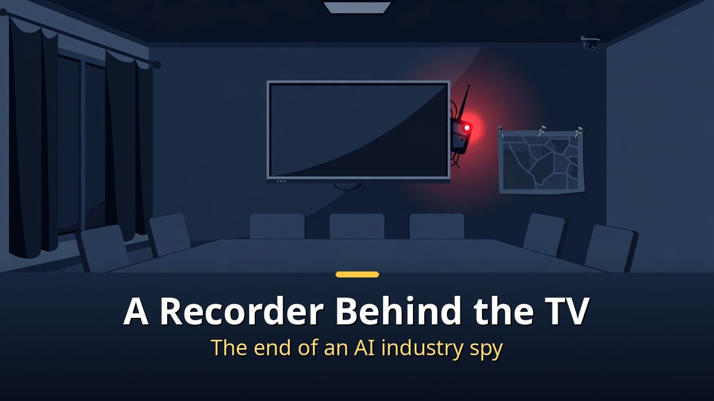
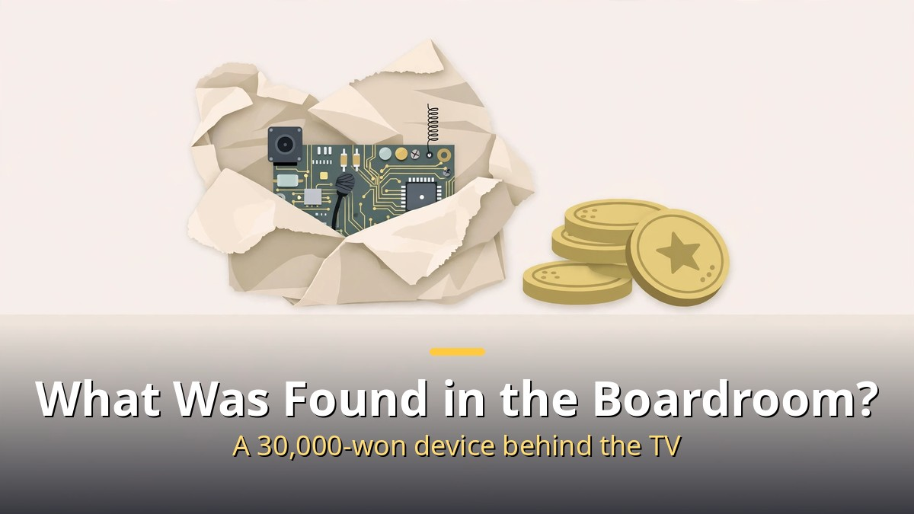
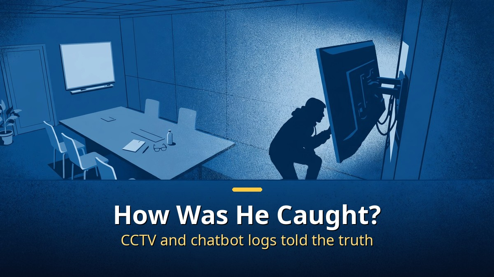

<!-- 본문 시작 -->

Behind the TV in OpenAI's executive boardroom, a recording device wrapped in tissue paper was found.
It was planted not by an outsider, but by an in-house engineer.
The FBI arrested him, and he faces up to 5 years in prison.
This is how an AI-era industry spy story began.

> **Key takeaway**
>
> OpenAI engineer Abdullah Al-Fozan (35, Saudi national) was arrested by the FBI on October 9 for hiding a recording device behind the TV in the executive boardroom.
> The device was built from cheap parts costing about 30,000 won, and chat logs asking a chatbot how to build it became decisive evidence.
> OpenAI said it identified the suspect using its own AI models. There is still no sign that model weights or source code leaked.

---

## What was found in the boardroom?

September 30, OpenAI's San Francisco headquarters executive boardroom.

During a security check, something odd turned up between the terminals behind the TV.
A small circuit board wrapped round and round in tissue paper.

The executive boardroom is not open to everyone.
Only executives and their aides may enter.
This is where top secrets are discussed: in-house research, product plans, and deals with governments and other companies.
Sensitive information like the timing of the next model release passes through this room too.

Taking the device apart revealed what it was.
A Seeed Studio XIAO ESP32-S3 Sense board, a small board with a microphone and a camera.
The antenna was marked "seeed studio 2.4g AO2."

The price was more shocking.
About $0.50 for the antenna part, $13.90 for the board.
All together, around 30,000 won.
A 30,000-won device was used to target the secrets of a world-leading AI company.

## How was the culprit caught?

OpenAI said it identified the suspect with its own AI models.

"We analyzed the device with our models and figured out who installed it," the company said.
It did not disclose the exact method.

CCTV told the story.
Over several days before the device was found, one engineer lingered near the executive boardroom.
He had neither access to the room nor permission to attend its meetings.
On October 5, he was filmed entering the room and looking behind the TV.

The chatbot logs were decisive.
Using a spouse's account, the engineer asked a chatbot step by step: how to build a recorder, how to connect it to Wi-Fi, how to listen live, and how to encrypt the SD card.
The record of those questions remained intact.

A second recording device was found in his bag.
It was similar to the one installed behind the TV, carried alongside his wallet and ID.

The arrest came on October 9.
Abdullah Al-Fozan, a 35-year-old Saudi national engineer.
He had worked at OpenAI since July 2025.
He had already booked a one-way ticket to Saudi Arabia for October 12.

## Why did this happen?

The motive cannot yet be stated as fact.
But the circumstances look unusual.

Al-Fozan joined in July 2025.
Just before that, in June, OpenAI had received a $40 billion investment including from Saudi Arabia's sovereign wealth fund.
It also overlapped with reports that Sam Altman was trying to raise $50 billion from Middle East investors.

Speculation arose: "Was a spy planted using investment as bait?"
But the prosecution's announcement mentions no link to any foreign government or investor.
Speculation remains speculation.

OpenAI's response is interesting.
According to the Wall Street Journal, OpenAI began security training for all employees.
It even included warnings about "honeypot" approaches.
One real case was shared: a stranger approaching an employee's child at a San Francisco playground and asking about their parent's work.

No OpenAI logo clothing when out, privacy screens required on public transport, whiteboards erased after meetings.
Sensitive technology isolated on offline computers, more fingerprint-recognition zones.
Security tightening that accelerated after the DeepSeek shock in China reached a peak with this incident.

---

| Item | Detail |
|---|---|
| Suspect | Abdullah Al-Fozan (35, Saudi national) |
| Installed | Around September 28, 2026 |
| Found | September 30, during a security check |
| Arrested | October 9 (FBI) |
| Charge | Intercepting or attempting to intercept oral communication |
| Maximum sentence | 5 years in prison, $250,000 fine |
| Leak confirmed | No sign of model weight or source code leaks |

---

This is being called the "first confirmed insider spy case at a frontier AI lab" in the AI industry.
There is a bitter irony here.
An AI model analyzed the spy device and caught the culprit, while the spy learned how to build the device from a chatbot.
The model safety debate has widened beyond misinformation and cyberattacks to "real-world operations."
An era when a listening device may sit in a boardroom.
An era when an AI company's executive boardroom needs defense-industry-level security.

## Frequently asked questions

**Q. Did confidential information actually leak?**

A. No leak has been confirmed so far. OpenAI said there is no record of access to model weights, source code, or customer data.

**Q. Has the engineer's backer been identified?**

A. No. Prosecutors did not mention any foreign government link, and any connection to Saudi investment remains speculation. The presumption of innocence applies.

**Q. What is the next court date?**

A. A detention hearing was scheduled for October 19. Until a guilty verdict is confirmed, he is not treated as a criminal.

<!-- 본문 끝 -->

## 작업용 출처·이미지 정보 (업로드 제외)

- 자료 출처: 오픈AI 회의실에 숨겨진 녹음기 (네이버 224443356012 한국어본)
- 이미지: images/01-hero-en.jpg ~ 04-img3-en.jpg / 직접 제작 (AI 생성 + 영어 오버레이) / 사용권: 자작

## 발행 기록 (업로드 제외)

- 사용자 요청: GitHub 저장소를 통한 Codex 발행 (영어 백로그)
