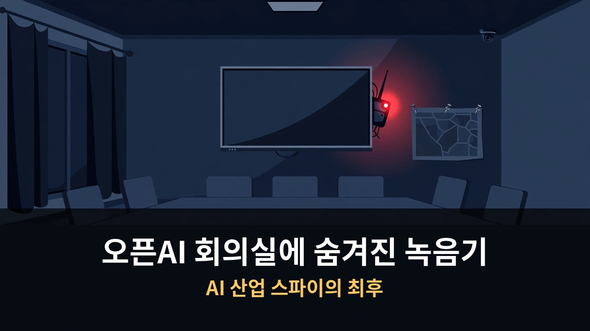
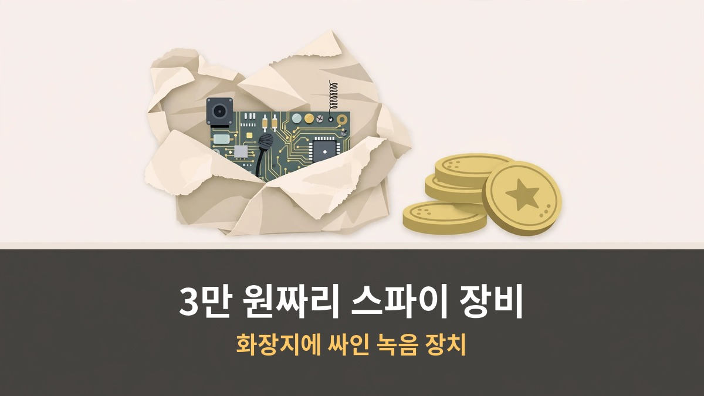
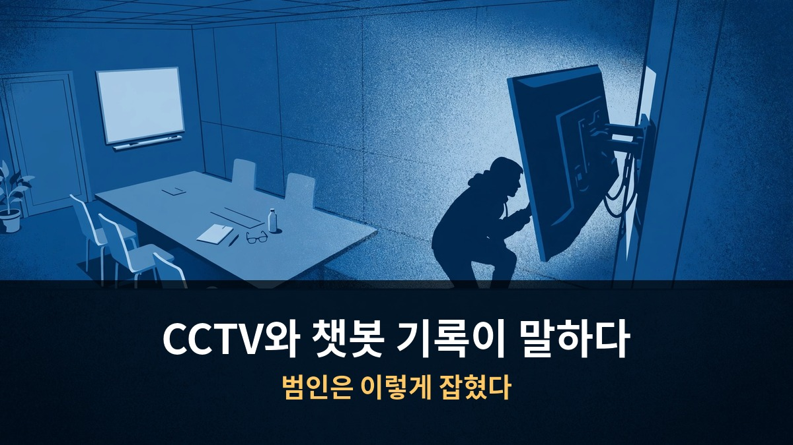
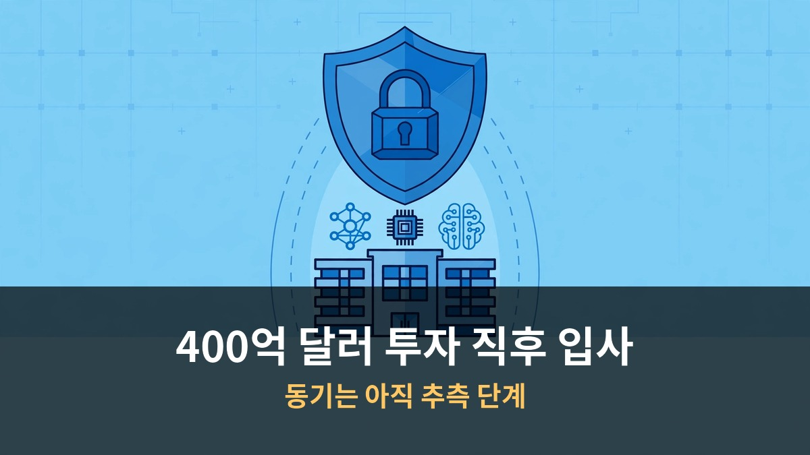

<!-- 본문 시작 -->

오픈AI 임원 회의실 TV 뒤에서 화장지에 싸인 녹음 장치가 발견됐습니다.
설치한 건 외부인이 아니라 내부 엔지니어였습니다.
FBI가 체포했고, 최대 징역 5년을 받을 수 있습니다.
AI 시대의 산업 스파이는 이렇게 시작됐습니다.

> **핵심 정리: 오픈AI 엔지니어 압둘라흐만 알포잔(35, 사우디 국적)이 임원 회의실 TV 뒤에 녹음 장치를 숨긴 혐의로 10월 9일 FBI에 체포됐습니다. 장치는 3만 원짜리 저가 부품으로 만들었고, 챗봇에게 제작 방법을 물어본 기록이 결정적 증거가 됐습니다. 오픈AI는 자체 AI 모델로 용의자를 특정했다고 밝혔습니다. 모델 가중치나 소스 코드 유출 정황은 아직 없습니다.**

## 회의실에서 발견된 건 뭐였나요?

9월 30일, 오픈AI 샌프란시스코 본사 임원 회의실.
보안 점검 중 TV 뒤 단자 사이에서 이상한 물건이 나왔습니다.
화장지로 둘둘 싸인 작은 기판이었습니다.

TV 뒤에 숨겨진 3만 원짜리 녹음 장치

임원 회의실은 아무나 못 들어갑니다.
임원과 보좌관만 출입 가능한 곳입니다.
여기서 자체 연구, 제품 계획, 정부·타사와의 거래 같은 최고 기밀을 논의합니다.
다음 모델 출시 시기 같은 민감한 정보도 이 방에서 오갑니다.

장치를 뜯어보니 정체가 드러났습니다.
Seeed Studio의 XIAO ESP32-S3 Sense 보드였습니다.
마이크와 카메라가 달린 작은 보드죠.
안테나에는 "seeed studio 2.4g AO2"라고 적혀 있었습니다.

가격이 더 충격적입니다.
안테나 부품 약 0.5달러, 기판 13.9달러.
전체를 합쳐도 3만 원 선입니다.
3만 원짜리 장비로 세계 최고 AI 기업의 기밀을 노린 겁니다.

## 범인은 어떻게 잡혔나요?

오픈AI는 자사 AI 모델로 용의자를 특정했다고 밝혔습니다.
"우리 모델로 장치를 분석하고 누가 설치했는지 파악했다"는 겁니다.
구체적인 방식은 공개하지 않았습니다.

CCTV와 챗봇 기록이 말한 진실

CCTV가 말해줍니다.
장치 발견 전 여러 날에 걸쳐 한 엔지니어가 임원 회의실 근처를 서성였습니다.
그는 회의실 출입 권한도, 회의 참석 권한도 없었습니다.
10월 5일에는 회의실에 들어가 TV 뒤쪽을 들여다보는 모습이 찍혔습니다.

챗봇 기록이 결정타였습니다.
엔지니어는 배우자 계정으로 챗봇에게 물었습니다.
녹음기 제작 방법, 와이파이 연결, 실시간 청취, SD 카드 암호화 방법까지.
단계별로 차근차근 물어본 기록이 그대로 남았습니다.

가방에서는 두 번째 녹음 장치가 나왔습니다.
TV 뒤에 설치된 것과 유사한 장치였습니다.
지갑, 신분증과 함께 들어 있었습니다.

체포된 건 10월 9일입니다.
사우디아라비아 국적의 35세 엔지니어 압둘라흐만 알포잔.
2025년 7월부터 오픈AI에서 일했습니다.
10월 12일 사우디행 편도 항공권을 끊어둔 상태였습니다.

## 왜 이런 일이 벌어졌나요?

동기는 아직 단정할 수 없습니다.
다만 정황이 심상치 않습니다.

400억 달러 투자 직후 입사한 엔지니어

알포잔이 입사한 건 2025년 7월입니다.
그 직전인 6월, 오픈AI는 사우디 국부펀드 등으로부터 400억 달러 투자를 받았습니다.
샘 알트만이 중동 투자자들에게 500억 달러를 모으려 한다는 보도가 나온 시기와도 겹칩니다.

"투자를 미끼로 스파이를 심은 것 아니냐"는 추측이 나왔습니다.
하지만 검찰 발표에는 외국 정부나 투자와의 관련성 언급이 없습니다.
추측은 추측일 뿐입니다.

재미있는 건 오픈AI의 대응입니다.
WSJ 보도에 따르면 오픈AI는 전 직원 대상 보안 교육을 시작했습니다.
"허니팟(미인계) 조심하라"는 내용까지 포함됐습니다.
샌프란시스코 놀이터에서 낯선 사람이 직원 자녀에게 접근해 일 얘기를 꺼낸 실제 사례도 공유됐습니다.

외출 시 오픈AI 로고 옷 금지, 대중교통에서 프라이버시 스크린 필수, 화이트보드는 회의 끝나면 지우기.
민감 기술은 오프라인 컴퓨터에 격리하고, 지문 인식 구역을 늘렸습니다.
중국 딥시크 충격 이후 가속화된 보안 강화가 이번 사건으로 정점을 찍은 셈입니다.

---

| 항목 | 내용 |
|---|---|
| 용의자 | 압둘라흐만 알포잔 (35세, 사우디 국적) |
| 범행 시기 | 2026년 9월 28일경 설치 |
| 발견 | 9월 30일 보안 점검 중 |
| 체포 | 10월 9일 (FBI) |
| 혐의 | 구두 대화 감청 또는 감청 시도 |
| 최대 형량 | 징역 5년, 벌금 25만 달러 |
| 유출 확인 | 모델 가중치·소스 코드 유출 정황 없음 |

---

AI 업계에서 "첫 번째로 확인된 프론티어 AI 연구소 내부 스파이 사건"이라는 말이 나옵니다.
씁쓸한 아이러니가 있습니다.
AI 모델이 스파이 장치를 분석해 범인을 잡았는데, 그 스파이는 챗봇에게 장치 만드는 법을 배웠다는 겁니다.
모델 안전성 논쟁이 허위정보·사이버공격을 넘어 "현실 세계 공작"까지 넓어졌습니다.
회의실에 도청 장치가 있을 수 있는 시대.
AI 기업의 임원 회의실이 방위산업체 수준의 보안이 필요한 시대가 온 겁니다.

## 자주 묻는 질문

**Q. 기밀 정보가 실제로 유출됐나요?**
A. 아직 유출 정황은 없습니다. 모델 가중치, 소스 코드, 고객 데이터 접근 기록이 없다고 오픈AI는 밝혔습니다.

**Q. 엔지니어의 배후가 밝혀졌나요?**
A. 아닙니다. 검찰은 외국 정부 연관성을 언급하지 않았고, 사우디 투자와의 연결은 추측 단계입니다. 무죄 추정의 원칙이 적용됩니다.

**Q. 다음 재판 일정은?**
A. 10월 19일 구금 심리가 예정되어 있습니다. 유죄 확정 전까지는 범죄자로 취급되지 않습니다.

<!-- 본문 끝 -->

## 작업용 출처·이미지 정보 (업로드 제외)

- 자료 출처: 오픈AI 회의실에 숨겨진 녹음기 (네이버 224443356012 한국어본)
- 이미지: images/01-hero.jpg ~ 04-img3.jpg / 기존 최종 이미지 재사용 / 사용권: 자작
