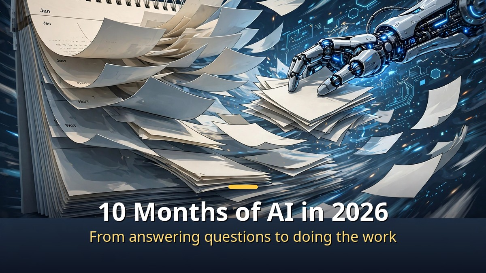
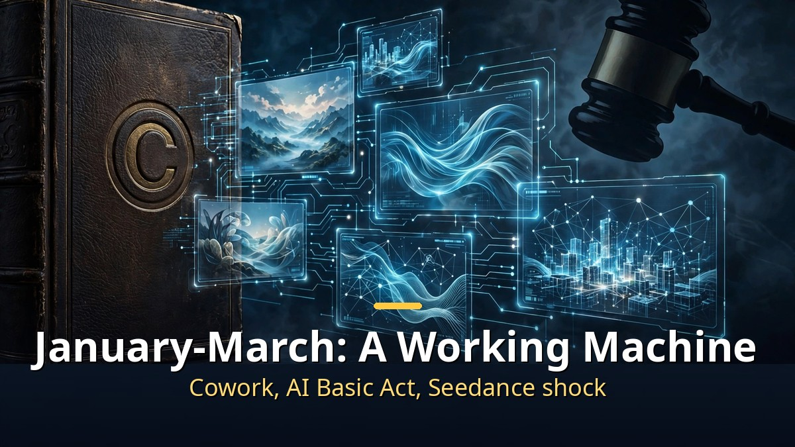
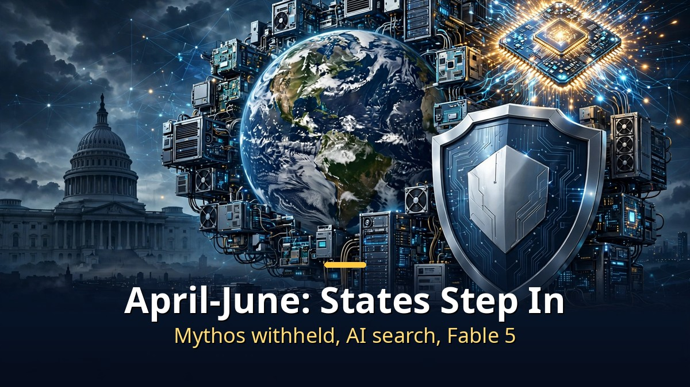

<!-- 본문 시작 -->

In January 2026, a job that took a week took 30 minutes by October.
AI changed from a tool that answers questions into a machine you can hand whole jobs to.
Here is what happened in those 10 months, month by month.

> **Key takeaway**
>
> The turning point came in January, when Claude Cowork turned AI from an "answering machine" into a "working machine." The same month, the world's first AI Basic Act took effect in Korea, and in February Seedance 2.0 drew a cease-and-desist from Disney. In July, Anthropic agreed to a $1.5 billion settlement with authors, and in September GPT-6's price cuts made AI cheaper and faster. The video ends with five things individuals should prepare in the remaining two months.

---

## January to March: how did AI become a "working machine"?

January's star was Claude Cowork.

Anthropic released Cowork on January 12. It is not a chat window.
Give it folder access and it plans on its own, reads files, creates them, and fixes them.
It brought the power developers had in Claude Code to non-developers.

The same month, Korea enforced the world's first AI Basic Act.
From January 22, AI businesses must disclose that content was made by AI.
Deepfakes in particular must be marked so people can recognize them at once, with fines of up to 30 million won for violations.
A grace period of at least one year means enforcement did not start immediately.

February brought ByteDance's video AI, Seedance 2.0.
Two lines of text produced a video of Tom Cruise fighting Brad Pitt, and Hollywood erupted.
Disney sent a cease-and-desist, saying characters were being sold "like a pirated library," and the Motion Picture Association said American works were used without permission "on a massive scale in a single day."
ByteDance said on February 16 it would strengthen safeguards.

In March, OpenAI shut down its video AI, Sora.
The reason was computing resources.
Rather than pouring huge compute into Sora, OpenAI chose to focus on GPT 5.4, an AI that operates computers directly.
It showed that even AI companies do not have unlimited computing power.

## April to June: why did AI become something states manage?

In April, Anthropic decided not to release a powerful AI, Claude Mythos.
It could find security vulnerabilities across all major operating systems, so instead of a public release it went only to specific institutions.
"Too strong to release" sums up the mood of 2026.

At Google I/O in May, search itself was declared changed.
The search box became a conversation box, and AI summaries began replacing search results.
The way people find information changed at that moment.

In June, the AI model Fable 5 was released, but overseas access was then cut off.
It was a signal that AI models, like semiconductors, can become state-managed objects.
As fast as the technology improves, the question of who may use it is being asked just as fast.

## July to October: prices collapsed and speed kept climbing

July had two big stories.

One was ChatGPT Work, which handles jobs on your behalf.
The other was the authors' lawsuit settlement.
Anthropic agreed to pay $1.5 billion for training on 7 million books downloaded from pirate sites.
Final court approval came on July 20, the largest US copyright settlement ever.
About 480,000 works were covered at $3,000 each, including books by Han Kang.
AI training data was no longer free.

In August came Claude in Chrome, and the Bank of Korea published an AI report.
An AI that works inside the browser, and a central bank analyzing the AI economy.
AI had become both everyday life and an economic variable.

In September, prices of major models including OpenAI's GPT-6 fell sharply.
More capacity, lower prices, a lower barrier to using AI.
In October, Anthropic's high-speed model Haiku 5.5 kept the speed race going.
A week of work in January, 30 minutes in October: that is the summary of 2026.

---

| Month | Event | What it meant |
|---|---|---|
| January | Claude Cowork launch, AI Basic Act enforced | The delegation era begins, the world's first AI regulation |
| February | Seedance 2.0, Disney cease-and-desist | The video AI copyright war begins |
| March | Sora shut down, focus on GPT 5.4 | Computing power is finite too |
| April | Claude Mythos withheld | An AI too strong to release |
| May | Google I/O, AI search mode | The search box becomes a conversation box |
| June | Fable 5, overseas access cut | AI becomes a state-managed object |
| July | $1.5 billion authors' settlement | Training data is not free |
| August | Claude in Chrome, Bank of Korea report | AI working in the browser |
| September | GPT-6 price cuts | The barrier to AI falls |
| October | Haiku 5.5 | The speed race continues |

---

The video ends with five things individuals should prepare in the remaining two months.
One lesson from 2026 sums it up, and it struck me while organizing this recap.
I had no idea the gap between people who "tried AI" and people who "delegated to AI" would widen this much in 10 months.
My own habit of stopping at getting answers needs to change first.
For the remaining two months, I plan to practice handing real work to AI myself.

## Frequently asked questions

**Q. Does the AI Basic Act apply to ordinary users?**

A. No. It targets businesses that develop AI models or run AI services. Ordinary users have no watermark obligation. Fines of up to 30 million won apply to businesses.

**Q. How much of the $1.5 billion settlement goes to authors?**

A. About $3,000 per work, covering some 480,000 works. Where a publisher holds the rights, the money is shared with the author, and some authors and publishers opposed to the settlement are pursuing separate lawsuits.

**Q. What should I prepare in the remaining two months of 2026?**

A. The video lists five things. The core is one: move beyond asking AI questions, and build experience delegating part of a real job to it.

<!-- 본문 끝 -->

## 작업용 출처·이미지 정보 (업로드 제외)

- 자료 출처: 2026년 AI 10개월 총정리 (네이버 224444407453 한국어본)
- 이미지: images/01-hero-en.jpg ~ 04-img3-en.jpg / 직접 제작 (AI 생성 + 영어 오버레이) / 사용권: 자작

## 발행 기록 (업로드 제외)

- 사용자 요청: GitHub 저장소를 통한 Codex 발행 (영어 백로그)
