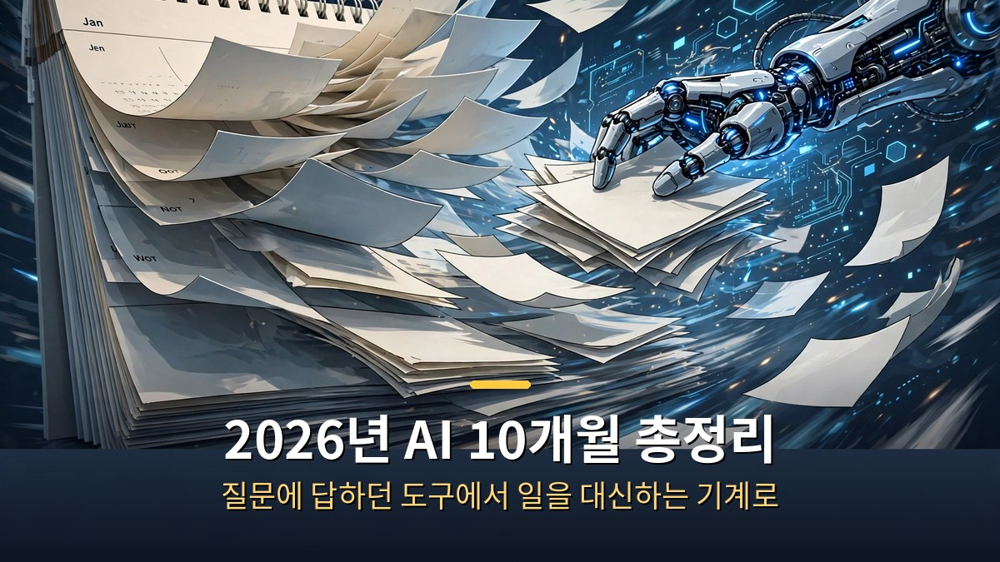
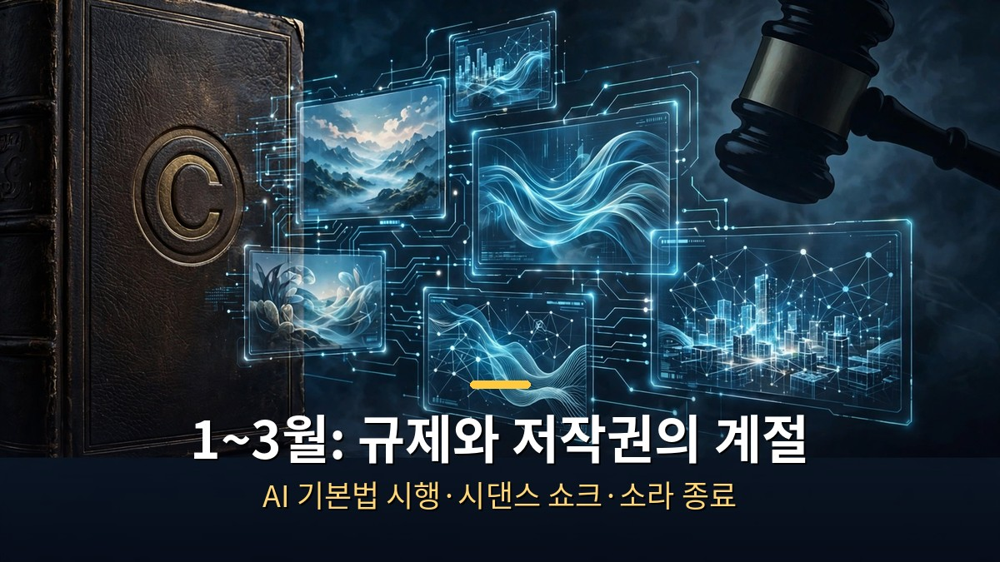
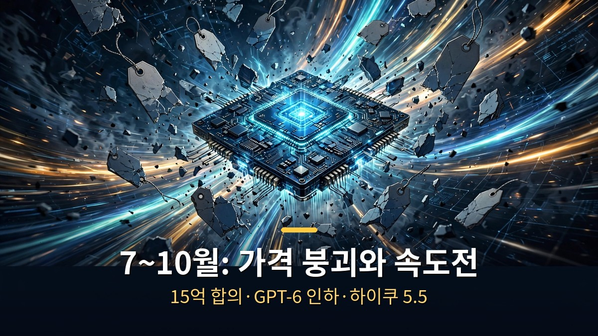

<!-- 본문 시작 -->

2026년 1월에 일주일 걸리던 일이 10월에는 30분으로 줄었습니다.
AI는 질문에 답해주는 도구에서, 일을 통째로 맡길 수 있는 기계로 바뀌었습니다.
그 10개월 동안 무슨 일이 있었는지, 월별로 정리했습니다.

> **핵심 정리: 2026년 1월 클로드 코워크 출시로 AI는 '답변 기계'에서 '작업 기계'로 전환하기 시작했습니다. 같은 달 세계 최초로 AI 기본법이 시행됐고, 2월 시댄스 2.0은 디즈니의 중지 요구를 받았습니다. 7월에는 앤트로픽이 작가들에게 15억 달러 합의를 했고, 9월 GPT-6 가격 인하로 AI는 더 싸고 빨라졌습니다. 남은 두 달, 개인이 준비할 다섯 가지를 영상 말미에 정리했습니다.**

---

## 1~3월, AI는 어떻게 '일하는 기계'가 됐나?

1월의 주인공은 클로드 코워크입니다.
앤트로픽이 1월 12일 내놓은 코워크는 채팅창이 아닙니다.
폴더 접근 권한을 주면 스스로 계획을 세우고 파일을 읽고 만들고 고치는 에이전트입니다.
개발자가 쓰던 클로드 코드의 능력을 비개발자에게 풀어준 셈입니다.

같은 달 한국에서는 세계 최초의 AI 기본법이 시행됐습니다.
1월 22일부터 AI 사업자는 AI가 만든 콘텐츠임을 알려야 합니다.
특히 딥페이크는 사람이 바로 알아볼 수 있게 표시해야 하고, 위반하면 최대 3천만 원의 과태료가 나옵니다.
다만 최소 1년의 계도기간이 있어 바로 단속하지는 않습니다.

2월에는 바이트댄스의 영상 AI 시댄스 2.0이 터졌습니다.
문장 두 줄로 톰 크루즈와 브래드 피트가 싸우는 영상을 만들자 할리우드가 발칵 뒤집혔습니다.
디즈니는 "캐릭터를 해적판 라이브러리처럼 끼워 팔았다"며 중지 요구 서한을 보냈고, 미국영화협회는 "단 하루 만에 미국 저작물을 대규모로 무단 이용했다"고 비판했습니다.
바이트댄스는 2월 16일 보호 조치를 강화하겠다고 밝혔습니다.

1~3월, 규제와 저작권이 AI의 발목을 잡기 시작했다

3월에는 오픈AI가 비디오 AI 소라를 접었습니다.
이유는 컴퓨팅 자원이었습니다.
소라에 들어가는 막대한 연산량을 감당하기보다, 컴퓨터를 직접 조작하는 AI인 GPT 5.4에 집중하겠다는 판단이었습니다.
AI 기업에게도 컴퓨팅 파워는 무한하지 않다는 걸 보여준 사건이었습니다.

## 4~6월, 왜 AI는 국가가 관리하는 대상이 됐나?

4월에는 앤트로픽이 강력한 AI '클로드 미토스'를 공개하지 않기로 했습니다.
모든 주요 운영체제의 보안 취약점을 찾아내는 수준이라, 일반 공개 대신 특정 기관에만 제공했습니다.
너무 강해서 풀지 않은 AI, 이 한 줄이 2026년의 분위기를 보여줍니다.

5월 구글 I/O에서는 검색의 변화를 선언했습니다.
검색창이 대화창이 되고, AI 요약이 검색 결과를 대신하기 시작했습니다.
정보를 찾는 방식 자체가 바뀌는 순간이었습니다.

6월에는 AI 모델 페이블 5가 공개됐으나 해외 접근이 중단되는 일이 있었습니다.
AI 모델이 반도체처럼 국가 관리 대상이 될 수 있다는 신호였습니다.
기술이 좋아지는 속도만큼, 누가 쓸 수 있는지를 따지는 속도도 빨라졌습니다.

4~6월, 강해진 AI만큼 통제와 규제도 강해졌다

## 7~10월, 가격은 무너지고 속도는 빨라졌다?

7월에는 두 가지 큰 소식이 있었습니다.
하나는 일을 대신 처리하는 챗GPT 워크의 등장이고, 다른 하나는 작가 소송 합의입니다.
앤트로픽은 작가들의 책 700만 권을 해적 사이트에서 내려받아 학습한 혐의로 15억 달러를 물기로 했습니다.
법원 최종 승인은 7월 20일, 미국 저작권 소송 사상 최대 규모입니다.
권당 3천 달러씩, 48만여 작품이 대상이었고 한강 작가의 책도 포함됐습니다.
AI 학습 자료는 이제 공짜가 아니라는 선례가 남았습니다.

8월에는 클로드 인 크롬이 나왔고, 한국은행이 AI 보고서를 냈습니다.
브라우저 안에서 직접 일하는 AI, 그리고 중앙은행이 분석하는 AI 경제.
AI가 일상이자 경제 변수가 된 달이었습니다.

7~10월, 15억 달러 합의와 가격 붕괴가 남긴 것

9월에는 오픈AI의 GPT-6를 비롯한 주요 모델 가격이 크게 떨어졌습니다.
처리 용량은 늘고 가격은 내리니, AI를 쓰는 문턱이 낮아졌습니다.
10월에는 앤트로픽의 고속 모델 하이쿠 5.5가 나오며 속도 경쟁이 이어졌습니다.
1월에 일주일 걸리던 일이 10월엔 30분, 이게 2026년의 요약입니다.

---

| 월 | 사건 | 의미 |
|---|---|---|
| 1월 | 클로드 코워크 출시, AI 기본법 시행 | 작업 위임 시대 개막, 세계 첫 AI 규제 |
| 2월 | 시댄스 2.0, 디즈니 중지 요구 | 영상 AI 저작권 전쟁 시작 |
| 3월 | 소라 종료, GPT 5.4 집중 | 컴퓨팅 자원도 유한하다 |
| 4월 | 클로드 미토스 비공개 | 너무 강한 AI는 풀지 않는다 |
| 5월 | 구글 I/O, AI 검색 모드 | 검색창이 대화창으로 |
| 6월 | 페이블 5, 해외 접근 중단 | AI도 국가 관리 대상 |
| 7월 | 작가 소송 15억 달러 합의 | 학습 자료는 공짜가 아니다 |
| 8월 | 클로드 인 크롬, 한은 보고서 | 브라우저에서 일하는 AI |
| 9월 | GPT-6 가격 인하 | AI 문턱이 낮아졌다 |
| 10월 | 하이쿠 5.5 | 속도 경쟁 현재진행형 |

---

영상 말미에는 남은 두 달 동안 개인이 준비할 다섯 가지를 정리해뒀습니다.
저도 정리하면서 든 생각인데, 2026년의 교훈은 하나로 모입니다.
AI를 "써본 사람"과 "맡겨본 사람"의 격차가 10개월 만에 이렇게 벌어질 줄은 몰랐다는 겁니다.
질문에 답을 받는 수준에 머물렀던 제 습관부터 바꿔야겠습니다.
남은 두 달, 저부터 AI에게 일을 맡기는 연습을 해보려 합니다.

## 자주 묻는 질문

**Q. AI 기본법은 일반 사용자에게도 적용되나요?**
A. 아닙니다. AI 모델을 개발하거나 서비스하는 사업자가 대상이고, 일반 사용자는 워터마크 의무가 없습니다. 위반 시 최대 3천만 원 과태료는 사업자에게 부과됩니다.

**Q. 15억 달러 합의금은 작가들에게 얼마나 돌아가나요?**
A. 작품당 약 3천 달러씩, 48만여 작품이 대상입니다. 다만 출판사가 권리를 가진 경우 작가와 나누고, 일부 작가·출판사는 합의에 반대해 별도 소송을 이어가고 있습니다.

**Q. 2026년 남은 두 달에 뭘 준비해야 하나요?**
A. 영상에서는 다섯 가지를 정리했습니다. 핵심은 하나입니다. AI에게 질문하는 수준을 넘어, 실제 업무 일부를 위임해보는 경험을 쌓는 것입니다.

<!-- 본문 끝 -->

## 작업용 출처·이미지 정보 (업로드 제외)

- 자료 출처: 2026년 AI 10개월 총정리 (네이버 224444407453 한국어본)
- 이미지: images/01-hero.jpg ~ 04-img3.jpg / 기존 최종 이미지 재사용 / 사용권: 자작
