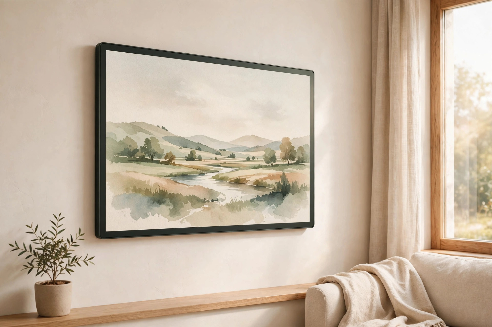
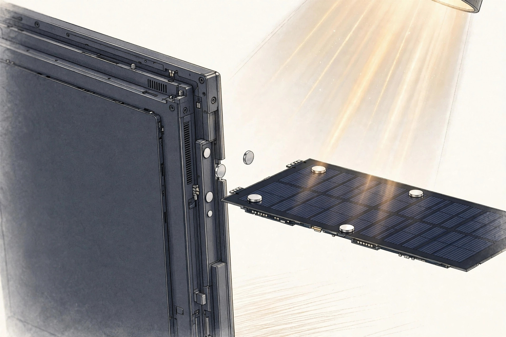
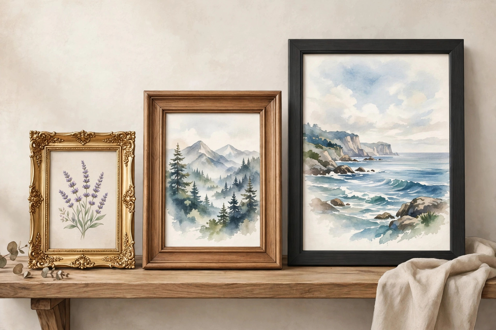

<!-- 본문 시작 -->
A picture frame that charges on room light alone — the Inkanva self-charging e-ink canvas

If the picture in a frame on your wall were different from yesterday, how would that feel?
Inkanva's e-ink canvas is a digital frame that shows pictures like paper, yet can swap to a different picture whenever you need it to.
Its most distinctive feature is the power cord. It doesn't need one — because it charges itself on indoor light alone.
This introduction is based on published materials; I have not used the product myself.

> One line
>
> ### **An e-ink frame that hangs on the wall with no outlet, charging itself**

## What is the Inkanva E-Ink Canvas?

Inkanva is a new manufacturer promoting "art powered by light," a brand specializing in e-ink art frames.
This canvas is a digital frame using a color e-ink (Spectra 6) panel, and it comes in three sizes: 7.09-inch, 13.3-inch, and 28.5-inch.
You upload pictures, photos, messages, and calendars through a dedicated app and display them on the frame — a product aimed at the fun of changing the picture on your wall with the seasons.

## How does it charge itself?

The secret is a detachable magnetic panel.
Made from perovskite, a next-generation photovoltaic material, this panel gathers electricity not from direct sunlight but from indoor light.
According to the manufacturer, the 13.3-inch model, kept in a bright place and changing its picture once a day, can be used with virtually no worry about running out of power.
This works because e-ink uses electricity only at the moment it changes the picture, and uses none while simply displaying it.
For anyone who found a glowing, TV-like frame burdensome, this is a fairly persuasive combination.

## How long does it last, and what's different?

Even with the charging panel removed, it holds up on a built-in 5,000mAh battery. According to the manufacturer, that is up to 4 months, based on changing the picture once a day.
If you use it in a dark room or want to change pictures often, you can charge it over USB-C.
The outer frame is magnetically swappable, so over the basic aluminum frame you can overlay a gold decoration or a wood style to change the mood.
You can feel its ambition to look like a real picture frame.

| Item | Detail |
| --- | --- |
| Product | Inkanva E-Ink Canvas |
| Display | Color e-ink (Spectra 6, 48 base colors — manufacturer claim) |
| Sizes | 7.09-inch / 13.3-inch / 28.5-inch (Gallery Edition) |
| Self-charging | Perovskite magnetic panel (7.09- and 13.3-inch, indoor light) |
| Battery | 5,000mAh, up to 4 months changing once a day (manufacturer claim) |
| Sales stage | Kickstarter funding in progress (scheduled to end November 15, 2026) |

## Things to check before you buy

Right now it is at the Kickstarter funding stage. It has far exceeded its $12,743 goal, raising more than $220,000, and shipping is scheduled to begin from late November to December 2026, starting with the 28.5-inch model.
Funding, however, is a plan rather than a promise, so it could be delayed.
There are two points to watch. First, the 28.5-inch Gallery Edition does not include the self-charging panel.
Second, shipping to Korea and the final price could not be confirmed.

## Editor's take

This suits someone who gets tired of the same picture every day but doesn't want a frame that glows like a TV.
Hung in a bright place like an entryway or a study, it looks like you could enjoy changing the picture with the seasons without worrying about charging.
On the other hand, if you plan to hang it in a dark hallway, you should factor in USB-C charging.
Given the nature of crowdfunding, there seems to be no need to hurry — deciding after the Korea shipping terms are confirmed would not be too late.

Sources: Inkanva official site (inkanva.com), mensgear.net (October 12, 2026), mymodernmet.com (October 17, 2026). For the Kickstarter campaign's detailed terms (price, shipping countries), please check the campaign page directly.
Related posts:
https://blog.naver.com/3700708/224444416786
https://blog.naver.com/3700708/224444408193
https://blog.naver.com/3700708/224444384256
<!-- 본문 끝 -->

## Working notes (excluded from upload)

- Sources: Inkanva official site (inkanva.com/pages/about) / mensgear.net (2026-10-12) / mymodernmet.com (2026-10-17) / verified 2026-10-19
- 3 images (AI-generated illustrations, self-made, usage rights: own):
  - images/01-hero.jpg / E-ink holds a picture without using electricity — no heat or glare even while it's on (illustration)
  - images/02-panel.jpg / The charging panel attaches and detaches with magnets — on the 13.3-inch model, changing the picture once a day, the battery lasts up to 4 months, per the manufacturer (illustration)
  - images/03-sizes.jpg / The 28.5-inch Gallery Edition does not include the self-charging panel (illustration)
- Fact check: shipping to Korea and final price not confirmed (Kickstarter funding stage). Series category: "one for my desk."
- Target: English WordPress/Blogger (multi-channel program). English edition content_revision: 1 — confirm against check_distribution before first submit.
- Additional requests: none
