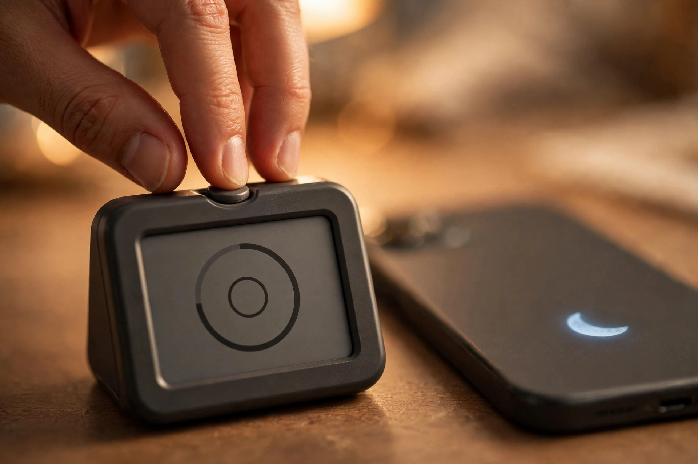
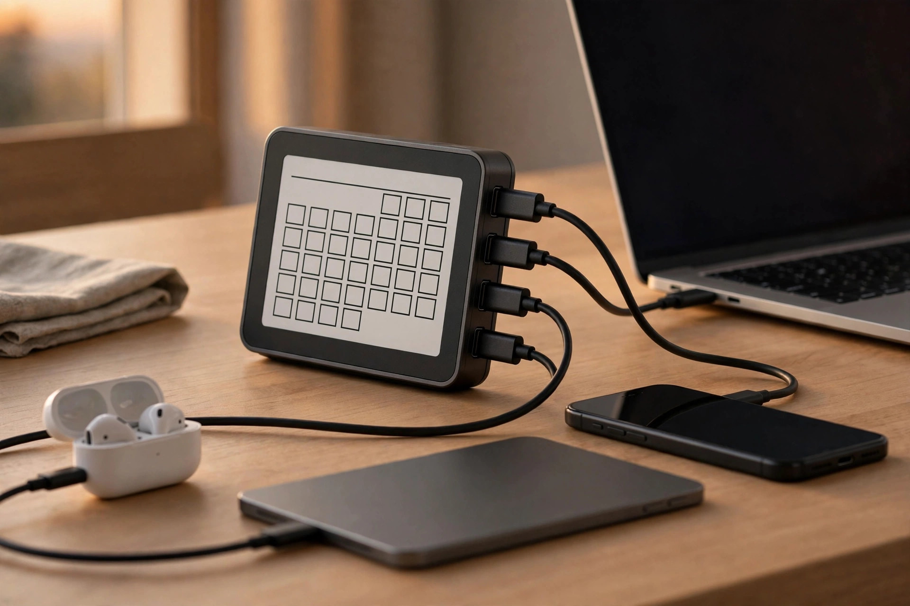

<!-- 본문 시작 -->
One button and your phone goes quiet — the ZIEA One AI desk calendar

You've probably opened your phone just to check one appointment, then lost 10 minutes to a notification. ZIEA One is a device made to take those 10 minutes away. This introduction is based on published materials.

> If you've ever opened your phone to check your schedule and come back without ever seeing it
>
> ### **This device was made to take the phone out of checking your schedule**

## A calendar on your desk instead of your phone

ZIEA One is an E-ink display device that sits on your desk. It syncs with Google, Apple, and Outlook calendars and always shows today's schedule and your "next 3 things to do" on screen. Calendar apps already exist on your phone, but this product chose to eliminate the act of opening that app itself. The whole process of turning on the screen, finding the app, and clearing notifications disappears.

## Three fun things about it

First, the physical focus button. Press the button and a Pomodoro timer starts, and your linked phone automatically goes into Do Not Disturb mode. Taking focus mode out of deep app settings and putting it on a single button on your desk is the core idea of this product.

Second, AI schedule planning. Tell the GPT-5-based voice assistant a big goal like "get me ready for a marathon," and, according to the manufacturer, it breaks the goal down and places it into calendar blocks. Each task gets a checkbox, so there's also the small pleasure of physically checking off finished work.

Third, it doubles as a 160W charging hub. With three USB-C ports and one USB-A port, it charges a laptop, phone, tablet, and earbuds at once. When you're not using it, it becomes a digital photo frame showing photos uploaded through the app. A calendar alone would have trouble justifying its place on the desk, so they attached charging — a function you use every day.

## Key product facts

| Item | Detail |
| --- | --- |
| Product | ZIEA One |
| Type | AI desk calendar (E-ink display) |
| Key features | Calendar sync, AI schedule planning, focus timer, 160W charging hub |
| Linked calendars | Google, Apple, Outlook |
| Price | $269 (list price $419) |
| Subscription | Basic free / Pro $9.9 per month, Ultra $19.9 per month (optional) |
| Availability in Korea | No official launch; direct import (listed as worldwide shipping) |

## The catch

The price is steep for a calendar. At $269, you could buy a decent secondary monitor. And "no subscription needed" applies only to the basic features. The free plan has limits on AI voice and real-time search capacity, and heavy use requires a Pro or Ultra subscription. It is also a Kickstarter-born startup product, so the fact that its AI features depend on the company's servers is another variable. Whether Korean voice is supported could not be confirmed on the official page.

## Editor's take

This product's value is not in its feature list, but in creating "a desk where you don't have to open your phone." The design is clever: it attaches a focus button and a charging hub — reasons your hand reaches for it every day — to a calendar. Before buying, though, it would be wise to check the AI subscription structure and the company's sustainability once more. This is a product for people who want to spend their schedule-management money not on an "app" but on their "environment."

Sources: ZIEA official product page (ziea.net), Hackster coverage. Reviews were cited from published materials; this is not a hands-on experience.
Related posts:
https://blog.naver.com/3700708/224444416786
https://blog.naver.com/3700708/224444408193
https://blog.naver.com/3700708/224444384256
<!-- 본문 끝 -->

## Working notes (excluded from upload)

- Sources: ZIEA official product page (ziea.net/products/ziea-one-the-device-that-reclaims-your-focus) / Hackster coverage / verified 2026-10-20
- 3 images (AI-generated illustrations, self-made, usage rights: own):
  - images/01-hero.jpg / With a separate device for checking your schedule, your phone can stay on the charger (illustration)
  - images/02-focus.jpg / While the timer runs, your phone goes quiet first — the point is making Do Not Disturb a "button," not a "setting" (illustration)
  - images/03-charge.jpg / The 160W hub is built into the body, so your hand reaches for it every day — if not for the calendar, then for the charging (illustration)
- Fact check: Korean voice support not confirmed. The $269 price is based on the official store (the page also lists $299, so it may change).
- Target: English WordPress/Blogger (multi-channel program). English edition content_revision: 1 — confirm against check_distribution before first submit.
- Additional requests: none
